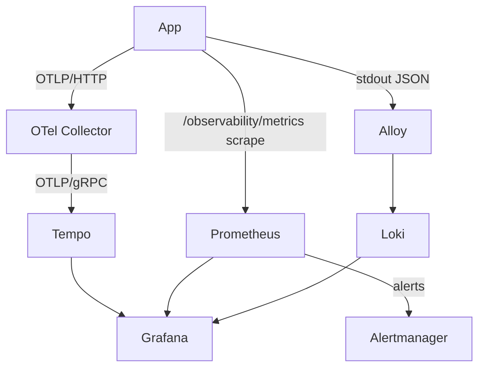

# Grafana

Grafana is the **single UI** for all observability signals: traces (Tempo), metrics (Prometheus), and logs (Loki).

## Where to find it

- URL: `http://localhost:3001`
- Login: anonymous Admin in dev (no password)
- Datasources: **Tempo**, **Prometheus**, **Loki** (all auto-provisioned)
- Dashboards: **API Traces** (auto-provisioned)

Grafana dashboard JSON files live in `docker/observability/grafana/dashboards/`.
Provisioning files live at:

- `docker/observability/grafana.datasources.yaml`
- `docker/observability/grafana.dashboard-providers.yaml`

## Find a request that broke

1. Look at the application log line — it carries a `trace_id`.
2. Open Grafana → **Explore** → datasource **Tempo**.
3. Paste the `trace_id`. You see the full span tree (HTTP → Express handler → DB query → Redis), with errors marked red.
4. Click the Loki link next to any span to jump to the correlated log lines.

## Full observability flow

## Stack overview

| Service        | Role                                                                 |
| -------------- | -------------------------------------------------------------------- |
| OTel Collector | Telemetry fan-out hub                                                |
| Tempo          | Trace store                                                          |
| Prometheus     | Metrics store / alert evaluation                                     |
| Alertmanager   | Alert routing                                                        |
| Loki           | Log store                                                            |
| Alloy          | Log shipper (Docker/Podman → Loki) and browser-facing Faro collector |
| Grafana        | Unified UI                                                           |

Images are in `docker-compose.yml`; the URLs are [the host port map](../build/pairing-and-ports.md#host-port-map).

## Admin API vs Grafana

The `/observability/*` endpoints expose the same metrics as Grafana but as a **point-in-time JSON snapshot** — no time axis, no historical trend. Use Grafana for SRE workflows; use the observability API as a data layer for a custom dashboard.

→ Full details: [Observability Endpoints](../reference/observability.md)

## Works with

- **[Prometheus](./prometheus.md)** — Grafana reads all metric time-series from Prometheus. Every chart, KPI panel, and Explore metric query uses Prometheus as the data source. Prometheus stores the numbers; Grafana makes them visual and queryable.
- **[Tempo](./tempo.md)** — Grafana is the only UI for Tempo. Go to Explore → Tempo to search traces by `service.name`, `trace_id`, HTTP route, or error. Clicking a Loki log's `trace_id` link also lands here.
- **[Loki](./loki.md)** — Grafana is the only UI for Loki. Go to Explore → Loki and use LogQL to filter logs. The derived-field config makes every `trace_id` in a log line a clickable link that jumps to Tempo. → [Trace ↔ log correlation](./loki.md#trace-log-correlation)

## External references

- [Correlating logs and traces](https://grafana.com/docs/grafana/latest/datasources/loki/#derived-fields) — how the [Loki](./loki.md) ↔ [Tempo](./tempo.md) cross-signal jumps are configured

## Read next

- [Observability Reference](./observability-reference.md)
- [Tempo](./tempo.md)
- [OpenTelemetry](./opentelemetry.md)
- [Prometheus](./prometheus.md)
- [Winston & Audit Logs](./winston.md)
