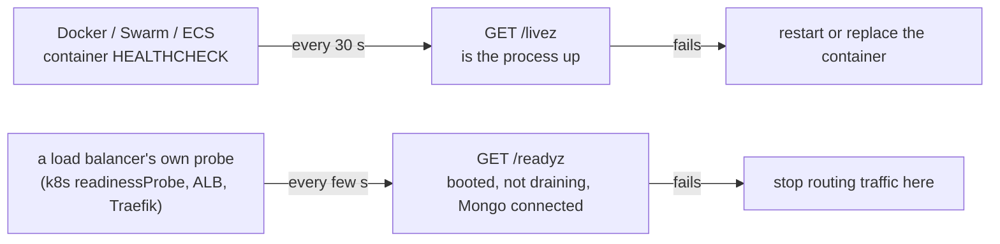
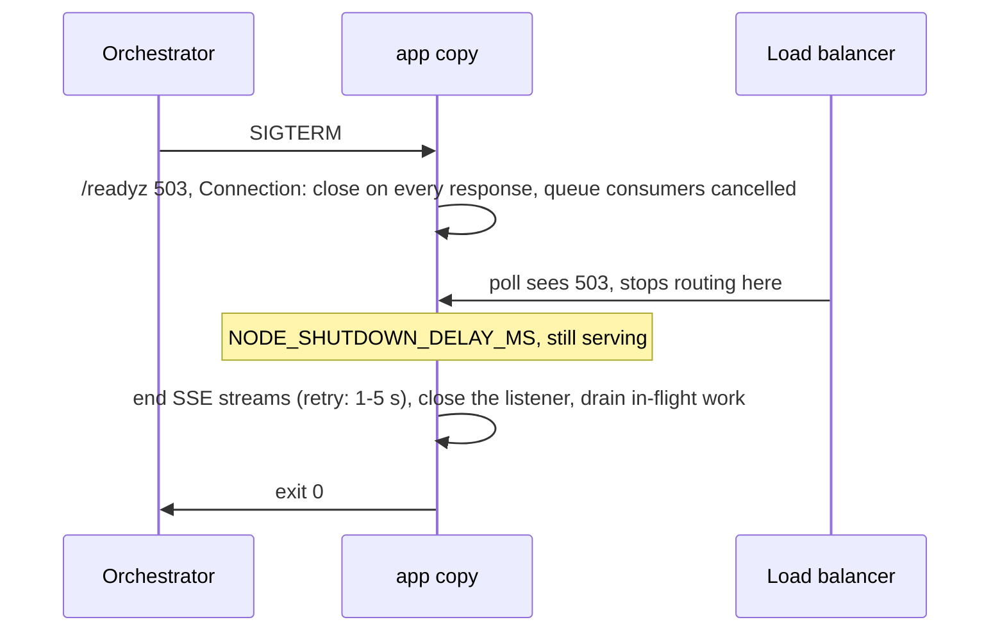

# Health checks

A container health check is a command Docker runs on a timer. Docker records `healthy` or
`unhealthy`, and other tools act on that word. This page says what each container's check tests,
and why it never tests more.

## The rule: one container, one job, one check

A health check tests **this container's own job**. Nothing else.

- **A web container** checks that the web process answers: `GET /livez`.
- **A long-running worker** checks its own loop, not the web port. `cron` asks supercronic's
  `/health`. Mastodon's `sidekiq` and Sentry's workers do the same. The queue `worker` has no
  scheduler to ask, so the process listens on its own port, `NODE_WORKER_PORT` (3010), and answers `GET /livez` (`src/app/worker-process.ts`):
  alive means the process answers, never that the broker or the database does.
  That loop is alive even when every job would refuse a bad environment, so `cron` runs
  `config:check` (`scripts/ops/check-config.ts`) before supercronic starts: a broken `.env` stops the container instead.
- **A one-shot job** has no check. Its exit code is the signal, and
  `depends_on: service_completed_successfully` already reads it. `setup` sets `disable: true`.
- **A container never inherits a check for a job it does not do.** It could never pass. That is a
  permanent false alarm, and under Swarm a restart loop.

| Container      | Its check                                            | Where declared                                       |
| -------------- | ---------------------------------------------------- | ---------------------------------------------------- |
| `app`          | `GET /livez`                                         | the image, and compose again (see [Podman](#podman)) |
| `worker`       | its own `GET /livez` on `NODE_WORKER_PORT`           | compose                                              |
| `worker-heavy` | the same `GET /livez`, the heavy half of the workers | compose                                              |
| `cron`         | supercronic's `GET /health` on `127.0.0.1:9746`      | compose                                              |
| `backup`       | the same supercronic `/health`, with `curl`          | `docker/Dockerfile.backup` (the image)               |
| `setup`        | none: `healthcheck: disable: true`                   | `compose.production.yaml`                            |
| `database`     | the database's own ping                              | compose                                              |
| `cache`        | the cache's own ping                                 | compose                                              |
| `queue`        | the broker's own diagnostics                         | compose                                              |

## Liveness and readiness

Two questions, two endpoints.

| Endpoint                    | Answers                                                 | I/O  | Read by                           |
| --------------------------- | ------------------------------------------------------- | ---- | --------------------------------- |
| `GET /livez`                | Is the process up?                                      | none | every container HEALTHCHECK       |
| `GET /readyz`               | Should this instance receive traffic right now?         | none | a load balancer's own probe, only |
| `GET /`                     | The client-facing ping (the frontend's API-down banner) | none | a browser, never an orchestrator  |
| `GET /observability/health` | What exactly is missing? Admin only                     | some | an operator or a dashboard        |

Liveness never looks at a dependency:

- Spring Boot: a failing external system "would trigger massive restarts and cascading failures".
  [docs](https://docs.spring.io/spring-boot/reference/features/spring-application.html)
- Kubernetes: liveness must "truly indicate unrecoverable application failure".
  [docs](https://kubernetes.io/docs/concepts/configuration/liveness-readiness-startup-probes/)
- Microsoft's Health Endpoint Monitoring keeps the shallow and deep checks on separate endpoints.
  [pattern](https://learn.microsoft.com/en-us/azure/architecture/patterns/health-endpoint-monitoring)

A restart does not bring a downed Mongo back. So `/readyz` (which reads the Mongo connection) is
never a container check.

### Who reads Docker's HEALTHCHECK

| Platform                  | What "unhealthy" does                                                             |
| ------------------------- | --------------------------------------------------------------------------------- |
| Plain Docker              | status only; restart policies act on exit, not health. `service_healthy` reads it |
| Docker Swarm              | kills and replaces the task                                                       |
| Traefik (Docker provider) | drops the container from routing                                                  |
| ECS / Fargate             | replaces the task, if the check is in the task definition                         |
| Podman                    | only for images built with `--format docker`; the default OCI format drops it     |
| Kubernetes                | ignores it. Use `livenessProbe` and `readinessProbe`                              |

## Readiness at the load balancer

A proxy does **not** read `/readyz` unless you configure it to. There is one `app` replica on one
host, so an unready instance has nowhere else to send traffic, and a proxy's own 503 carries no CORS
headers, so the SPA would see a network error, not a readable one.

With an orchestrator in front of several replicas, point its readiness probe at `/readyz` (a
Kubernetes `readinessProbe`, an ALB target-group health check). Those probes stop sending traffic to
an unready replica; a plain proxy health check is the same idea, one path to configure.

`/readyz` answers 503 from the moment a shutdown signal arrives. What happens next is the next
section.

## Shutting down behind a load balancer

A load balancer learns a copy is leaving only by polling `/readyz`. If the listener closed at the
signal, a request sent in the meantime would meet a closed socket. So the copy first goes quiet on
the balancer's side, then stops.

| Step                      | What it does                                                               | Why                                                                                                                              |
| ------------------------- | -------------------------------------------------------------------------- | -------------------------------------------------------------------------------------------------------------------------------- |
| `/readyz` 503             | The balancer's next poll removes this copy                                 | the copy must leave routing before it stops                                                                                      |
| `Connection: close`       | Every response tells its client to open a new connection                   | Node keeps a connection alive on a response already in flight when `close()` runs, so a pooled client would reuse a dying socket |
| Queue consumers cancelled | No new job is taken; running ones finish and ack                           | a job taken now has no time to finish and is redelivered                                                                         |
| Delay                     | Waits `NODE_SHUTDOWN_DELAY_MS`, still serving                              | the balancer's poll needs time to see the 503                                                                                    |
| SSE streams ended         | Each stream gets a random `retry:` of 1-5 s, then ends                     | `close()` waits for a stream, which never ends alone; the random delay stops one copy's clients reconnecting together            |
| Teardown                  | Close the listener, settle renders, marks, queue handlers, then the stores | see [Scaling](../understand/scaling.md#graceful-shutdown)                                                                        |

A second signal while this runs is ignored: one teardown, one deadline.

Two numbers, one timeline:

| Setting                             | Default | Meaning                                                                                                       |
| ----------------------------------- | ------- | ------------------------------------------------------------------------------------------------------------- |
| `NODE_SHUTDOWN_DELAY_MS`            | `0`     | The lame-duck delay. `0` closes at once, which is right with one copy and no balancer                         |
| `NODE_GRACEFUL_SHUTDOWN_TIMEOUT_MS` | `15000` | The teardown budget, counted after the delay. The steps take shares of it (`SHUTDOWN_SHARES`, always under 1) |

The forced exit fires at delay + budget. Keep the orchestrator's grace period above that sum
(Kubernetes `terminationGracePeriodSeconds`, Docker `stop_grace_period`), or it kills the copy
mid-drain.

Set the delay above the balancer's poll interval times its failure threshold. Kubernetes' own
advice is the same shape: a short pause before the app stops accepting.
[docs](https://kubernetes.io/docs/concepts/containers/container-lifecycle-hooks/)

## Kubernetes and PaaS

| Here                 | There                                                                             |
| -------------------- | --------------------------------------------------------------------------------- |
| `app` `GET /livez`   | `livenessProbe`                                                                   |
| `app` `GET /readyz`  | `readinessProbe`                                                                  |
| a startup wait       | `startupProbe` on `/livez`, 3 min budget (`k8s/base/app.yaml`)                    |
| `worker`             | a Deployment with `httpGet` probes on its own `/livez` (`k8s/base/worker.yaml`)   |
| `cron` (supercronic) | a one-replica Deployment with an `exec` probe on `/health` (`k8s/base/cron.yaml`) |
| `setup`              | a `Job`, applied and awaited before the app (`k8s/rig.sh`)                        |

## Podman

Podman builds OCI images by default, and OCI has no `HEALTHCHECK`. So the image declares none, and
the one definition of the `app` check (and of each other service's) is the `healthcheck:` block in `compose.production.yaml`, which
works on both engines. Run the image outside compose (Swarm, ECS, `docker run`) and give the platform
the same probe: `GET /livez` on `NODE_PORT`, by `node -e` since the image has no curl.

## Supercronic's `/health`

`cron` and `backup` start supercronic with `-prometheus-listen-address 127.0.0.1:9746`. That serves `/health`,
which answers `OK` while the scheduler runs, and `/metrics` (success and failure counters per job).
The loopback bind keeps both private to the container. Each of these services declares its own check in
its compose file (`cron` by `node -e`, `backup` and the second machine's `maintenance` by `curl`, which the backup
image has); `docker/deploy.sh` reads `backup`'s, so a hung scheduler fails the deploy. `backup` is a second scheduler in a second container, on purpose: it holds the backup secrets and the app's `cron` does not ([Backups](./backups.md)). Scraping `/metrics` needs a non-loopback
bind, which is not set up.
[source](https://github.com/aptible/supercronic/blob/master/prometheus_metrics/prommetrics.go)

Related: [The Observability Layer](../understand/observability-layer.md), [Docker & Podman](../build/docker-and-podman.md).

## Read next

- [Deploy and rollback](./deploy-and-rollback.md)
- [Observability Stack Reference](./observability-reference.md)
