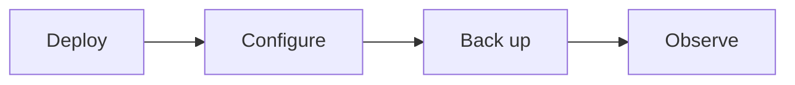

# Operate

Deploy it, configure it, back it up, and watch it run.

## Where to go

| You want to                     | Read                                                          |
| ------------------------------- | ------------------------------------------------------------- |
| Choose where to run it          | [Ways to deploy](./ways-to-deploy/index.md)                   |
| Run it for the first time       | [Getting Started — Production](./first-deploy.md)             |
| Ship an update or roll one back | [Deploy and rollback](./deploy-and-rollback.md)               |
| Check which hosts can run it    | [Hosting](./hosting.md)                                       |
| Run two clients on one host     | [Two Client Stacks](./two-client-stacks.md)                   |
| Harden the deployment           | [Deployment hardening](./deployment-hardening.md)             |
| Probe liveness and readiness    | [Health checks](./health-checks.md)                           |
| Set environment variables       | [Configuration](./configuration.md)                           |
| Back up and restore             | [Backups](./backups.md)                                       |
| Watch it run                    | [Observability Stack Reference](./observability-reference.md) |

## Every page, by group

| Group     | Pages                                                                                                                                                                                                                                                                                                                        |
| --------- | ---------------------------------------------------------------------------------------------------------------------------------------------------------------------------------------------------------------------------------------------------------------------------------------------------------------------------- |
| Deploy    | [Ways to deploy](./ways-to-deploy/index.md) · [Getting Started — Production](./first-deploy.md) · [Hosting](./hosting.md) · [Deploy and rollback](./deploy-and-rollback.md) · [Two Client Stacks](./two-client-stacks.md) · [Deployment hardening](./deployment-hardening.md) · [Health checks](./health-checks.md)          |
| Configure | [Configuration](./configuration.md)                                                                                                                                                                                                                                                                                          |
| Backups   | [Backups](./backups.md) · [Backup server](./backup-server.md) · [restic](./restic.md) · [rclone](./rclone.md) · [MongoDB Database Tools](./mongodb-database-tools.md)                                                                                                                                                        |
| Observe   | [Observability Stack Reference](./observability-reference.md) · [Grafana](./grafana.md) · [Prometheus](./prometheus.md) · [Loki](./loki.md) · [Tempo](./tempo.md) · [OpenTelemetry](./opentelemetry.md) · [Gatus](./gatus.md) · [Winston & Audit Logs](./winston.md) · [Frontend Observability](./frontend-observability.md) |

## Read next

- [Getting Started — Production](./first-deploy.md)
