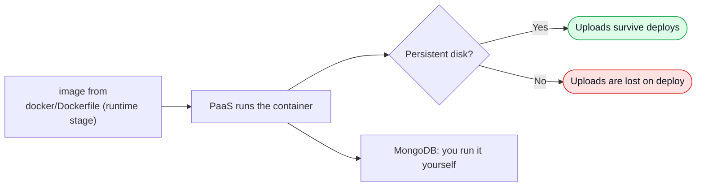

# Container PaaS

A platform that runs a built image for you. The image is a standard OCI image and the compose file does not apply. It has not been tested on any PaaS here.

::: warning Not tested here
Nothing below says a PaaS works. It says what the app needs and where a PaaS stops providing it.
:::

## What the platform leaves to you

| App needs                   | A PaaS usually offers                          | Gap                                                |
| --------------------------- | ---------------------------------------------- | -------------------------------------------------- |
| Compose-defined services    | One image per service                          | Each service (app, cron) is set up by hand         |
| MongoDB 9                   | No managed MongoDB among the platforms checked | Run your own container, or use an external MongoDB |
| Persistent disk for uploads | Sometimes a volume add-on                      | Without one, images vanish on every deploy         |
| The `scripts/ops/` jobs     | The platform's own scheduler, if any           | Wire each job in by hand                           |

The platforms checked are in the [capability matrix](../hosting.md#_3-·-the-capability-matrix).

## Read next

- [Ways to deploy](./index.md)
- [Managed services](./managed-services.md)
