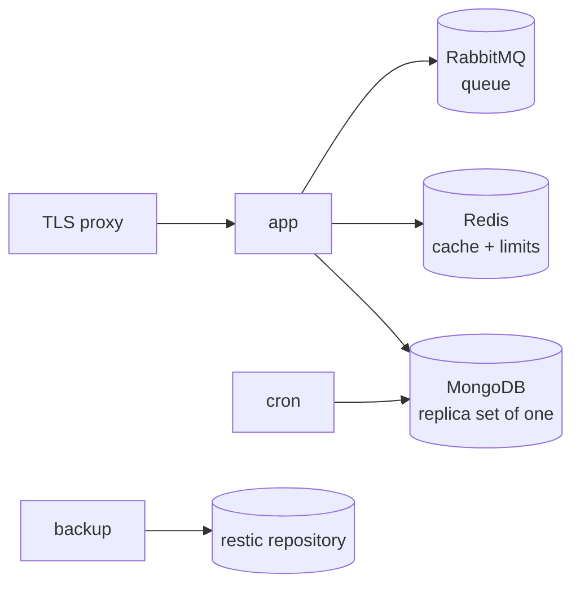

# Docker server

A VPS or dedicated machine with Docker or Podman, running the compose file as shipped. This is the one supported path.

## Why it is the supported path

| Choice                                    | Why                                                         | What it costs                            |
| ----------------------------------------- | ----------------------------------------------------------- | ---------------------------------------- |
| `docker-compose.production.yml`           | Every service, hardening and healthcheck is already decided | You run the host: patches, disk, backups |
| One host, one stack                       | One client per stack, one failure domain                    | No horizontal scale                      |
| Image from `docker/Dockerfile.production` | The image the compose file builds and runs                  | You build or pull it yourself            |

## Do it

1. Pick a host with root and a container runtime: [capability matrix](../hosting.md#_3-·-the-capability-matrix).
2. Follow [Getting Started — Production](../first-deploy.md).
3. Update with [Deploy and rollback](../deploy-and-rollback.md).
4. Run two clients on one machine: [Two Client Stacks](../two-client-stacks.md).

## Read next

- [Getting Started — Production](../first-deploy.md)
- [Deployment hardening](../deployment-hardening.md)
