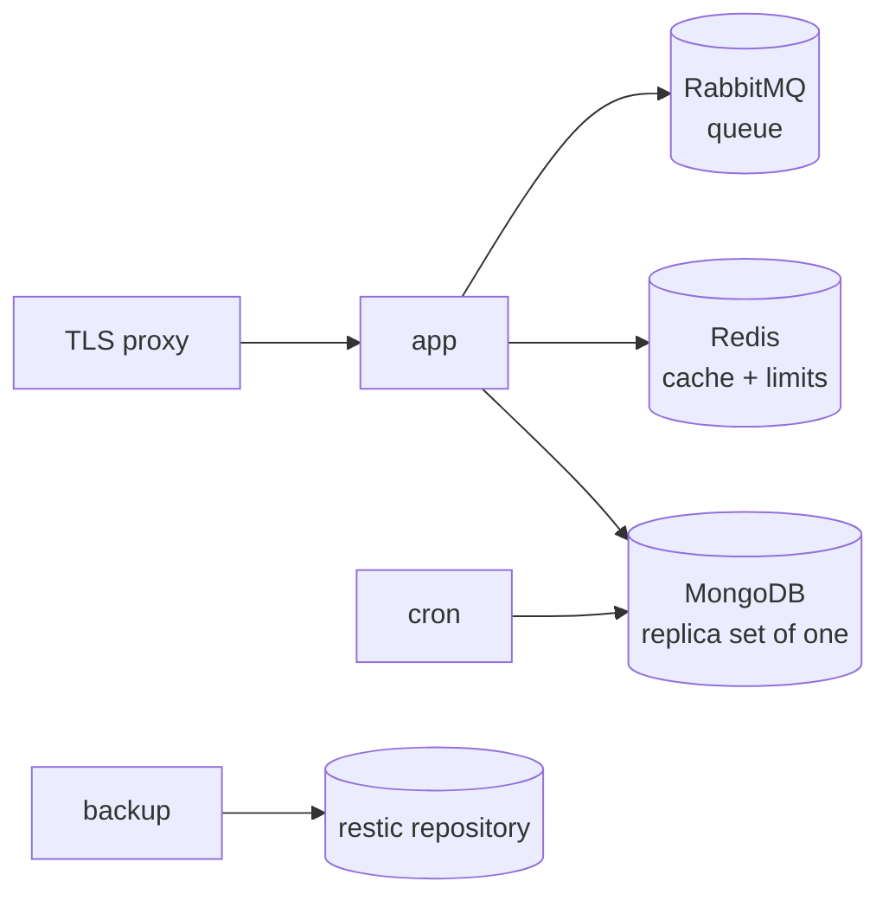
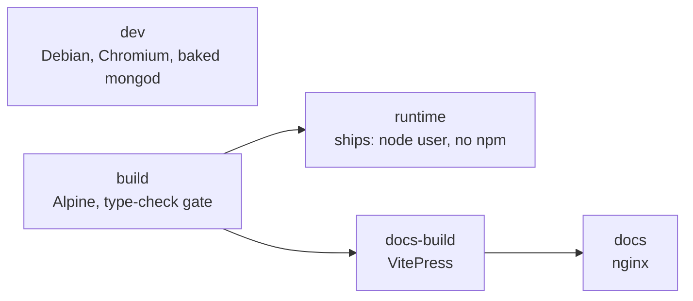

# Docker server

A VPS or dedicated machine with Docker or Podman, running the compose file as shipped. This is the one supported path.

## Why it is the supported path

| Choice                          | Why                                                         | What it costs                            |
| ------------------------------- | ----------------------------------------------------------- | ---------------------------------------- |
| `docker-compose.production.yml` | Every service, hardening and healthcheck is already decided | You run the host: patches, disk, backups |
| One host, one stack             | One client per stack, one failure domain                    | No horizontal scale                      |
| Image from the `runtime` stage  | The image the compose file builds and runs                  | You build or pull it yourself            |

## Why the image is shaped this way

One file, `docker/Dockerfile`, holds every image this repo builds. `runtime` is the last stage, so a build with no
`--target` gives the image that ships.

| Target    | What it is                                                         | Who builds it                                  |
| --------- | ------------------------------------------------------------------ | ---------------------------------------------- |
| `dev`     | The development image, and the one `npm run complete` runs in      | compose (`app`, `cron`), CI `container-gate`   |
| `runtime` | What ships: production dependencies, the type-checked source       | compose production, CI `boot`, `publish-image` |
| `docs`    | The documentation site served by nginx                             | compose profile `docs`                         |
| `build`   | Installs everything and refuses a type error. Not built on its own | `runtime` and `docs-build` copy from it        |

### Why `dev` is Debian and `runtime` is Alpine

`mongodb-memory-server` downloads a glibc-linked `mongod`, which cannot load on musl. The `dev` image runs the test
suite, so it is Debian. Trixie over bookworm: the library maps any Debian 12 or newer to the same `debian12` binary,
so both resolve, and trixie is newer. The `runtime` image runs no test and never starts `mongod`, so it keeps
Alpine's smaller footprint. Each image is sized for the job it does.

Node is 24 in both. `dependency-cruiser` (part of `npm run complete`) hard-exits on Node 25, and 24 is the Active LTS
line. CI's `NODE_VERSION` matches.

### Why it ships TypeScript and not compiled JavaScript

`runtime` runs `node --import tsx src/main.ts`, the same command as `npm start`. tsx transpiles with esbuild at boot and
does not type-check. That is why `build` type-checks, and refuses to produce an image otherwise. Lint runs in CI and
the commit hook, not in the image build.

A `tsc` emit would give a faster cold start and no transpiler in the image. It is not done, because with this tsconfig
it is a refactor and not a build flag:

- `verbatimModuleSyntax: true` conflicts with a CommonJS emit.
- An ESM emit needs a `.js` extension on every relative import. This code resolves with `moduleResolution: "bundler"`
  and writes them extensionless, across about 300 files.
- `paths` aliases (`@infrastructure/*`, `@kernel/*`, `@modules/*`, `@api/*`) are not rewritten by `tsc`, so the output
  would import package names that do not exist. That needs `tsc-alias`, a bundler, or Node subpath imports.

All three together or none. Until then this runs the code that was tested, at the cost of a second or two of boot.

### What the `dev` image does that `runtime` does not

| Line                                | Why                                                                                                                 |
| ----------------------------------- | ------------------------------------------------------------------------------------------------------------------- |
| `chromium`, `fonts-freefont-ttf`    | puppeteer, for invoice PDFs. Debian's name for Alpine's `ttf-freefont`, so rendered PDFs use the same fallback font |
| `libcurl4`                          | The baked `mongod` links against it and Debian slim does not ship it                                                |
| `git`                               | `local/comment-links` runs `git ls-files`. The `.git` directory itself is mounted when the gate runs                |
| `PUPPETEER_EXECUTABLE_PATH`         | puppeteer-core's own fallback is Alpine's binary path, which Debian lacks, so this image must set it                |
| `COPY . .` before `npm ci`          | `postinstall` bundles and generates from `scripts/`, `shared/` and the module contracts, which must be on disk      |
| `MONGOMS_DOWNLOAD_DIR` and the bake | The suite needs no network, and the library's machine-wide download lock (no timeout) is never taken                |

The compose bind mount overlays the copied source with the live tree, so what lasts from the copy is the populated
`/app/node_modules` volume. `docker/ensure-deps.sh` keeps that volume in step with the lockfile.

### `runtime` details worth knowing

- **Chromium is off by default** (about 200 MB). Only invoice rendering needs it. Turn it on with
  `--build-arg INSTALL_CHROMIUM=true`. Without it, `GET /orders/{id}/invoice` answers 500, which is visible. The
  order-confirmation mail does not fail: the render error is logged and the mail sends with no invoice attached,
  silently, for every order. A shop that mails invoices needs Chromium.
- **`npm ci --omit=dev --ignore-scripts`** is about 200 MB instead of 1.4 GB, and no transitive dependency runs code
  at build time.
- **npm, npx, corepack and yarn are deleted in the same layer as the install.** A later `RUN` would leave them in the
  layer below. Nothing starts through them, and npm bundles its own undici and tar.
- **The code is root-owned.** No `--chown`: `node` can read it and cannot rewrite it. Only `public/images`, `tmp/storage`
  and `tmp/quarantine` belong to `node`, and each exists before its volume is mounted over it.
- **`dumb-init` is PID 1**, so SIGTERM reaches Node and graceful shutdown in `src/serve.ts` can run.
- **`build` deletes `tests/` and `factories.ts`** after the type-check and before `runtime` copies `src/`.

## Do it

1. Pick a host with root and a container runtime: [capability matrix](../hosting.md#_3-·-the-capability-matrix).
2. Follow [Getting Started — Production](../first-deploy.md).
3. Update with [Deploy and rollback](../deploy-and-rollback.md).
4. Run two clients on one machine: [Two Client Stacks](../two-client-stacks.md).

## Read next

- [Getting Started — Production](../first-deploy.md)
- [Deployment hardening](../deployment-hardening.md)
