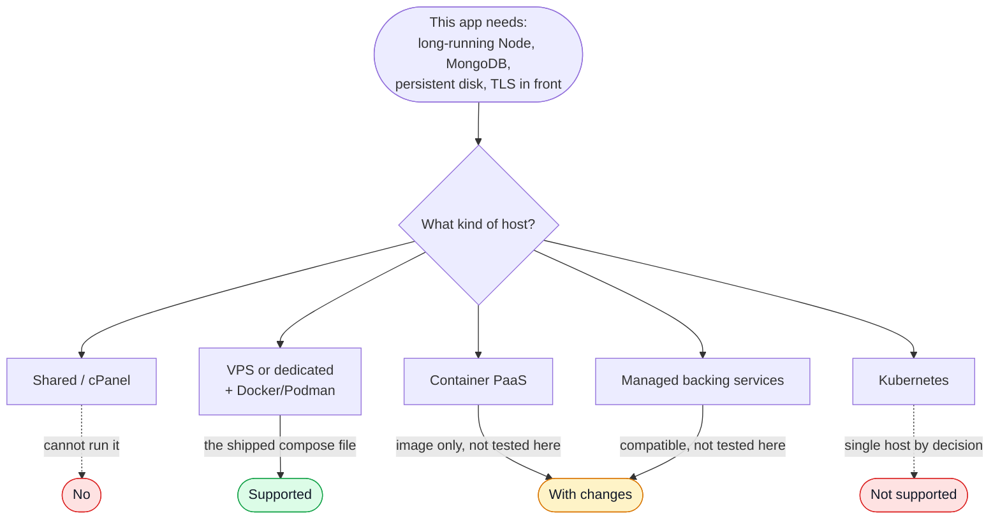

# Ways to deploy

Five ways to run this app, drawn once: what it needs, which kind of host gives that, and which page covers it.

This repo names categories and never picks a provider. Hosts appear only as examples.

## What the app needs from a host

Four things decide everything: a long-running process, MongoDB 9, a persistent disk and TLS in front.
Serverless functions fail the first one.
The full table, with the optional services, is one home: [Hosting § what this app needs](../hosting.md#_1-·-what-this-app-needs-from-a-host).

## The five pages

| Way                              | Verdict here                     | Page                                      |
| -------------------------------- | -------------------------------- | ----------------------------------------- |
| Shared hosting                   | Cannot run the app               | [Shared hosting](./shared-hosting.md)     |
| A server with Docker or Podman   | **The supported path**           | [Docker server](./docker-server.md)       |
| Container PaaS                   | Runs the image; none tested here | [Container PaaS](./container-paas.md)     |
| Kubernetes                       | Starting point only (`k8s/`)     | [Kubernetes](./kubernetes.md)             |
| Managed MongoDB, Redis, RabbitMQ | Compatible, not tested here      | [Managed services](./managed-services.md) |

## Pick one

1. Do you have a machine you can SSH into and run containers on? → [Docker server](./docker-server.md).
2. Only a platform that runs images? → [Container PaaS](./container-paas.md), and read what it leaves to you.
3. Only a cPanel account? → [Shared hosting](./shared-hosting.md): it cannot run this.
4. Which providers offer which controls: [Hosting](../hosting.md).

## Read next

- [Hosting: the capability matrix](../hosting.md)
- [Getting Started — Production](../first-deploy.md)
