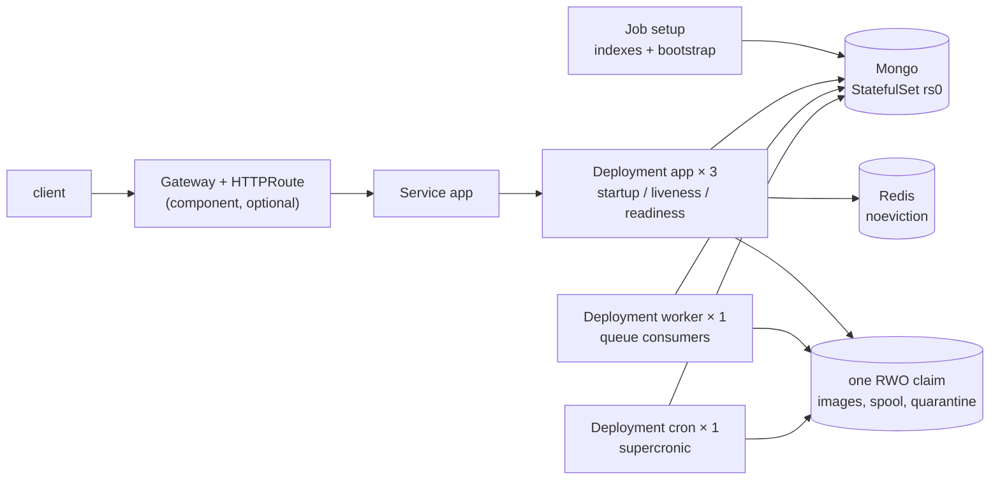

# Kubernetes

Not a supported deployment target: this repo runs one host per stack by decision. It does ship a **starting point**,
`k8s/`, whose only tested home is a kind cluster, on a developer machine and weekly in CI ([Kubernetes testing](../../build/kubernetes-testing.md)).
Read it as the answer to "what would the app need on Kubernetes", not as a chart to install. This page says what is
there, what is yours to add, and when to revisit.

## What `k8s/` ships, and what a real cluster changes

| Piece              | In `k8s/base`                                                                                      | On a real cluster                                                       |
| ------------------ | -------------------------------------------------------------------------------------------------- | ----------------------------------------------------------------------- |
| App                | `Deployment` × 3, hardened like compose, startup/liveness/readiness                                | Your replica count, requests and limits                                 |
| Config and secrets | A generated `ConfigMap`; secrets are `NODE_*_FILE` mounts of a Secret                              | The Secret from your own store; `edge-env` with your real URL           |
| Database           | A one-member Mongo `StatefulSet` with no TLS or auth                                               | A managed MongoDB: set `NODE_DB_URI`, drop `k8s/base/mongo.yaml`        |
| Queue consumers    | One `worker` Deployment (`src/worker.ts`), 1 replica, rolling; the kind overlay sets 0 (no broker) | Your replica count; needs a broker (`NODE_RABBITMQ_URL`) to do anything |
| Scheduled jobs     | One `cron` Deployment (supercronic), 1 replica, `Recreate`                                         | The same, or one `CronJob` per `docker/crontab` line                    |
| Public traffic     | None in `base`; `components/gateway` is a Gateway API Gateway + route                              | Your Gateway or Ingress, with TLS                                       |
| Uploads            | One `ReadWriteOnce` claim: pods on one node share it                                               | An S3-compatible `ImageStore` or a `ReadWriteMany` class                |
| Packaging          | Kustomize: `base`, a gateway component, a `kind` overlay                                           | Your own overlay (or a Helm chart)                                      |

`cron` is a Deployment, not a `CronJob` per schedule: supercronic already is the scheduler, and one container gives every
job the same environment, volumes and health check as the compose `cron` service. The crontab is generated into
`k8s/base/crontab` by `npm run regenerate`, so it cannot drift from `docker/crontab`.

## When to revisit

The decision to stay on one host has a trigger list: [Tenancy § when to revisit](../../understand/tenancy.md#_9-·-when-to-revisit-this-decision).

## Read next

- [Ways to deploy](./index.md)
- [Docker server](./docker-server.md)
