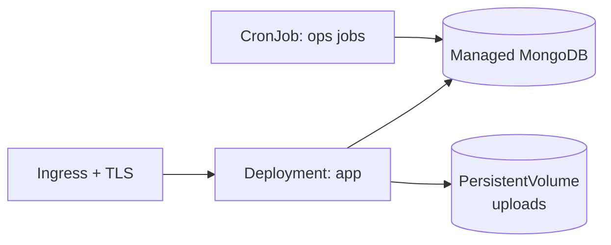

# Kubernetes

Not supported here. This repo runs one host per stack by decision. This page says how it is usually done and when to revisit.

## How it is usually done

| Piece              | Usual form                                       |
| ------------------ | ------------------------------------------------ |
| App and workers    | A `Deployment` per process, built from the image |
| Config and secrets | `ConfigMap` and `Secret`, or an external store   |
| Database           | A managed MongoDB, not a pod                     |
| Scheduled jobs     | `CronJob` per `scripts/ops/` job                 |
| Public traffic     | An ingress controller terminating TLS            |
| Packaging          | Raw manifests or a Helm chart                    |

This repo ships none of those files.

## When to revisit

The decision to stay on one host has a trigger list: [Tenancy § when to revisit](../../understand/tenancy.md#_9-·-when-to-revisit-this-decision).

## Read next

- [Ways to deploy](./index.md)
- [Docker server](./docker-server.md)
