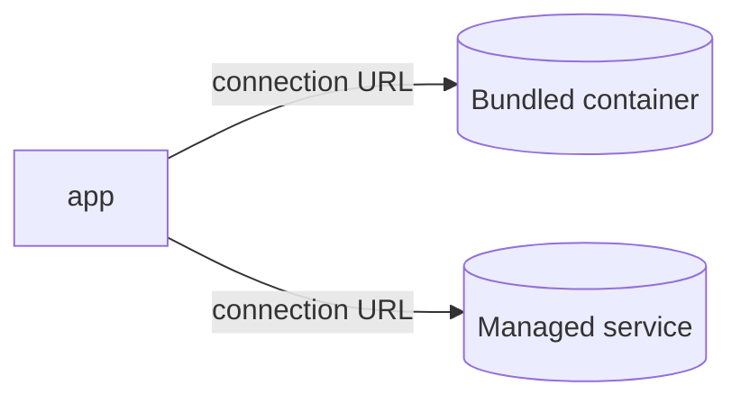

# Managed services

A managed MongoDB, Redis or RabbitMQ is compatible, not identical. Every "compatible" claim here is **not tested here**.

## What changes

| Service  | Setting                                                                   | Risk                                            | Tested here |
| -------- | ------------------------------------------------------------------------- | ----------------------------------------------- | ----------- |
| MongoDB  | `NODE_DB_URI` at the managed cluster                                      | Wire protocol is shared, features may not be    | No          |
| Redis    | `NODE_REDIS_URL` and `NODE_RATE_LIMIT_REDIS_URL` at the managed instances | Two instances are needed: cache and `limits`    | No          |
| RabbitMQ | `NODE_RABBITMQ_URL` at the managed broker                                 | Queue and exchange names are created by the app | No          |

Wire-compatible stores (Cosmos DB for MongoDB, DocumentDB) can lack an aggregation operator or index type. Check each against the vendor's compatibility page.

The full comparison, the Atlas free-tier limits and the data-protection angle: [Hosting § managed backing services](../hosting.md#_5-·-managed-backing-services-—-compatible-not-identical).

## Read next

- [Two Client Stacks](../two-client-stacks.md)
- [Container PaaS](./container-paas.md)
