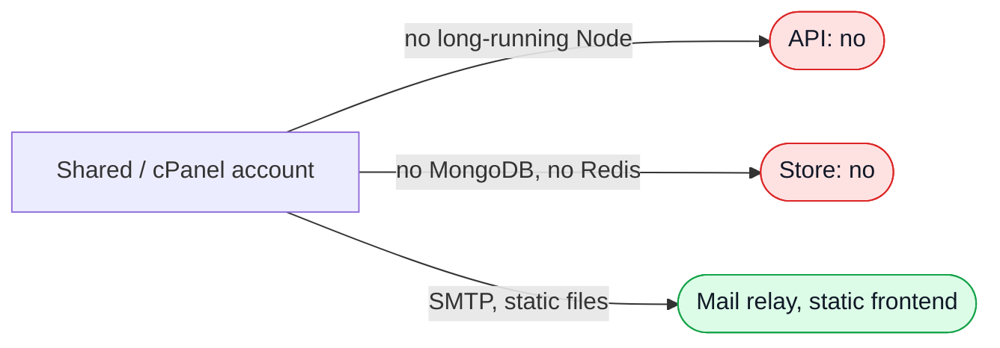

# Shared hosting

Shared and cPanel hosting cannot run this app. It can still do two small jobs.

## Why it cannot run

| The app needs                        | Shared hosting gives                       |
| ------------------------------------ | ------------------------------------------ |
| A Node process that stays up         | Short request-bound processes, if any Node |
| MongoDB 9 and a queue consumer       | No database server you control             |
| A shell to install and schedule jobs | No root, no container runtime              |

## What it can still do

| Job                         | Why it fits                                  |
| --------------------------- | -------------------------------------------- |
| Send the app's email (SMTP) | Mail relay is what these hosts are built for |
| Serve static files          | The built frontend is static                 |

Neither job runs the API. The API still needs another host from [Ways to deploy](./index.md).

## Read next

- [Ways to deploy](./index.md)
- [Hosting: capability matrix](../hosting.md#_3-·-the-capability-matrix)
