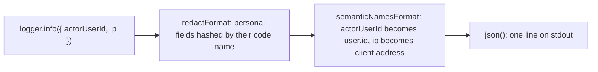

# Winston & Audit Logs

How the app writes its two log streams, and where each one ends up.

## Two log streams

| Stream        | Purpose                                                               | Format                                                                                                |
| ------------- | --------------------------------------------------------------------- | ----------------------------------------------------------------------------------------------------- |
| `logger`      | normal application logs (request access logs, errors, warnings)       | Pretty and coloured only in a relaxed environment on a terminal (`logger.ts:470-471`), JSON otherwise |
| `auditLogger` | security/admin events (login attempts, role checks, token cleanup, …) | always JSON                                                                                           |

Both write to **stdout**, which Docker captures. There is no Loki transport bundled — adding one later is a few lines in `src/infrastructure/adapters/logger.ts`.

## What an access log looks like

One slim line per request, only the fields that actually help:

```json
{
    "level": "info",
    "message": "GET /products 200 12.4ms",
    "service.name": "api",
    "app.request.id": "1b2c3d…",
    "trace_id": "4bf92f3577b34da6a3ce929d0e0e4736",
    "http.request.method": "GET",
    "http.route": "/products",
    "http.response.status_code": 200,
    "app.request.duration_ms": 12.4
}
```

The `trace_id` is the bridge to Grafana → Tempo: paste it in Explore to see the full request timeline, every DB query, every error attribute.

## What an error log looks like

One line per error, no stack trace bloat — the stack lives on the OTel span:

```json
{
    "level": "error",
    "message": "ValidationError: name is required",
    "service.name": "api",
    "app.request.id": "1b2c3d…",
    "trace_id": "4bf92f3577b34da6a3ce929d0e0e4736",
    "http.response.status_code": 422,
    "exception.type": "ValidationError",
    "exception.message": "name is required"
}
```

## Field names in the log line

Code logs camelCase fields (`actorUserId`, `statusCode`). `semanticNamesFormat`, the last step of
the transport format, renames them to [OpenTelemetry semantic-convention](https://opentelemetry.io/docs/specs/semconv/)
names, so a dashboard or alert written against the standard works here unchanged. Mongo and the API
keep the camelCase; only the log line changes.



Redaction runs first on purpose: its lists know the names code writes.

| In code                                                                                 | On the line                                                          | Convention                      |
| --------------------------------------------------------------------------------------- | -------------------------------------------------------------------- | ------------------------------- |
| `service`                                                                               | `service.name`                                                       | resource attribute              |
| `pid`                                                                                   | `process.pid`                                                        | process semconv                 |
| `hostname`                                                                              | `host.name`                                                          | host semconv                    |
| `traceId`, `spanId`                                                                     | `trace_id`, `span_id`                                                | Logs Data Model (trace context) |
| `method`, `route`, `statusCode`                                                         | `http.request.method`, `http.route`, `http.response.status_code`     | HTTP semconv                    |
| `ip`, `userAgent`                                                                       | `client.address`, `user_agent.original`                              | client / user-agent semconv     |
| `actorUserId`, `actorRole`                                                              | `user.id`, `user.roles` (a one-entry list)                           | user semconv                    |
| `action`                                                                                | `event.name`                                                         | event semconv                   |
| `error` (an `Error` or a string)                                                        | `exception.type`, `.message`, `.stacktrace`, `.cause`                | exception semconv               |
| `requestId`, `clientRequestId`, `durationMs`                                            | `app.request.id`, `app.request.client_id`, `app.request.duration_ms` | custom, `app.` namespace        |
| `outcome`, `actorRoleName`, `actorCredentialId`, `actorScope`, `targetType`, `targetId` | `app.audit.outcome`, `app.actor.*`, `app.target.*`                   | custom, `app.` namespace        |

The map lives in `src/infrastructure/adapters/semantic-names.ts`. Only top-level fields are renamed:
`metadata` and a nested `error.cause` keep the call site's own shape. In LogQL, `| json` turns a dot
into an underscore: read `user.id` as `user_id`. Alloy extracts the `service` label from
`service.name`.

## Audit events

An auditable action writes one JSON line on `auditLogger` (`log_type: "audit"`, an `event.name`, an `app.audit.outcome`) and, for most, a row in Mongo. The line goes to stdout and on to [Loki](./loki.md) like every other log.

The actions, the line-or-row rule, where an entry ends up and its retention live with the module that stores them: [audit-logs](../modules/audit-logs.md#audit-events).

## Configuration

| Env var                    | Effect                                                                                                                                                                                                                         |
| -------------------------- | ------------------------------------------------------------------------------------------------------------------------------------------------------------------------------------------------------------------------------ |
| `NODE_LOG_LEVEL`           | logger level (`error`, `warn`, `info`, `debug`, …). Defaults to `info` in production, `debug` elsewhere.                                                                                                                       |
| `NODE_SERVICE_NAME`        | tag on every log entry. Useful when several services ship logs to the same aggregator.                                                                                                                                         |
| `NODE_LOG_PERSONAL_FIELDS` | `hash` (default), `redact`, or `plain` — see [Personal data](#personal-data) below.                                                                                                                                            |
| `NODE_PSEUDONYM_KEY`       | Root secret for `hash` mode (and every other [pseudonymised identifier](../understand/security.md#pseudonymised-identifiers)). Required: unset, every digest throws (the development doubles and the test setup each set one). |

## Redaction

`redactSensitiveFields` replaces values of well-known sensitive keys (`password`, `token`, `cookie`, `authorization`, …) with `[REDACTED]` before logging. It runs on every log entry. An audit event's `metadata` is scrubbed of credentials once, before both copies: the log line and the stored row. Personal fields (below) are handled on the line only; the stored row keeps `ip` readable.

## Personal data

A second, separate list — `PERSONAL_FIELDS` (`email`, `ip`, `phone`, `street`, `zip`, `fullname`) — covers fields that are personal data without being credentials. A mail recipient is logged under `email`; `to` is the transition key of a `{ from, to }` change and stays readable. Data minimisation applies to logs the same as it applies to collections, and these flow into Winston, and from there into [Loki](./loki.md), same as everything else.

Kept apart from `SENSITIVE_FIELDS` on purpose: a credential is always replaced outright, never kept in any form. A personal field defaults to **hashed** instead (`NODE_LOG_PERSONAL_FIELDS=hash`, HMAC-SHA256 under the `log` subkey of `NODE_PSEUDONYM_KEY`, truncated to 12 hex characters, `hmac:`-prefixed — not `sha256:`, since the algorithm name alone can't tell a reader the digest is keyed) — the same input always produces the same digest, so a trace stays followable ("did this user's requests all fail the same way") without the log line being readable on its own. The hash is keyed rather than bare: an unkeyed `sha256(email)` or `sha256(ip)` is brute-forced from a breach list or the whole IPv4 space in seconds, which is GDPR pseudonymisation in name only. `redact` drops it entirely, like a credential; `plain` leaves it untouched, for local development where the log never leaves the machine.

The private setting (`hash`) is the default deliberately: a boilerplate's default config is the one most deployments never revisit.

**Rotating `NODE_PSEUDONYM_KEY` breaks correlation across the change.** The same user's digest before and after a rotation is two different values — by design, since the whole point of keying the hash is that nobody without the key can link one either. Rotate it only alongside a reason to, and expect an operator tracing an incident spanning the rotation to see it as two different "users".

## Works with

- **[OpenTelemetry](./opentelemetry.md)** — the OTel SDK automatically injects the active `trace_id` into Winston's logging context on every request. You write nothing; every log line just has it. → full explanation: [How logs and traces correlate](./opentelemetry.md#how-logs-and-traces-correlate)
- **[Loki](./loki.md)** — Winston writes JSON to stdout; Alloy tails those lines and ships them to Loki. The `trace_id` on each line is what enables jumping from a log entry straight to a Tempo trace. → [Trace ↔ log correlation](./loki.md#trace-log-correlation)

## External references

- [OWASP Logging Cheat Sheet](https://cheatsheetseries.owasp.org/cheatsheets/Logging_Cheat_Sheet.html) — guidance for what audit/security logs should capture
- [winston-loki transport](https://github.com/JaniAnttonen/winston-loki) — drop-in if you want to push logs directly to [Loki](./loki.md) instead of via Alloy

## Read next

- [Events & Logging](../understand/events-and-logging.md) — how these two streams relate to analytics, metrics and queue jobs
- [OpenTelemetry](./opentelemetry.md)
- [Tempo](./tempo.md)
- [Grafana](./grafana.md)
