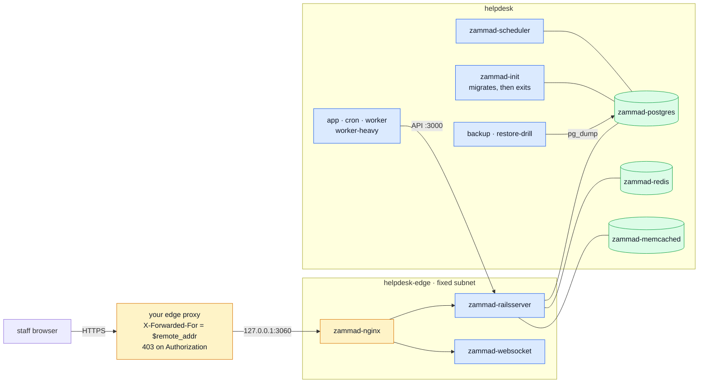

# Zammad

The production compose file can run a self-hosted [Zammad](https://zammad.org) next to the API: the
`helpdesk` profile. Staff answer customers there. It is **off until you ask for it**, and nothing in the
API changes while it is off.

## Before you start

- A host with **at least 4 GB more memory** than the base stack: Zammad is five containers plus its own
  Postgres, Redis and memcached, roughly three to four times what the API stack uses
  ([Hosting](./hosting.md)). It is still one host.
- A TLS proxy with its own hostname for Zammad (`helpdesk.example.com`), set up as
  [this section](./first-deploy-proxy-and-storage.md#proxy-settings) says. **Do this before you let anyone
  sign in.**
- The three secret files `zammad_postgres_password`, `zammad_postgres_superuser_password` and `zammad_api_token`
  ([Secrets](./first-deploy.md#secrets)). Compose needs both files whether or not the profile runs.

## The design



| Piece                | What                                                                                                                                                                                                                    |
| -------------------- | ----------------------------------------------------------------------------------------------------------------------------------------------------------------------------------------------------------------------- |
| Services             | `zammad-init`, `-railsserver`, `-scheduler`, `-websocket`, `-nginx`, plus `zammad-postgres` (17), `-redis` and `-memcached`. All `profiles: [helpdesk]`                                                                 |
| Images               | Every one `tag@sha256`. Zammad is 7.2.3 or later: the two-factor layer had a critical bypass (fixed in 7.2.1) and a brute-force hole (fixed in 7.2.3)                                                                   |
| Search               | **None.** `ELASTICSEARCH_ENABLED=false`, and no Elasticsearch service ([turning search on](#turning-search-on))                                                                                                         |
| Networks             | `helpdesk` for the data and for the API's callers; `helpdesk-edge` for the proxy tier. **Zammad is never on `default`**, the network Mongo and both Redis share                                                         |
| One port             | Only `zammad-nginx` publishes: `127.0.0.1:${ZAMMAD_PORT:-3060}`, loopback like `app`                                                                                                                                    |
| How the API calls it | Over `helpdesk`, to `zammad-railsserver:3000`. The API needs no nginx; nginx is the browser's door                                                                                                                      |
| User                 | Every Zammad container runs as the image's own non-root user, `zammad-init` included (upstream's compose runs it as root; it is not needed). No `read_only`: Zammad writes its own `tmp`, `log` and nginx configuration |
| Hardening            | Every capability dropped, no privilege gain, on every service. The three data services take back only what their entrypoints use, like the other data stores                                                            |
| Not shipped          | Zammad's own backup service: up to a day of data lost, runs as root, and the heartbeat cannot see it. Our [`backup`](#backup) does the job                                                                              |

## Steps

### 1 · Turn it on {#turn-it-on}

```bash
# in clients/acme/.env
COMPOSE_PROFILES=bundled,helpdesk
ZAMMAD_PORT=3060                 # the loopback port your proxy points at

# once, with the other secrets (first-deploy.md#secrets)
for name in zammad_postgres_password zammad_postgres_superuser_password; do
    openssl rand -hex 32 > "clients/acme/secrets/$name"
    chmod 0644 "clients/acme/secrets/$name"
done
: > clients/acme/secrets/zammad_api_token
```

Then `docker/deploy.sh acme` as always, which starts every service of the profile. The deploy's health
check covers the API services (and `backup`), **not Zammad**: watch `zammad-init` yourself. It creates the
database on the first start and the others wait for it; give it a few minutes.
Open Zammad through your proxy and follow its setup wizard, or seed the first admin and settings with an
[autowizard file](https://docs.zammad.org/en/latest/appendix/auto-wizard.html) in `ZAMMAD_AUTOWIZARD_JSON`
(base64, first start only).

`docker/zammad/postgres-init.sh` runs once, on the empty data directory: it creates the role Zammad
connects as and the database that role owns. The bootstrap superuser is for administration only and has its own
secret, `zammad_postgres_superuser_password`, which only `zammad-postgres` mounts: the Zammad processes and the
backup hold only the `zammad` role's `zammad_postgres_password`, so none of them can log in as a superuser.

The Rails console needs the database password in its environment, which only the entrypoint sets:

```bash
docker compose --env-file "clients/acme/.env" -f compose.yaml -f compose.production.yaml \
    exec zammad-railsserver bash -c \
    'export POSTGRESQL_PASS="$(cat /run/secrets/zammad_postgres_password)"; bundle exec rails r "puts Setting.get(%q(fqdn))"'
```

### 2 · Turn off the geo lookup {#geo-ip}

`geo_ip_backend` is **on by default** and sends every client address to `geo.zammad.com`. Turn it off:
Admin → System → Services → Geo IP → `-`, or in the console `Setting.set('geo_ip_backend', '')`. The
[drill's](#the-drill) autowizard file sets it the same way and checks the setting reads empty.

### 3 · The client address {#client-address}

Zammad rate-limits and logs sign-ins, password resets and two-factor attempts **per client address**. At its
defaults it trusts only loopback, so behind a proxy every request would come from one address and one
attacker could lock everyone out. The compose file therefore sets `RAILS_TRUSTED_PROXIES` to **exactly two
addresses**: `zammad-nginx`'s own, and the gateway of `helpdesk-edge`. Which of the two a request arrives
from depends on the engine's port forwarder (rootless Podman with pasta: the container's own address;
Docker: the gateway). Zammad matches the list address by address, never as a range.

| Variable               | Default            | Meaning                                                                       |
| ---------------------- | ------------------ | ----------------------------------------------------------------------------- |
| `ZAMMAD_EDGE_SUBNET`   | `10.250.77.0/24`   | `helpdesk-edge`'s subnet                                                      |
| `ZAMMAD_EDGE_GATEWAY`  | `10.250.77.1`      | Its gateway: one of the two trusted addresses                                 |
| `ZAMMAD_EDGE_NGINX_IP` | `10.250.77.2`      | `zammad-nginx`'s fixed address: the other                                     |
| `ZAMMAD_EDGE_RANGE`    | `10.250.77.128/25` | Where the other two edge services get theirs, so nginx's is never taken first |

Your proxy must **overwrite** `X-Forwarded-For` with `$remote_addr`
([the snippet](./first-deploy-proxy-and-storage.md#proxy-settings)). A proxy that appends lets a client
choose the address Zammad records for it.

The fixed subnet is why `helpdesk-edge` exists apart from `helpdesk`: a network every stack creates cannot
carry one, or a second client stack on the host fails to come up ([Two Client Stacks](./two-client-stacks.md#the-helpdesk-profile)).
Two stacks that **both** run the profile set different `ZAMMAD_EDGE_*` values, all four.

### 4 · Turning search on {#turning-search-on}

Staff search is substring only, with no attachment search and no `field:value` syntax, and Zammad's
built-in reports refuse to run. That is what no Elasticsearch costs: about 1–4 GB of memory and an
open-core component saved. To turn it on, add an Elasticsearch service of your own to an override file, set
`ELASTICSEARCH_ENABLED=true` and `ELASTICSEARCH_HOST` on the five Zammad services, and restart:
`zammad-init` builds a missing index on its next start, so the switch is reversible. The API's own
lookups (by `request_ref`, by date) use SQL and work in both modes.

## Upgrade {#upgrade}

**Back up first, every time.** Zammad migrates its database on the first start of a new image, and there is
no downgrade: the only way back is the backup.

1. Wait for a green [`backup`](#backup) run, or take one: `docker compose ... exec backup backup-job`.
2. Bump the image in `compose.production.yaml` (the tag and the digest together) and run `docker/deploy.sh acme`.
3. Watch `zammad-init` finish (`docker compose ... logs -f zammad-init`).

Zammad fixes security bugs on its **current stable line only**, so follow each new minor release within one
patch cycle of the old line, not after it.

## Security releases {#security-releases}

| Severity       | The pin is bumped within | Then                                               |
| -------------- | ------------------------ | -------------------------------------------------- |
| critical, high | 7 days                   | Each operator backs up and runs `docker/deploy.sh` |
| medium, low    | 30 days                  | The same                                           |

Dependabot's cooldown skips the Zammad image (`.github/dependabot.yml`), so a bump PR arrives at once. Its
security updates do not fire for Zammad: the advisories carry no ecosystem, and some are missing from
GitHub's global database. Until an automated watcher exists, read
<https://github.com/zammad/zammad/security/advisories> weekly and compare the affected range with the pin.
Zammad's version numbers carry a build suffix (`7.2.3-0017`); the advisory ranges do not.

## Backup {#backup}

Our restic [`backup`](./backups.md#one-run) service does it, not Zammad's:

- **`pg_dump -Fc`** of `zammad_production` as the `zammad` role, streamed into the same restic repository
  (tag `helpdesk-db`), with its ticket and user counts beside it (`helpdesk-counts`). The password comes
  from the secret file through a `0600` password file in the container's tmpfs.
- **`zammad-storage` mounted read-only**, backed up with the other files. Zammad keeps attachments in its
  database by default; the volume matters only if you switch its storage provider to the file system.
- **Retention:** no Zammad dump is kept longer than `BACKUP_HELPDESK_MAX_DAYS`, which follows
  `NODE_ERASURE_LEDGER_RETENTION_DAYS` (220). After a restore, the erasure ledger is how erased accounts
  are applied again, and it only reaches back that far.
- **On the second machine** (`BACKUP_PRUNE=false`) the client cannot delete, so the server's upkeep applies the
  same cap with its own `BACKUP_HELPDESK_MAX_DAYS` ([the upkeep](./backup-server.md#the-upkeep)).
- **Skipped** while `zammad-postgres` does not answer by name; `BACKUP_HELPDESK=true` makes that a failure.
- **The restore drill** restores the dump into a throwaway Postgres 17 and compares ticket and user counts
  ([the restore drill](./backups-restore-drill.md#the-restore-drill)).

The image carries the PostgreSQL **17** client from the PGDG repository: Ubuntu 24.04 ships 16, and a client
older than the server refuses its dump.

## Restore {#restore}

Restoring Zammad **alone** (not the whole host) brings back every customer erased after the dump. Our erase
jobs (`zammaderasejobs`) outlive the dump, so they can delete those customers again. Do it in this order:

1. **Export the Zammad `data_privacy_tasks` rows done since the dump**, from the database being replaced:
   `SELECT deletable_type, deletable_id, updated_at FROM data_privacy_tasks WHERE state = 'completed' AND updated_at >= '<dump time>'`.
   Each row stores `deletable_id`, which also covers erasures staff filed by hand, and which our jobs do not know.
2. **Stop the Zammad channels and our sender** (`sweep:zammad-contacts`), so no new ticket takes a recycled id
   before the replay and nothing is mailed from the restored state.
3. **Restore** the dump ([Backup](#backup), restic tag `helpdesk-db`).
4. **Run the replay**, then re-file the hand-made erasures from step 1 by hand (Admin, Data Privacy):

    ```sh
    npm run zammad:replay-erasures -- --since <dump time> --snapshot <restic snapshot id> --by <your name>
    ```

    It sets the erase jobs completed since the dump back to `pending` and runs one erase pass; the scheduled
    `sweep:zammad-erasures` then follows the tasks to `completed`. A customer the restored Zammad does not hold
    (it was created after the dump) counts as done. A restoration-log audit row records who did it.

5. **Rebuild the search index** with `rake zammad:searchindex:rebuild`, only if you turned Elasticsearch on
   ([Turning search on](#turning-search-on)).
6. **Restart the channels.**

A dump older than `NODE_ERASURE_LEDGER_RETENTION_DAYS` (220) cannot be replayed: the jobs that would name its
erasures have expired. That is why [the backup](#backup) keeps no Zammad dump longer than that. A **whole-host**
restore needs none of this: `ops:reapply-erasures` brings the erase hook back to life
([Restoring](./backups-restoring.md)).

## The drill {#the-drill}

`npm run helpdesk:drill` (`docker/helpdesk-drill.sh`, Linux only) boots the profile from the pinned images
on a throwaway client, seeded by `docker/zammad/autowizard.drill.json`, and checks, in order:

| Step                                        | What it proves                                                                                                                                                                         |
| ------------------------------------------- | -------------------------------------------------------------------------------------------------------------------------------------------------------------------------------------- |
| the compose file parses, profile on and off | no stack that skips the profile is affected                                                                                                                                            |
| Zammad boots and the autowizard runs        | the images, the non-root `zammad-init`, the secret file reaching Postgres, the seed settings                                                                                           |
| only `zammad-nginx` publishes               | one port, on loopback                                                                                                                                                                  |
| a sign-in behind the documented proxy       | Zammad's session list shows the **real** client address                                                                                                                                |
| the same with a forged `X-Forwarded-For`    | the recorded address does not change                                                                                                                                                   |
| an `Authorization` header                   | 403 at the proxy, for a token and for basic auth                                                                                                                                       |
| Zammad's own screen in a real Chromium      | the sign-in through the proxy works and **no request carries `Authorization`**, so the 403 rule cannot lock staff out (`scripts/testing/helpdesk-legacy-ui.ts`, with `puppeteer-core`) |
| the geo lookup                              | `geo_ip_backend` reads empty after the seed settings, so the runbook's off-switch is the real one                                                                                      |
| a second stack without the profile          | comes up beside it: its `helpdesk` network exists, `helpdesk-edge` does not                                                                                                            |

It needs a Chromium: `CHROMIUM_PATH`, or `chromium` / `google-chrome` on the `PATH`; without one it fails rather than skips.
Run it on the engine you deploy with (`CONTAINER_ENGINE=docker` or `podman`); a commit that changes the
profile says which engines ran. The throwaway proxy is the Zammad image's own nginx on the host network.
Every container it starts is named `boilerplate-helpdesk-drill*`, labelled `crew=boilerplate` and removed,
with its volumes and networks, at the end.

## Read next

- [Backups](./backups.md)
- [Two Client Stacks](./two-client-stacks.md)
- [Putting a reverse proxy in front](./first-deploy-proxy-and-storage.md#putting-a-reverse-proxy-in-front)
