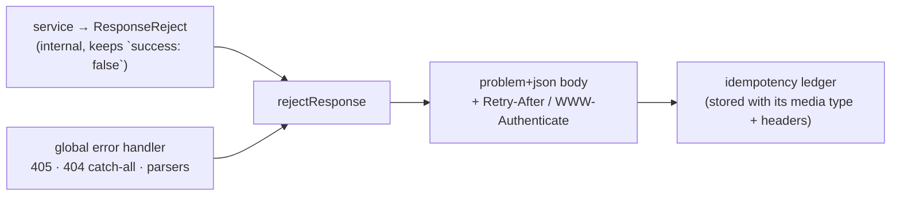

# Error Responses

Every 4xx and 5xx the application sends is an [RFC 9457](https://www.rfc-editor.org/rfc/rfc9457)
problem details document, as `application/problem+json`. One shape, one media type, whatever route
failed. Node's HTTP server answers four statuses itself, outside Express, with no body: 400 and 431
for a malformed request line or headers (before any route), and 408 (request not received within
`NODE_HTTP_REQUEST_TIMEOUT_MS`), 413 (chunk extension over 16 KiB) and 400 (malformed body framing)
mid-request, after the route was reached. See [Outside the JSON API](#outside-the-json-api).

|                                 | Standard                                                                                 |
| ------------------------------- | ---------------------------------------------------------------------------------------- |
| The error body                  | [RFC 9457](https://www.rfc-editor.org/rfc/rfc9457) — Problem Details for HTTP APIs       |
| Media type, content negotiation | [RFC 9110 §12.5.1](https://www.rfc-editor.org/rfc/rfc9110#section-12.5.1)                |
| Status names (`title`)          | [RFC 9110 §15](https://www.rfc-editor.org/rfc/rfc9110#section-15)                        |
| Language of the text            | [RFC 9110 §8.5](https://www.rfc-editor.org/rfc/rfc9110#section-8.5) — `Content-Language` |

## Problem details

```json
404 Content-Type: application/problem+json
{
    "type": "about:blank",
    "title": "Not Found",
    "status": 404,
    "detail": "The requested order was not found",
    "instance": "urn:uuid:5b0c9a1e-7a3d-4a3e-9c53-0d6b5d5c2e11",
    "errors": [{ "code": "NOT_FOUND", "message": "The requested order was not found" }]
}
```

| Member     | Rule                                                                                                           | Why                                                                                                                                                                                                           |
| ---------- | -------------------------------------------------------------------------------------------------------------- | ------------------------------------------------------------------------------------------------------------------------------------------------------------------------------------------------------------- |
| `type`     | always `about:blank`, sent explicitly                                                                          | the status says what happened (RFC 9457 §4.2.1). The machine key stays `errors[].code`; why a type URI per code is not sent: [about-blank-with-codes](../understand/api-standards.md#where-we-differ-and-why) |
| `title`    | the English RFC 9110 phrase for the status (`Not Found`, `Content Too Large`, `Unprocessable Content`)         | names the status class, so it is never translated (§3.1.3)                                                                                                                                                    |
| `status`   | the HTTP status, from the same variable                                                                        | survives a proxy that rewrites the status line (§3.1.2)                                                                                                                                                       |
| `detail`   | the translated sentence: the one error's `message`, or the status's generic text when there are several        | what a person reads (§3.1.4)                                                                                                                                                                                  |
| `instance` | `urn:uuid:` and the request id. A replay keeps the original occurrence's `instance`; its `x-request-id` is new | names this occurrence in a support task. Never the URL: an OAuth callback's query holds `code` and `state` (§5)                                                                                               |
| `errors`   | the extension: `{ code, message, details? }` items, never empty                                                | see [the errors extension](#the-errors-extension)                                                                                                                                                             |

There is no `success` and no top-level `message` in an error body. A client tells a failure from a
success by the status line, as any HTTP client does.



Inside the code, `ServiceResult` still branches on `success`: only `rejectResponse` turns a
rejection into a problem, so no service or controller builds the body itself.

## The errors extension

`errors[]` is where a client branches. Each item is `{ code, message, details? }`:

- `code` is the stable machine key. Branch on it, never on `message` or `title`.
- `message` is translated text, safe to show.
- `details.field` names the request field a refusal is about, as a dotted path
  (`shippingAddress.zip`), so a form can put the message under that input.

A response always carries at least one item: a status-only failure (a bare 404) answers one built
from the status.

### What an operation lists

An operation's `x-error-codes: { '<status>': [CODE, ...] }` lists the codes it can answer with, so a
client reads what THIS call can refuse. A code the catalogue marks `scope: app` is the exception:
any operation may send it (a status-derived code, `VALIDATION_ERROR`, `RATE_LIMITED`, `LIMIT_*`), so
no operation lists it. Every other catalogue code is listed on at least one operation.

Three checks keep the lists true:

| Check                                                                                          | Where                                                                 |
| ---------------------------------------------------------------------------------------------- | --------------------------------------------------------------------- |
| A sent code is listed: an HTTP test whose answer carries an unlisted code fails                | `assertResponseMatchesContract`, `tests/support/response-contract.ts` |
| A catalogue code is listed somewhere, and a guard-made code is listed on every route it guards | `tests/cross-cutting/contract-error-declarations.test.ts`             |
| The bundle refuses a listed name the catalogue lacks, or one under another status              | `scripts/contracts/openapi-bundle.ts`                                 |

Guard-made means the route table decides it: `requireFreshAuth*` or a rule's `stepUp` makes
`401 REAUTH_REQUIRED`, and a rule's `deniedCode` makes that 403. A service code is caught by the
runtime check once a test provokes it.

The permission-made codes are not written by hand. A guarded operation names its permission in its
`security` scopes, and the bundler writes the codes from it
([the permission on an operation](../build/contract-fragmentation.md#the-permission-on-an-operation)):

| Code                                      | Status | Written when                                                                             |
| ----------------------------------------- | ------ | ---------------------------------------------------------------------------------------- |
| the rule's `deniedCode`, else `FORBIDDEN` | 403    | the operation names the permission                                                       |
| `SECOND_FACTOR_ENROLLMENT_REQUIRED`       | 403    | a staff role withheld for want of an authenticator app would hold the rule once enrolled |
| `REAUTH_REQUIRED`                         | 401    | the rule carries a `stepUp` tier                                                         |

`FORBIDDEN` is `scope: app`, so a hand-written list never needs it; on a guarded operation it is
listed anyway, because the generated list names every code the guard can send.

### The status-only code

An error that names no cause of its own gets the **official RFC 9110 name of its status**, in
UPPER_SNAKE: the same name `title` shows. There is no table; `resolveErrorCode`
(`src/infrastructure/http/response.ts`) derives it, and the message is the locale key
`generic.error-<the code in kebab-case>`.

The pairs are `resolveErrorCode`'s output, and a code an operation may answer with is on the contract's
`x-error-codes`; the names are the RFC 9110 status names, so `404` is `NOT_FOUND` and `422` is
`UNPROCESSABLE_CONTENT`.

Two rules keep it total:

- a derived name the contract's `x-error-codes` does not list is `CLIENT_ERROR`, so no wording is
  invented for it;
- a 5xx other than 503 is always `INTERNAL_SERVER_ERROR`, because the flavour of a server fault
  would leak internals.

`RATE_LIMITED` is a cause, not a status default: it is what a spent budget answers (a request
limiter, a mailbox's send budget, the 2FA wrong-code lock). `TOO_MANY_REQUESTS` is only the
derived code of a bare 429, which nothing sends today. A global error handler and a controller's
own `.catch` both go through `rejectResponse(status)`, so one failure has one code wherever it is
caught.

## Language

`detail` and `errors[].message` follow `Accept-Language`; `title` is always English.
`Content-Language` and `Vary: Accept-Language` are set on every response, errors included, because
the language is negotiated before the request is parsed. The one exception is the success of a
[language-neutral read](../understand/redis-cache-keys.md#language-neutral-routes); its errors
carry both.

## Headers on an error

| Status | Header             | Value                                                                                                                                            |
| ------ | ------------------ | ------------------------------------------------------------------------------------------------------------------------------------------------ |
| every  | `Cache-Control`    | `no-store`: an error is never kept by a browser or a CDN, even on a route that caches its success                                                |
| 401    | `WWW-Authenticate` | `Bearer realm="api"`, or the specific challenge a guard sets (`error="invalid_token"`, `error="insufficient_user_authentication"` for a step-up) |
| 405    | `Allow`            | the methods the path does answer                                                                                                                 |
| 429    | `Retry-After`      | whole seconds, at least 1, until this refusal ends (budget, cooldown or lock); also in `details.retryAfter`                                      |
| 503    | `Retry-After`      | a rough hint (a few seconds), not a promise                                                                                                      |

An error is never an attachment: `Content-Disposition` is removed, so an export route's failure
does not reach the browser as a file download.

A replay through [`Idempotency-Key`](../understand/idempotency.md#what-a-failure-stores) sends the stored
media type and these headers back with the stored body. `Cache-Control` is not among them: a replay
leaves through the same route, so it gets the route default, `no-store`.

## Negotiation

The response is `application/problem+json` whatever `Accept` says; the API never answers 406 to
refuse an error (RFC 9110 §12.5.1 lets a server ignore `Accept`). Express appends
`; charset=utf-8`, which carries no meaning for JSON (RFC 8259 §11).

## Outside the JSON API

These answers are not problem documents on purpose:

| Answer                                        | Why                                                                                                                                                                                                                                                                                                                                                      |
| --------------------------------------------- | -------------------------------------------------------------------------------------------------------------------------------------------------------------------------------------------------------------------------------------------------------------------------------------------------------------------------------------------------------- |
| `/livez`, `/readyz`                           | a probe reads the status and nothing else; a 503 has no body                                                                                                                                                                                                                                                                                             |
| `GET /observability/metrics`, a failed scrape | Prometheus exposition text, `text/plain`                                                                                                                                                                                                                                                                                                                 |
| `GET /.well-known/security.txt`, found        | plain text, fixed by RFC 9116. Its 404 is a problem                                                                                                                                                                                                                                                                                                      |
| A stream already open (SSE)                   | the status line is gone; the stream carries its own events                                                                                                                                                                                                                                                                                               |
| A redirect (OAuth callback success)           | a `302`, not an error                                                                                                                                                                                                                                                                                                                                    |
| Node's own 400 / 408 / 413 / 431              | Node's HTTP server writes a bare status line and closes the connection; no language, no request id. A broken request line or headers never reach a route; a timed-out or malformed body is cut after the route has started. Behind a proxy, the proxy may answer first: it can reject a bad request line itself and cut a slow request before Node's 408 |

The API never answers 511: RFC 6585 §6 reserves it for an intercepting proxy, not an origin server.

The 404 for a path that matches nothing and the 405 for a method a path does not offer belong to no
operation, so the contract describes them once, in the root document's description.

## In the contract

One `Problem` schema is the body of every shared error response (`BadRequest` … `InternalError`),
declared under `application/problem+json` only. A local Spectral rule,
`error-responses-are-problem-json`, refuses any other 4xx/5xx content type, and
`error-responses-have-a-body` refuses one with no body at all; the Prometheus 500 and the
`/readyz` 503 opt out with `x-not-problem: true`. Every Jest response is checked for the media type too
(`tests/support/response-contract.ts`).
