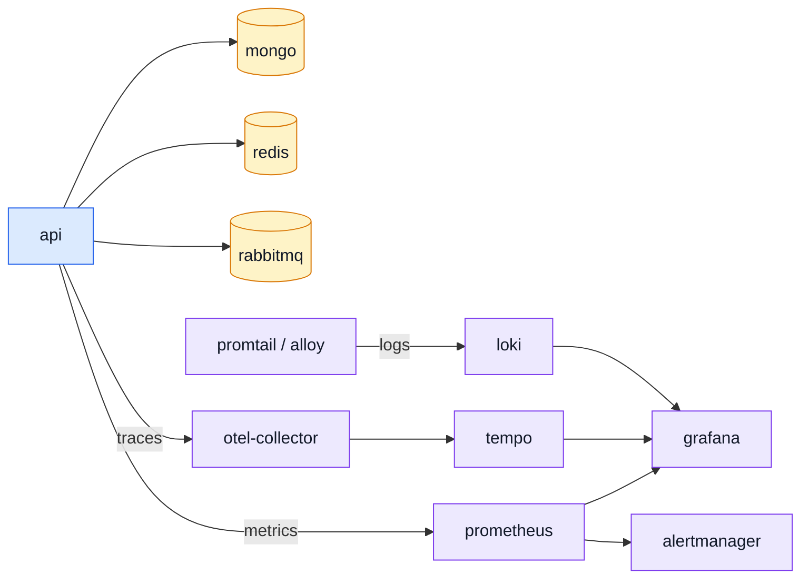

# Ops & Assets

Everything that is not application code: the images the app runs in, the observability stack that
watches it, the CI that gates it, the templates it renders and the files it serves.

---

## The compose stack

| File                                                      | What it is                                                                                                                                                                                                                                                                                                                                                                                                                   | Read next                                                                                                           |
| --------------------------------------------------------- | ---------------------------------------------------------------------------------------------------------------------------------------------------------------------------------------------------------------------------------------------------------------------------------------------------------------------------------------------------------------------------------------------------------------------------- | ------------------------------------------------------------------------------------------------------------------- |
| `docker-compose.yml`                                      | The development stack: the API plus every backing service and the whole observability chain. What `npm run compose -- up -d` starts. Podman by default, Docker by environment override.                                                                                                                                                                                                                                      | [Docker & Podman](../tools/docker-and-podman.md) · [Pairing & Ports](../tools/pairing-and-ports.md)                 |
| `docker-compose.production.yml`                           | The production shape of the same stack — the built image instead of a bind mount, no dev tooling.                                                                                                                                                                                                                                                                                                                            | [Getting Started — Production](../getting-started-production.md) · [Docker & Podman](../tools/docker-and-podman.md) |
| `docker/mongo-init.js`                                    | Runs once, against an empty Mongo volume: creates the app's own `readWrite` user, scoped to its database, so it never authenticates as the container's root account.                                                                                                                                                                                                                                                         | [Getting Started — Production](../getting-started-production.md)                                                    |
| `.dockerignore`                                           | What never enters the build context. The reports directory alone is tens of megabytes of mutation HTML, copied on every build otherwise.                                                                                                                                                                                                                                                                                     | [Docker & Podman](../tools/docker-and-podman.md)                                                                    |
| `docker/Dockerfile.dockerignore`                          | The per-Dockerfile override for `docker/Dockerfile` only (it keeps `.git` in, which the in-container `complete` gate needs). It replaces the root list, so it repeats it in full.                                                                                                                                                                                                                                            | [Docker & Podman](../tools/docker-and-podman.md)                                                                    |
| `docker/mongo-entrypoint.sh` `docker/mongo-rs-init.sh` | Mongo's replica-set bootstrap: the entrypoint wrapper creates the keyFile and wire-TLS certificates with the right ownership before `mongod` reads them, and the one-shot init initiates the single-node replica set and waits for PRIMARY.                                                                                                                                                                                  | [MongoDB & Mongoose](../tools/mongodb-mongoose.md)                                                                  |
| `docker/boot-check.sh`                                    | Boots the production image against a real Mongo and proves it starts fail-closed (`/livez` answers) and the runtime user cannot write under `src/`.                                                                                                                                                                                                                                                                          | [Deployment hardening](../tools/deployment-hardening.md)                                                            |
| `docker/install-supercronic.mjs`                          | Installs supercronic, the scheduler the `cron` service runs, at image build time for both Dockerfiles.                                                                                                                                                                                                                                                                                                                       | [Scheduled jobs](#scheduled-jobs)                                                                                   |
| `docker/webhook-tester-tls.Caddyfile`                     | The TLS door in front of the `webhook-tester` service in `docker-compose.yml`.                                                                                                                                                                                                                                                                                                                                               | [Webhooks](../modules/webhooks.md)                                                                                  |
| `docker/backup/`                                          | The backup container's scripts: `entrypoint.sh` (knobs into a crontab), `backup.sh` (one run), `maintenance.sh` (weekly prune and check), `server-maintenance.sh` (the second machine's), `common.sh` (shared: knobs, heartbeat, counts), `restore-drill.sh` (the restore drill) and `drill.sh` (`npm run backup:drill`: the whole system on a private docker network). Copied into the image by `docker/Dockerfile.backup`. | [Backups](../tools/backups.md)                                                                                      |
| `docker-compose.backup-server.yml`                        | The second machine: an append-only restic server (`rclone serve restic`) and its weekly prune and check. Dormant until started there; run from its own directory with its own `.env`.                                                                                                                                                                                                                                        | [Backup server](../tools/backup-server.md)                                                                          |
| `docker-compose.proxy.yml` `traefik/`                  | The shared Traefik proxy for several client stacks on one host, and the per-client route template (`traefik/client.example.yml`) copied into `traefik/dynamic/`.                                                                                                                                                                                                                                                             | [Hosting](../tools/hosting.md)                                                                                      |
| `docker-compose.test.yml`                                 | The wired half of the container lane: proves `NODE_TEST_MONGO_URI` / `NODE_TEST_REDIS_URL` reach the suites, with a `gate` service that runs `npm run complete` against real services.                                                                                                                                                                                                                                       | [Docker & Podman](../tools/docker-and-podman.md)                                                                    |

## Images

| File                           | What it is                                                                                                            | Read next                                          |
| ------------------------------ | --------------------------------------------------------------------------------------------------------------------- | -------------------------------------------------- |
| `docker/Dockerfile`            | The development image: source bind-mounted, the TypeScript runner watching.                                           | [Docker & Podman](../tools/docker-and-podman.md)   |
| `docker/Dockerfile.production` | The production image — a multi-stage build that installs, compiles and ships without the toolchain.                   | [Docker & Podman](../tools/docker-and-podman.md)   |
| `docker/Dockerfile.backup`     | The backup image: restic, the MongoDB Database Tools and supercronic, each pinned by SHA-256, run as a non-root user. | [Backups](../tools/backups.md)                     |
| `docker/Dockerfile.docs`       | Builds the VitePress site and serves it with nginx, so the docs deploy like any other service.                        | [Testing (overview)](../tools/testing-and-docs.md) |
| `docker/nginx.docs.conf`       | The nginx config behind that image.                                                                                   | —                                                  |

## The observability stack

One config per service in the chain. Each is mounted into its container by the compose file.

| File                                                                                                       | What it is                                                                                                                                                                                   | Read next                                        |
| ---------------------------------------------------------------------------------------------------------- | -------------------------------------------------------------------------------------------------------------------------------------------------------------------------------------------- | ------------------------------------------------ |
| `docker/observability/otel-collector.config.yaml`                                                          | Receivers, processors and exporters for the OpenTelemetry Collector — where the app's spans arrive and where they go next.                                                                   | [OpenTelemetry](../tools/opentelemetry.md)       |
| `docker/observability/tempo.config.yaml`                                                                   | Tempo's storage and retention for the traces the collector forwards.                                                                                                                         | [Tempo](../tools/tempo.md)                       |
| `docker/observability/prometheus.config.yaml`                                                              | The scrape configuration: which targets, how often, with which credentials.                                                                                                                  | [Prometheus](../tools/prometheus.md)             |
| `docker/observability/prometheus.alert-rules.yaml`                                                         | The alerting rules evaluated against those metrics.                                                                                                                                          | [Prometheus](../tools/prometheus.md)             |
| `docker/observability/prometheus.infra-rules.yaml`                                                         | The rules about the alerting pipeline itself (heartbeat, failed sends, broken rules) and the host around the app.                                                                            | [Prometheus](../tools/prometheus.md)             |
| `docker/observability/alertmanager.config.template.yaml`                                                   | What happens to a firing alert — routing, grouping, silencing.                                                                                                                               | [Prometheus](../tools/prometheus.md)             |
| `docker/observability/loki.config.yaml`                                                                    | Loki's storage, schema and retention for logs.                                                                                                                                               | [Loki](../tools/loki.md)                         |
| `docker/observability/promtail.config.yaml`                                                                | The log shipper: which files and container streams reach Loki, and how they are labelled.                                                                                                    | [Loki](../tools/loki.md)                         |
| `docker/observability/promtail.podman.config.yaml`                                                         | The same under Podman, whose container log paths and socket differ from Docker's.                                                                                                            | [Docker & Podman](../tools/docker-and-podman.md) |
| `docker/observability/alloy.config.alloy`                                                                  | The Grafana Alloy alternative to promtail, in Alloy's own configuration language.                                                                                                            | [Loki](../tools/loki.md)                         |
| `docker/observability/alloy.logs.config.alloy` `docker/observability/alloy.audit-forward.example.alloy` | The production stack's container-log pipeline (Alloy replaces the deprecated Promtail there), and an example of forwarding the audit stream to a second system the application cannot reach. | [Loki](../tools/loki.md)                         |
| `docker/observability/prometheus.production.config.yaml`                                                   | Prometheus for the production `monitoring` profile: the API, its alert rules, Alertmanager — without the OTel collector the local file also scrapes.                                         | [Prometheus](../tools/prometheus.md)             |
| `docker/observability/grafana.datasources.yaml`                                                            | Provisions Grafana's data sources — Prometheus, Loki, Tempo — so a fresh stack comes up already wired.                                                                                       | [Grafana](../tools/grafana.md)                   |
| `docker/observability/grafana.dashboard-providers.yaml`                                                    | Tells Grafana where to load dashboards from on startup.                                                                                                                                      | [Grafana](../tools/grafana.md)                   |
| `docker/observability/grafana/dashboards/api-traces.json`                                                  | The provisioned dashboard itself: request rates, latencies and the trace links into Tempo.                                                                                                   | [Grafana](../tools/grafana.md)                   |
| `docker/observability/umami-init.sh`                                                                       | Initialises the Umami analytics database on first start.                                                                                                                                     | [Product Analytics](../tools/analytics.md)       |

## Scheduled jobs

The `cron` service in both compose files — [supercronic](https://github.com/aptible/supercronic) reading `docker/crontab` — is an
external scheduler: the schedule is deployment configuration instead of code, and the shape
survives a move off compose unchanged (a `CronJob` on Kubernetes, a systemd timer on a VM). It runs
the jobs the modules declare — one runner, `scripts/ops/run-job.ts`, via `scripts/run-script.ts`.

**A job is declared once**, as a `JobDeclaration` on the manifest of the module that owns the work
(`AppModule.jobs`), or in `src/app/jobs.ts` when it belongs to none: its name, schedule, one-line
summary, the function that does the work, and what it needs (the event subscriptions, the
translations, a lease). `npm run jobs:generate` (a step of `npm run regenerate`) writes the three
things that used to be kept by hand — `docker/crontab`, the `reap:*`/`sweep:*` scripts in
`package.json`, and the table below — and `npm run check:jobs` fails `complete` when any of them has
drifted. Deleting a module deletes its jobs on the next regeneration.

The backup schedule is **not** in `docker/crontab`: the `backup` service (the `backup` compose profile)
builds its own crontab at start from `BACKUP_SCHEDULE` and `BACKUP_CHECK_SCHEDULE`, and runs it with
its own supercronic, so the backup secrets stay out of the `cron` container. See [Backups](../tools/backups.md).

<!-- jobs:start -->

| Job                              | Schedule (UTC) | Leased | What it does                                                                                                                                                                |
| -------------------------------- | -------------- | ------ | --------------------------------------------------------------------------------------------------------------------------------------------------------------------------- |
| `npm run reap:quarantine`        | 02:00 nightly  | No     | Deletes quarantined upload files past their retention window.                                                                                                               |
| `npm run reap:orphaned-images`   | 02:03 nightly  | No     | Deletes a stored image or thumbnail no document names, once it is over an hour old.                                                                                         |
| `npm run reap:mail-spool`        | 02:30 nightly  | No     | Deletes a spooled email attachment older than its retention window — a mail job died mid-flight.                                                                            |
| `npm run sweep:outbox`           | every minute   | No     | Publishes every due outbox event — the backstop for the writer's own after-commit nudge.                                                                                    |
| `npm run reap:inactive-accounts` | 02:05 nightly  | Yes    | Minimises an account inactive past NODE_INACTIVE_MINIMISE_DAYS; with deletion turned on, warns, then soft-, then hard-deletes one inactive past NODE_INACTIVE_ACCOUNT_DAYS. |
| `npm run reap:previous-emails`   | 02:07 nightly  | Yes    | Forgets the previous email of an account whose undo link has lapsed (sessions and one-time tokens delete themselves at their own expiry date).                              |
| `npm run reap:account-exports`   | 02:09 nightly  | No     | Deletes built data exports (file and row) past NODE_ACCOUNT_EXPORT_TTL_DAYS; the account can ask again.                                                                     |
| `npm run reap:delivery`          | 02:11 nightly  | No     | Unsets a fulfillment order's hold note once it has not changed for its retention window.                                                                                    |
| `npm run sweep:preorders`        | 02:20 nightly  | Yes    | Asks the buyer of a late preorder whether to keep waiting, and announces a wait left unanswered for 30 days, which `returns` cancels and refunds.                           |
| `npm run sweep:reservations`     | every 5 min    | Yes    | Drains every stale checkout hold (batches of 200) and cancels the order behind each.                                                                                        |
| `npm run reap:invoice-pdfs`      | 02:08 nightly  | No     | Deletes stored invoice and credit-note PDFs past their retention window; the next download renders again.                                                                   |
| `npm run reap:orders`            | 02:10 nightly  | No     | Anonymizes an order's remaining PII once its retention window has passed, and unsets a timeline row's staff text once its own window has.                                   |
| `npm run reap:payments`          | 02:15 nightly  | No     | Deletes abandoned (never-settled) payment attempts past their retention window.                                                                                             |
| `npm run sweep:payment-effects`  | every 5 min    | No     | Retries refunds the provider has not answered, and settles unsettled payments whose webhook never arrived.                                                                  |
| `npm run reap:returns`           | 02:12 nightly  | No     | Unsets a return's free text (`note`, `declineReason`) once the return has not changed for its retention window.                                                             |
| `npm run sweep:stock-alerts`     | `35 * * * *`   | Yes    | Answers waiting back-in-stock requests for a product that can be ordered again without any write announcing it, such as a preorder whose release date passed.               |
| `npm run sweep:webhook-retries`  | every minute   | No     | Re-enqueues a webhook delivery whose `nextAttemptAt` has come — the delayed-retry story's other half.                                                                       |

<!-- jobs:end -->

The nightly jobs are staggered a few minutes apart so they do not all land on the connection pool at
once. `sweep:webhook-retries`, `sweep:outbox`, `sweep:payment-effects` and `sweep:reservations`
run on a different schedule entirely, every 5 minutes or faster, because the
sweep interval IS the retry/expiry granularity for what each covers — see
[webhooks](../modules/webhooks.md#the-delivery-path),
[payments](../modules/payments.md#one-settlement-transaction),
[inventory](../modules/inventory-reservations.md) and [orders](../modules/orders.md).
`tests/cross-cutting/scheduled-jobs.test.ts` holds the declarations to their rules (a unique name, a
five-field schedule, a `reap:`/`sweep:` prefix) and `npm run check:jobs` holds the generated files
to the declarations, so a job that exists in one place and not the other cannot reach `main`.

**Mutual exclusion.** `deploy: replicas: 1` on the `cron` service is what actually stops two passes
racing over the same collection — nothing here is meant to scale. `withLease`
(`src/infrastructure/persistence/lease.ts`) is the backstop if it ever is: an atomic Mongo upsert
that only one caller can hold at a time, TTL-bounded so a crashed holder's lease still expires.
The `leases` row itself never expires: **retire a job by deleting its `leases` row** (by hand, once the job is
out of `docker/crontab`).
`reap:inactive-accounts` wraps its work in it, as the reference implementation — it hard-deletes
accounts, so it is where "exactly one runner" earns its keep. Every other job is correct today
under `replicas: 1` alone and is not wrapped — the frequent sweeps included, each with its
own independent reason a concurrent pass costs nothing (`webhookDeliveryRepository.claimPending`'s
atomic claim, `commitForOrder`'s exactly-once hold claim, `reservationRepository.claimStatus`'s
own). Any future scheduled job that would NOT be safe to run twice concurrently should wrap its
work in `withLease` too.

**Observability.** `scripts/run-script.ts` records every crontab job's outcome — `lastSuccessAt` on
success, `lastError` on a throw — onto the same `leases` document `withLease` itself writes when a
job also takes one; `GET /observability/health`'s `jobs` array reports the whole set, so any
crontab job silently failing or silently not running at all is visible on the probe an operator
already looks at. `job_last_success_timestamp_seconds{task="…"}` (`infrastructure/observability/metrics-registry.ts`)
exposes the same value to Prometheus, next to `job_last_run_timestamp_seconds{task="…"}` (when the row was last touched,
success or not); `ScheduledJobStale` (`docker/observability/prometheus.alert-rules.yaml`)
fires when a nightly job's last success is more than 48 hours old, and keeps firing until the job runs again or its row is deleted. The 5-minute-or-faster
jobs are excluded from that alert, each covered by its own faster-firing one instead:
`sweep:webhook-retries` by `WebhookRetriesStalled` (15 min), and `sweep:outbox` /
`sweep:payment-effects` / `sweep:reservations` by `FrequentSweepStale`
(30 min) — 48 hours at that cadence would page two days after a stuck payment, a reservation
nobody is expiring or a refund nobody is retrying. `ScheduledJobNeverSucceeded` covers every job that
has a run series but no success series: one that has only ever failed. No Pushgateway needed: the value
lives in Mongo, and the long-running app exports it at scrape time.
See `docs/tools/observability-layer.md`.

## Data retention

Several collections delete their own rows on a timer, via a Mongo TTL index rather than a scheduled
job — that is cleanup with no scheduler involved at all, the cheapest form there is, and it stays
right for state with no retry story (a cart, an audit entry, or a feedback ticket never needs a second attempt at expiring). The jobs above are the other half: retention and
periodic work that DOES need to run as a step, with a real success/failure outcome — see Scheduled
jobs above.

Every TTL index, reaper and cap, with its variable, default and lawful basis, is in the single
[retention table](../theory/data-protection.md#processing-register-art-30). It is not repeated here.

Every TTL index shares one caveat, worth stating once: **Mongo will not modify an
existing TTL index's `expireAfterSeconds` in place.** In development and test, where `autoIndex` is
on, raising or lowering any of these variables and RESTARTING fails the boot outright — Mongo
refuses the conflicting options. `npm run db:sync` is what applies it: it drops the index and
rebuilds it, which is why `db:bootstrap` syncs before the server starts there. Production runs with
`autoIndex` off for exactly this reason — a restart never asks Mongo to rebuild anything — and
`docker-compose.production.yml`'s one-shot `setup` service is what runs `db:sync` on deploy instead,
see [Data — TTL windows](./data.md#ttl-windows). `feedback`'s window
is the longest on purpose: a contact request can be evidence in a commercial dispute, and 24 months
sits inside the common limitation periods. `carts` ties to `updatedAt`, so any edit (a cart line changed) restarts the clock; only a genuinely
abandoned row is ever removed. `leases` has no TTL on purpose: a job that stopped running entirely must
keep alerting (`ScheduledJobStale`), and an expired row would make that alert resolve on its own. Pushgateway
and Healthchecks.io behave the same way: a silent job stays down until someone deletes it.

`orders` and a SETTLED `payments` row must NOT be removed on a timer — both are invoices, kept for
tax and commercial-law reasons. `orders` carries PII (both addresses, notes, email) that survives
an account's erasure, so `npm run reap:orders` past `NODE_ORDER_PII_RETENTION_DAYS` (default 3653
days) replaces the email and unsets both addresses and the notes — see the script's own header.
The invoices keep their own encrypted copy of the buyer address: they are the legal record. `payments`
carries none: `cardLast4` is not a PAN, and `amount`/`currency`/`provider` were never personal
data, so a settled payment is never touched by any timer.

A payment that never settled is a different case, not a PII one: `npm run reap:payments` DELETES
an attempt (never `succeeded`) once it has sat untouched for
`NODE_PAYMENT_ABANDONED_RETENTION_DAYS` (default 30 days) — an abandoned checkout is not an
invoice, so there is nothing there worth keeping. See the script's own header, and
[payments](../modules/payments.md)'s retention section for the full reasoning.

`users` has no TTL either. `npm run reap:inactive-accounts` measures activity as the latest login
(refresh-token use) or API-key use, and runs two independent dials:

| Dial                          | Default           | What happens past it                                                                                                   |
| ----------------------------- | ----------------- | ---------------------------------------------------------------------------------------------------------------------- |
| `NODE_INACTIVE_MINIMISE_DAYS` | `1095`, on        | every module's `personalData.minimise` hook runs: the address book goes, the orders' PII clock starts; the login stays |
| `NODE_INACTIVE_ACCOUNT_DAYS`  | `0`, **disabled** | warn, then soft-delete, then hard-delete — the controller's call, never a default                                      |

Why minimise rather than delete: [Data Retention](../theory/data-retention.md#inactive-accounts-minimise-don-t-delete).
See the script's own header for the stages.

`returns` has no TTL: the row is a legal record. `npm run reap:returns` unsets only its free text
(`note`, `declineReason`) once the return's `updatedAt` is older than `NODE_RETURN_TEXT_RETENTION_DAYS`
(default 1095). `updatedAt`, not the closing date, because an approved return whose goods never
arrive never closes. Safe to repeat: the filter only matches returns still holding text, and the
wipe does not move `updatedAt`. Why three years: [Data Retention](../theory/data-retention.md#free-text-on-returns).

`delivery` has no TTL either: a fulfillment order is the record of what was promised and what left.
`npm run reap:delivery` unsets only staff's hold note (`holdNote`) once the fulfillment order's `updatedAt`
is older than `NODE_HOLD_NOTE_RETENTION_DAYS` (default 365), on the same terms as `reap:returns`: the filter
only matches one still holding a note, and the wipe does not move `updatedAt`. Why a year:
[Data Retention](../theory/data-retention.md#free-text-on-holds).

A cancel's refund has no sweep of its own. The `order.cancelled` row the cancel writes carries the
`refund` it owes, the outbox relay (`sweep:outbox`) delivers it until `payments` has opened the
refund record, and from then on `sweep:payment-effects` finishes the record. See
[the outbox](../tools/outbox.md#limits-on-purpose).

The stock half of a cancel is not covered here, because it cannot half-happen: the status move,
the hold's release (a paid, unshipped order's claim included) is one `withTransaction`. A release that throws
rolls the status back with it — the order stays `paid`, the counters stay put, and the cancel can
simply be retried. Only the catalogue's stock cache is refreshed after the commit, and the next
stock transition on a product corrects it if that one write is lost.

`npm run sweep:reservations` is what heals a `held` hold's own expiry: it expires every hold
past its `expiresAt` and, through `orders`' own `RESERVATION_EXPIRED` listener, cancels the order
behind it — the same work `POST /inventory/reservations/sweep` does on demand, on a schedule
instead. Without it, an abandoned checkout would hold its units forever and a bank-transfer hold
would never end. A card payment gone `processing` (a SEPA debit, some bank redirects, which can
settle over days) gets its hold extended to the bank-transfer window, `NODE_BANK_TRANSFER_HOLD_HOURS`
(168 h by default — no setting of its own), the moment `settlePayment` sees that state; a payment
still `requires_action` gets no such grace, since that means the BROWSER has work to do and the
ordinary window already fits it. Money that lands after the hold has expired anyway is refunded
automatically regardless. Runs every 5 minutes, well inside both windows. See
[Reservations](../modules/inventory-reservations.md).

`npm run sweep:payment-effects` is the provider-facing counterpart. A settlement is one database
transaction (payment, order, hold, outbox rows), so a crash leaves nothing half-done; what can still
be owed is the provider's side. The sweep retries every refund still open, with the same idempotency
key, once it is past `NODE_PAYMENT_REFUND_RETRY_MINUTES` (default 1: longer than a refund request in
flight). Runs every 5 minutes. See [payments](../modules/payments.md#one-settlement-transaction).

The same job reconciles lost webhooks: an unsettled payment untouched for
`NODE_PAYMENT_RECONCILE_MINUTES` (default 15) is asked about at the provider and settled through the
same function the webhook uses, so a payment the webhook did deliver is left alone. See
[payments](../modules/payments.md#lost-webhooks).

Log lines are Loki's retention, not Mongo's: `docker/observability/loki.config.yaml` sets
`retention_period: 168h` (7 days) for the local stack. A production deployment tunes this
independently — it is the one retention window this repo does not read from `.env`.

The lawful basis behind each of these windows, and the subject-request and breach runbooks that
sit on top of them, are in [Data Protection](../theory/data-protection.md).

## CI

| File                                                                      | What it is                                                                                                                                                                                                                                                                          | Read next                                                                               |
| ------------------------------------------------------------------------- | ----------------------------------------------------------------------------------------------------------------------------------------------------------------------------------------------------------------------------------------------------------------------------------- | --------------------------------------------------------------------------------------- |
| `.github/workflows/ci.yml`                                                | The gate on every push and pull request: build, lint, the contract checks and the test suites, and the `backup-drill` job (backup a real Mongo, restore it, prove the append-only server refuses a delete). Checks out the paired frontend first, so the cross-repo checks can run. | [Package Scripts](../tools/package-scripts.md)                                          |
| `.github/workflows/pr-title.yml`                                          | Lints the pull request title against `commitlint.config.cjs`. PRs merge by squash only, so the title becomes the commit subject on `main`.                                                                                                                                          | [Scripts & Hooks](./scripts.md)                                                         |
| `.github/workflows/mutation.yml` `.github/workflows/mutation-wave.yml` | The monthly mutation sweep (run in waves of at most 256 shards) and the diff job that gates a branch on the files it touched — too slow for every push, too valuable to skip.                                                                                                       | [Mutation Testing](../tools/mutation-testing.md)                                        |
| `.github/workflows/fuzz.yml`                                              | The scheduled fuzz run, which walks the whole contract with generated hostile input.                                                                                                                                                                                                | [Fuzz Testing](../tools/fuzz-testing.md)                                                |
| `.github/workflows/schemathesis.yml`                                      | Nightly stateful fuzzing: request sequences through the contract's declared `links`.                                                                                                                                                                                                | [Fuzz Testing](../tools/fuzz-testing.md#stateful-fuzzing-sequences-not-single-requests) |
| `.github/workflows/order-random.yml`                                      | Nightly run of the integration, contract and fuzz suites with jest's `--randomize`, to catch a test that only passes in file order.                                                                                                                                                 | [Integration Testing](../tools/integration-testing.md)                                  |
| `.github/workflows/image-scan.yml`                                        | Builds the production image and reports what is inside it (Syft SBOM into Grype, SARIF to the Security tab as `grype-image`). The Monday run fails on a fixable `high` finding and opens a tracking issue.                                                                          | [Deployment hardening](../tools/deployment-hardening.md)                                |
| `.github/workflows/codeql.yml`                                            | GitHub's static security analysis.                                                                                                                                                                                                                                                  | [Security](../tools/security.md)                                                        |
| `.github/workflows/audit.yml`                                             | The weekly `npm audit` and `npm audit signatures` run, with a tracking issue when it fails.                                                                                                                                                                                         | [Supply chain](../theory/defences/supply-chain.md)                                      |
| `.github/dependabot.yml`                                                  | The dependency update schedule.                                                                                                                                                                                                                                                     | [Package Dependencies](../tools/package-dependencies.md)                                |
| `.github/CODEOWNERS` `.github/actions/`                                | Who reviews every pull request, and the composite actions the workflows share (`setup`, `mutation-runner`, `notify-failure`).                                                                                                                                                       | —                                                                                       |
| `.github/copilot-instructions.md`                                         | The house rules, written for an assistant and equally readable by a person: the code brain, the docs brain and the change brain in three short lists.                                                                                                                               | [Reading Path](../theory/reading-path.md)                                               |

## Rendered templates

| Pattern                          | What it is                                                                                                                                                                                                                      | Read next                                                                              |
| -------------------------------- | ------------------------------------------------------------------------------------------------------------------------------------------------------------------------------------------------------------------------------- | -------------------------------------------------------------------------------------- |
| `src/modules/*/templates/*.ejs`  | One template per email a module sends, or the PDF a module renders (today, `invoicing`'s), named for the module and the event that sends it — collected via `AppModule.templates`, so deleting the module deletes them with it. | [Email & PDF Rendering](../tools/email-and-rendering.md) · [Modules](./src-modules.md) |
| `shared/templates/layouts/*.ejs` | The shared wrappers those templates include: the email head, the PDF head, and the common footer — owned by no module, the same reasoning `shared/contracts` is. Styling lives here so a template holds only its own content.   | [Email & PDF Rendering](../tools/email-and-rendering.md)                               |

## Served assets

`public/` is served by the static handler, which is also why `.gitignore` excludes uploads from it
— anything a user uploads lands in a tracked directory.

| Pattern                        | What it is                                                                                                                                                                                                             | Read next         |
| ------------------------------ | ---------------------------------------------------------------------------------------------------------------------------------------------------------------------------------------------------------------------- | ----------------- |
| `public/favicon/*`             | The favicon set and its manifests — every size and format a browser or mobile launcher asks for.                                                                                                                       | —                 |
| `public/images/seed/*.jpg`     | The demo product images, named by content hash and referenced from the seed fixtures. Committed on purpose, unlike the rest of the images directory, because they are repository content rather than someone's upload. | [Data](./data.md) |
| `public/images/seed/README.md` | What those hashed filenames are and where they came from.                                                                                                                                                              | [Data](./data.md) |

## The docs site itself

The site you are reading. Its pages are not listed here one by one — the sidebar already is that
list, and a row per page would be a second copy of it to keep in sync.

| Pattern              | What it is                                                                                                                                                                                                              | Read next                                                  |
| -------------------- | ----------------------------------------------------------------------------------------------------------------------------------------------------------------------------------------------------------------------- | ---------------------------------------------------------- |
| `docs/*.md`          | The two pages outside a section: the home page and [Getting Started](../getting-started.md).                                                                                                                            | —                                                          |
| `docs/*/*.md`        | Every section page — Theory, Tools, API and this Reference section. Use the sidebar.                                                                                                                                    | [Theory](../theory/) · [Tools](../tools/) · [API](../api/) |
| `docs/.vitepress/**` | The site's own configuration and theme: the config holds the nav and every sidebar group, and the theme directory holds the custom CSS. Adding a page means adding it here too, or it exists without a way to reach it. | —                                                          |
