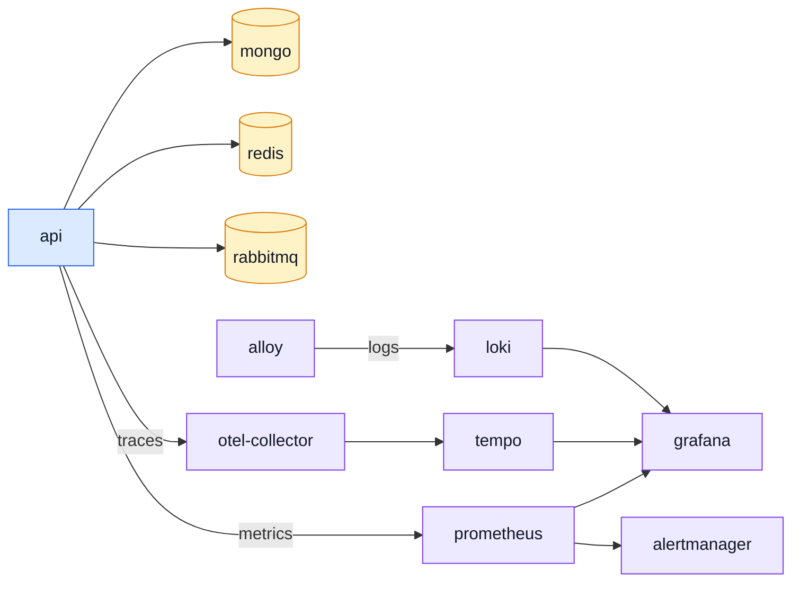

# Ops & Assets

Everything that is not application code: the images the app runs in, the observability stack that
watches it, the CI that gates it, the templates it renders and the files it serves.

---

## The compose stack

| Folder / file               | What lives here                                                                                                                                                                                          | Read next                                                                                     |
| --------------------------- | -------------------------------------------------------------------------------------------------------------------------------------------------------------------------------------------------------- | --------------------------------------------------------------------------------------------- |
| `compose*.yaml` (repo root) | The shared base, the development stack (auto-loaded beside it), its production shape (built image, no dev tooling), the backup server's second machine, and the shared proxy for several client stacks   | [Docker & Podman](../build/docker-and-podman.md) · [First deploy](../operate/first-deploy.md) |
| `docker/`                   | The Dockerfiles, the container scripts (Mongo init and replica-set bootstrap, `deploy.sh`, `boot-check.sh`, `ensure-deps.sh`, supercronic install), the generated `crontab`, the nginx and Caddy configs | [Deploy and rollback](../operate/deploy-and-rollback.md)                                      |
| `docker/backup/`            | The backup container's scripts: entrypoint, one backup run, weekly maintenance                                                                                                                           | [Backups](../operate/backups.md)                                                              |
| `docker/observability/`     | The Prometheus, Alertmanager, Loki, Tempo, Alloy and Grafana configs the stack mounts                                                                                                                    | [Observability](../operate/grafana.md)                                                        |
| `.dockerignore`             | What never enters the build context, `.git` included (the in-container `complete` gate mounts it read-only instead)                                                                                      | [Docker & Podman](../build/docker-and-podman.md)                                              |

## Images

| Folder                  | What lives here                                                                                                                                                                                                                                            | Read next                                                                           |
| ----------------------- | ---------------------------------------------------------------------------------------------------------------------------------------------------------------------------------------------------------------------------------------------------------- | ----------------------------------------------------------------------------------- |
| `docker/` (Dockerfiles) | `Dockerfile` holds the development image (`dev`), the production image (`runtime`, no toolchain) and the docs image (`docs`, VitePress served by nginx) as stages; `Dockerfile.backup` is the backup image (restic and the Mongo tools, pinned by SHA-256) | [Docker & Podman](../build/docker-and-podman.md) · [Backups](../operate/backups.md) |

## The observability stack

One config per service in the chain. Each is mounted into its container by the compose file.

| Service in the chain    | Its config under `docker/observability/`                                                                     | Read next                                       |
| ----------------------- | ------------------------------------------------------------------------------------------------------------ | ----------------------------------------------- |
| OpenTelemetry collector | Receivers, processors and exporters for traces                                                               | [OpenTelemetry](../operate/opentelemetry.md)    |
| Tempo                   | Storage and retention for traces                                                                             | [Tempo](../operate/tempo.md)                    |
| Prometheus              | The scrape configuration (dev and production), the alert rules, and the rules about the alerting path itself | [Prometheus](../operate/prometheus.md)          |
| Alertmanager            | Where a firing alert goes: the config template and its render and route-test scripts                         | [Alerting](../operate/prometheus.md)            |
| Loki and Alloy          | Loki's storage and schema; Alloy's browser-facing intake and container-log pipeline                          | [Loki](../operate/loki.md)                      |
| Grafana                 | Provisioned data sources, the dashboard providers and the dashboards themselves                              | [Grafana](../operate/grafana.md)                |
| Gatus                   | The development status page's checks                                                                         | [Gatus](../operate/gatus.md)                    |
| Umami                   | The analytics database initialisation                                                                        | [Product Analytics](../understand/analytics.md) |

`ls docker/observability` is the file list; the compose file mounts each into its container.

## Scheduled jobs

The `cron` service in both compose files — [supercronic](https://github.com/aptible/supercronic) reading `docker/crontab` — is an
external scheduler: the schedule is deployment configuration instead of code, and the shape
survives a move off compose unchanged (a `CronJob` on Kubernetes, a systemd timer on a VM). It runs
the jobs the modules declare — one runner, `scripts/ops/run-job.ts`, via `scripts/run-script.ts`.

**A job is declared once**, as a `JobDeclaration` on the manifest of the module that owns the work
(`AppModule.jobs`), or in `src/app/jobs.ts` when it belongs to none: its name, schedule, one-line
summary, the function that does the work, and an optional lease. Every job boots like the app
(event subscriptions, translations, mail templates, the admin's copy overlay) and settles the
outbox nudges it caused before it returns, inside its lease; only a `connectFirst: false` job
(a filesystem reaper with no Mongo, so no mail) skips the boot. The name, schedule and summary are data, in the owner's `module.yaml`
`jobs:` block (`shared/rules/jobs.yaml` for the kernel's), generated into `jobs.generated.ts`
beside `jobs.ts`, which adds the rest. `npm run regenerate` writes the two things derived from it —
`docker/crontab`, its copy `k8s/base/crontab` (the Kubernetes `cron` Deployment's ConfigMap) and the table below — and `npm run check` fails `complete` when either has
drifted. `npm run job <name>` runs one by hand (inside a running container: `cd /app && node --import tsx scripts/ops/run-job.ts <name>`); with no name it lists them. Deleting a module deletes its jobs on the next regeneration.

The backup schedule is **not** in `docker/crontab`: the `backup` service (the `backup` compose profile)
builds its own crontab at start from `BACKUP_SCHEDULE` and `BACKUP_CHECK_SCHEDULE`, and runs it with
its own supercronic, so the backup secrets stay out of the `cron` container. See [Backups](../operate/backups.md).

<!-- jobs:start -->

| Job                                    | Schedule (UTC) | Leased | What it does                                                                                                                                                                                                                   |
| -------------------------------------- | -------------- | ------ | ------------------------------------------------------------------------------------------------------------------------------------------------------------------------------------------------------------------------------ |
| `npm run job reap:quarantine`          | 02:00 nightly  | No     | Deletes quarantined upload files past their retention window.                                                                                                                                                                  |
| `npm run job reap:orphaned-images`     | 02:03 nightly  | No     | Deletes a stored image or thumbnail no document names, once it is over an hour old.                                                                                                                                            |
| `npm run job reap:mail-spool`          | 02:30 nightly  | No     | Deletes a spooled email attachment older than its retention window — a mail job died mid-flight.                                                                                                                               |
| `npm run job sweep:outbox`             | every minute   | No     | Publishes every due outbox event — the backstop for the writer's own after-commit nudge.                                                                                                                                       |
| `npm run job reap:inactive-accounts`   | 02:05 nightly  | Yes    | Minimises an account inactive past NODE_INACTIVE_MINIMISE_DAYS; with deletion turned on, warns, then soft-, then hard-deletes one inactive past NODE_INACTIVE_ACCOUNT_DAYS.                                                    |
| `npm run job reap:previous-emails`     | 02:07 nightly  | Yes    | Forgets the previous email of an account whose undo link has lapsed (sessions and one-time tokens delete themselves at their own expiry date).                                                                                 |
| `npm run job reap:account-exports`     | 02:09 nightly  | No     | Deletes built data exports (file and row) past NODE_ACCOUNT_EXPORT_TTL_DAYS; the account can ask again.                                                                                                                        |
| `npm run job reap:scheduled-deletions` | `13 * * * *`   | Yes    | Erases, cascade included, every account whose owner asked to delete it and whose grace (NODE_ACCOUNT_DELETION_GRACE_DAYS) has run out, then mails the goodbye.                                                                 |
| `npm run job reap:delivery`            | 02:11 nightly  | No     | Unsets a fulfillment order's hold note and a shipment's loss note once they have not changed for their retention window.                                                                                                       |
| `npm run job sweep:preorders`          | 02:20 nightly  | Yes    | Tells the buyer of a preorder whose expected date is a day away or gone, with the goods still not here, that it will miss the date, once. It asks nothing and cancels nothing.                                                 |
| `npm run job sweep:reservations`       | every 5 min    | Yes    | Drains every stale checkout hold (batches of 200) and cancels the order behind each.                                                                                                                                           |
| `npm run job reap:invoice-pdfs`        | 02:08 nightly  | No     | Deletes stored invoice and credit-note PDFs past their retention window; the next download renders again.                                                                                                                      |
| `npm run job reap:invoices`            | 02:14 nightly  | No     | Blanks an invoice's or credit note's buyer block once its tax retention has ended; the numbered document stays and its cached PDF is deleted.                                                                                  |
| `npm run job reap:orders`              | 02:10 nightly  | No     | Anonymizes an order's remaining PII once its retention window has passed, and unsets a timeline row's staff text once its own window has.                                                                                      |
| `npm run job reap:payments`            | 02:15 nightly  | No     | Deletes abandoned (never-settled) payment attempts past their retention window.                                                                                                                                                |
| `npm run job sweep:payment-effects`    | every 5 min    | Yes    | Retries refunds the provider has not answered, and settles unsettled payments whose webhook never arrived.                                                                                                                     |
| `npm run job reap:returns`             | 02:12 nightly  | No     | Unsets a return's free text (`note`, `declineMessage`) once the return has not changed for its retention window.                                                                                                               |
| `npm run job sweep:staff-digest`       | 06:30 nightly  | Yes    | Rewrites the staff summary rows (transfers due, unshipped, undecided returns, open holds, missing tracking codes, undelivered parcels, stale refunds, low stock) and mails each person the overdue ones that appeared or grew. |
| `npm run job sweep:staff-weekly`       | `30 6 * * 1`   | Yes    | Rewrites the late-preorder summary row for the staff who edit orders, and mails it when it appeared or grew.                                                                                                                   |
| `npm run job sweep:stock-alerts`       | every 5 min    | Yes    | Answers waiting back-in-stock requests for a product that is no longer out of stock, asking inventory's availability read 100 products at a time.                                                                              |
| `npm run job sweep:tasks-overdue`      | 06:40 nightly  | Yes    | Tells the staff who work a task's kind, once, that an open task is three days from its due date and once more that it passed it; a task closed before the sweep is skipped, and one already told is never told again.          |
| `npm run job reap:purchase-holds`      | 02:12 nightly  | Yes    | Reduces every expired purchase hold to the date that restarts the count of cancellations, dropping its note and who set it.                                                                                                    |
| `npm run job sweep:webhook-retries`    | every minute   | No     | Re-enqueues a webhook delivery whose `nextAttemptAt` has come — the delayed-retry story's other half.                                                                                                                          |

<!-- jobs:end -->

The nightly jobs are staggered a few minutes apart so they do not all land on the connection pool at
once. `sweep:webhook-retries`, `sweep:outbox`, `sweep:payment-effects` and `sweep:reservations`
run on a different schedule entirely, every 5 minutes or faster, because the
sweep interval IS the retry/expiry granularity for what each covers — see
[webhooks](../modules/webhooks.md#the-delivery-path),
[payments](../modules/payments.md#one-settlement-transaction),
[inventory](../modules/inventory-reservations.md) and [orders](../modules/orders.md).
`tests/cross-cutting/scheduled-jobs.test.ts` holds the declarations to their rules (a unique name, a
five-field schedule, a `reap:`/`sweep:` prefix) and `npm run check` holds the generated files
to the declarations, so a job that exists in one place and not the other cannot reach `main`.

**Mutual exclusion.** `deploy: replicas: 1` on the `cron` service is what actually stops two passes
racing over the same collection — nothing here is meant to scale. `withLease`
(`src/infrastructure/persistence/lease.ts`) is the backstop if it ever is: an atomic Mongo upsert
that only one caller can hold at a time, TTL-bounded so a crashed holder's lease still expires.
The `leases` row itself never expires: **retire a job by deleting its `leases` row** (by hand, once the job is
out of `docker/crontab`).
`reap:inactive-accounts` wraps its work in it, as the reference implementation — it hard-deletes
accounts, so it is where "exactly one runner" earns its keep. Every other job is correct today
under `replicas: 1` alone and is not wrapped — the frequent sweeps included, each with its
own independent reason a concurrent pass costs nothing (`webhookDeliveryRepository.claimPending`'s
atomic claim, `commitForOrder`'s exactly-once hold claim, `reservationRepository.claimStatus`'s
own). Any future scheduled job that would NOT be safe to run twice concurrently should wrap its
work in `withLease` too.

**Observability.** `scripts/run-script.ts` records every crontab job's outcome — `lastSuccessAt` on
success, `lastError` on a throw — onto the same `leases` document `withLease` itself writes when a
job also takes one; `GET /observability/health`'s `jobs` array reports the whole set, so any
crontab job silently failing or silently not running at all is visible on the probe an operator
already looks at. `job_last_success_timestamp_seconds{task="…"}` (`infrastructure/observability/metrics-registry.ts`)
exposes the same value to Prometheus, next to `job_last_run_timestamp_seconds{task="…"}` (when the row was last touched,
success or not); `ScheduledJobStale` (`docker/observability/prometheus.alert-rules.yaml`)
fires when a nightly job's last success is more than 48 hours old, and keeps firing until the job runs again or its row is deleted. The 5-minute-or-faster
jobs are excluded from that alert, each covered by its own faster-firing one instead:
`sweep:webhook-retries` by `WebhookRetriesStalled` (15 min), and `sweep:outbox` /
`sweep:payment-effects` / `sweep:reservations` by `FrequentSweepStale`
(30 min) — 48 hours at that cadence would page two days after a stuck payment, a reservation
nobody is expiring or a refund nobody is retrying. `ScheduledJobNeverSucceeded` covers every job that
has a run series but no success series: one that has only ever failed. No Pushgateway needed: the value
lives in Mongo, and the long-running app exports it at scrape time.
See `docs/understand/observability-layer.md`.

## Data retention

Several collections delete their own rows on a timer, via a Mongo TTL index rather than a scheduled
job — that is cleanup with no scheduler involved at all, the cheapest form there is, and it stays
right for state with no retry story (a cart, an audit entry, or a task never needs a second attempt at expiring). The jobs above are the other half: retention and
periodic work that DOES need to run as a step, with a real success/failure outcome — see Scheduled
jobs above.

Every TTL index, reaper and cap, with its variable, default and lawful basis, is in the single
[retention table](../understand/data-protection.md#processing-register-art-30). It is not repeated here.

Every TTL index shares one caveat, worth stating once: **Mongo will not modify an
existing TTL index's `expireAfterSeconds` in place.** In development and test, where `autoIndex` is
on, raising or lowering any of these variables and RESTARTING fails the boot outright — Mongo
refuses the conflicting options. `npm run db:sync` is what applies it: it replaces the index (drops it and
rebuilds it), which is why `db:bootstrap` syncs before the server starts there. Production runs with
`autoIndex` off for exactly this reason — a restart never asks Mongo to rebuild anything — and
`compose.production.yaml`'s one-shot `setup` service is what runs `db:sync` on deploy instead,
see [Data — TTL windows](./data.md#ttl-windows). `tasks`'s window
is the longest on purpose: a contact request can be evidence in a commercial dispute, and 24 months
sits inside the common limitation periods. It runs on `closedAt`, so an open task never expires and a
reopen stops the clock; changing it needs `npm run db:sync`. `carts` ties to `updatedAt`, so any edit (a cart line changed) restarts the clock; only a genuinely
abandoned row is ever removed. `leases` has no TTL on purpose: a job that stopped running entirely must
keep alerting (`ScheduledJobStale`), and an expired row would make that alert resolve on its own. Pushgateway
and Healthchecks.io behave the same way: a silent job stays down until someone deletes it.

Past the TTL indexes, retention is a job, not a timer on a row: the reapers and sweeps are in the
table above, and each script's header says what it matches and why it is safe to repeat. What each
one removes or unsets, and why (`orders` and a settled `payments` row are invoices and are never
reaped; the inactive-account step and its two dials; the free text on returns and holds), is
[Data Retention](../understand/data-retention.md). The sweeps that heal other state belong to their
module: reservations in [Reservations](../modules/inventory-reservations.md), the provider-facing
refund retry and the lost-webhook reconcile in [payments](../modules/payments.md#one-settlement-transaction),
a cancel's refund in [the outbox](../understand/outbox.md#limits-on-purpose).

Log lines are Loki's retention, not Mongo's: `docker/observability/loki.config.yaml` sets
`retention_period: 168h` (7 days) for the local stack. A production deployment tunes this
independently — it is the one retention window this repo does not read from `.env`.

The lawful basis behind each of these windows, and the subject-request and breach runbooks that
sit on top of them, are in [Data Protection](../understand/data-protection.md).

## CI

| Folder / file        | What lives here                                                                                                                                                                                              | Read next                                                                                           |
| -------------------- | ------------------------------------------------------------------------------------------------------------------------------------------------------------------------------------------------------------ | --------------------------------------------------------------------------------------------------- |
| `.github/workflows/` | One workflow per concern: the gate on every push (`ci`), the PR-title lint, the mutation sweep and its diff job, the scheduled fuzz and random-order runs, the image scan, CodeQL and the weekly `npm audit` | [Testing and docs](../build/testing-and-docs.md) · [Mutation testing](../build/mutation-testing.md) |
| `.github/actions/`   | The composite actions the workflows share: `setup`, `mutation-runner`, `notify-failure`                                                                                                                      | —                                                                                                   |
| `.github/`           | `dependabot.yml` (update schedule), `CODEOWNERS` (who reviews) and `copilot-instructions.md` (a pointer to `CLAUDE.md`)                                                                                      | —                                                                                                   |

## Rendered templates

| Pattern                          | What it is                                                                                                                                                                                                                      | Read next                                                                                   |
| -------------------------------- | ------------------------------------------------------------------------------------------------------------------------------------------------------------------------------------------------------------------------------- | ------------------------------------------------------------------------------------------- |
| `src/modules/*/templates/*.ejs`  | One template per email a module sends, or the PDF a module renders (today, `invoicing`'s), named for the module and the event that sends it — collected via `AppModule.templates`, so deleting the module deletes them with it. | [Email & PDF Rendering](../understand/email-and-rendering.md) · [Modules](./src-modules.md) |
| `shared/templates/layouts/*.ejs` | The shared wrappers those templates include: the email head and the common footer — owned by no module, the same reasoning `shared/contracts` is. Styling lives here so a template holds only its own content.                  | [Email & PDF Rendering](../understand/email-and-rendering.md)                               |

## Served assets

`public/` is served by the static handler, which is also why `.gitignore` excludes uploads from it
— anything a user uploads lands in a tracked directory.

| Pattern                        | What it is                                                                                                                                                                                                             | Read next         |
| ------------------------------ | ---------------------------------------------------------------------------------------------------------------------------------------------------------------------------------------------------------------------- | ----------------- |
| `public/favicon/*`             | The favicon set and its manifests — every size and format a browser or mobile launcher asks for.                                                                                                                       | —                 |
| `public/images/seed/*.jpg`     | The demo product images, named by content hash and referenced from the seed fixtures. Committed on purpose, unlike the rest of the images directory, because they are repository content rather than someone's upload. | [Data](./data.md) |
| `public/images/seed/README.md` | What those hashed filenames are and where they came from.                                                                                                                                                              | [Data](./data.md) |

## The docs site itself

The site you are reading. Its pages are not listed here one by one — the sidebar already is that
list, and a row per page would be a second copy of it to keep in sync.

| Folder             | What lives here                                                                                                                                             | Read next                                             |
| ------------------ | ----------------------------------------------------------------------------------------------------------------------------------------------------------- | ----------------------------------------------------- |
| `docs/`            | The home page (`index.md`) and one folder per section: `use-the-shop`, `understand`, `build`, `modules`, `operate` and this `reference`                     | [Writing these docs](../build/documentation-style.md) |
| `docs/.vitepress/` | The site's configuration and theme: the config holds the nav and every sidebar group (the `/modules/` sidebar is generated), the theme holds the custom CSS | [Writing these docs](../build/documentation-style.md) |
