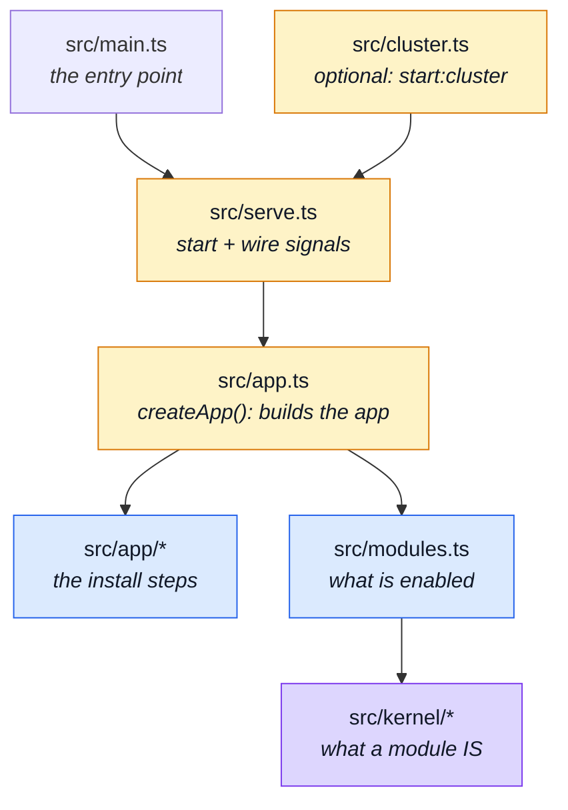

# App, Kernel & Types

The entry files at the top of `src/`, then one row per folder: the assembly layer, the module system, the supporting directories and the shared locale bundles.

Read [Architecture](../understand/architecture.md) first if the four tiers are new: dependencies run
one way — `infrastructure` → `kernel` → `modules` → `app` — and `eslint.config.ts` enforces it.

---

## Where these sit

## The top of `src/`

| File               | What it is                                                                                                                                                                                                                                                                                                                                    | Read next                                                                                        |
| ------------------ | --------------------------------------------------------------------------------------------------------------------------------------------------------------------------------------------------------------------------------------------------------------------------------------------------------------------------------------------- | ------------------------------------------------------------------------------------------------ |
| `src/main.ts`      | The process entry point named by `package.json`, and what `npm start`, `npm run dev` and the image (`node --import tsx src/main.ts`) run. One process: loads `.env`, starts tracing, loads the [development doubles](../build/test-doubles.md) when `NODE_ENV=development`, then imports `src/serve.ts`.                                      | [Clustering & Shutdown](../understand/clustering.md)                                             |
| `src/cluster.ts`   | The optional second entry, `npm run start:cluster`, for a bare VM with no PM2 or systemd. Forks one worker per core (each loading the development doubles when `NODE_ENV=development`, then running `src/serve.ts`) and restarts a worker that dies. Containers do not use it: they scale with `--scale app=N`.                               | [Clustering & Shutdown](../understand/clustering.md)                                             |
| `src/app.ts`       | `createApp()`: builds one Express app and hands back `{ app, boot, start, stop }`. Tracing starts before anything instrumented is imported; `boot` brings up database/cache/queue/i18n, `start` adds the demo profile's own data and listens. Calling it is the side effect, not importing it.                                                | [Reading Path](../understand/reading-path.md) · [Request Flow](../understand/request-flow.md)    |
| `src/serve.ts`     | The only file that calls `createApp().start()` — wires `stop()` to the process signals. What `main.ts`, or a cluster worker, actually runs; `tests/support/http.ts`, `scenarios/apply.ts` and `scenarios/run-server.ts` call `createApp()` themselves instead, for the parts of the lifecycle each one needs.                                 | [Clustering & Shutdown](../understand/clustering.md)                                             |
| `src/modules.ts`   | The list of domains this build serves: one import and one array entry each, kept alphabetical. There is no filesystem discovery and no auto-registration — `tests/cross-cutting/modules-are-enabled.test.ts` requires every folder under `src/modules/` to have an entry here, so disabling one means deleting its folder, not just its line. | [Modules](../understand/modules.md) · [Adding & Removing a Module](../build/module-lifecycle.md) |
| `src/globals.d.ts` | The ambient declarations that widen Express's `Request` — the per-request additions (uploaded image URLs, locale, translator, observability handle) that middlewares attach and controllers read. Without it those reads are type errors.                                                                                                     | [Request Input](../understand/request-input.md)                                                  |

## The folders

| Folder                    | What lives here                                                                                                                                                                                                         | Read next                                                                                                                         |
| ------------------------- | ----------------------------------------------------------------------------------------------------------------------------------------------------------------------------------------------------------------------- | --------------------------------------------------------------------------------------------------------------------------------- |
| `src/app/`                | Assembly: the install steps `createApp()` runs in order (security, request context, telemetry, routes, error handling), the system routes, the app config slice, the module-less jobs and the queue-worker registration | [Request Flow](../understand/request-flow.md) · [Security](../understand/security.md) · [Scheduled jobs](./ops.md#scheduled-jobs) |
| `src/kernel/`             | The module system: what a module is, the authentication and translation seams, permissions and the CASL ability, domain events, the transactional outbox, the boot config gate                                          | [Modules](../understand/modules.md) · [Authorization](../understand/authorization.md) · [Outbox](../understand/outbox.md)         |
| `src/kernel/access/`      | Which rows a caller may read once the route guard let them through, and the one shop's pinned id                                                                                                                        | [Authorization](../understand/authorization.md)                                                                                   |
| `src/kernel/middlewares/` | The route guard: reads the bearer token, resolves the caller, enforces the rule a route names                                                                                                                           | [Security](../understand/security.md)                                                                                             |
| `src/types/`              | The one import path for contract types, the generated AsyncAPI types, and a few hand-written shared types                                                                                                               | [Regenerating After a Change](../build/regenerating.md)                                                                           |
| `src/domain-primitives/`  | Value types and units every domain shares: `Money`, time constants, postal address, lifecycle                                                                                                                           | [Domain layer](../understand/domain-layer.md)                                                                                     |
| `shared/locales/`         | App-level translation bundles: the strings that belong to no module                                                                                                                                                     | [Internationalisation](../understand/i18n.md)                                                                                     |
