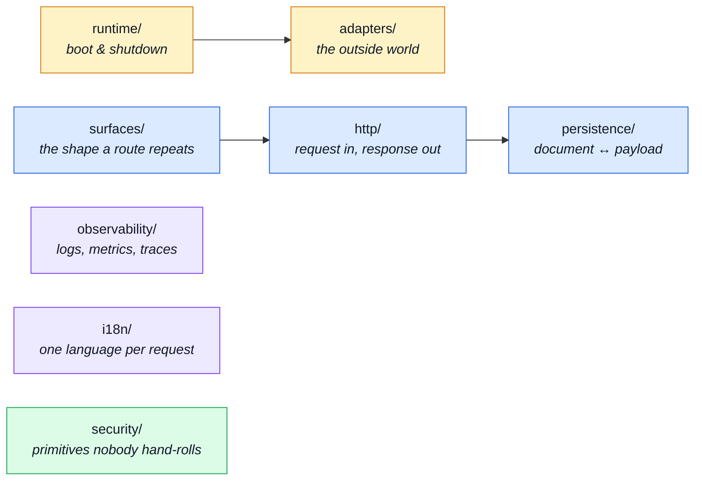

# Infrastructure

`src/infrastructure/` is the substrate: everything the application runs _on_, and nothing about
any domain. It is the bottom tier — it never knows modules exist, and `eslint.config.ts` stops it
finding out.

Nine subdirectories (plus `object-guards.ts`, generic value guards with no home of their own), each a different kind of substrate.

One row per folder. A file's own `@module` header says what it is.

---

## The groups

## The folders

| Folder                                            | What lives here                                                                                                                                   | Read next                                                                                                                                       |
| ------------------------------------------------- | ------------------------------------------------------------------------------------------------------------------------------------------------- | ----------------------------------------------------------------------------------------------------------------------------------------------- |
| `src/infrastructure/runtime/`                     | Boot and shutdown: OpenTelemetry start, the process config slice, database connection, graceful shutdown, readiness, provider registry            | [Scaling & Shutdown](../understand/scaling.md) · [Health Checks](../operate/health-checks.md)                                                   |
| `src/infrastructure/config/`                      | The config engine: `defineConfig`, field builders, the one environment reader, `.env` loading, `*_FILE` secrets                                   | [Configuration](../operate/configuration.md)                                                                                                    |
| `src/infrastructure/config/shared-rules/`         | One Zod checker per `shared/rules/*.yaml` table, plus the loader and the registry                                                                 | [Shared rules](../understand/shared-rules.md)                                                                                                   |
| `src/infrastructure/adapters/`                    | The outside world behind ports: Redis cache and limits, RabbitMQ, mail, PDF, image storage and digesting, SSRF-guarded outbound calls, logger     | [Redis Cache](../understand/redis-cache.md) · [RabbitMQ](../understand/rabbitmq.md) · [Email & Rendering](../understand/email-and-rendering.md) |
| `src/infrastructure/adapters/antibot-providers/`  | The human-challenge providers behind the antibot rungs                                                                                            | [antibot](../modules/antibot.md)                                                                                                                |
| `src/infrastructure/http/`                        | Request in, response out: input reading, ids, response and problem bodies, error types, uploads, preconditions, origins, the controller steps     | [Request Flow](../understand/request-flow.md) · [Success Responses](responses.md) · [Error Responses](errors.md)                                |
| `src/infrastructure/http/middlewares/`            | The Express middlewares no module owns: rate limit, human challenge, idempotency, locale, cache, request log, content type, origin guard, uploads | [Security](../understand/security.md) · [Idempotency](../understand/idempotency.md)                                                             |
| `src/infrastructure/surfaces/`                    | Controller factories for the shapes a route repeats: list, search, item, update, delete, restore                                                  | [Request Input](../understand/request-input.md)                                                                                                 |
| `src/infrastructure/persistence/`                 | Document ↔ payload: the repository base, search and paging, serialisation, money fields, revisions, leases, retired indexes                       | [MongoDB & Mongoose](../understand/mongodb-mongoose.md) · [Write Methods](../understand/write-methods.md)                                       |
| `src/infrastructure/observability/`               | Tracer, the shared Prometheus registry and its metric groups, security events, the audit trail                                                    | [Prometheus](../operate/prometheus.md) · [Winston & Audit Logs](../operate/winston.md)                                                          |
| `src/infrastructure/observability/analytics/`     | The product-analytics port and its providers (Umami, PostHog, none)                                                                               | [Product Analytics](../understand/analytics.md)                                                                                                 |
| `src/infrastructure/i18n/`                        | One language per request: boot, catalogue, admin overrides, the ambient translator, the served-language list                                      | [Internationalisation](../understand/i18n.md)                                                                                                   |
| `src/infrastructure/security/`                    | Primitives nobody hand-rolls: password hash, constant-time compare, secret and PII encryption, pseudonyms, key re-encryption                      | [Security](../understand/security.md)                                                                                                           |
| `src/infrastructure/security/breached-passwords/` | The breached-password check, applied when a password is set                                                                                       | [Authentication defences](../understand/defences/authentication.md)                                                                             |

`src/infrastructure/object-guards.ts` is the one loose file: generic value guards with no home of their own.
