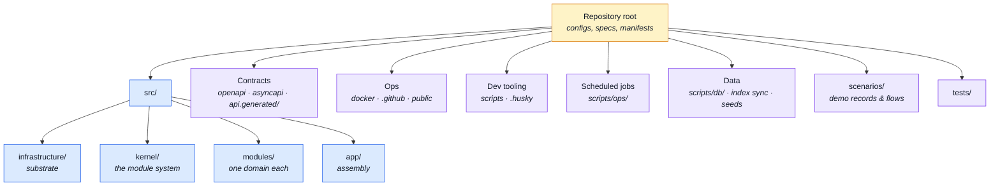

# Reference

**Look something up.** The folders of the repository, what lives in each, and the lookups an API
reader or an operator keeps open: endpoints, errors, field limits, scripts, dependencies, terms.

It is a **map, not a theory page**. Nothing here re-explains what the [understand](../understand/start.md) or
[build](../build/start.md) sections already explain: a row points at them.

::: tip Looking for a file you just found?
Open it: every file starts with a `@module` header that says what it is. A row on these pages
names the **folder**, and its "Read next" says which page explains the idea. Reading the codebase
for the first time? [Reading Path](../understand/reading-path.md) names nine files in order.
:::

## The map

### The folder map

| Page                                      | Covers                                                                                                                  |
| ----------------------------------------- | ----------------------------------------------------------------------------------------------------------------------- |
| [Repository Root](./root.md)              | Everything with no directory above it — configs, manifests, tool entry points                                           |
| [App, Kernel & Types](./src-app.md)       | `src/app/`, `src/kernel/`, `src/types/`, `src/domain-primitives/`, `shared/locales/`, and the entry files of `src/`     |
| [Infrastructure](./src-infrastructure.md) | `src/infrastructure/` — adapters, http, observability, persistence, runtime                                             |
| [Modules](./src-modules.md)               | The file shapes a module is built from, and which module has which                                                      |
| [Contracts](./contracts.md)               | `openapi.yaml`, `asyncapi.yaml`, `shared/contracts/`, generated `api.generated/`, collection exports, Spectral rulesets |
| [Data](./data.md)                         | `scripts/db/` — the index sync, cache tools, and `scenarios/` — the demo records and the flow runner                    |
| [Scripts & Hooks](./scripts.md)           | `scripts/` folder by folder, `.husky/`                                                                                  |
| [Tests](./tests.md)                       | `tests/` suite by suite, the co-located module suites, `tests/load/`                                                    |
| [Ops & Assets](./ops.md)                  | `docker/`, `.github/`, compose files, `public/`, the scheduled jobs                                                     |

### The API lookups

| Page                                          | Covers                                                       |
| --------------------------------------------- | ------------------------------------------------------------ |
| [Endpoints](./endpoints.md)                   | Why each domain's routes are shaped as they are              |
| [`GET /config`](./config.md)                  | The one public answer a client boots from                    |
| [Observability endpoints](./observability.md) | The `/observability/*` routes and who may call them          |
| [Success responses](./responses.md)           | The shape of an answer: a resource, a list, no body          |
| [Error responses](./errors.md)                | Problem details, the `errors` extension, headers on an error |
| [Sorting a list](./sorting.md)                | The `sort` parameter and which fields each list allows       |
| [Field limits](./field-limits.md)             | The `maxLength` every string carries, by kind                |

### The other lookups

| Page                                                | Covers                                                            |
| --------------------------------------------------- | ----------------------------------------------------------------- |
| [Glossary](./glossary.md)                           | Terms as each module means them, and the terms that cross modules |
| [Package scripts](./package-scripts.md)             | Every `npm run`, grouped by job                                   |
| [Package dependencies](./package-dependencies.md)   | What each dependency is for                                       |
| [Permission vocabulary](./permission-vocabulary.md) | The generated, closed lists of actions, subjects and sets         |

## Keeping this page true

A commit that adds, moves or removes a **folder** updates the row that names it, on the page the
folder map above points to. A new file inside an existing folder needs nothing here: its own
`@module` header says what it is, and `npm run check` refuses a dead path in a code span.

::: warning If you are writing a row
A row describes what exists. If writing one shows a folder that should not exist, raise it. Do not
document a mistake into permanence.
:::
