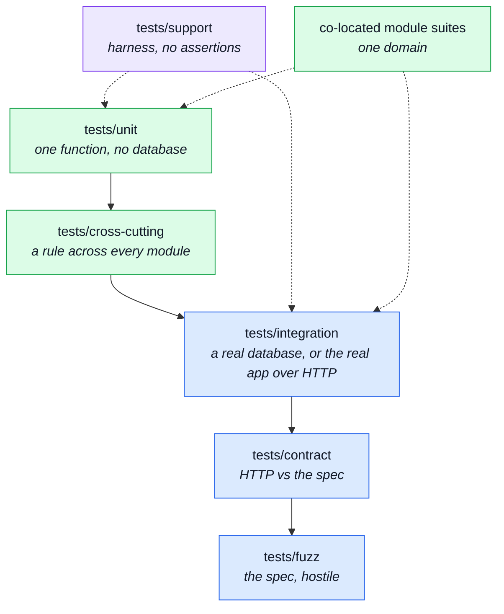
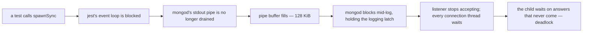
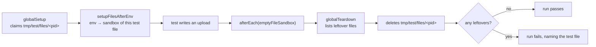

# Tests

Every file here is a distinct guarantee, which is why this page names them one at a time: knowing
_which_ test covers a rule is most of the value of having it.

Tests live in two places, and the split is by scope rather than by taste. A test about **one
module** lives inside that module. A test about **the system** — infrastructure, the kernel, or a
rule that holds across every module — lives in `tests/`.
`eslint-plugin-boundaries` enforces the line, at the offending import rather than by naming a
file — see `eslint.config.ts`.

---

## The suites

## Order-dependence

`--runInBand` runs `tests/integration`, `tests/contract` and `tests/fuzz` in one process, in
whatever order Jest discovers the files — deterministic, but not meaningful: a suite that only
passes because an earlier file left state behind (a fixture, a cached module) looks identical to
one that doesn't, until the file order changes.

`npm run test:order-random` runs the same three suites shuffled (`--randomize --showSeed`) instead
of gating on it. Not part of `npm run test` or the merge gate: it runs nightly in
`.github/workflows/order-random.yml`, and is cheap enough to run by hand after touching shared test
fixtures or module-level state. `--showSeed` prints the seed a red run needs to reproduce.

## Three numbers, and they are not the same question

This trips people up, so it is stated before anything else on this page.

**Tests passing is 100%, always.** Every test here must pass. One failing test
is a red build — no threshold, no percentage, no "most of them". A test that fails is fixed or it
is deleted; nothing in this repo tolerates a known-failing test. Everything below is about a
different question, and none of it softens this one.

The other number is a measurement of the SUITE rather than of the code:

|                    | The question it answers                      | Verdict on a low number                      |
| ------------------ | -------------------------------------------- | -------------------------------------------- |
| **Pass rate**      | did every assertion hold                     | something is **broken** — fix it now         |
| **Mutation score** | would a test **notice** if this line changed | the suite is **weak here** — the real signal |

### Mutation testing is the instrument; coverage is not measured

Line coverage asks only whether a line ran. A line can be executed by a test that asserts nothing
whatever about it, and coverage will call that 100%.

Mutation testing asks the question you actually care about: **Stryker edits the code — flips a
comparison, drops a call, changes a constant — and checks that some test goes red.** A test that
does not notice the change did not really test the line, and the mutant "survives".

That relationship is one-directional: an uncovered line cannot possibly kill a mutant, so **every
coverage gap shows up as surviving mutants (`NoCoverage`, per line), while the converse is false**.
Mutation score subsumes coverage, so no coverage run, threshold or report exists. See
[Coverage & Confidence](../tools/coverage-and-confidence.md#why-the-coverage-floors-were-deleted)
for why the floors were deleted.

So the honest framing of this repository's tooling:

- **`npm run mutation` / `npm run mutation:full` are the judgement of test quality.** Their
  per-file scores in `mutation-baseline.json` are what "is this actually tested" means here.
- **A module spec that calls `setupTestDb()` belongs in that module's `tests/integration/`**, not
  its `tests/unit/`: `unit-layer-stays-database-free` in `.dependency-cruiser.cjs` refuses a spec
  under `tests/unit` that can reach a database at all.

::: tip One ruler
`stryker.json` is the only mutation config, and it runs `tests/integration/` as well as the unit suites — see
[one ruler](../tools/mutation-testing.md#one-ruler). A 0% in `mutation-baseline.json` is a real
finding: no eligible spec killed a mutant in that file. Read the ratchet against its own recorded
history, not as an absolute grade.
:::

### Which command answers which question

| Command                 | Runs                        | Answers                                      |
| ----------------------- | --------------------------- | -------------------------------------------- |
| `npm run test`          | every suite                 | does everything pass — **the one that must** |
| `npm run mutation:full` | unit + integration, mutated | **would the tests notice a change**          |

See [Mutation Testing](../tools/mutation-testing.md) for the run itself, its baseline ratchet and
what the `high`/`low`/`break` thresholds mean.

---

## `tests/cross-cutting/` — rules that hold across every module

The house speciality: one file per architectural rule, asserted over every module at once.
A new module is covered the day it is added, without anyone writing a test for it.

| File                                                          | What it guarantees                                                                                                                                                                                                                                                                                     | Read next                                                                           |
| ------------------------------------------------------------- | ------------------------------------------------------------------------------------------------------------------------------------------------------------------------------------------------------------------------------------------------------------------------------------------------------ | ----------------------------------------------------------------------------------- |
| `tests/cross-cutting/locale-namespaces.test.ts`               | Locale ownership: a module's keys stay in its own namespace and never collide with the app bundle.                                                                                                                                                                                                     | [App, Kernel & Types](./src-app.md)                                                 |
| `tests/cross-cutting/locale-parity.test.ts`                   | Every language declares the same keys, across the shared file and every module at once.                                                                                                                                                                                                                | [Modules](./src-modules.md)                                                         |
| `tests/cross-cutting/audit-actions.test.ts`                   | The audit vocabulary is consistent across every module that writes to the trail.                                                                                                                                                                                                                       | [Winston & Audit Logs](../tools/winston.md)                                         |
| `tests/cross-cutting/contract-bundles.test.ts`                | Every bundled document is exactly what its fragments say it is built from.                                                                                                                                                                                                                             | [Contracts](./contracts.md)                                                         |
| `tests/cross-cutting/contract-refs-follow-depends-on.test.ts` | A module's contract only `$ref`s a sibling its `module.yaml` declares in `dependsOn`.                                                                                                                                                                                                                  | [Contract Fragmentation](../api/contract-fragmentation.md)                          |
| `tests/cross-cutting/contract-scalars.test.ts`                | The shared scalars in infrastructure still match every operation in the contract.                                                                                                                                                                                                                      | [Contract-Derived Request Data](../tools/contract-request-data.md)                  |
| `tests/cross-cutting/scenario-fixtures.test.ts`               | The three claims about the demo fixtures no index, build sweep or contract suite already makes.                                                                                                                                                                                                        | [Data](./data.md)                                                                   |
| `tests/cross-cutting/process-snapshot.test.ts`                | The process is read in exactly one place and published in exactly one shape, so the SSE frame and the REST payloads cannot drift.                                                                                                                                                                      | [Observability Endpoints](../api/observability.md)                                  |
| `tests/cross-cutting/authenticated-controllers.test.ts`       | A controller asserting the caller with `request.authContext!` is mounted behind `isAuth` — not `isAuthOrCredential`, which resolves no context — the half no type can carry, including the mid-file `router.use` hazard.                                                                               | [Request Flow](../theory/request-flow.md)                                           |
| `tests/cross-cutting/role-hierarchy.test.ts`                  | The rank rule over the real app: every staff write on a person's thing, driven by every role that holds the route's key, against owners at every level — a lower owner passes, an equal or higher one is a 403 `OUTRANKED`, the caller's own passes, a platform-only account outranks every shop role. | [Authorization](../theory/authorization.md#acting-on-someone-else-s-things)         |
| `tests/cross-cutting/role-hierarchy-routes.test.ts`           | The row list the matrix above is driven by is held to the mounted route table, so a new write route on a person's thing cannot be left out of it.                                                                                                                                                      | [Authorization](../theory/authorization.md#acting-on-someone-else-s-things)         |
| `tests/cross-cutting/api-key-authentication.test.ts`          | An `sk_...` credential reaches the routes its keys cover over the real chain, and no module mounts both identity guards.                                                                                                                                                                               | [Security](../tools/security.md#machine-to-machine-credentials)                     |
| `tests/cross-cutting/ci-covers-the-gate.test.ts`              | Every check `npm run complete` runs has a CI job behind it, so `--no-verify` or a fork PR cannot bypass one silently.                                                                                                                                                                                  | [Scripts & Hooks](./scripts.md)                                                     |
| `tests/cross-cutting/personal-data-erasure.test.ts`           | Every module whose model references `User` declares a `personalData.erase` hook, so a hard delete leaves none of an account's rows behind.                                                                                                                                                             | [Data protection](../theory/data-protection.md)                                     |
| `tests/cross-cutting/frontend-pairing.test.ts`                | A counterpart that is not the module's own name carries its reason (`module.yaml#frontend`), and — when that checkout is present — the names still resolve on both sides.                                                                                                                              | [Pairing & Ports](../tools/pairing-and-ports.md)                                    |
| `tests/cross-cutting/metric-names.test.ts`                    | A metric name is an identifier three places agree on, and only one of them is type-checked.                                                                                                                                                                                                            | [Prometheus](../tools/prometheus.md)                                                |
| `tests/cross-cutting/outbox-names.test.ts`                    | Every mail names itself the way the PHP twin does — engine-neutral, and still resolving to a real template.                                                                                                                                                                                            | [Email & PDF Rendering](../tools/email-and-rendering.md)                            |
| `tests/cross-cutting/credential-fields.test.ts`               | Nothing credential-shaped survives serialization, on any model.                                                                                                                                                                                                                                        | [Security](../tools/security.md)                                                    |
| `tests/cross-cutting/contract-aliases.test.ts`                | Which spelling of an operation a caller should reach for, and that both spellings agree.                                                                                                                                                                                                               | [Contracts](./contracts.md)                                                         |
| `tests/cross-cutting/contract-error-declarations.test.ts`     | Every status the error interpreter can answer is a status the contract describes.                                                                                                                                                                                                                      | [Contracts](./contracts.md)                                                         |
| `tests/cross-cutting/contract-search-parity.test.ts`          | The two spellings of one search accept the same thing.                                                                                                                                                                                                                                                 | [Contracts](./contracts.md)                                                         |
| `tests/cross-cutting/paginated-sort-is-total.test.ts`         | Every `$sort` a `$skip` pages through ends in a unique key, so a page boundary cannot show one document twice and another not at all.                                                                                                                                                                  | [MongoDB & Mongoose](../tools/mongodb-mongoose.md)                                  |
| `tests/cross-cutting/search-pagination.test.ts`               | Pagination normalisation is the single authority on page defaults.                                                                                                                                                                                                                                     | [MongoDB & Mongoose](../tools/mongodb-mongoose.md)                                  |
| `tests/cross-cutting/search-regex.test.ts`                    | Client text reaching MongoDB's regex operator is escaped — the server evaluates the pattern, so an unescaped one is a denial of service.                                                                                                                                                               | [Security](../tools/security.md)                                                    |
| `tests/cross-cutting/search.property.test.ts`                 | The same, as **properties** over generated inputs rather than examples.                                                                                                                                                                                                                                | [Property Testing](../tools/property-testing.md)                                    |
| `tests/cross-cutting/serialize.property.test.ts`              | The universal guarantees of serialisation, over generated documents: the public id present and the internal fields gone, whatever the input.                                                                                                                                                           | [Property Testing](../tools/property-testing.md)                                    |
| `tests/cross-cutting/money-reconciliation.property.test.ts`   | The composition `orders.orderTotal` + `delivery.priceShipping` that cart, payments and the confirmation email each perform themselves: reconciling lines and shipping never invents or drops a cent.                                                                                                   | [Property Testing](../tools/property-testing.md)                                    |
| `tests/cross-cutting/production-topology.test.ts`             | The deployment's four invisible decisions: containers read-only with no capabilities, no data port published to the host, no debugger flag, no dependency lifecycle script run during the image build.                                                                                                 | [Docker & Podman](../tools/docker-and-podman.md) · [Security](../tools/security.md) |
| `tests/cross-cutting/alert-rules-metrics.test.ts`             | Every metric an alert rule reads is one the code registers — a misspelled metric makes an alert that never fires.                                                                                                                                                                                      | [Prometheus](../tools/prometheus.md)                                                |
| `tests/cross-cutting/analytics-events.test.ts`                | The analytics vocabulary swept across every module: no name claimed twice, every module's names reach `AnalyticsEventMap`.                                                                                                                                                                             | [Product Analytics](../tools/analytics.md)                                          |
| `tests/cross-cutting/audit-actions-registered.test.ts`        | Each module's audit vocabulary reaches the app-wide `AuditAction` union through its `declare module` augmentation.                                                                                                                                                                                     | [Winston & Audit Logs](../tools/winston.md)                                         |
| `tests/cross-cutting/authorization-conformance.test.ts`       | The cases the PHP twin must answer identically (`shared/authorization-conformance.yaml`), run against this repo's evaluator.                                                                                                                                                                           | [Authorization](../theory/authorization.md)                                         |
| `tests/cross-cutting/authorization-keys.test.ts`              | The shared keys and roles files are internally consistent, and every preset role is expressible.                                                                                                                                                                                                       | [Authorization](../theory/authorization.md)                                         |
| `tests/cross-cutting/permission-actions.test.ts`              | The permission-action vocabulary has one home (`actions:` in `shared/authorization-keys.yaml`) and the generated file matches it.                                                                                                                                                                      | [Permission Actions](../tools/permission-actions.md)                                |
| `tests/cross-cutting/mail-copy.test.ts`                       | Every variable an EJS mail template prints, a builder supplies — templates interpolate, they do not translate.                                                                                                                                                                                         | [Email & Rendering](../tools/email-and-rendering.md)                                |
| `tests/cross-cutting/module-descriptors.test.ts`              | Every module's `module.yaml` is well-formed.                                                                                                                                                                                                                                                           | [Strategic DDD](../theory/strategic-ddd.md)                                         |
| `tests/cross-cutting/module-subscriptions.test.ts`            | Every module's `subscribe()` hook is held to the two rules that make the event bus a graph rather than a pile of listeners.                                                                                                                                                                            | [Events & Logging](../tools/events-and-logging.md)                                  |
| `tests/cross-cutting/modules-are-enabled.test.ts`             | Every folder under `src/modules/` is enabled in `src/modules.ts`, and nothing there names a folder that is gone.                                                                                                                                                                                       | [Modules](../theory/modules.md)                                                     |
| `tests/cross-cutting/proxy-overlay.test.ts`                   | The shared Traefik overlay, the one container facing the internet, keeps its security decisions (no Docker socket, routes only).                                                                                                                                                                       | [Hosting](../tools/hosting.md)                                                      |
| `tests/cross-cutting/rate-limit-budgets.test.ts`              | Every rate-limit budget is consistent as a set: no two share a name or an environment variable.                                                                                                                                                                                                        | [Security](../tools/security.md#the-rate-limit-budgets)                             |
| `tests/cross-cutting/raw-body-paths.test.ts`                  | Every module's `rawBodyPaths` resolves to a route actually mounted on its router, so signature verification cannot be silently disabled.                                                                                                                                                               | [Security](../tools/security.md)                                                    |
| `tests/cross-cutting/replace-patch-parity.test.ts`            | A PUT and a PATCH on one resource declare the same writable fields.                                                                                                                                                                                                                                    | [Write Methods](../api/write-methods.md)                                            |
| `tests/cross-cutting/scheduled-jobs.test.ts`                  | `docker/crontab` and `package.json`'s `reap:*`/`sweep:*` scripts agree in both directions.                                                                                                                                                                                                             | [Ops & Assets](./ops.md#scheduled-jobs)                                             |
| `tests/cross-cutting/side-effects-have-one-layer.test.ts`     | A queued email, an audit record, an analytics event and a domain event are each published from one layer, or the exception is argued for.                                                                                                                                                              | [Layers](../theory/layers.md)                                                       |
| `tests/cross-cutting/step-up-auth-routes.test.ts`             | Every money or identity route carries `requireFreshAuth` at its assigned tier.                                                                                                                                                                                                                         | [Security](../tools/security.md)                                                    |
| `tests/cross-cutting/translatable-targets.test.ts`            | Every `translatables` manifest entry names a real Mongoose collection and real fields on it.                                                                                                                                                                                                           | [Internationalisation](../tools/i18n.md)                                            |
| `tests/cross-cutting/webhook-event-producers.test.ts`         | Every event `webhooks/asyncapi.yaml` declares has a real producer, proved by triggering it, and nothing subscribes to an undeclared one.                                                                                                                                                               | [webhooks](../modules/webhooks.md)                                                  |
| `tests/cross-cutting/write-routes-are-guarded.test.ts`        | Every write route is authenticated and behind a `requirePermission` key unless it is listed with a reason.                                                                                                                                                                                             | [Authorization](../theory/authorization.md)                                         |

## `tests/unit/`

One function, no database, no HTTP. Fast enough to run from the pre-commit hook.

A unit test mirrors the path of its subject: `tests/unit/infrastructure/http/preconditions.test.ts` tests
`src/infrastructure/http/preconditions.ts`. The tables below name the ones whose subject or reason
is not obvious from the path; `ls tests/unit/<path>` is the complete list.

| File                                                            | What it guarantees                                                                                                                                                                        | Read next                                                                          |
| --------------------------------------------------------------- | ----------------------------------------------------------------------------------------------------------------------------------------------------------------------------------------- | ---------------------------------------------------------------------------------- |
| `tests/unit/scripts/db/host-scripts.test.ts`                    | The `host` script and the URI resolver agree over the whole environment matrix — the pin that keeps `npm run host -- <script>` reaching the database `.env` names.                        | [Repository Root](./root.md)                                                       |
| `tests/unit/scripts/run-script.test.ts`                         | The entry-point wrapper opens, closes and exits non-zero on failure.                                                                                                                      | [Data](./data.md)                                                                  |
| `tests/unit/scripts/modules/new-module-needs-nothing.test.ts`   | A throwaway module folder reaches the contract, the docs index and sidebar, the probes and the router-guard set with no other edit — the "only `src/modules.ts`" claim.                   | [Adding & Removing a Module](../theory/module-lifecycle.md)                        |
| `tests/unit/scripts/contracts/root-assembly.test.ts`            | The root OpenAPI document is completed from the fragments: new paths and tags appended, a deleted module's refs dropped, the root's order and comments kept.                              | [Contract Fragmentation](../api/contract-fragmentation.md)                         |
| `tests/unit/scripts/contracts/prune-unused.test.ts`             | The last bundle step drops components nothing reaches, unused security schemes and unused tags, and keeps what a path reaches.                                                            | [Contract Fragmentation](../api/contract-fragmentation.md)                         |
| `tests/unit/scripts/audit/shallow-candidates.test.ts`           | The `code-shape` audit's counter: a use through an alias or a shorthand property still counts, a forwarder is told from a partial application, and a barrel-published function is marked. | [AI Auditing](../tools/ai-auditing.md#code-shape-the-tools-count-the-model-judges) |
| `tests/unit/scripts/contracts/personal-data-assembly.test.ts`   | The export schema is completed from each module's `x-personal-data`: sections added, optional ones left out of `required`, refs retargeted, a duplicate refused.                          | [Contract Fragmentation](../api/contract-fragmentation.md)                         |
| `tests/unit/scripts/docs/module-catalogue.test.ts`              | The docs index and sidebar group modules by `group`, foundation first, and nest deeper pages.                                                                                             | [Modules](../modules/index.md)                                                     |
| `tests/unit/scripts/docs/module-descriptor.test.ts`             | `module.yaml` requires a `summary`, refuses an empty `noAudit` and an unknown key, and defaults the frontend counterpart to the module's own name.                                        | [Strategic DDD](../theory/strategic-ddd.md)                                        |
| `tests/unit/scenarios/scenario-images.test.ts`                  | Every seed row's `imageUrl` is a real file under `public/images/seed/`, addressed as the static mount would serve it.                                                                     | [Data](./data.md)                                                                  |
| `tests/unit/scenarios/check.test.ts`                            | `findUnmetGuarantees` catches a guarantee with no matching subject and a subject no module declared, fed a hand-made map — no database, no real scenario built.                           | [Data](./data.md)                                                                  |
| `tests/unit/scenarios/accounts.test.ts`                         | The named demo identities and the env vars that override their passwords, reloading the module per case since the overrides are read at module scope.                                     | [Demo profile](../tools/demo-profile.md)                                           |
| `tests/unit/scripts/eslint/controller-chain-must-catch.test.ts` | The repo's own lint rule fires on the code it is meant to catch and stays quiet otherwise.                                                                                                | [Scripts & Hooks](./scripts.md)                                                    |
| `tests/unit/scripts/eslint/no-hardcoded-user-text.test.ts`      | The same for the hardcoded-copy rule.                                                                                                                                                     | [Scripts & Hooks](./scripts.md)                                                    |
| `tests/unit/i18n/email-locale.test.ts`                          | Where an email's language is decided — the producer resolves the copy before publishing, so a queued job cannot be rendered in the worker's locale.                                       | [Email & PDF Rendering](../tools/email-and-rendering.md)                           |
| `tests/unit/infrastructure/i18n/context.test.ts`                | The request-scoped `t`: that two overlapping scopes stay apart, and that code outside any scope still resolves.                                                                           | [Request Flow](../theory/request-flow.md)                                          |
| `tests/unit/infrastructure/i18n/catalog.test.ts`                | Which languages exist, the per-module dictionary merge, and why the supported list is cached rather than re-read.                                                                         | [Internationalisation](../tools/i18n.md)                                           |
| `tests/unit/infrastructure/i18n/overrides.test.ts`              | The database overlay: a stored edit wins, a deleted one stops answering, a failed read keeps the last good copy — plus the timer that spreads an edit across workers.                     | [Internationalisation](../tools/i18n.md)                                           |
| `tests/unit/kernel/registry.test.ts`                            | `registerModules` calls every declared `subscribe` hook, and treats a module without one as ordinary.                                                                                     | [Modules](../theory/modules.md)                                                    |
| `tests/unit/kernel/events.test.ts`                              | The event bus breaks the cycle it exists for: a deleted product empties out of every cart without the two modules importing each other.                                                   | [Events & Logging](../tools/events-and-logging.md)                                 |
| `tests/unit/kernel/authorizations.test.ts`                      | Token extraction and the role guard.                                                                                                                                                      | [Security](../tools/security.md)                                                   |
| `tests/unit/kernel/access-query.test.ts`                        | The shared read-scoping rule — the caller's rules, compiled into the filter a collection is read with.                                                                                    | [Authorization](../theory/authorization.md)                                        |
| `tests/unit/kernel/step-up.test.ts`                             | Step-up demanded by the KEY: refused before challenged, and the demand recorded.                                                                                                          | [Authorization](../theory/authorization.md)                                        |
| `tests/unit/scripts/mutation/baseline.test.ts`                  | The ratchet reads a Stryker report into per-file scores correctly.                                                                                                                        | [Mutation Testing](../tools/mutation-testing.md)                                   |
| `tests/unit/scripts/testing/machine-budget.test.ts`             | The sizing arithmetic behind `npm run test:*` — worker counts, shard counts and heap caps, bounded by cores and by free memory rather than total.                                         | [Weak Machines](../tools/weak-machines.md)                                         |
| `tests/unit/support/file-sandbox.test.ts`                       | The file sandbox redirects every file-writing setting, refuses to run or delete outside its root, and attributes a leftover file to the test file that left it.                           | [Test layout](#a-test-leaves-no-files-behind)                                      |
| `tests/unit/scripts/pairing/spec-identity.test.ts`              | The cross-repo shared-file list and its comparison.                                                                                                                                       | [Pairing & Ports](../tools/pairing-and-ports.md)                                   |

### `tests/unit/infrastructure/runtime/` and `persistence/`

| File                                                    | What it guarantees                                                                                                          | Read next                      |
| ------------------------------------------------------- | --------------------------------------------------------------------------------------------------------------------------- | ------------------------------ |
| `tests/unit/infrastructure/runtime/environment.test.ts` | The fail-fast boot check, tested exhaustively because it is small and because it decides whether the process starts at all. | [Runtime](../tools/runtime.md) |

### `tests/unit/infrastructure/adapters/`

| File                                                                  | What it guarantees                                                                                                                                                                                       | Read next                                                |
| --------------------------------------------------------------------- | -------------------------------------------------------------------------------------------------------------------------------------------------------------------------------------------------------- | -------------------------------------------------------- |
| `tests/unit/infrastructure/adapters/managed-connection.test.ts`       | The lifecycle Redis and RabbitMQ share, against a fake handle: never rejecting, never opening a second connection, warning once, closing an in-flight connect.                                           | [Redis Cache](../tools/redis-cache.md)                   |
| `tests/unit/infrastructure/adapters/cache.test.ts`                    | The fail-open behaviour the whole cache depends on, the tag index behind group invalidation, and `clearCache` telling "nothing to clear" from "could not clear".                                         | [Redis Cache](../tools/redis-cache.md)                   |
| `tests/unit/infrastructure/adapters/queue.test.ts`                    | Whether the queue is enabled, and what every function does when it is not.                                                                                                                               | [RabbitMQ](../tools/rabbitmq.md)                         |
| `tests/unit/app/process-error-handlers.test.ts`                       | The process-level handlers: an uncaught exception is always audited and always exits, and no handler is installed under a test runner.                                                                   | [Winston & Audit Logs](../tools/winston.md)              |
| `tests/unit/infrastructure/adapters/email.worker.test.ts`             | The email consumer: queue name, ack on success, dead-letter on a permanent refusal, and a rejection left to escape so `<queue>.retry`'s TTL, not an immediate broker requeue, saves a transient failure. | [RabbitMQ](../tools/rabbitmq.md)                         |
| `tests/unit/infrastructure/adapters/logger.test.ts`                   | Redaction and error serialization — that a password never reaches a log line.                                                                                                                            | [Winston & Audit Logs](../tools/winston.md)              |
| `tests/unit/infrastructure/adapters/mailer-dispatch.test.ts`          | The queue-or-send-inline dispatch: queue when a broker exists, send inline when it does not.                                                                                                             | [Email & PDF Rendering](../tools/email-and-rendering.md) |
| `tests/unit/infrastructure/adapters/mailer-templates.test.ts`         | Every template referenced by a module resolves and renders.                                                                                                                                              | [Email & PDF Rendering](../tools/email-and-rendering.md) |
| `tests/unit/infrastructure/adapters/mailer-transport.test.ts`         | The SMTP transport configuration, which transport a name selects, what each one claims to `deliver` — and that the test environment uses one that sends nothing.                                         | [Email & PDF Rendering](../tools/email-and-rendering.md) |
| `tests/unit/infrastructure/adapters/pdf.test.ts`                      | The HTML to PDF adapter's contract with its caller.                                                                                                                                                      | [Email & PDF Rendering](../tools/email-and-rendering.md) |
| `tests/unit/scenarios/mail-outbox.test.ts`                            | The demo profile's email sink (the `outbox` transport) — what the paired frontend's password-reset and verification specs are ultimately reading.                                                        | [Demo profile](../tools/demo-profile.md)                 |
| `tests/unit/infrastructure/http/middlewares/upload.test.ts`           | The upload callbacks: where a file lands, what it is renamed to, which types are refused.                                                                                                                | [Security](../tools/security.md)                         |
| `tests/unit/infrastructure/adapters/image-signatures.test.ts`         | An image is identified by its bytes, and only as many bytes as needed are read.                                                                                                                          | [Security](../tools/security.md)                         |
| `tests/unit/infrastructure/adapters/image-store.test.ts`              | The filesystem image store's put, resolve and delete.                                                                                                                                                    | [Security](../tools/security.md)                         |
| `tests/unit/infrastructure/adapters/image-store.test.ts`              | The step between "multer wrote a file" and "the API has an image".                                                                                                                                       | [Security](../tools/security.md)                         |
| `tests/unit/infrastructure/adapters/filesystem.test.ts`               | The one filesystem operation an upload cannot survive getting wrong.                                                                                                                                     | —                                                        |
| `tests/unit/infrastructure/http/middlewares/rate-limit-store.test.ts` | One connection needs one `connect()` — the shared limiter store.                                                                                                                                         | [Security](../tools/security.md)                         |

### `tests/unit/infrastructure/http/`

| File                                                                | What it guarantees                                                                                                                                                                                  | Read next                                                                            |
| ------------------------------------------------------------------- | --------------------------------------------------------------------------------------------------------------------------------------------------------------------------------------------------- | ------------------------------------------------------------------------------------ |
| `tests/unit/infrastructure/http/request.test.ts`                    | Input reading finds a value in a param, a query string or a body, and reports honestly when it cannot.                                                                                              | [Request Input](../theory/request-input.md)                                          |
| `tests/unit/infrastructure/http/ids.test.ts`                        | A malformed id is answered once per position: `requireId` gives a path id the unknown-id 404 and a body or query id a 422 naming the field, and the schema walk finds every contract `Id` field.    | [Request Flow](../theory/request-flow.md#a-malformed-id-has-one-answer-per-position) |
| `tests/unit/infrastructure/http/schemas.test.ts`                    | The contract scalars more than one endpoint accepts.                                                                                                                                                | [Contract-Derived Request Data](../tools/contract-request-data.md)                   |
| `tests/unit/infrastructure/http/response.test.ts`                   | The success and error envelopes are the shape every client branches on.                                                                                                                             | [Endpoints](../api/endpoints.md)                                                     |
| `tests/unit/infrastructure/http/errors.test.ts`                     | `databaseErrorInterpreter` maps a duplicate key and a bad ObjectId to the status each documents, an ordinary `Error` to 500.                                                                        | [Request Flow](../theory/request-flow.md)                                            |
| `tests/unit/infrastructure/http/uploads.test.ts`                    | What a handler is allowed to see of a multipart request.                                                                                                                                            | [Security](../tools/security.md)                                                     |
| `tests/unit/infrastructure/http/middlewares/rate-limit.test.ts`     | The two rate-limit budgets and the metrics scrape guard.                                                                                                                                            | [Security](../tools/security.md)                                                     |
| `tests/unit/infrastructure/http/middlewares/locale.test.ts`         | Locale attachment fixes the translator for the rest of the chain; negotiation itself (q-weights, region tags, the fallback, and Express's own `acceptsLanguages` in place of a hand-rolled parser). | [Request Flow](../theory/request-flow.md)                                            |
| `tests/unit/infrastructure/http/middlewares/cache.test.ts`          | The cache key depends on the query parameters the answer actually depends on — plus the TTL clamp and the per-entry size limit.                                                                     | [Redis Cache](../tools/redis-cache.md)                                               |
| `tests/unit/infrastructure/http/middlewares/request-logger.test.ts` | One access-log line per request, at the right level for the status.                                                                                                                                 | [Winston & Audit Logs](../tools/winston.md)                                          |
| `tests/unit/infrastructure/http/middlewares/route-flag.test.ts`     | A route's own meaning reaches the controller as an ordinary param.                                                                                                                                  | [Endpoints](../api/endpoints.md)                                                     |

### `tests/unit/infrastructure/observability/`

| File                                                               | What it guarantees                                                                    | Read next                                   |
| ------------------------------------------------------------------ | ------------------------------------------------------------------------------------- | ------------------------------------------- |
| `tests/unit/infrastructure/observability/metrics-http.test.ts`     | Route labels are normalised, so an id in a URL cannot explode the metric cardinality. | [Prometheus](../tools/prometheus.md)        |
| `tests/unit/infrastructure/observability/metrics-registry.test.ts` | The scrape endpoint's exposition includes the standard process families.              | [Prometheus](../tools/prometheus.md)        |
| `tests/unit/infrastructure/observability/audit.test.ts`            | The core audit actions and the shape of an entry.                                     | [Winston & Audit Logs](../tools/winston.md) |
| `tests/unit/infrastructure/observability/analytics.test.ts`        | Provider resolution and all three implementations behind the port.                    | [Product Analytics](../tools/analytics.md)  |
| `tests/unit/infrastructure/observability/tracer.test.ts`           | The tracing helpers over the OpenTelemetry API.                                       | [OpenTelemetry](../tools/opentelemetry.md)  |

## `tests/integration/` — the real app over HTTP

Boots the application against an in-memory MongoDB and drives it as a client would. Run serially.

| File                                                                                                                                               | What it guarantees                                                                                                                                                                                               | Read next                                                                            |
| -------------------------------------------------------------------------------------------------------------------------------------------------- | ---------------------------------------------------------------------------------------------------------------------------------------------------------------------------------------------------------------- | ------------------------------------------------------------------------------------ |
| `tests/integration/app-health.test.ts`                                                                                                             | The system routes and the observability endpoints answer as documented.                                                                                                                                          | [Observability Endpoints](../api/observability.md)                                   |
| `tests/integration/observability-auth.test.ts`                                                                                                     | The two observability endpoints, and exactly which credentials reach them.                                                                                                                                       | [Security](../tools/security.md)                                                     |
| `tests/integration/auth-hardening.test.ts`                                                                                                         | Two properties invisible until someone attacks them — credential endpoints rate-limited on their own budget, and the rest.                                                                                       | [Security](../tools/security.md)                                                     |
| `tests/integration/upload-security.test.ts`                                                                                                        | What actually reaches the disk when a hostile file is uploaded.                                                                                                                                                  | [Security](../tools/security.md)                                                     |
| `tests/integration/product-multipart-write.test.ts`                                                                                                | Writing a product through a multipart body — the only way to send one with an image.                                                                                                                             | [Endpoints](../api/endpoints.md)                                                     |
| `tests/integration/locale.test.ts`                                                                                                                 | Per-request language negotiation, end to end.                                                                                                                                                                    | [Request Flow](../theory/request-flow.md)                                            |
| `tests/integration/locale-cache-invalidation.test.ts`                                                                                              | An admin edit reaches the next anonymous reader — the cached public dictionary is invalidated.                                                                                                                   | [Redis Cache](../tools/redis-cache.md)                                               |
| `tests/integration/concurrency/auth-races.test.ts`                                                                                                 | The account endpoints under simultaneous callers: concurrent signups for one address, and the rest of the race table.                                                                                            | [Concurrency Testing](../tools/concurrency-testing.md)                               |
| `tests/integration/concurrency/cart-races.test.ts`                                                                                                 | The cart and checkout endpoints under simultaneous writes of the same product.                                                                                                                                   | [Concurrency Testing](../tools/concurrency-testing.md)                               |
| `tests/integration/concurrency/payment-races.test.ts`                                                                                              | Money and stock under simultaneous callers: a double confirm, a redelivered webhook, overselling the last units, a cancel racing the payment.                                                                    | [Concurrency Testing](../tools/concurrency-testing.md)                               |
| `tests/integration/conditional-writes.test.ts`                                                                                                     | `ETag` on a versioned row's read, optional `If-Match` on its PUT/PATCH/DELETE, 412 when it moved — including two editors racing on one tag.                                                                      | [Write Methods](../api/write-methods.md#conditional-writes-etag-and-if-match)        |
| `tests/integration/malformed-ids.test.ts`                                                                                                          | Every id site `openapi.yaml` declares holds to the one-answer-per-position rule: a malformed path id is the unknown-id 404, a malformed body or query id a 422 naming the field.                                 | [Request Flow](../theory/request-flow.md#a-malformed-id-has-one-answer-per-position) |
| `tests/integration/persistence/revision.test.ts`                                                                                                   | The edit counter behind every `ETag`, against a real database: moves by one per edit through every form of write, never for a non-edit, never repeats under two writers.                                         | [Write Methods](../api/write-methods.md#what-the-tag-is)                             |
| `tests/integration/scripts/db/index-sync.test.ts`                                                                                                  | `db:sync` builds every declared index, drops every undeclared one, converges on a second run, and refuses a unique constraint the rows already violate.                                                          | [Data](./data.md)                                                                    |
| `tests/integration/scenarios/demo-restore.test.ts`                                                                                                 | `restoreScenario`'s `blank` path against a real database, plus two real-HTTP cases proving the defects `emptyDatabase()` and the pinned tenant id exist to close.                                                | [Demo profile](../tools/demo-profile.md)                                             |
| `tests/integration/scenarios/shop.test.ts`                                                                                                         | Builds the `shop` scenario for real, then reads every row back through the real serializers against the generated response schemas, and holds every declared guarantee equal to the subjects the build produced. | [Demo profile](../tools/demo-profile.md)                                             |
| `tests/integration/access.test.ts`                                                                                                                 | The demo seed's authorization side: a role lives in the membership row alone, never mirrored onto the user document.                                                                                             | [Authorization](../theory/authorization.md)                                          |
| `tests/integration/bad-bodies.test.ts`                                                                                                             | A request with a bad body gets a 4xx with the right status, never a 500.                                                                                                                                         | —                                                                                    |
| `tests/integration/checkout-money-reconciliation.test.ts`                                                                                          | One basket, three prices, one number: the cart view, the order total and the payment intent agree.                                                                                                               | [Cart & Checkout](../modules/cart-checkout.md)                                       |
| `tests/integration/checkout-stock-divergence.test.ts`                                                                                              | Checkout, the hold and the cart view when the catalogue's cached counters and the `stocklevels` ledger differ.                                                                                                   | [Reservations](../modules/inventory-reservations.md)                                 |
| `tests/integration/concurrency/checkout-interleavings.test.ts`                                                                                     | Checkout against a cart that moves under it — a real interleaving, not a mocked `null`.                                                                                                                          | —                                                                                    |
| `tests/integration/concurrency/order-status-races.test.ts`                                                                                         | Two simultaneous status changes on one order cannot both pass a check and both write.                                                                                                                            | [orders](../modules/orders.md)                                                       |
| `tests/integration/cookie-json-forgery.test.ts`                                                                                                    | A `j:`-prefixed cookie never reaches a controller as an object.                                                                                                                                                  | [Authentication defences](../theory/defences/authentication.md)                      |
| `tests/integration/cors.test.ts`                                                                                                                   | A disallowed origin gets the CORS header omitted, not an error.                                                                                                                                                  | [Security](../tools/security.md)                                                     |
| `tests/integration/create-app-env.test.ts` `tests/integration/create-app-extension.test.ts`                                                     | `createApp({ env })` and `createApp({ extension })`: an injected environment is what config reads, and an extension mounts before the 404 catch-all.                                                             | [Demo profile](../tools/demo-profile.md)                                             |
| `tests/integration/image-acl.test.ts`                                                                                                              | A client may never name a path in the image store.                                                                                                                                                               | [Image Processing](../tools/image-processing.md)                                     |
| `tests/integration/kernel/outbox.test.ts` `tests/integration/kernel/outbox-bus-failure.test.ts`                                                 | The transactional outbox against a real database, and the relay when the event bus itself rejects.                                                                                                               | [Outbox](../tools/outbox.md)                                                         |
| `tests/integration/order-snapshot-locale.test.ts`                                                                                                  | An order line snapshot freezes the buyer's language, never re-resolved later.                                                                                                                                    | [orders](../modules/orders.md)                                                       |
| `tests/integration/payment-succeeded-outbox.test.ts`                                                                                               | The whole path a `payment.succeeded` webhook takes through the outbox, including a settlement that dies after charging.                                                                                          | [Outbox](../tools/outbox.md)                                                         |
| `tests/integration/persistence/lease.test.ts`                                                                                                      | `withLease` against a real database: only one holder at a time, TTL-bounded.                                                                                                                                     | [Ops & Assets](./ops.md#scheduled-jobs)                                              |
| `tests/integration/persistence/query-time-limit.test.ts` `tests/integration/persistence/strict-query.test.ts`                                   | `maxTimeMS` and `strictQuery: 'throw'` against a real database: a runaway query is killed, a filter on an undeclared path is refused.                                                                            | [MongoDB & Mongoose](../tools/mongodb-mongoose.md)                                   |
| `tests/integration/product-removal-protects-orders.test.ts`                                                                                        | A product removed, hidden or taken off sale after an order was placed still counts as present for that order.                                                                                                    | [products](../modules/products.md)                                                   |
| `tests/integration/product-write.test.ts`                                                                                                          | `productService.writeCreate`/`writeUpdate` against a real database and a real translation port.                                                                                                                  | [products](../modules/products.md#writing-translated-content)                        |
| `tests/integration/refund-retry-webhooks.test.ts` `tests/integration/refund-webhook.test.ts` `tests/integration/return-refund-retry.test.ts` | Refund edge cases: a retried refund never re-delivers the cancellation webhook, an operator's refund fans out `payment.refunded`, a refused return refund stays open for the sweep.                              | [payments](../modules/payments.md)                                                   |
| `tests/integration/refusal-request-id.test.ts`                                                                                                     | A request the global rate limiter refuses still carries `x-request-id`.                                                                                                                                          | [Observability Layer](../tools/observability-layer.md)                               |
| `tests/integration/scenarios/demo-routes.test.ts` `tests/integration/scenarios/webhooks-seed.test.ts`                                           | The demo control routes on a throwaway app, and the seeded webhook subscription being an ordinary editable one.                                                                                                  | [Demo profile](../tools/demo-profile.md)                                             |
| `tests/integration/scripts/reencrypt.test.ts`                                                                                                      | `npm run reencrypt` end to end: `v1` rows move to `v2`, a second run changes nothing, `--dry-run` writes nothing.                                                                                                | [Security](../tools/security.md#database-credential-and-key-rotation)                |
| `tests/integration/security-events.test.ts` `tests/integration/security-middleware.test.ts`                                                     | The credential refusals the guards audit and count, and helmet's headers plus a spoofed `X-Forwarded-For` buying no fresh rate-limit bucket.                                                                     | [Security](../tools/security.md)                                                     |
| `tests/integration/signup-grant-atomicity.test.ts`                                                                                                 | A signup whose starting membership grant fails leaves no `User` row, even when a delete could not have removed it, so the email can retry.                                                                       | [account](../modules/account.md)                                                     |
| `tests/integration/staff-reads.test.ts`                                                                                                            | Staff opening someone else's record leaves `admin.<resource>.viewed`; own-record reads and lists do not.                                                                                                         | [Authentication defences](../theory/defences/authentication.md)                      |
| `tests/integration/translation-cache-invalidation.test.ts` `tests/integration/translation-resolution.test.ts`                                   | A translation write reaches the next anonymous reader, and a page of products resolves in one query in the caller's language.                                                                                    | [Internationalisation](../tools/i18n.md)                                             |
| `tests/integration/trust-proxy-warning.test.ts`                                                                                                    | The one proxy misconfiguration worth a warning: `X-Forwarded-For` arriving while `NODE_TRUST_PROXY_HOPS` is `0`.                                                                                                 | [Security](../tools/security.md)                                                     |
| `tests/integration/upload-claim.test.ts`                                                                                                           | An upload no write claimed is deleted when the response closes 4xx/5xx; a successful write claims it and the file stays.                                                                                         | [Image Processing](../tools/image-processing.md)                                     |

## `tests/cluster/` — more than one worker

One process is not the deployment. These boot real workers, because the bugs they look for cannot
happen in a single process.

| File                               | What it asserts                                               | Read next                                      |
| ---------------------------------- | ------------------------------------------------------------- | ---------------------------------------------- |
| `tests/cluster/rate-limit.test.ts` | One budget means one budget — across workers, not per worker. | [Cluster Testing](../tools/cluster-testing.md) |

## `tests/broker/` — a real RabbitMQ

`queue.test.ts` mocks `amqplib`; these run the adapter against a real broker, so they see what
RabbitMQ does with the arguments the unit suite only asserts we pass.

| File                                | What it asserts                                                                                                                                                                     | Read next                                    |
| ----------------------------------- | ----------------------------------------------------------------------------------------------------------------------------------------------------------------------------------- | -------------------------------------------- |
| `tests/broker/queue-broker.test.ts` | The topology declares on RabbitMQ 4; retry, parking, priority, prefetch and reconnect behave as documented; a consumer that dies past the delivery limit loses its job (known gap). | [Broker Testing](../tools/broker-testing.md) |

## `tests/contract/` and `tests/fuzz/`

| File                                            | What it guarantees                                                                                                                                                                     | Read next                                                          |
| ----------------------------------------------- | -------------------------------------------------------------------------------------------------------------------------------------------------------------------------------------- | ------------------------------------------------------------------ |
| `tests/contract/system.test.ts`                 | The system routes and the shared error envelopes match the contract.                                                                                                                   | [Contract Testing (Response)](../tools/contract-testing.md)        |
| `tests/contract/request-contract.test.ts`       | For every POST/PUT/PATCH (merge-patch and `null` included): the API accepts every payload the contract permits and rejects the rest — with the payloads generated _from_ the contract. | [Contract-Derived Request Data](../tools/contract-request-data.md) |
| `tests/contract/route-spec-parity.test.ts`      | Every route a module's router mounts is declared in `openapi.yaml`, and every declared operation is mounted — read from the live routers, both ways.                                   | [Contract Testing (Response)](../tools/contract-testing.md)        |
| `tests/contract/request-sources.test.ts`        | Every controller reads only the request sources its own contract declares — no undocumented query parameter.                                                                           | [Contract-Derived Request Data](../tools/contract-request-data.md) |
| `tests/fuzz/endpoints.fuzz.test.ts`             | Spec-driven fuzzing: every operation in `openapi.yaml` walked with generated hostile input, asserting the API never answers with something the contract does not describe.             | [Fuzz Testing](../tools/fuzz-testing.md)                           |
| `tests/contract/authorization-contract.test.ts` | Contract-derived authorization sweep: every route behind `isAuth` answers 401 to a callerless request, every route behind `requirePermission` 403 to a non-admin.                      | [Authorization](../theory/authorization.md)                        |
| `tests/contract/idempotency.test.ts`            | The `Idempotency-Key` middleware against a real database.                                                                                                                              | [Idempotency](../tools/idempotency.md)                             |
| `tests/contract/password-set-paths.test.ts`     | Every place a password is written runs the same breach check.                                                                                                                          | [Authentication defences](../theory/defences/authentication.md)    |
| `tests/contract/product-write.test.ts`          | The multilingual product write surface over real HTTP.                                                                                                                                 | [products](../modules/products.md#writing-translated-content)      |
| `tests/contract/unknown-query-params.test.ts`   | An unknown query parameter is a 422, not a silent no-op.                                                                                                                               | [Request Input](../theory/request-input.md)                        |
| `tests/contract/write-methods.test.ts`          | The write-method standard over real HTTP: no stored empty string, a `Location` on every 201, the `ETag`/412 rules.                                                                     | [Write Methods](../api/write-methods.md)                           |
| `tests/fuzz/ssrf-guard.fuzz.test.ts`            | The SSRF guard against a table of hostile URLs: private ranges, loopback, link-local, IPv6-mapped IPv4, numeric encodings.                                                             | [webhooks](../modules/webhooks.md)                                 |

## `tests/support/` — the harness

No assertions live here. These are what the suites are built from.

| File                                                                                                 | What it is                                                                                                                                                            | Read next                                                                            |
| ---------------------------------------------------------------------------------------------------- | --------------------------------------------------------------------------------------------------------------------------------------------------------------------- | ------------------------------------------------------------------------------------ |
| `tests/support/setup.ts`                                                                             | Jest's per-worker bootstrap — runs before any test, and raises the rate limits so a concurrency suite does not answer 429 to its own fixtures.                        | [Unit Testing](../tools/unit-testing.md)                                             |
| `tests/support/setup-environment.ts`                                                                 | The worker's environment defaults (rate limits, test keys), imported first by `setup.ts` so they land before the config store's first read.                           | [Configuration](../tools/configuration.md#in-tests)                                  |
| `tests/support/environment.ts`                                                                       | The ways a test changes config: overrides on the config store (`setEnvironment`, `withEnvironment`) and, for a script that reads it directly, the real `process.env`. | [Configuration](../tools/configuration.md#in-tests)                                  |
| `tests/support/setup-environment-reset.ts`                                                           | After every case, puts the config overrides back to what the file began with.                                                                                         | [Configuration](../tools/configuration.md#in-tests)                                  |
| `tests/support/test-environment.ts`                                                                  | The jest environment every file runs in: `node`, plus clearing every timer and performance observer a file left running, so the file's memory is freed.               | [Mutation Testing](../tools/mutation-testing.md#one-process-per-dry-run)             |
| `tests/support/global-setup.ts`                                                                      | Starts the shared in-memory Mongo for the jest instance.                                                                                                              | [Integration Testing](../tools/integration-testing.md)                               |
| `tests/support/global-teardown.ts`                                                                   | Stops it, once, after the last worker exits — and fails the run if any test file left files in its sandbox.                                                           | [Integration Testing](../tools/integration-testing.md)                               |
| `tests/support/file-sandbox.ts`                                                                      | The per-test-file directory that uploads, quarantine and staging are redirected into.                                                                                 | [Below](#a-test-leaves-no-files-behind)                                              |
| `tests/support/setup-file-sandbox.ts`                                                                | Points one test file at its sandbox, before the file loads.                                                                                                           | [Below](#a-test-leaves-no-files-behind)                                              |
| `tests/support/setup-test-db.ts`                                                                     | The database lifecycle for one suite. Called at the top level of any file that touches Mongo.                                                                         | [Integration Testing](../tools/integration-testing.md)                               |
| `tests/support/database.ts`                                                                          | Connects one test file to the instance's shared in-memory Mongo.                                                                                                      | [Integration Testing](../tools/integration-testing.md)                               |
| `tests/support/http.ts`                                                                              | The HTTP-level harness — booting the app and driving it as a client.                                                                                                  | [Integration Testing](../tools/integration-testing.md)                               |
| `tests/support/express.ts`                                                                           | Express request and response stubs, for a unit test that needs a middleware and not a server.                                                                         | [Unit Testing](../tools/unit-testing.md)                                             |
| `tests/support/stub.ts`                                                                              | The one sanctioned cast for a hand-built stub, and the reason double casts can be banned everywhere else.                                                             | [Repository Root](./root.md)                                                         |
| `tests/support/contract.ts`                                                                          | Compares a real HTTP response against `openapi.yaml`.                                                                                                                 | [Contract Testing (Response)](../tools/contract-testing.md)                          |
| `tests/support/contract-data.ts`                                                                     | Generates request bodies from the contract's own Zod schemas.                                                                                                         | [Contract-Derived Request Data](../tools/contract-request-data.md)                   |
| `tests/support/pattern-samples.ts`                                                                   | Known-good strings for `pattern`s no generator can build a value for — one table, read by both generators.                                                            | [Fuzz Testing](../tools/fuzz-testing.md)                                             |
| `tests/support/spec-walk.ts`                                                                         | Enumerates every operation in `openapi.yaml` — what makes a suite cover new endpoints automatically.                                                                  | [Fuzz Testing](../tools/fuzz-testing.md)                                             |
| `tests/support/spec-ids.ts`                                                                          | Where the spec puts an id — path, query, body — found by the shared `Id` pattern, and the helpers to put a bad one there.                                             | [Request Flow](../theory/request-flow.md#a-malformed-id-has-one-answer-per-position) |
| `tests/support/spec-arbitraries.ts`                                                                  | Turns a JSON Schema node from the contract into a property-testing arbitrary.                                                                                         | [Property Testing](../tools/property-testing.md)                                     |
| `tests/support/knobs.ts`                                                                             | The GENERATIVE suites' depth knobs — how many cases a property explores, how many participants a race fires — each floored against a vacuous run.                     | [Weak Machines](../tools/weak-machines.md)                                           |
| `tests/support/race.ts`                                                                              | The concurrency harness: fire N requests at one instant and assert on the whole set of outcomes.                                                                      | [Concurrency Testing](../tools/concurrency-testing.md)                               |
| `tests/support/callers.ts`                                                                           | The callers a test acts as, by role rather than by flag.                                                                                                              | —                                                                                    |
| `tests/support/credentials.ts`                                                                       | A real `sk_...` API credential minted through the real `mint`, for tests that drive the mounted chain.                                                                | —                                                                                    |
| `tests/support/cookies.ts`                                                                           | Reading `Set-Cookie` off a supertest response, where Node hands back an array.                                                                                        | —                                                                                    |
| `tests/support/totp.ts`                                                                              | The code a real authenticator would show for a secret at a given RFC 6238 time step.                                                                                  | —                                                                                    |
| `tests/support/session-epoch.ts`                                                                     | Swapping a caller's access token after a 2FA factor change moves `tokensValidAfter`.                                                                                  | —                                                                                    |
| `tests/support/account-export.ts`                                                                    | Driving the data export as a client does: ask, wait for the inline build, download.                                                                                   | —                                                                                    |
| `tests/support/checkout-as.ts` `tests/support/checkout-modules.ts`                                | `POST /cart/checkout` as a client sends it (the cart's total echoed back as `expectedTotal`), and the module set a checkout needs registered.                         | —                                                                                    |
| `tests/support/shopper-routes.ts`                                                                    | The routes only a shopper may call, and the role that reaches them.                                                                                                   | —                                                                                    |
| `tests/support/clock.ts`                                                                             | A controlled wall clock (`Date` only) for tests that also talk to a real Mongo.                                                                                       | —                                                                                    |
| `tests/support/eventually.ts`                                                                        | Polling for a side effect the code deliberately does not await, instead of sleeping a fixed time.                                                                     | —                                                                                    |
| `tests/support/container-engine.ts`                                                                  | Starting a throwaway container with the engine the repo already names (podman-first, so not testcontainers).                                                          | —                                                                                    |
| `tests/support/https-test-server.ts`                                                                 | A real local HTTPS listener a test starts and stops, to prove a webhook delivery arrived signed.                                                                      | —                                                                                    |
| `tests/support/ports.ts`                                                                             | Observing an observability port from a test, without `jest.spyOn`.                                                                                                    | —                                                                                    |
| `tests/support/response.ts`                                                                          | Narrowing a service's response envelope in a test without an inline cast per assertion.                                                                               | —                                                                                    |
| `tests/support/response-contract.ts`                                                                 | Judges one captured HTTP response against the schema `openapi.yaml` declares for it, including a `Location` on every 201.                                             | —                                                                                    |
| `tests/support/contract-routes.ts` `tests/support/routes.ts` `tests/support/routed-modules.ts` | The route table read back from the mounted app and from a module's router, and which modules mount a router at all.                                                   | —                                                                                    |
| `tests/support/role-hierarchy-rows.ts`                                                               | Every staff write on something a person owns: the rows the role-hierarchy suites drive and hold to the route table.                                                   | —                                                                                    |
| `tests/support/spec-world.ts`                                                                        | The rows a spec-driven request can name and the URL that names them, shared by the fuzz suite and the write contract walk.                                            | —                                                                                    |
| `tests/support/schema.ts`                                                                            | Reading a Mongoose schema's contract (paths, indexes) back out of the schema object.                                                                                  | —                                                                                    |
| `tests/support/rate-limit-budgets.ts` `tests/support/rate-limit-harness.ts`                       | Looking up a module's declared budget by name, and a trivial app for driving one limiter in isolation over real HTTP.                                                 | —                                                                                    |
| `tests/support/paths.ts`                                                                             | Repo-relative path constants with relative imports only, so the file sandbox can use them.                                                                            | —                                                                                    |
| `tests/support/puppeteer-core.stub.ts`                                                               | `puppeteer-core` replaced suite-wide by `moduleNameMapper`, since v25 ships ESM only.                                                                                 | —                                                                                    |

### Never block the event loop in a test

A test may not call `spawnSync`, `execSync`, or anything else that blocks jest's event loop, and
this is not a style preference.

`tests/support/global-setup.ts` starts one `mongod` per jest instance and pipes its stdout into
**jest's own main process**. Nothing else reads it. A blocking call stops that reading, the pipe
buffer fills, and `mongod` blocks part-way through writing a log line while it holds its logging
latch — at which point the server stops answering anyone, its listener included.

A seed or a boot logs enough for this to happen within seconds. Spawn asynchronously and `await`
the result: `tests/integration/scenarios/apply.test.ts` is the worked example.

### A test leaves no files behind

A test run must not write onto the machine it runs on. The application writes files in three
places, and each defaults to a real directory:

| Setting                    | Default outside tests             | In tests                                      |
| -------------------------- | --------------------------------- | --------------------------------------------- |
| `NODE_PUBLIC_PATH`         | `public/` — uploads, thumbnails   | `tmp/test/files/<pid>/<test file>/public`     |
| `NODE_QUARANTINE_PATH`     | `tmp/quarantine/`                 | `tmp/test/files/<pid>/<test file>/quarantine` |
| `NODE_UPLOAD_STAGING_PATH` | `<system temp>/node-api-uploads/` | `tmp/test/files/<pid>/<test file>/uploads`    |

Two rules, both enforced:

- **Redirected.** `tests/support/setup-file-sandbox.ts` assigns all three before a test file loads,
  overriding `.env` and the shell. Without `globalSetup` it refuses to run rather than fall back.
- **Removed.** A test that writes a file for real deletes it — `afterEach(emptyFileSandbox)` is
  the whole idiom. Teardown lists what is left, deletes the sandbox anyway, then fails the run
  naming each offending test file.

A killed run never reaches teardown; the next run sweeps a dead instance's directory, exactly as it
does for the in-memory Mongo data.

## Co-located module tests

A module's own suites live inside it. Same runner, same conventions; `npm run test:unit`,
`npm run test:integration` and `npm run test:contract` each pick up both locations.

| Pattern                                     | What it is                                                                                                                                                                                                                                                      | Read next                                                                                   |
| ------------------------------------------- | --------------------------------------------------------------------------------------------------------------------------------------------------------------------------------------------------------------------------------------------------------------- | ------------------------------------------------------------------------------------------- |
| `src/modules/*/tests/unit/*.test.ts`        | The module's unit suites, one file per subject rather than per source file. A name carrying `property` before the test extension is generated-input rather than example-based. No database — see `unit-layer-stays-database-free` in `.dependency-cruiser.cjs`. | [Unit Testing](../tools/unit-testing.md) · [Property Testing](../tools/property-testing.md) |
| `src/modules/*/tests/integration/*.test.ts` | Specs of the same module that DO need a real database — calling `setupTestDb()` and exercising the repository or service directly, no HTTP. `stryker.json`'s mutation run includes this tier — it is what covers the service and repository layers at all.      | [Integration Testing](../tools/integration-testing.md)                                      |
| `src/modules/*/tests/contract/*.test.ts`    | The module's endpoints driven over HTTP and checked against its slice of `openapi.yaml`. One per module that has routes.                                                                                                                                        | [Contract Testing (Response)](../tools/contract-testing.md)                                 |
| `src/modules/*/tests/factories.ts`          | Test-only factories too specific to belong in the module's published factory.                                                                                                                                                                                   | [Unit Testing](../tools/unit-testing.md)                                                    |

## Load testing

Not part of any gate — these are run by hand against a running instance.

`tests/load/` is the one directory under `tests/` that is **not** a jest suite. These are k6
scripts: JavaScript for the k6 Go runtime, not this project's TypeScript. Jest's `testMatch` wants
`*.test.ts` and never sees them, and `eslint.config.ts` ignores the directory outright, because
they import from `k6/http` — a specifier that resolves only inside k6.

| File                     | What it is                                                                                                                                       | Read next                                |
| ------------------------ | ------------------------------------------------------------------------------------------------------------------------------------------------ | ---------------------------------------- |
| `tests/load/browse.js`   | The read path under load: the storefront as an anonymous visitor sees it. Where autocannon hammers one URL at a flat rate, this walks a journey. | [Load Testing](../tools/load-testing.md) |
| `tests/load/checkout.js` | The write path: log in, fill a cart, check out. The scenario worth having, and the reason k6 earns its place beside autocannon.                  | [Load Testing](../tools/load-testing.md) |
