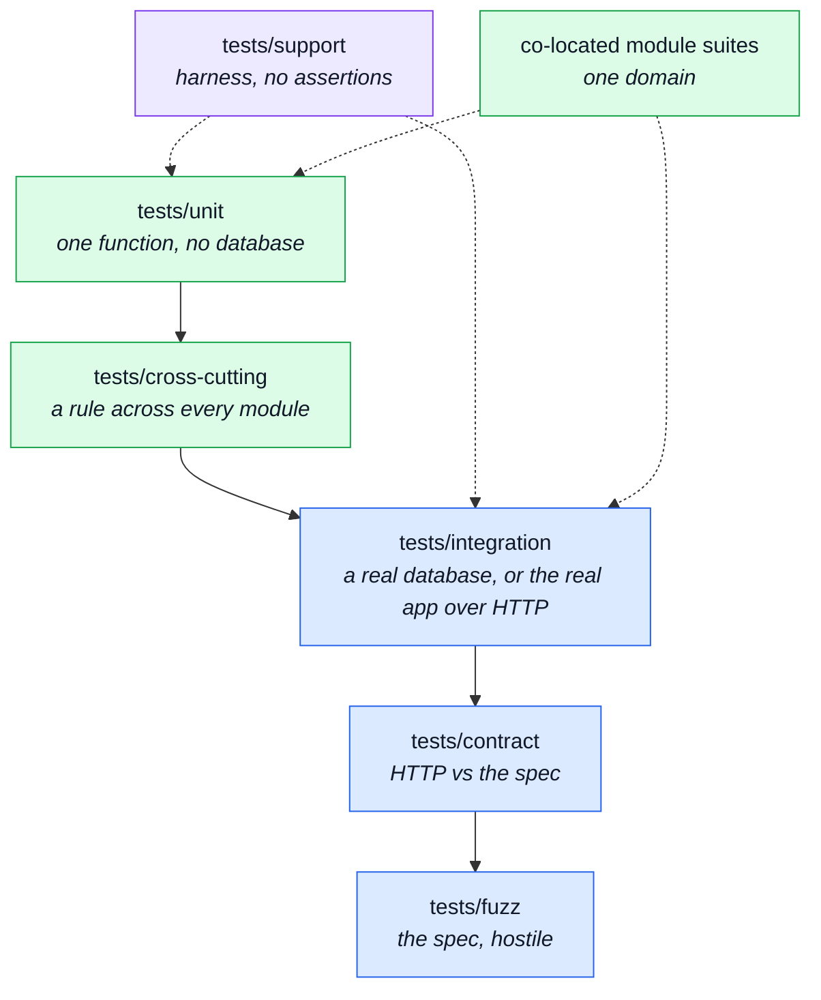
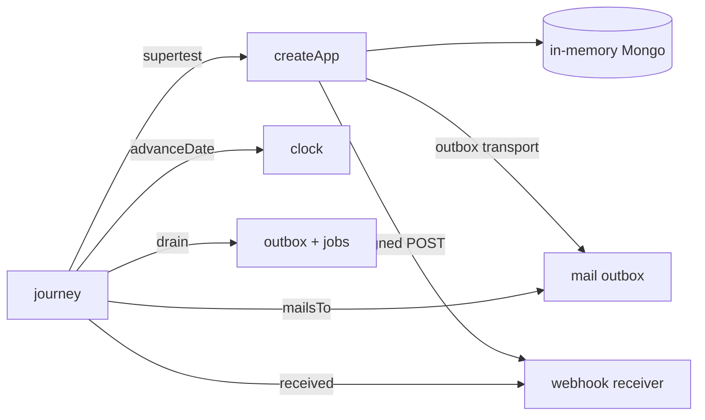
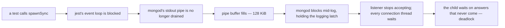
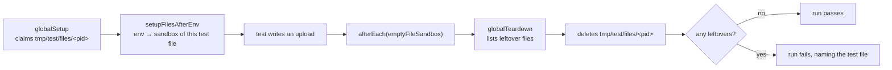

# Tests

One row per folder. A test file's own name and `describe` say which rule it covers.

Tests live in two places, split by whose rule they check rather than by what they touch:

- **A module's own rules** live inside it, in `src/modules/<module>/tests/`. They may run the real
  modules it depends on (its `dependsOn` in `module.yaml`): removing one of those already means
  changing this module.
- **The system's rules** live in `tests/` — infrastructure, the kernel, a rule every module must
  hold, the demo scenarios, and any flow no single module depends on all of: two modules joined
  only by a port or an event (`products` + `locales`, `payments` + `webhooks`).

When several modules qualify, the one highest in the dependency chain owns the test — checkout's
suites sit in `cart`, which depends on `orders`, `inventory` and `payments`.

A test asserts only its own module's rules. The modules below it are setup; their rules are proven
in their own folders. So removing a module removes its tests and nothing a dependency needs.

`eslint-plugin-boundaries` enforces the door at the import: a module's tests reach a sibling
through its barrel, or through its `tests/factories.ts` for storage the barrel will not publish —
see `eslint.config.ts`.

---

## The suites



## Order-dependence

`--runInBand` runs `tests/integration`, `tests/contract` and `tests/fuzz` in one process, in
whatever order Jest discovers the files — deterministic, but not meaningful: a suite that only
passes because an earlier file left state behind (a fixture, a cached module) looks identical to
one that doesn't, until the file order changes.

`npm run test:order-random` runs the same three suites shuffled (`--randomize --showSeed`) instead
of gating on it. Not part of `npm run test` or the merge gate: it runs nightly in
`.github/workflows/order-random.yml`, and is cheap enough to run by hand after touching shared test
fixtures or module-level state. `--showSeed` prints the seed a red run needs to reproduce.

## Warnings fail the case

A warning printed to a green run is read by nobody, and a deprecation is cheapest to fix the day it first appears. `tests/support/setup-fail-on-warning.ts` (a `setupFilesAfterEnv` entry) wraps `console.warn` and `console.error` and listens for `process` `'warning'` events (a `DeprecationWarning`, a `MaxListenersExceededWarning`, a driver warning) around every case, and fails the case that caused one it did not declare.

A case that warns on purpose says so, with `expectWarning` from `tests/support/expect-warning.ts`:

```ts
import { expectWarning } from '@tests/expect-warning';

expectWarning(/connection pool/); // a substring or a pattern; it must fire, or the case fails
```

The declaration must fire: a stale one fails the case, so it cannot outlive the warning it covered. A case that spies on the console itself stands on top of the watcher and keeps its own control of what it expects. The app's own logger (`winston`) writes to the stream, not to `console`, so a logged warning is not a test warning.

What the guard watches, and does not:

- Each case only, from its `beforeEach` to its `afterEach`. A warning from `beforeAll`/`afterAll` or from module load is not counted.
- Node's warnings arrive late (one tick), so the guard waits one real tick before and after each case. A warning from a sync case is credited to that case.
- Jest's `process` is a copy with no listeners; `tests/support/test-environment.ts` forwards the host process's warnings into it.
- A Node-core deprecation fires once per worker, so which file fails depends on scheduling. Never declare one; fix the caller.
- The replicas and broker configs run no guard.
- Why hand-written and not `jest-fail-on-console`: it has no must-fire check and sees the console only, not `process` warnings.

The paired frontend has the same idea for `[Vue warn]`, as a declared fork that is not kept in step.

## Three numbers, and they are not the same question

This trips people up, so it is stated before anything else on this page.

**Tests passing is 100%, always.** Every test here must pass. One failing test
is a red build — no threshold, no percentage, no "most of them". A test that fails is fixed or it
is deleted; nothing in this repo tolerates a known-failing test. Everything below is about a
different question, and none of it softens this one.

The other number is a measurement of the SUITE rather than of the code:

|                    | The question it answers                      | Verdict on a low number                      |
| ------------------ | -------------------------------------------- | -------------------------------------------- |
| **Pass rate**      | did every assertion hold                     | something is **broken** — fix it now         |
| **Mutation score** | would a test **notice** if this line changed | the suite is **weak here** — the real signal |

### Mutation testing is the instrument; coverage is not measured

Line coverage asks only whether a line ran. A line can be executed by a test that asserts nothing
whatever about it, and coverage will call that 100%.

Mutation testing asks the question you actually care about: **Stryker edits the code — flips a
comparison, drops a call, changes a constant — and checks that some test goes red.** A test that
does not notice the change did not really test the line, and the mutant "survives".

That relationship is one-directional: an uncovered line cannot possibly kill a mutant, so **every
coverage gap shows up as surviving mutants (`NoCoverage`, per line), while the converse is false**.
Mutation score subsumes coverage, so no coverage run, threshold or report exists. See
[Coverage & Confidence](../build/coverage-and-confidence.md#_2-why-the-coverage-floors-were-deleted)
for why the floors were deleted.

So the honest framing of this repository's tooling:

- **`npm run mutation` / `npm run mutation:full` are the judgement of test quality.** Their
  per-file scores in `mutation-baseline.json` are what "is this actually tested" means here.
- **A module spec that calls `setupTestDb()` belongs in that module's `tests/integration/`**, not
  its `tests/unit/`: `unit-layer-stays-database-free` in `.dependency-cruiser.cjs` refuses a spec
  under `tests/unit` that can reach a database at all.

::: tip One ruler
`stryker.json` is the only mutation config, and it runs `tests/integration/` as well as the unit suites — see
[one ruler](../build/mutation-testing.md#one-ruler). A 0% in `mutation-baseline.json` is a real
finding: no eligible spec killed a mutant in that file. Read the ratchet against its own recorded
history, not as an absolute grade.
:::

### Which command answers which question

| Command                 | Runs                        | Answers                                      |
| ----------------------- | --------------------------- | -------------------------------------------- |
| `npm run test`          | every suite                 | does everything pass — **the one that must** |
| `npm run mutation:full` | unit + integration, mutated | **would the tests notice a change**          |

See [Mutation Testing](../build/mutation-testing.md) for the run itself, its baseline ratchet and
what the `high`/`low`/`break` thresholds mean.

### What earns a test

A documented rule gets a test when all three hold:

1. **A line of our own code enforces it today** — a branch, comparison, sort, constant, check
   order, event emit or route mount, so a change to existing code can break it.
    - Skip a rule that holds **by absence** (no middleware, no second caller, no emit call) or
      **by construction** (a value read back from the stored row, or a check made once at placement
      and not repeated). Breaking it means writing new code on purpose.
    - Exception: a security or money stop that a **dependency** provides gets one learning test.
      Dependabot bumps dependencies weekly, unasked.
2. **A break would be silent** — nothing fails at boot, no type error, no other suite goes red.
3. **Someone is hurt by the break** — security, money or stock, a state or precedence rule, a
   promise to a client (retry semantics included), or a metric behind an alert.

How to build what passes:

- If a sweep already owns the family, extend the sweep; do not add a per-route copy.
- Put the test in a suite Stryker runs (unit, integration or cross-cutting). Use the contract
  suite only when the claim is about the response shape, or about per-route wiring that a mutant
  cannot reach.
- Read [Coverage & Confidence](../build/coverage-and-confidence.md) for what a surviving or
  `NoCoverage` mutant means.

### A test never checks inside a branch

`eslint-plugin-jest`'s `flat/recommended` set is in the lint gate (`eslint.config.ts`, the Jest
block). The one that shapes how a spec is written is `jest/no-conditional-expect`: an `expect`
inside an `if`, a `catch` or a `?:` is refused, because when the branch is skipped the test is
green and checked nothing.

- A table row that differs per case: put the difference in the **expected value**
  (`expect(x).toBe(isDefault)`), or filter and assert the bad set is empty
  (`expect(bad).toEqual([])`).
- A race with two legal outcomes: read every value first, then one `toEqual` against the whole
  outcome each order allows. A hybrid then matches neither.
- A check that only holds when a module is deployed: `expect(found > 0).toBe(isDeployed('x'))`.
- A branch with no honest unconditional form takes a described `eslint-disable`. There are two
  (`malformed-ids.test.ts`, `spec-identity.test.ts`); a third is a sign to rewrite, not to disable.

---

## `tests/cross-cutting/` — rules that hold across every module

The house speciality: one file per architectural rule, asserted over every module at once.
A new module is covered the day it is added, without anyone writing a test for it.

| Theme                              | What the files hold                                                                                                |
| ---------------------------------- | ------------------------------------------------------------------------------------------------------------------ |
| Contract and spec agreement        | Bundles, error declarations, responses never null, search parity, replace/patch parity, scalars, browser events    |
| Authorization and identity         | Permission vocabulary and conditions, guarded routes, stale bearer on open operations, step-up, api-key security   |
| Security conformance               | Security headers, request headers, cookies, rate-limit keys and budgets, SSRF, crypto, credential fields           |
| Shared rules and conformance cases | Money, outbox backoff, normalise email, log redaction, env booleans, permission-model version                      |
| Modules and topology               | Descriptors, subscriptions, enabled modules, scheduled jobs, production topology, proxy overlay, webhook producers |
| Data and locales                   | Personal-data erasure, locale parity and namespaces, translatable targets, analytics events, audit actions         |

`ls tests/cross-cutting` is the list: one file per rule, named for it.

## `tests/unit/`

One function, no database, no HTTP. Fast enough to run from the pre-commit hook.

A unit test mirrors the path of its subject: `tests/unit/infrastructure/http/preconditions.test.ts` tests
`src/infrastructure/http/preconditions.ts`. The tables below name the ones whose subject or reason
is not obvious from the path; `ls tests/unit/<path>` is the complete list.

| Folder                          | What lives here                                                                                                                                                 |
| ------------------------------- | --------------------------------------------------------------------------------------------------------------------------------------------------------------- |
| `tests/unit/infrastructure/`    | One subfolder per `src/infrastructure/` folder: adapters, config, http (and middlewares), i18n, observability, persistence, runtime, security, surfaces         |
| `tests/unit/kernel/`            | The registry, permissions and ability, access queries, authentication and bearer seams, events, the outbox, step-up, the config gate                            |
| `tests/unit/app/`               | `src/app/`: config, error handling, the entry point, process error handlers, security.txt, server timeouts, telemetry, trust proxy                              |
| `tests/unit/domain-primitives/` | Money, time, postal address, lifecycle                                                                                                                          |
| `tests/unit/i18n/`              | The locale an email is rendered in                                                                                                                              |
| `tests/unit/scenarios/`         | `scenarios/`: accounts, personas, waves, seed, the fake payments and OAuth providers, the webhook sink, the demo clock                                          |
| `tests/unit/scripts/<folder>/`  | One subfolder per `scripts/` folder: contracts, docs, eslint (the lint rules), hooks, mutation, pairing, scaffold, security, setup, testing, audit, db, modules |
| `tests/unit/support/`           | The harness's own helpers: the file sandbox, expect-warning, the response-contract and spec-walk checks                                                         |

## `tests/integration/` — the real app over HTTP

Boots the application against an in-memory MongoDB and drives it as a client would. Run serially.

| Folder                           | What lives here                                                                                                                                                       | Read next                                               |
| -------------------------------- | --------------------------------------------------------------------------------------------------------------------------------------------------------------------- | ------------------------------------------------------- |
| `tests/integration/`             | The real app over HTTP and the real database: health, hardening, bad bodies, conditional writes, erasure, outbox, security middleware, upload security, webhook rules | [Integration testing](../build/integration-testing.md)  |
| `tests/integration/concurrency/` | Races: two requests that must not both win (account deletion, cart, payment)                                                                                          | [Integration testing](../build/integration-testing.md)  |
| `tests/integration/kernel/`      | The outbox and session failure paths, through the kernel                                                                                                              | [Outbox](../understand/outbox.md)                       |
| `tests/integration/persistence/` | The persistence helpers against a real database: leases, revisions, money fields, strict queries, command metrics                                                     | [MongoDB & Mongoose](../understand/mongodb-mongoose.md) |
| `tests/integration/scenarios/`   | The demo scenarios applied, restored and served                                                                                                                       | [Demo profile](../build/demo-profile.md)                |
| `tests/integration/scripts/db/`  | The index-sync script against a real database                                                                                                                         | [Data](./data.md)                                       |
| `tests/integration/journeys/`    | One user across modules (next section)                                                                                                                                | below                                                   |

## `tests/integration/journeys/` — one user across modules

A journey walks one story through the REST API with no browser and asserts the **end state across
modules**: money, stock, documents, audit and mail agree. It does not mirror the frontend's
Cypress journeys, and it never re-tests a rule one module's own tests pin. It runs inside the
`integration` suite (in-process `createApp()`), in jwt mode there and in cookie mode through
`npm run test:journeys:cookie`. Stryker ignores the folder (see
[Mutation Testing](../build/mutation-testing.md#what-is-still-excluded-and-why)).

| Step that leaves the API | How a journey handles it                                                                 |
| ------------------------ | ---------------------------------------------------------------------------------------- |
| Email                    | the `outbox` transport, read with `mailsTo` / `waitForMail`; never cleared between steps |
| Time                     | `freezeDate` then `advanceDate`, only forward; sign in again after a jump                |
| Background work          | `drain(...jobs)`: settle the outbox, run the named jobs in-process, settle again         |
| Card provider            | the `fake` double and its levers                                                         |
| Human check, TOTP        | `altcha-lib`'s solver through `GET /antibot/challenge`; `codeFor(secret, steps)`         |
| A webhook subscriber     | `startWebhookReceiver`: the demo sink's certificate and exemption, no mocks              |



## `tests/replicas/` — more than one copy

One process is not the deployment. These boot real copies of the app behind a proxy, because the bugs they look for cannot
happen in a single process.

| Folder            | What lives here                                                   | Read next                                                                                         |
| ----------------- | ----------------------------------------------------------------- | ------------------------------------------------------------------------------------------------- |
| `tests/replicas/` | N copies behind a proxy: what only more than one process can show | [Replicas testing](../build/replicas-testing.md) · [Scaling & Shutdown](../understand/scaling.md) |

## `tests/broker/` — a real RabbitMQ

`queue.test.ts` mocks `amqplib`; these run the adapter against a real broker, so they see what
RabbitMQ does with the arguments the unit suite only asserts we pass.

| Folder          | What lives here                           | Read next                             |
| --------------- | ----------------------------------------- | ------------------------------------- |
| `tests/broker/` | The queue adapter against a real RabbitMQ | [RabbitMQ](../understand/rabbitmq.md) |

## `tests/contract/` and `tests/fuzz/`

| Folder            | What lives here                                                                                                                                                 | Read next                                        |
| ----------------- | --------------------------------------------------------------------------------------------------------------------------------------------------------------- | ------------------------------------------------ |
| `tests/contract/` | The app-wide HTTP-versus-spec sweeps: system routes and problem errors, request and response shapes, ownership, write methods, ETags, idempotency, upload types | [Contract testing](../build/contract-testing.md) |
| `tests/fuzz/`     | The spec driven hostile: generated endpoints, negative bodies, the SSRF guard                                                                                   | [Fuzz testing](../build/fuzz-testing.md)         |

## `tests/support/` — the harness

No assertions live here. These are what the suites are built from.

| Folder                    | What lives here                                                                                                                                                                                           |
| ------------------------- | --------------------------------------------------------------------------------------------------------------------------------------------------------------------------------------------------------- |
| `tests/support/`          | Jest's bootstrap (global setup/teardown, per-worker setup, the environment and its resets), the in-memory Mongo, the HTTP harness, the file sandbox, fail-on-warning, and the helpers every suite imports |
| `tests/support/fixtures/` | Localhost TLS certificate and key for the tests that need HTTPS                                                                                                                                           |

`ls tests/support` is the list: each file's own `@module` header says what it is.

### Never block the event loop in a test

A test may not call `spawnSync`, `execSync`, or anything else that blocks jest's event loop, and
this is not a style preference.

`tests/support/global-setup.ts` starts one `mongod` per jest instance and pipes its stdout into
**jest's own main process**. Nothing else reads it. A blocking call stops that reading, the pipe
buffer fills, and `mongod` blocks part-way through writing a log line while it holds its logging
latch — at which point the server stops answering anyone, its listener included.



A seed or a boot logs enough for this to happen within seconds. Spawn asynchronously and `await`
the result: `tests/integration/scenarios/apply.test.ts` is the worked example.

### A test leaves no files behind

A test run must not write onto the machine it runs on. The application writes files in several
places, and each defaults to a real directory:

| Setting                          | Default outside tests               | In tests                                      |
| -------------------------------- | ----------------------------------- | --------------------------------------------- |
| `NODE_PUBLIC_PATH`               | `public/` — uploads, thumbnails     | `tmp/test/files/<pid>/<test file>/public`     |
| `NODE_QUARANTINE_PATH`           | `tmp/quarantine/`                   | `tmp/test/files/<pid>/<test file>/quarantine` |
| `NODE_UPLOAD_STAGING_PATH`       | `<system temp>/node-api-uploads/`   | `tmp/test/files/<pid>/<test file>/uploads`    |
| `NODE_MAIL_SPOOL_PATH`           | the mail spool                      | `tmp/test/files/<pid>/<test file>/mail-spool` |
| `NODE_DOCUMENT_STORE_PATH`       | stored invoice and credit-note PDFs | `tmp/test/files/<pid>/<test file>/documents`  |
| `NODE_ACCOUNT_EXPORT_STORE_PATH` | built account exports               | `tmp/test/files/<pid>/<test file>/exports`    |

Two rules, both enforced:

- **Redirected.** `tests/support/setup-file-sandbox.ts` assigns every one before a test file loads,
  overriding `.env` and the shell. Without `globalSetup` it refuses to run rather than fall back.
- **Removed.** A test that writes a file for real deletes it — `afterEach(emptyFileSandbox)` is
  the whole idiom. Code that builds exports in the background (`settleInlineExports()`) waits for
  the build first: `afterEach(() => settleInlineExports().then(emptyFileSandbox))`. Teardown lists what is left, deletes the sandbox anyway, then fails the run
  naming each offending test file.



A killed run never reaches teardown; the next run sweeps a dead instance's directory, exactly as it
does for the in-memory Mongo data.

## Co-located module tests

A module's own suites live inside it. Same runner, same conventions; `npm run test:unit`,
`npm run test:integration` and `npm run test:contract` each pick up both locations.

| Pattern                                     | What it is                                                                                                                                                                                                                                                                  | Read next                                                                                   |
| ------------------------------------------- | --------------------------------------------------------------------------------------------------------------------------------------------------------------------------------------------------------------------------------------------------------------------------- | ------------------------------------------------------------------------------------------- |
| `src/modules/*/tests/unit/*.test.ts`        | The module's unit suites, one file per subject rather than per source file. A name carrying `property` before the test extension is generated-input rather than example-based. No database — see `unit-layer-stays-database-free` in `.dependency-cruiser.cjs`.             | [Unit Testing](../build/unit-testing.md) · [Property Testing](../build/property-testing.md) |
| `src/modules/*/tests/integration/*.test.ts` | Specs of the same module that DO need a real database — calling `setupTestDb()` and exercising the repository, the service or the module's routes over HTTP. `stryker.json`'s mutation run includes this tier — it is what covers the service and repository layers at all. | [Integration Testing](../build/integration-testing.md)                                      |
| `src/modules/*/tests/contract/*.test.ts`    | The module's endpoints driven over HTTP and checked against its slice of `openapi.yaml`. One per module that has routes.                                                                                                                                                    | [Contract Testing (Response)](../build/contract-testing.md)                                 |
| `src/modules/*/tests/factories.ts`          | Test-only factories too specific to belong in the module's published factory — and the module's test-side door: the repository reads and `force*` writers a sibling's tests may use, which the barrel never publishes to production code.                                   | [Unit Testing](../build/unit-testing.md)                                                    |

## Load testing

Not part of any gate — these are run by hand against a running instance.

`tests/load/` is the one directory under `tests/` that is **not** a jest suite. These are k6
scripts: JavaScript for the k6 Go runtime, not this project's TypeScript. Jest's `testMatch` wants
`*.test.ts` and never sees them, and `eslint.config.ts` ignores the directory outright, because
they import from `k6/http` — a specifier that resolves only inside k6.

| Folder        | What lives here                                                                                                                                              | Read next                                |
| ------------- | ------------------------------------------------------------------------------------------------------------------------------------------------------------ | ---------------------------------------- |
| `tests/load/` | k6 scripts: one URL at constant load, the anonymous storefront read path, and the log-in, fill-a-cart, check-out write path (`npm run bench` runs the first) | [Load testing](../build/load-testing.md) |
