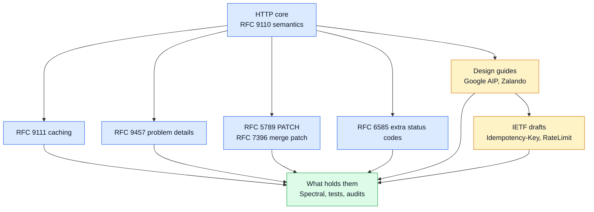

# API Standards

This API follows the mature HTTP standards, and writes down where it does not. This page names
each standard, links its source, and lists the differences with their reasons. The ten audits under
`scripts/audit/api-*` read it; they report and never change a file.

## Why standards matter here

This is a boilerplate other projects copy. A copied API should be boring and predictable
([API](../api/index.md#what-matters-most-here)): a client, a proxy or a reader who knows HTTP
should not be surprised. A standard is the cheapest way to be unsurprising.

Most of it is already held mechanically. Spectral lints the contract, the bundler adds `ETag`,
`If-Match`, `412` and `304`, and tests walk the contract. The audits cover what a rule cannot: does
an operation's _meaning_ fit the standard, is a difference written down, does a doc disagree with
the code.

## How the standards stack up

## The standards

Each audit has one standard, a folder under `scripts/audit/`, and its rules in
[`scripts/audit/api-standards.yaml`](https://github.com/Guebbit/boilerplate-node-backend/blob/main/scripts/audit/api-standards.yaml).
The "follows" column is a link, not a restatement.

| Standard          | What it is                                                    | Source                                                                                                                                         | Where we follow it, and differ                                                                                |
| ----------------- | ------------------------------------------------------------- | ---------------------------------------------------------------------------------------------------------------------------------------------- | ------------------------------------------------------------------------------------------------------------- |
| RFC 9110          | HTTP semantics: methods, status codes, conditional requests   | [RFC 9110](https://www.rfc-editor.org/rfc/rfc9110), [MDN](https://developer.mozilla.org/en-US/docs/Web/HTTP)                                   | [Write methods](../api/write-methods.md)                                                                      |
| RFC 9111          | HTTP caching                                                  | [RFC 9111](https://www.rfc-editor.org/rfc/rfc9111)                                                                                             | [HTTP and caches](./defences/http-and-caches.md)                                                              |
| RFC 9457          | Problem details for HTTP errors                               | [RFC 9457](https://www.rfc-editor.org/rfc/rfc9457)                                                                                             | [Errors](../api/errors.md#problem-details)                                                                    |
| RFC 5789          | The PATCH method                                              | [RFC 5789](https://www.rfc-editor.org/rfc/rfc5789)                                                                                             | [PATCH](../api/write-methods.md#patch-—-json-merge-patch)                                                     |
| RFC 7396          | JSON Merge Patch                                              | [RFC 7396](https://www.rfc-editor.org/rfc/rfc7396)                                                                                             | [PATCH](../api/write-methods.md#patch-—-json-merge-patch), [null](../api/write-methods.md#empty-null-omitted) |
| RFC 6585          | 428, 429, 431, 511                                            | [RFC 6585](https://www.rfc-editor.org/rfc/rfc6585)                                                                                             | [Status codes a write answers](../api/write-methods.md#status-codes-a-write-answers)                          |
| RateLimit headers | `RateLimit`, `RateLimit-Policy` (an IETF draft)               | [draft-ietf-httpapi-ratelimit-headers](https://datatracker.ietf.org/doc/draft-ietf-httpapi-ratelimit-headers/)                                 | [Security](../tools/security.md)                                                                              |
| Idempotency-Key   | Safe retry of a POST (an IETF draft)                          | [draft-ietf-httpapi-idempotency-key-header](https://datatracker.ietf.org/doc/draft-ietf-httpapi-idempotency-key-header/)                       | [Idempotency](../tools/idempotency.md)                                                                        |
| Google AIP        | Resource-oriented design (AIP-121 to 136, 140, 158, 193, 216) | [AIP-135](https://google.aip.dev/135), [136](https://google.aip.dev/136), [158](https://google.aip.dev/158), [193](https://google.aip.dev/193) | the rows below                                                                                                |
| Zalando           | RESTful API guidelines                                        | [Zalando guidelines](https://opensource.zalando.com/restful-api-guidelines/)                                                                   | the rows below                                                                                                |

The two IETF drafts move. The page was checked on 2026-11-06 against
`draft-ietf-httpapi-ratelimit-headers-11` (expires 2026-11-24) and
`draft-ietf-httpapi-idempotency-key-header-08` (dated 2026-10-22). Each audit re-checks the latest
draft when it runs, because a draft's number is not a fact that keeps.

The OWASP API Security Top 10 is deliberately not an audit. It is a list of risks, not of rules,
and [Web Attacks & Defences](./defences/) already answers each one.

Compatibility and sunset rules are not covered yet. There is nothing to compare before 1.0; then
the right tool is a deterministic contract diff such as oasdiff, not an AI.

## When standards disagree

They do: Zalando wants `snake_case` and Google's JSON mapping wants `lowerCamelCase`; Zalando wants
problem JSON and Google wants `google.rpc.Status`. A single audit reports against its own standard
only.

When someone asks for several audits at once, they state the **order of precedence first**
(for example "RFC 9110 > Google AIP > Zalando"). Each conflict is then reported once, under the
winning standard, and the losing standards' view is a note. The agent never picks the order.

## Where we differ, and why

This is information, not a rule the audits obey. Each row has an `id` that a rule in the registry
may name; the audit then reports a hit as `KNOWN-DIFFERENCE`, still visible. A source marked
`verified` was read on 2026-11-06; `from memory` was not re-read.

| id                                  | Standard says                                                                                                                                                                                                                                                                                                                                                                                               | We do                                                                                                                                                                                                                                                       | Why                                                                                                                                                                                                                                                                                                                                                                                                                                                                                                                                                                                                                                                                                                                                                                                             | Source                                                                                                                                                                                                                                                                           |
| ----------------------------------- | ----------------------------------------------------------------------------------------------------------------------------------------------------------------------------------------------------------------------------------------------------------------------------------------------------------------------------------------------------------------------------------------------------------- | ----------------------------------------------------------------------------------------------------------------------------------------------------------------------------------------------------------------------------------------------------------- | ----------------------------------------------------------------------------------------------------------------------------------------------------------------------------------------------------------------------------------------------------------------------------------------------------------------------------------------------------------------------------------------------------------------------------------------------------------------------------------------------------------------------------------------------------------------------------------------------------------------------------------------------------------------------------------------------------------------------------------------------------------------------------------------------- | -------------------------------------------------------------------------------------------------------------------------------------------------------------------------------------------------------------------------------------------------------------------------------- | --------------------------------------------------------------------------------------------------------------------------------------------------------------------------------------------------------------------------- | ---------------------------------------------------------------------------------------------------------- |
| `offset-paging`                     | AIP-158: pages by opaque `page_token`; `skip` and `total_size` are optional. Zalando #160: prefer cursor paging, avoid offset                                                                                                                                                                                                                                                                               | `page` and `pageSize`, with totals                                                                                                                                                                                                                          | admin tables jump to page N and show "of 37": [Pagination](../api/responses.md#pagination)                                                                                                                                                                                                                                                                                                                                                                                                                                                                                                                                                                                                                                                                                                      | verified: https://google.aip.dev/158, https://opensource.zalando.com/restful-api-guidelines/                                                                                                                                                                                     |
| `page-size-strict`                  | AIP-158: unset or 0 → the default, and the API must not return an error; above the max it should coerce down; negative must be `INVALID_ARGUMENT`                                                                                                                                                                                                                                                           | 1 to 100 as declared; 0, negatives, non-integers and anything above 100 answer 422                                                                                                                                                                          | AIP's 0-means-unset exists because proto3 cannot tell 0 from unset; a query string can. A wrong value is reported, not quietly turned into another request. Same stance as Stripe's 1..100 `limit`, `idempotency-key-malformed-refused` and the unknown-query-parameter 422: [Request Input](../theory/request-input.md)                                                                                                                                                                                                                                                                                                                                                                                                                                                                        | verified: https://google.aip.dev/158, https://docs.stripe.com/api/pagination                                                                                                                                                                                                     |
| `bounded-list-unpaged`              | AIP-158: page every collection from the start                                                                                                                                                                                                                                                                                                                                                               | a list stays unpaged when the domain or a config value bounds it, and its description names the bound                                                                                                                                                       | a whole small list in one read; adding paging later costs no client here: [A list](../api/responses.md#a-list)                                                                                                                                                                                                                                                                                                                                                                                                                                                                                                                                                                                                                                                                                  | verified: https://google.aip.dev/158                                                                                                                                                                                                                                             |
| `merge-patch-field-masks`           | AIP-134: a partial update carries a field mask (`update_mask`)                                                                                                                                                                                                                                                                                                                                              | PATCH takes an RFC 7396 merge patch, no mask                                                                                                                                                                                                                | A mask is a second parameter that names the fields; a merge patch says it in the one body, with `null` as the explicit clear. Any HTTP client and JSON tool can send it. The mask is a protobuf idea with no counterpart in this stack. See [PATCH](../api/write-methods.md#patch-—-json-merge-patch)                                                                                                                                                                                                                                                                                                                                                                                                                                                                                           | verified: https://google.aip.dev/134                                                                                                                                                                                                                                             |
| `custom-verb-path`                  | AIP-136: a custom method is `POST /x/{id}:verb`                                                                                                                                                                                                                                                                                                                                                             | `POST /x/{id}/verb`                                                                                                                                                                                                                                         | `:` opens a parameter in Express route patterns and is awkward in OpenAPI path templates; a path segment needs no escaping anywhere. The shape stays one rule: [Action](../api/write-methods.md#post)                                                                                                                                                                                                                                                                                                                                                                                                                                                                                                                                                                                           | verified: https://google.aip.dev/136                                                                                                                                                                                                                                             |
| `pointer-put`                       | AIP-136 would use POST `:setDefault`                                                                                                                                                                                                                                                                                                                                                                        | `PUT …/default` with no body states the fact and is idempotent (Shopify the same): [A PUT with no body points at something](../api/write-methods.md#put--replace)                                                                                           | a custom POST would add a verb for what the URI already says; sent twice, nothing changes                                                                                                                                                                                                                                                                                                                                                                                                                                                                                                                                                                                                                                                                                                       | verified: https://google.aip.dev/136                                                                                                                                                                                                                                             |
| `camel-case`                        | Zalando #118: property names are `snake_case`, never `camelCase`                                                                                                                                                                                                                                                                                                                                            | `camelCase` properties                                                                                                                                                                                                                                      | the JSON maps straight onto the TypeScript types and the frontend, with no rename layer to keep true. Google's JSON mapping is `lowerCamelCase`, so AIP agrees with us here                                                                                                                                                                                                                                                                                                                                                                                                                                                                                                                                                                                                                     | verified: https://opensource.zalando.com/restful-api-guidelines/ (AIP side: from memory)                                                                                                                                                                                         |
| `problem-json-status`               | AIP-193: an error is a `google.rpc.Status` with an `ErrorInfo` detail                                                                                                                                                                                                                                                                                                                                       | `application/problem+json` (RFC 9457) with an `errors[]` extension                                                                                                                                                                                          | RFC 9457 is the IETF standard for any HTTP API; `google.rpc.Status` is protobuf-first. Zalando #176 asks for problem JSON too, so the two guides disagree and RFC 9457 sits above both: [Problem details](../api/errors.md#problem-details)                                                                                                                                                                                                                                                                                                                                                                                                                                                                                                                                                     | verified: https://google.aip.dev/193, https://opensource.zalando.com/restful-api-guidelines/                                                                                                                                                                                     |
| `conflict-409`                      | AIP-216 maps a refused state transition to a precondition failure (HTTP 400)                                                                                                                                                                                                                                                                                                                                | 409 with a `<RESOURCE>_ALREADY_<STATE>` code                                                                                                                                                                                                                | RFC 9110 §15.5.10 defines 409 as a conflict with the current state, which is exactly this: [Repeating an action](../api/write-methods.md#repeating-an-action-409)                                                                                                                                                                                                                                                                                                                                                                                                                                                                                                                                                                                                                               | RFC: from memory; AIP: from memory                                                                                                                                                                                                                                               |
| `oauth-callback-get`                | RFC 9110 §9.2.1: a GET is safe, it changes nothing                                                                                                                                                                                                                                                                                                                                                          | `GET /account/oauth/{provider}/callback` sets a session                                                                                                                                                                                                     | the identity provider redirects the browser, and a redirect is a GET; the method is not ours to choose. The `state` cookie is the CSRF guard: [OAuth](../modules/account-oauth.md#the-endpoint-surface-and-how-failure-travels)                                                                                                                                                                                                                                                                                                                                                                                                                                                                                                                                                                 | from memory (RFC 6749 §3.1.2)                                                                                                                                                                                                                                                    |
| `line-answers-parent`               | RFC 9110 §15.3.2: a 201 names a new resource at `Location`                                                                                                                                                                                                                                                                                                                                                  | a line write (cart item, saved product) answers 200 with the whole parent                                                                                                                                                                                   | a line has no read of its own (no line URL answers a GET), so a 201 would have no `Location` to name. The parent is what the client re-renders: [A line is written through its parent](../api/write-methods.md#a-line-is-written-through-its-parent)                                                                                                                                                                                                                                                                                                                                                                                                                                                                                                                                            | RFC: from memory                                                                                                                                                                                                                                                                 |
| `signup-refusal-201`                | RFC 9110 §15.3.2: a 201 means created                                                                                                                                                                                                                                                                                                                                                                       | when antibot rung 2 (`NODE_ANTIBOT_EMAIL_POLICY`) refuses an address, `POST /account/signup` still answers 201 with the account body and `Location: /account`; nothing is stored and no session cookie is set                                               | a bot must not learn its address was refused. Only the missing `Set-Cookie` tells the two apart; rung 2 is off by default: [Deliberate exceptions](../api/write-methods.md#deliberate-exceptions)                                                                                                                                                                                                                                                                                                                                                                                                                                                                                                                                                                                               | verified: https://www.rfc-editor.org/rfc/rfc9110#section-15.3.2                                                                                                                                                                                                                  |
| `metrics-text-plain`                | RFC 9457 and Zalando #176: an error is problem JSON                                                                                                                                                                                                                                                                                                                                                         | a failed Prometheus scrape answers `text/plain`                                                                                                                                                                                                             | the scraper reads exposition text and nothing else: [Outside the JSON API](../api/errors.md#outside-the-json-api)                                                                                                                                                                                                                                                                                                                                                                                                                                                                                                                                                                                                                                                                               | verified: https://opensource.zalando.com/restful-api-guidelines/                                                                                                                                                                                                                 |
| `probe-empty-503`                   | RFC 9457 and Zalando #176: an error is problem JSON                                                                                                                                                                                                                                                                                                                                                         | `GET /readyz` answers 503 with an empty body                                                                                                                                                                                                                | a probe reads the status and nothing else; Kubernetes counts 200-399 as success and anything else as failure: [Outside the JSON API](../api/errors.md#outside-the-json-api)                                                                                                                                                                                                                                                                                                                                                                                                                                                                                                                                                                                                                     | verified: https://kubernetes.io/docs/tasks/configure-pod-container/configure-liveness-readiness-startup-probes/                                                                                                                                                                  |
| `server-parser-bare-errors`         | RFC 9457 and Zalando #176: an error is problem JSON                                                                                                                                                                                                                                                                                                                                                         | Node's HTTP server answers 400, 408, 413 and 431 itself with a bare status line                                                                                                                                                                             | RFC 9457 requires no body; Node's own docs example writes a bare 400, and Express, Koa, Go and Kestrel leave it bare. A `clientError` listener would copy a private Node guard and be a second `Problem` producer: [Outside the JSON API](../api/errors.md#outside-the-json-api)                                                                                                                                                                                                                                                                                                                                                                                                                                                                                                                | verified: https://www.rfc-editor.org/rfc/rfc9457 and https://nodejs.org/api/http.html#event-clienterror                                                                                                                                                                          |
| `request-id-x-prefix`               | RFC 6648: new parameters SHOULD NOT carry an `X-` prefix                                                                                                                                                                                                                                                                                                                                                    | the `x-request-id` header                                                                                                                                                                                                                                   | it is the de facto name that proxies, load balancers and log tools already read and forward; a new name would be one nobody propagates. RFC 6648 also says no assumption may rest on the prefix, and no standard defines a request-id header to use instead                                                                                                                                                                                                                                                                                                                                                                                                                                                                                                                                     | verified: https://www.rfc-editor.org/rfc/rfc6648                                                                                                                                                                                                                                 |
| `lowercase-enums`                   | Zalando #240: `UPPER_SNAKE_CASE`. AIP-126: `UPPER_SNAKE_CASE` for a proto enum, `kebab-case` for a string field with enumerated values                                                                                                                                                                                                                                                                      | lowercase `snake_case` values                                                                                                                                                                                                                               | the references we rank first spell them that way: Stripe (`requires_capture`), Solidus (`balance_due`), Shopify REST (`partially_refunded`). Error codes are not enum values and stay `UPPER_SNAKE`; the exceptions are listed in [Generated output](../api/openapi-workflow.md#generated-output-api)                                                                                                                                                                                                                                                                                                                                                                                                                                                                                           | verified: https://opensource.zalando.com/restful-api-guidelines/, https://google.aip.dev/126, https://docs.stripe.com/api/payment_intents/object, https://shopify.dev/docs/api/admin-rest/latest/resources/order                                                                 |
| `revoke-keeps-row`                  | AIP-135 and AIP-164: a soft delete returns the resource; a delete removes it                                                                                                                                                                                                                                                                                                                                | `DELETE /api-keys/{id}` answers 204 and keeps the row, with `revokedAt` set                                                                                                                                                                                 | the credential stops working at once, which is what a DELETE means to a client (RFC 9110 §9.3.5), while the row and its audit history stay readable. There is no undelete door, and the secret is never shown again, so a returned resource would add nothing                                                                                                                                                                                                                                                                                                                                                                                                                                                                                                                                   | verified: https://google.aip.dev/135, https://google.aip.dev/164                                                                                                                                                                                                                 |
| `soft-delete-204`                   | AIP-164: a soft delete returns the resource; a repeat is NOT_FOUND                                                                                                                                                                                                                                                                                                                                          | `DELETE /users                                                                                                                                                                                                                                              | products                                                                                                                                                                                                                                                                                                                                                                                                                                                                                                                                                                                                                                                                                                                                                                                        | orders/{id}` answers 204 with no body, and a repeat answers 204 again, changing nothing                                                                                                                                                                                          | one delete shape, soft or hard (RFC 9110 §9.3.5); the client drops the row, `POST …/restore` is the undo. A repeat: RFC 9110 §13.1.1 allows a 2xx when the change was already applied to a representation that still exists | verified: https://google.aip.dev/164, https://github.com/solidusio/solidus (Solidus `discard` answers 204) |
| `hard-delete-path`                  | AIP-135: Delete at the resource name                                                                                                                                                                                                                                                                                                                                                                        | `DELETE /x/{id}/hard` is an alias of `?hardDelete=true`                                                                                                                                                                                                     | the destructive variant has its own URL so it is asked for on purpose; a client or gateway that drops a query or body can't turn it into a soft delete: [Endpoints](../api/endpoints.md#users-staff), [Content-Type](../api/write-methods.md#content-type-415)                                                                                                                                                                                                                                                                                                                                                                                                                                                                                                                                  | verified: https://google.aip.dev/135                                                                                                                                                                                                                                             |
| `money-string`                      | Google `google.type.Money`: `currency_code`, whole `units` (int64) and `nanos` (10^-9 units). Zalando #173: `amount` is a JSON number with `format: decimal`, beside `currency`                                                                                                                                                                                                                             | `amount` is a decimal **string** at the currency's own places (`"19.90"`, `"1000"` JPY)                                                                                                                                                                     | a JSON number loses its scale (`19.9` is not `19.90`) and may lose digits in a client's float; the string keeps both and needs no currency table to show it: [Money](../api/responses.md#money)                                                                                                                                                                                                                                                                                                                                                                                                                                                                                                                                                                                                 | verified: https://github.com/googleapis/googleapis/blob/master/google/type/money.proto, https://opensource.zalando.com/restful-api-guidelines/                                                                                                                                   |
| `money-resource-currency`           | Zalando #173 and Google `google.type.Money`: every amount carries its own currency, as `{ amount, currency }`                                                                                                                                                                                                                                                                                               | one `currency` per resource, or per row in a list; an amount in a child (an order line, a shipping option) reads the nearest ancestor's `currency` in the same answer. An amount with no currency reachable in its own answer is a bug, not this difference | one shop, one currency (`docs/modules/shop.md`, "One currency"); the wrapper pays only when one answer holds several currencies, as Shopify's money bags do. Even the multi-currency stats answers stay flat, one `currency` per row. Solidus, Shopify REST and Stripe keep single-currency amounts flat too: [Money](../api/responses.md#money)                                                                                                                                                                                                                                                                                                                                                                                                                                                | verified: https://opensource.zalando.com/restful-api-guidelines/#173, https://github.com/googleapis/googleapis/blob/master/google/type/money.proto, https://shopify.dev/docs/api/admin-rest/latest/resources/order, https://docs.stripe.com/api/payment_intents/object           |
| `civil-date-wire-form`              | AIP-142: a civil date is `google.type.Date`, a year/month/day message with no zone. Zalando #238: `date` is an RFC 3339 `full-date` string (`2019-07-30`)                                                                                                                                                                                                                                                   | a promise date is an ISO `format: date` string (`"2026-11-06"`), the same calendar day with no zone                                                                                                                                                         | the meaning matches (a calendar day, no time zone); only the wire form differs. A `Date` message is protobuf-first, a JSON client would rebuild the string from three numbers to show or sort it. The `full-date` string is the form Zalando, OpenAPI and `Intl` already read                                                                                                                                                                                                                                                                                                                                                                                                                                                                                                                   | verified: https://google.aip.dev/142, https://opensource.zalando.com/restful-api-guidelines/                                                                                                                                                                                     |
| `idempotency-key-malformed-refused` | RFC 9651 §2.2: a field that fails to parse is ignored                                                                                                                                                                                                                                                                                                                                                       | a malformed `Idempotency-Key` answers 422                                                                                                                                                                                                                   | ignoring it would run an unprotected write the client believes is protected. The draft's quoted form and the bare token are both accepted, as one key: [Idempotency](../tools/idempotency.md#how-it-works)                                                                                                                                                                                                                                                                                                                                                                                                                                                                                                                                                                                      | verified: https://www.rfc-editor.org/rfc/rfc9651.txt                                                                                                                                                                                                                             |
| `about-blank-with-codes`            | RFC 9457 §4.2.1 and §3.1.1: `type` is the primary identifier, and an app-specific problem gets its own type URI (a non-resolving one, such as `tag:`, is allowed). §3.2: an extension member belongs to the type that defines it. RateLimit draft-11 §5: three MAY types (`quota-exceeded`, `temporary-reduced-capacity`, `abnormal-usage-detected`). AIP-193: a `Help` link when the message is not enough | every error sends `type: about:blank`, including a refusal a draft defines a type for, and no docs link (no `Link: rel="describedby"`, no `doc_url`-style member). The domain meaning is `errors[].code`                                                    | one machine key, the `errors[].code` catalogue that stays true per operation; RFC 9457 §4: conditions the status already names are better as plain status codes, and most of our categories are the status; a type URI is a second identity, fixed forever once published (§3.1.1); the coarse-plus-fine model of AIP-193, Stripe and Azure. Every body bends §4.2.1 (`about:blank` claims no meaning beyond the status, `errors[].code` adds some). The RFC, Zalando and the IETF drafts follow the typed-URI model, and the big public APIs follow ours: it is a split. Reopens when IANA registers, through a published RFC and not a draft, a problem type for exactly our condition, or when a third-party client of this API appears: [Problem details](../api/errors.md#problem-details) | verified: https://www.rfc-editor.org/rfc/rfc9457.html, https://www.iana.org/assignments/http-problem-types/http-problem-types.xhtml, https://www.ietf.org/archive/id/draft-ietf-httpapi-ratelimit-headers-11.txt, https://google.aip.dev/193, https://docs.stripe.com/api/errors |
| `closed-problem-schema`             | RFC 9457 §3.2: a client ignores an extension member it does not know. Zalando #111: a format must not declare `additionalProperties` to be `false`                                                                                                                                                                                                                                                          | `Problem` and `ErrorItem` are `additionalProperties: false`                                                                                                                                                                                                 | the contract tests catch a member that leaked into a response ([Testing and docs](../tools/testing-and-docs.md)). Both clients regenerate from one contract, and the frontend copies an error body as it arrives, without checking it against the schema                                                                                                                                                                                                                                                                                                                                                                                                                                                                                                                                        | verified: https://www.rfc-editor.org/rfc/rfc9457.html, https://opensource.zalando.com/restful-api-guidelines/                                                                                                                                                                    |
| `if-match-edit-version`             | RFC 9110 §13.1.1: an origin that receives `If-Match` MUST use the strong comparison, the whole tag                                                                                                                                                                                                                                                                                                          | a write's `If-Match` compares only the edit part of the `"<editRevision>.<digest>"` tag; the digest part is ignored                                                                                                                                         | a stock move or a sale changes the body (so the digest) without being an edit, and must not refuse an editor's open form with a 412. The edit part is the atomic fence; the digest is what makes a read's 304 safe. FHIR's version-only `If-Match` is the same choice: [What the tag is](../api/write-methods.md#what-the-tag-is)                                                                                                                                                                                                                                                                                                                                                                                                                                                               | verified: https://www.rfc-editor.org/rfc/rfc9110#section-13.1.1, https://hl7.org/fhir/R4/http.html                                                                                                                                                                               |
| `unversioned-writes`                | RFC 9110 §13.1.1: an origin that receives `If-Match` MUST evaluate it before performing the method                                                                                                                                                                                                                                                                                                          | a write takes `If-Match` only on a path the contract marks `x-versioned`; every other write ignores the header, and its controller says why in one line                                                                                                     | two staff overwriting each other is a real loss on a subscription, a language and an entity's translations, so those are versioned. The rest have one owner or one field (an address in its book, a shipment's tracking code, a backorder limit), no GET on their URL to read a tag from (the cart, the default address, a cover upload), or their own state rule with a 409. A delete skips it too: a security action (log out, revoke a key) must never be refusable by a stale tag, and a language delete removes its rows first. GitHub, Stripe and Shopify check nothing; Google AIP-154 offers the check "where it is important": [Which resources are versioned](../api/write-methods.md#which-resources-are-versioned)                                                                  | verified: https://www.rfc-editor.org/rfc/rfc9110#section-13.1.1, https://google.aip.dev/154                                                                                                                                                                                      |

A promise date keeps AIP-142's meaning (a civil date, no time zone), so only its wire form is a
difference: `civil-date-wire-form`. AIP-142 spells the type `google.type.Date`; we send the string.

## Related

- [Write Methods](../api/write-methods.md), [Errors](../api/errors.md), [Responses](../api/responses.md)
- [AI auditing](../tools/ai-auditing.md): how the ten audits run and where reports go
- [Contract Fragmentation](../api/contract-fragmentation.md): where the bundled contract the audits read comes from
