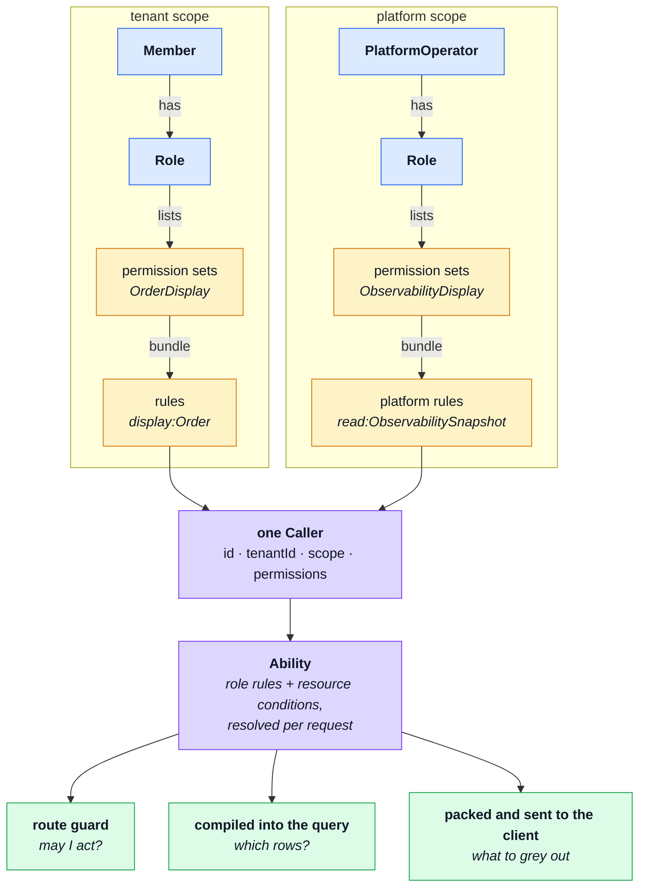
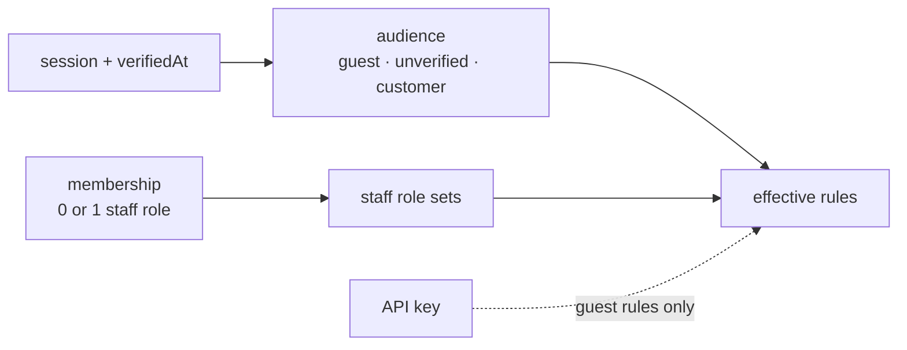
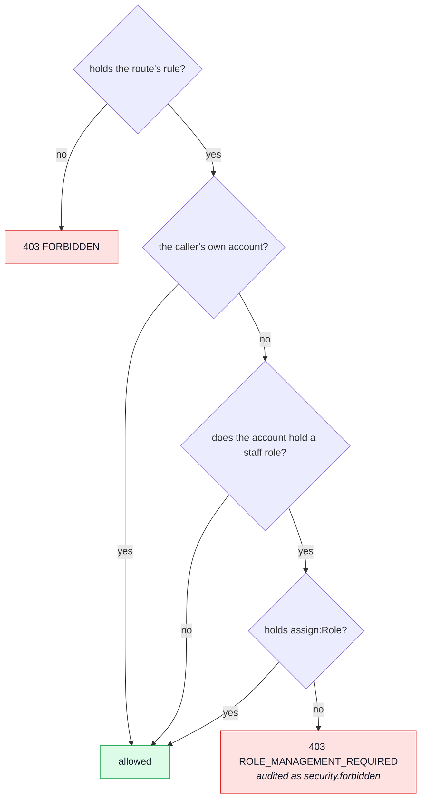

# Authorization

**Who may act, how strongly they proved it, and which rows they see.** Three separate questions,
answered by three separate things — and confusing them is how a system ends up with forty roles.

[Web attack defences](./defences/) covers keeping the wrong person out.
This page is about what the right person is allowed to do once they are in.

## The three axes

| Axis                            | Answers                             | Where it lives                                                         |
| ------------------------------- | ----------------------------------- | ---------------------------------------------------------------------- |
| **Who they are**                | may this caller act at all?         | the rules their role's sets hold — `holds`, behind `requirePermission` |
| **How strongly they proved it** | did they prove it _recently_?       | `amr` on the token + the freshness guards                              |
| **Which rows**                  | of the things they may read, which? | `kernel/access/query.ts` — the same rules, compiled into the filter    |

The middle axis is the one most applications never build. This one has it: the `amr` claim
(RFC 8176) and a `stepUp` tier let a high-risk action demand a recently proved session rather than
merely a valid one. The tier is declared on the RULE, so a new route guarding that rule inherits it
instead of having to remember it.

## The rule that everything else is arranged around

> The restriction has to ride **IN** the read.

Fetching a row and _then_ checking its owner is how a scoped find turns into a leak. It opens a
window between the check and whatever uses the document, and it lets _"not yours"_ and _"does not
exist"_ answer differently — which is a disclosure on its own, because a 403 confirms the row is
there.

So `accessibleFilter` returns a **query fragment**, not a verdict, and every scoped read spreads it
into its own find. That property is what picks the library: `@casl/ability` rules compile straight
into a Mongo query, and anything that answers yes/no about a document already in memory is a
downgrade.

The fail-closed detail is worth ten seconds. Rules that match nothing compile to CASL's
`EMPTY_RESULT_QUERY` — a filter matching no row — never to an absent filter, which every caller
downstream would read as "unrestricted". **A gap here returns an empty list, never somebody else's
data.**

## The model

**RBAC scoped by tenant, with conditions on the resource.** The role decides whether you may act,
the conditions its rules carry decide which rows, and those conditions compile into the query so the
rule above survives. One boolean cannot do that job: two callers can be administrators of
_different_ things, and `admin: true` cannot say which.

Read it as one sentence: **a role is a list of permission sets, a caller is one scope's worth of rules, and
the ability those rules produce is used in three places that can never disagree — because there is
only one of it.**

The third arrow is the one people miss. The frontend gets the _same_ rules the server enforces, so
"what to grey out" stops being a hand-maintained duplicate that drifts. It still has no authority:
it decides what to render, never what is allowed, and every request is re-evaluated server-side.

### Rule, permission set, role

This is the CanCan model as [Solidus](https://github.com/solidusio/solidus) uses it, three layers
and no more:

| Layer              | What it is                                                         | Example                            | Declared in                              |
| ------------------ | ------------------------------------------------------------------ | ---------------------------------- | ---------------------------------------- |
| **Rule**           | one `action` on one `subject`, optionally narrowed by conditions   | `display:Order`, `create:Refund`   | the owning module's `authorization.yaml` |
| **Permission set** | a named bundle of rules, per module                                | `OrderDisplay`, `PaymentRefunding` | the same file, beside its rules          |
| **Role**           | a list of sets, nothing else: no level, no rank, no inherited bits | `support`, `moderator`             | `shared/authorization-roles.yaml`        |

A rule's id is `<action>:<subject>` and no two rules share one. A guard asks for an action on a
subject, `requirePermission('display', 'Order')`; it never names a set or a role, and a route
never names a rule by a string made up for it.

**There is no `self` or `any` in a name.** "My own rows" is a **condition** on a rule
(`userId: $caller.id`), as in Solidus' `DefaultCustomer`. What tells a staff door from a customer's
own-rows rule is the **action**, and that is why the vocabulary has two staff actions:

| Plain action (the caller's own rows, or the public ones) | Staff action (every row) | Implies            |
| -------------------------------------------------------- | ------------------------ | ------------------ |
| `read:Order`, `read:Payment`, `read:Product`             | `display`                | `read`             |
| `update:Example`, `delete:Example`                       | `admin`                  | `update`, `delete` |

Every signed-in account holds `read:Order`, so a guard that accepted it for the staff list would
let every customer in. The staff door asks `display:Order`, which no customer holds. A holder of
`display:Order` also passes a plain `read` check, because the ability emits the implied rule beside
it (`implies:` in `shared/authorization-keys.yaml`): one query serves a customer's own rows and a
staff member's every row. A subject with no own-rows rule keeps plain `read`, so `read:Feedback` is
the staff door of the inbox.

**There is no wildcard of any kind.** No `manage`, no `all`. `admin` lists every declared tenant
set **by name** (bar the ones every signed-in account already gets from its
[audience](#everyone-is-a-customer-first)), spelled out in `shared/authorization-roles.yaml` like
every other role, so a set a new module needs is a line added to that file. The conformance suite
refuses a declared rule the list omits. See the file's own header note for why.

**A subject needs a concrete rule for every action a route asks about.** Every action a route can
gate on is its own declared rule, so a read-only role can never satisfy a guard meant for a minter.
`holds` (`kernel/ability.ts`) asks for the literal rule, or the staff action that implies it.
`heldRules` enumerates what a caller holds.

**A rule is tenant or platform, by its declared `scope`.** That is the whole safety property:

> A tenant rule can never be satisfied by a platform-scope caller, and a platform rule can never be
> satisfied by a tenant-scope caller.

A platform operator administers shared reference data and is **not** a super-member — they cannot
read one tenant's content. Mapping that person onto a single `admin` flag is one line to write, passes
every test that exists today, and is a total confidentiality failure. The `scope` field makes it
unrepresentable rather than discouraged.

Three supporting rules: ids are stored in credentials, so an action and a subject are **stable**
(renaming one is a migration); a **module declares its own rules and sets**, so deleting a module
deletes them; and **roles are data, permissions are code** — a role's sets live in
`shared/authorization-roles.yaml` alone, the one definition every deployment and the PHP twin share,
and a deployment may never invent a rule, because a rule nothing checks grants nothing while looking
like it grants something. A role's ASSIGNMENT — who holds it, where — is the one thing the database
stores; see [Where it lives](#where-it-lives).

## Everyone is a customer first

**Every signed-in account is a customer, staff included.** A request's _audience_ is computed, never
stored or granted, and unioned with the one staff role the account may hold:

| Audience     | When                                       | Holds                                              |
| ------------ | ------------------------------------------ | -------------------------------------------------- |
| `guest`      | no session                                 | the storefront: published products, the dictionary |
| `unverified` | a session, the account has no `verifiedAt` | the above, plus its own orders, payments, basket   |
| `customer`   | a session, the account has `verifiedAt`    | the above, plus `checkout:Cart`                    |

So a staff role lists only the staff sets it adds, and the audience roles in
`shared/authorization-roles.yaml` hold every own-rows rule of the shop. A rule an account holds
twice would say one thing in two places, so `tests/unit/kernel/permissions.test.ts` refuses a staff
role that lists an audience rule. Verifying an address is one write (`verifiedAt`), with nothing to
promote; an operator who types an address in sets it the same way.

Every door into a basket asks the rule: the cart routes, a reorder and a wishlist's move into the
cart ask `update:Cart`; placing an order and the card steps ask `checkout:Cart`, which
answers an unproven address with `EMAIL_NOT_VERIFIED` ("confirm your email") instead of a bare
permissions error. An order's `actions.pay` is offered only to a caller who holds the checkout rule.

## Protecting people

A rule says _what kind_ of thing you may touch. It does not say _whose_. Without a second rule, a
support agent who holds `update:User` may edit the administrator's account, which is a
privilege escalation with extra steps. So one permission, `assign:Role`, protects people:

> **R1.** An account that holds a staff role may be changed — edited, banned, erased, restored, or
> have its role taken away — only by a holder of `assign:Role`. Otherwise the answer is
> `403 ROLE_MANAGEMENT_REQUIRED`. The same permission is the only way to hand a staff role out.

Of the preset roles only `admin` (and `system`, its alias) holds it. Staff without it change
customers only: a moderator who may erase accounts erases customers, never the administrator.

Five details carry the rule:

- **Your own account is exempt**, so a support agent still edits their own profile.
- **A role is only a list of sets.** There is no `level`, no rank between staff roles, and no
  "outranks": what a role can do is exactly the rules its sets bundle.
- **An API key never manages staff.** `assign:Role` is `credential: false`, so no key can be minted
  with it and none can change a staff account, whoever minted it (Stripe and Shopify keep team
  management out of API keys the same way).
- **Changing who holds powers asks for a fresh session.** `POST`, `PUT` and `PATCH /users` that name
  a role (to grant it, or `null` to take it away), or that ban or unban while the caller holds
  `assign:Role`, are gated by `requireFreshAuthWhen` at the critical tier, the one minting an API
  key asks. A stolen session cannot quietly make a second administrator, unban an old one, or lock
  every other administrator out. A write that names no role and bans nobody is never prompted, and
  neither is a moderator banning a customer. `system` is never handed out at all.
- **An administrator may change another administrator**, and may hand out or take away any role,
  their own included. Locking the shop out of its last administrator is a technician's edit of the
  database to repair, by decision.

**Where it is applied.** `canChangeAccount` and `roleProtectedRefusal` in `@modules/access` answer
it; `users` asks before it edits, erases or restores an account, and `assignRole` refuses a grant
from a caller without the rule. The read side tells a client the same thing: the `actions` block on
a user already has the protection applied, so a screen renders only what would be accepted.

Orders, payments, returns and parcels have **no rank at all**: holding the permission is enough, on
a customer's order, a staff member's or one's own. Revoking someone else's API key is not protected
either: it only takes access away, so any administrator may revoke a fellow administrator's leaked
key (Stripe and GitHub work the same way).

**Credentials belong to their owner.** A password, a second factor and a sign-in email are never
written by anyone else, whatever their rules: `POST /users` takes no password and always
mails a setup link, and there is no admin reset of a second factor. Switching an account off is
its own rule (`ban:User`), because a role that edits a customer's phone should not by that
alone lock them out.

## Your own money

There is no rule against handling one's own order. A staff member is a customer too, so the
permission they hold is trusted wherever they act: recording a payment by hand, refunding it,
approving and receiving a return, or cancelling the remainder of an order all work on one's own
order exactly as on anyone's.

What the system adds is a record, not a refusal. The audit row of the two steps that move money out
or in — `payment.recorded_offline` and `admin.payment.refunded` (which also covers a return's refund
and a remainder cancel) — carries `ownOrder: true` when the caller is the buyer (`ownOrderFlag` in
`@modules/access`), so a review sees self-dealing at a glance.

Why trust and record rather than refuse: no shop platform ships a self-refund rule (Shopify, Stripe
and Saleor leave it to the merchant, as do Solidus and WooCommerce), a refund goes back to the card
that paid, so it cannot send money elsewhere, and a refusal for a one-person shop blocks its owner.
Where separation of duties is wanted, the audit row is what NIST SP 800-53 AC-5 asks of the
compensating control.

## Who can do what, per module

Each module's page carries a **Who can do what** table, generated from the model and not written by
hand: one row per rule the module declares, the set that bundles it, and a column per role as the
evaluator answers it (`own` where a condition pins the rule to the caller's own rows, `⚡` where a
freshly proved session is demanded, and whether an API key can be minted with it).
`npm run docs:roles` rewrites them; `check:docs-roles` fails the build on drift.

| Module                                                       | Module                                               | Module                                                              |
| ------------------------------------------------------------ | ---------------------------------------------------- | ------------------------------------------------------------------- |
| [products](../modules/products.md#who-can-do-what)           | [cart](../modules/cart.md#who-can-do-what)           | [orders](../modules/orders.md#who-can-do-what)                      |
| [payments](../modules/payments.md#who-can-do-what)           | [inventory](../modules/inventory.md#who-can-do-what) | [delivery](../modules/delivery.md#who-can-do-what)                  |
| [returns](../modules/returns.md#who-can-do-what)             | [feedback](../modules/feedback.md#who-can-do-what)   | [locales](../modules/locales.md#who-can-do-what) (and translations) |
| [users](../modules/users.md#who-can-do-what)                 | [access](../modules/access.md#who-can-do-what)       | [audit-logs](../modules/audit-logs.md#who-can-do-what)              |
| [webhooks](../modules/webhooks.md#who-can-do-what)           | [api-keys](../modules/api-keys.md#who-can-do-what)   | [observability](../modules/observability.md#who-can-do-what)        |
| [notifications](../modules/notifications.md#who-can-do-what) | [stats](../modules/stats.md#who-can-do-what)         | [the role matrix](../demo-ecommerce/index.md)                       |

## Where it lives

The model is stored, evaluated, compiled into every scoped read, published to the client and
enforced per rule.

- **`shared/authorization-keys.yaml`** — every rule and permission set, with each rule's subject, scope, conditions and step-up
  tier, and the `implies:` map of the staff actions. **`-roles.yaml`** — the presets both seeders read. **`-conformance.yaml`** — dozens of
  cases, most of them denials, run by both backends. All three byte-identical in the PHP twin.
- **`kernel/permissions.ts`** turns an account's audience and its two role names into the rules for
  ONE scope, expanding sets; **`kernel/ability.ts`** builds the CASL ability and answers `holds`.
- **`@modules/access`** stores the ASSIGNMENT half — tenants and memberships, never a role's own
  permissions — with the invariants as refusals: only a holder of `assign:Role` hands out a
  role, and `customer`, `unverified` and `guest` are never granted because they are computed.
  Removing a shop's last administrator is allowed. It also answers the protection of staff
  accounts (`canChangeAccount`). Routeless — `account`, `api-keys`, `users` and the modules that
  write on a buyer's behalf are its consumers.
- **`kernel/access/query.ts`** compiles the rules into the Mongo filter every scoped read spreads,
  so a rule that grants more returns more without anybody editing a fragment.
- **`GET /account/abilities`** publishes the packed rules; the frontend evaluates _those_, not a
  copy of them.
- Route guards take an action and a subject. `delete:User` and `create:Refund` carry `stepUp: critical`, and the
  guard demands the fresh session and audits that it did.

**Where the boilerplate stops short, on purpose.** It ships one shop, so most collections carry no
`tenantId` column and `accessibleFilter` drops that condition — the model is tenant-aware and its
conformance cases prove it, while these tables are not partitioned. See
[Tenancy](./tenancy.md) for why, and what a pooled deployment would actually have to change.

## The twins

The PHP backend answers all of this **identically** — same roles, same scopes, same rule shape,
same wire format — with different tools, because the idiomatic library on each side is different
and forcing one abstraction over both makes both worse.

| Same in both, on purpose                                                               | Allowed to differ                              |
| -------------------------------------------------------------------------------------- | ---------------------------------------------- |
| The vocabulary: `action`, `subject`, `conditions`, `fields`, `manage`, `all`, `Caller` | The library doing the evaluating               |
| The permission rules and sets, and the preset roles seeded on day one                  | How rules become a query                       |
| The scope model: `tenant` \| `platform`, never both, never derived from a flag         | `guard_name`, which only the PHP package needs |
| The wire format of `GET /account/abilities`                                            | Everything else about the implementation       |
| The conformance suite — one fixture file, identical bytes, run by both                 | —                                              |

Here that is `@casl/ability`, whose rules compile straight into a Mongo query and can be shipped to
the browser as the same rules. There it is `spatie/laravel-permission` for the storage half only —
which roles exist and who holds them, in which shop — with the evaluation and the query fragment
hand-written over it, because a package that answers "does this name appear" cannot answer "in this
scope, on rows matching these conditions".

The suite is what keeps them honest, and it holds the **deny** cases rather than the happy path: a
widened scope does not fail a test that only checks the right thing is allowed.
