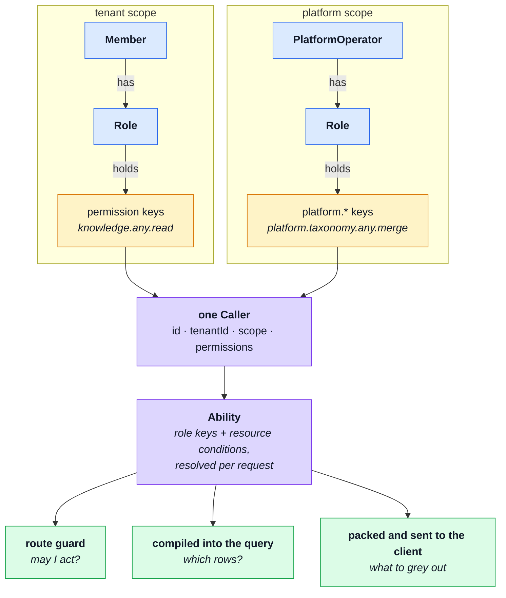
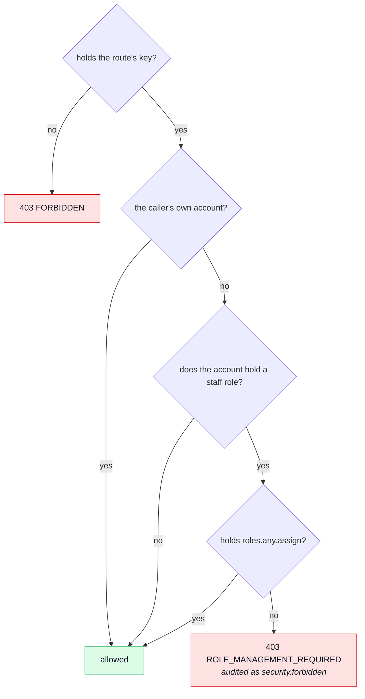

# Authorization

**Who may act, how strongly they proved it, and which rows they see.** Three separate questions,
answered by three separate things — and confusing them is how a system ends up with forty roles.

[Web attack defences](./defences/) covers keeping the wrong person out.
This page is about what the right person is allowed to do once they are in.

## The three axes

| Axis                            | Answers                             | Where it lives                                                      |
| ------------------------------- | ----------------------------------- | ------------------------------------------------------------------- |
| **Who they are**                | may this caller act at all?         | the keys their role holds — `holdsKey`, behind `requirePermission`  |
| **How strongly they proved it** | did they prove it _recently_?       | `amr` on the token + the freshness guards                           |
| **Which rows**                  | of the things they may read, which? | `kernel/access/query.ts` — the same rules, compiled into the filter |

The middle axis is the one most applications never build. This one has it: the `amr` claim
(RFC 8176) and a `stepUp` tier let a high-risk action demand a recently proved session rather than
merely a valid one. The tier is declared on the KEY, so a new route guarding that key inherits it
instead of having to remember it.

## The rule that everything else is arranged around

> The restriction has to ride **IN** the read.

Fetching a row and _then_ checking its owner is how a scoped find turns into a leak. It opens a
window between the check and whatever uses the document, and it lets _"not yours"_ and _"does not
exist"_ answer differently — which is a disclosure on its own, because a 403 confirms the row is
there.

So `accessibleFilter` returns a **query fragment**, not a verdict, and every scoped read spreads it
into its own find. That property is what picks the library: `@casl/ability` rules compile straight
into a Mongo query, and anything that answers yes/no about a document already in memory is a
downgrade.

The fail-closed detail is worth ten seconds. Rules that match nothing compile to CASL's
`EMPTY_RESULT_QUERY` — a filter matching no row — never to an absent filter, which every caller
downstream would read as "unrestricted". **A gap here returns an empty list, never somebody else's
data.**

## The model

**RBAC scoped by tenant, with conditions on the resource.** The role decides whether you may act,
the conditions its keys carry decide which rows, and those conditions compile into the query so the
rule above survives. One boolean cannot do that job: two callers can be administrators of
_different_ things, and `admin: true` cannot say which.



Read it as one sentence: **a role is a bundle of keys, a caller is one scope's worth of keys, and
the ability those keys produce is used in three places that can never disagree — because there is
only one of it.**

The third arrow is the one people miss. The frontend gets the _same_ rules the server enforces, so
"what to grey out" stops being a hand-maintained duplicate that drifts. It still has no authority:
it decides what to render, never what is allowed, and every request is re-evaluated server-side.

### The key grammar, and the invariant it exists for

```
tenant scope     <family>.<breadth>.<action>             knowledge.any.read · tasks.self.update
platform scope   platform.<family>.<breadth>.<action>    platform.taxonomy.any.merge
```

**Breadth is always written, never implied.** `orders.self.read` is the caller's own orders,
`orders.any.read` is everyone's, `products.any.create` has no owner to scope by and still says so.
A key you can grep for by shape beats a key you have to know the default of — the tradeoff is that
`any` is noise on most of the file, since most families have no owner to be `self` about in the
first place.

**There is no wildcard of any kind.** No per-family `manage`, no scope-wide `all.manage`. Breadth
on the key itself says "read everyone's, change nothing" directly: the support desk reads an order
that was never its own with `orders.any.read`, and that key grants no delete. `admin` holds every
declared tenant key **by name** (bar the ones every signed-in account already gets from its
[audience](#everyone-is-a-customer-first)), spelled out in `shared/authorization-roles.yaml` like
every other role, so a key a new route needs is a line added to that file — the conformance suite
refuses a declared key the list omits. See the file's own header note for why.

**A family needs a concrete key for every action a route asks about.** Every action a route can
gate on is its own declared key, so a read-only role can never satisfy a guard meant for a minter.
`holdsKey` (`kernel/ability.ts`) asks for the literal key and nothing collapses: every signed-in
account holds `orders.self.read`, so a guard that accepted it for `orders.any.read` would let every
customer into the staff list. `heldKeys` enumerates what a caller holds.

**Tenant keys are bare; platform keys are always prefixed.** That asymmetry is the whole safety
property:

> A bare key can never be satisfied by a platform-scope caller, and a `platform.` key can never be
> satisfied by a tenant-scope caller.

A platform operator administers shared reference data and is **not** a super-member — they cannot
read one tenant's content. Mapping that person onto a single `admin` flag is one line to write, passes
every test that exists today, and is a total confidentiality failure. The grammar makes it
unrepresentable rather than discouraged.

Three supporting rules: keys are lower-case, dotted and **stable** (renaming one is a migration); a
**module declares its own keys in its manifest**, so deleting a module deletes its keys; and
**roles are data, permissions are code** — a role's permissions live in `shared/authorization-roles.yaml`
alone, the one definition every deployment and the PHP twin share, and a deployment may never
invent a key, because a key nothing checks grants nothing while looking like it grants something.
A role's ASSIGNMENT — who holds it, where — is the one thing the database stores; see
[Where it lives](#where-it-lives).

## Everyone is a customer first

**Every signed-in account is a customer, staff included.** A request's _audience_ is computed, never
stored or granted, and unioned with the one staff role the account may hold:

| Audience     | When                                       | Holds                                              |
| ------------ | ------------------------------------------ | -------------------------------------------------- |
| `guest`      | no session                                 | the storefront: published products, the dictionary |
| `unverified` | a session, the account has no `verifiedAt` | the above, plus its own orders, payments, basket   |
| `customer`   | a session, the account has `verifiedAt`    | the above, plus `cart.self.checkout`               |


So a staff role lists only the `any` keys it adds, and the audience roles in
`shared/authorization-roles.yaml` hold every `self` key of the shop. A key an account holds twice
would say one thing in two places, so `tests/unit/kernel/permissions.test.ts` refuses a staff role
that lists an audience key. Verifying an address is one write (`verifiedAt`), with nothing to
promote; an operator who types an address in sets it the same way.

Every door into a basket asks the key: the cart routes, a reorder and a wishlist's move into the
cart ask `cart.self.update`; placing an order and the card steps ask `cart.self.checkout`, which
answers an unproven address with `EMAIL_NOT_VERIFIED` ("confirm your email") instead of a bare
permissions error. An order's `actions.pay` is offered only to a caller who holds the checkout key.

## Protecting people

A key says _what kind_ of thing you may touch. It does not say _whose_. Without a second rule, a
support agent who holds `users.any.update` may edit the administrator's account, which is a
privilege escalation with extra steps. So one permission, `roles.any.assign`, protects people:

> **R1.** An account that holds a staff role may be changed — edited, banned, erased, restored, or
> have its role taken away — only by a holder of `roles.any.assign`. Otherwise the answer is
> `403 ROLE_MANAGEMENT_REQUIRED`. The same permission is the only way to hand a staff role out.

Of the preset roles only `admin` (and `system`, its alias) holds it. Staff without it change
customers only: a moderator who may erase accounts erases customers, never the administrator.

Four details carry the rule:

- **Your own account is exempt**, so a support agent still edits their own profile.
- **A role is only a bundle of keys.** There is no `level`, no rank between staff roles, and no
  "outranks": what a role can do is exactly the keys it lists.
- **An API key holds exactly the keys it was minted with.** One minted without `roles.any.assign`
  cannot change a staff account, whoever minted it.
- **An administrator may change another administrator**, and may hand out or take away any role,
  their own included. Locking the shop out of its last administrator is a technician's edit of the
  database to repair, by decision.



**Where it is applied.** `canChangeAccount` and `roleProtectedRefusal` in `@modules/access` answer
it; `users` asks before it edits, erases or restores an account, and `assignRole` refuses a grant
from a caller without the key. The read side tells a client the same thing: the `actions` block on
a user already has the protection applied, so a screen renders only what would be accepted.

Orders, payments, returns and parcels have **no rank at all**: holding the permission is enough, on
a customer's order, a staff member's or one's own. Revoking someone else's API key is not protected
either: it only takes access away, so any administrator may revoke a fellow administrator's leaked
key (Stripe and GitHub work the same way).

**Credentials belong to their owner.** A password, a second factor and a sign-in email are never
written by anyone else, whatever their key: `POST /users` takes no password and always
mails a setup link, and there is no admin reset of a second factor. Switching an account off is
its own key (`users.any.ban`), because a role that edits a customer's phone should not by that
alone lock them out.

## Your own money

There is no rule against handling one's own order. A staff member is a customer too, so the
permission they hold is trusted wherever they act: recording a payment by hand, refunding it,
approving and receiving a return, or cancelling the remainder of an order all work on one's own
order exactly as on anyone's.

What the system adds is a record, not a refusal. The audit row of the two steps that move money out
or in — `payment.recorded_offline` and `admin.payment.refunded` (which also covers a return's refund
and a remainder cancel) — carries `ownOrder: true` when the caller is the buyer (`ownOrderFlag` in
`@modules/access`), so a review sees self-dealing at a glance.

Why trust and record rather than refuse: no shop platform ships a self-refund rule (Shopify, Stripe
and Saleor leave it to the merchant, as do Solidus and WooCommerce), a refund goes back to the card
that paid, so it cannot send money elsewhere, and a refusal for a one-person shop blocks its owner.
Where separation of duties is wanted, the audit row is what NIST SP 800-53 AC-5 asks of the
compensating control.

## Where it lives

The model is stored, evaluated, compiled into every scoped read, published to the client and
enforced per key.

- **`shared/authorization-keys.yaml`** — every key, its subject, scope, conditions and step-up
  tier. **`-roles.yaml`** — the presets both seeders read. **`-conformance.yaml`** — dozens of
  cases, most of them denials, run by both backends. All three byte-identical in the PHP twin.
- **`kernel/permissions.ts`** turns an account's audience and its two role names into the keys for
  ONE scope; **`kernel/ability.ts`** builds the CASL ability and answers `holdsKey`.
- **`@modules/access`** stores the ASSIGNMENT half — tenants and memberships, never a role's own
  permissions — with the invariants as refusals: only a holder of `roles.any.assign` hands out a
  role, and `customer`, `unverified` and `guest` are never granted because they are computed.
  Removing a shop's last administrator is allowed. It also answers the protection of staff
  accounts (`canChangeAccount`). Routeless — `account`, `api-keys`, `users` and the modules that
  write on a buyer's behalf are its consumers.
- **`kernel/access/query.ts`** compiles the rules into the Mongo filter every scoped read spreads,
  so a key that grants more returns more without anybody editing a fragment.
- **`GET /account/abilities`** publishes the packed rules; the frontend evaluates _those_, not a
  copy of them.
- Route guards take a KEY. `users.any.delete` and `payments.any.update` carry `stepUp: critical`, and the
  guard demands the fresh session and audits that it did.

**Where the boilerplate stops short, on purpose.** It ships one shop, so most collections carry no
`tenantId` column and `accessibleFilter` drops that condition — the model is tenant-aware and its
conformance cases prove it, while these tables are not partitioned. See
[Tenancy](./tenancy.md) for why, and what a pooled deployment would actually have to change.

## The twins

The PHP backend answers all of this **identically** — same roles, same scopes, same key grammar,
same wire format — with different tools, because the idiomatic library on each side is different
and forcing one abstraction over both makes both worse.

| Same in both, on purpose                                                               | Allowed to differ                              |
| -------------------------------------------------------------------------------------- | ---------------------------------------------- |
| The vocabulary: `action`, `subject`, `conditions`, `fields`, `manage`, `all`, `Caller` | The library doing the evaluating               |
| The permission keys, and the preset roles seeded on day one                            | How rules become a query                       |
| The scope model: `tenant` \| `platform`, never both, never derived from a flag         | `guard_name`, which only the PHP package needs |
| The wire format of `GET /account/abilities`                                            | Everything else about the implementation       |
| The conformance suite — one fixture file, identical bytes, run by both                 | —                                              |

Here that is `@casl/ability`, whose rules compile straight into a Mongo query and can be shipped to
the browser as the same rules. There it is `spatie/laravel-permission` for the storage half only —
which roles exist and who holds them, in which shop — with the evaluation and the query fragment
hand-written over it, because a package that answers "does this name appear" cannot answer "in this
scope, on rows matching these conditions".

The suite is what keeps them honest, and it holds the **deny** cases rather than the happy path: a
widened scope does not fail a test that only checks the right thing is allowed.
