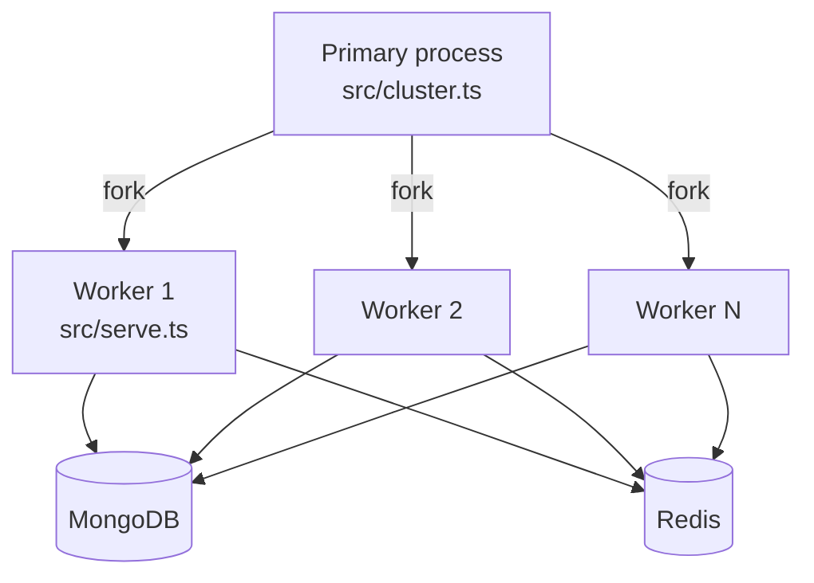
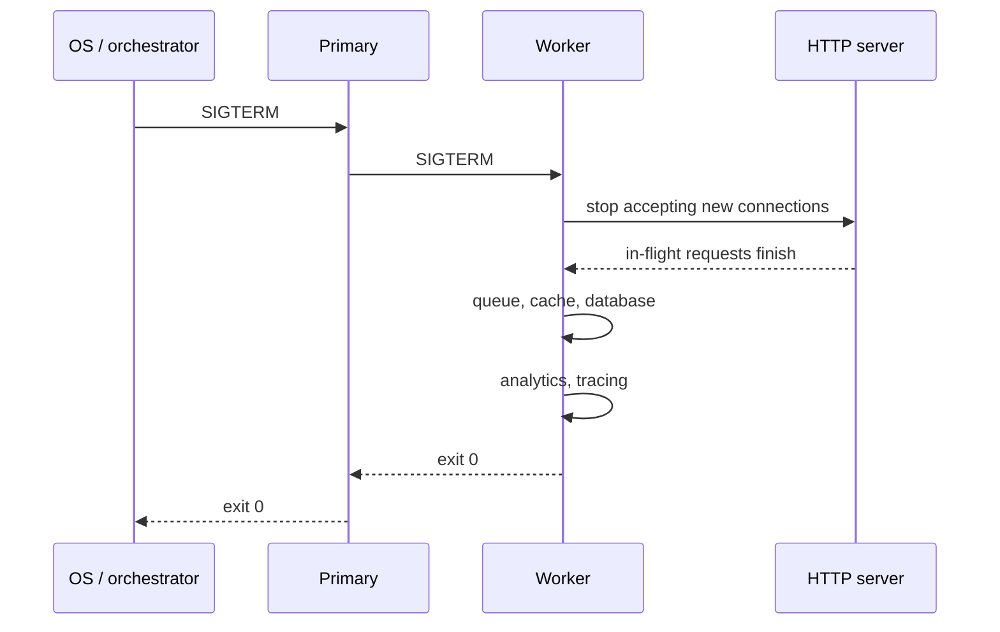

# Clustering & Graceful Shutdown

This page explains how the app boots, scales across CPU cores, and shuts down cleanly.
The relevant files are `src/cluster.ts` (process supervisor), `src/app.ts` (`createApp()`: the
HTTP app + its `boot`/`start`/`stop` lifecycle) and `src/serve.ts` (calls `start()`, wires
`stop()` to the process signals — the file a worker, or `dev:docker`, actually runs).

## Why a primary + workers

- One **primary** supervises the cluster: forks workers, watches exits, and coordinates shutdown.
- One **worker per available CPU** by default (`os.availableParallelism()`, which honours a container's CPU limit), each running the full Express app.
- Before forking, the primary judges the whole environment once (`assertProcessConfig`). A bad variable is one clean error and exit 1, not N workers crash-looping.
- Workers are independent processes; they do not share memory. State must live in Mongo or Redis.
- Every worker opens its own connection to each, but they address the **same** database and the
  **same** Redis keyspace — which is why a cache invalidation done by one worker needs no
  broadcast to the others. → [Redis and the workers](../tools/redis-cache.md#redis-and-the-workers)

## Configuration

| Env var                              | Effect                                                                                                                            |
| ------------------------------------ | --------------------------------------------------------------------------------------------------------------------------------- |
| `NODE_ENABLE_CLUSTERING`             | `1` enables the primary/worker mode. Anything else imports `src/serve.ts` straight from `src/cluster.ts`'s own process — no fork. |
| `NODE_CLUSTER_WORKERS`               | Number of workers; 0 or unset = one per available CPU (minimum 1).                                                                |
| `NODE_CLUSTER_CRASH_WINDOW_MS`       | Sliding window for counting crashes (default 60 000 ms).                                                                          |
| `NODE_CLUSTER_CRASH_BACKOFF_BASE_MS` | Base delay before respawning after a crash (default 500 ms, doubled per crash).                                                   |
| `NODE_CLUSTER_CRASH_BACKOFF_MAX_MS`  | Maximum respawn delay (default 30 000 ms).                                                                                        |
| `NODE_CLUSTER_CRASH_LIMIT`           | Crashes in one window before the primary gives up and exits 1 (default 10).                                                       |
| `NODE_CLUSTER_SHUTDOWN_TIMEOUT_MS`   | Hard kill timeout during shutdown (default 15 000 ms).                                                                            |
| `NODE_GRACEFUL_SHUTDOWN_TIMEOUT_MS`  | Worker-side hard exit timeout (default 15 000 ms), read by `registerSignalHandlers`; also scales the drain steps below.           |

## Crash backoff

When a worker exits unexpectedly the primary respawns it with **exponential backoff**, capped at `NODE_CLUSTER_CRASH_BACKOFF_MAX_MS`. This avoids tight crash loops when something is broken at startup (bad config, missing DB, …). Past `NODE_CLUSTER_CRASH_LIMIT` crashes inside one window the primary stops respawning and exits with code 1, so the supervisor sees a failure instead of a primary that stays up with no workers.

## Graceful shutdown

Each worker's shutdown sequence lives in `createApp()`'s `stop` (`src/app.ts`, wired to the
process signals by `src/serve.ts`):

1. Mark `GET /readyz` as draining (503) the moment the signal arrives.
2. Close the HTTP server: no new connections, idle keep-alive sockets dropped, in-flight requests
   drain. Anything still open at half the deadline (an SSE stream) is cut.
3. Stop the locale-override refresh timer, then let started PDF renders and event deliveries
   finish (`settleRenders`, `settleInFlight`).
4. `stopQueue()` before `stopCache()`: a running job would otherwise reopen the cache connection.
5. `stopLimitsRedis()`, then `stopDatabase()` — disconnect the stores.
6. `shutdownAnalytics()` — flush PostHog if configured.
7. `shutdownTracing()` — flush remaining OTel spans to Tempo.

Each step swallows its own failure, so a broken Redis cannot stop the database from closing.
The order lives in `shutdownInfra` (`src/infrastructure/runtime/server-lifecycle.ts`).

If shutdown takes longer than the timeout, the worker (or the primary) force-exits.

## Why this matters

- Workers are stateless: anything you store in memory dies on the next deploy or crash.
- Background timers must be cleared in `stop` (or the `stop*` helper it calls), otherwise the process never exits.
- OTel must be initialised **before** any other import; that is why both `src/cluster.ts` and `src/app.ts` call `startTracing()` first.

## Useful links

- [Node.js `cluster` module](https://nodejs.org/api/cluster.html)
- [Node.js `process` events (`SIGTERM`, `SIGINT`)](https://nodejs.org/api/process.html#signal-events)
- [Graceful shutdown best practices (DigitalOcean)](https://www.digitalocean.com/community/tutorials/how-to-scale-node-js-applications-with-clustering)
- [The Twelve-Factor App — Disposability](https://12factor.net/disposability)

## Related pages

- [Architecture](./architecture.md)
- [Request Flow](./request-flow.md)
- [Runtime](../tools/runtime.md)
- [OpenTelemetry](../tools/opentelemetry.md)
