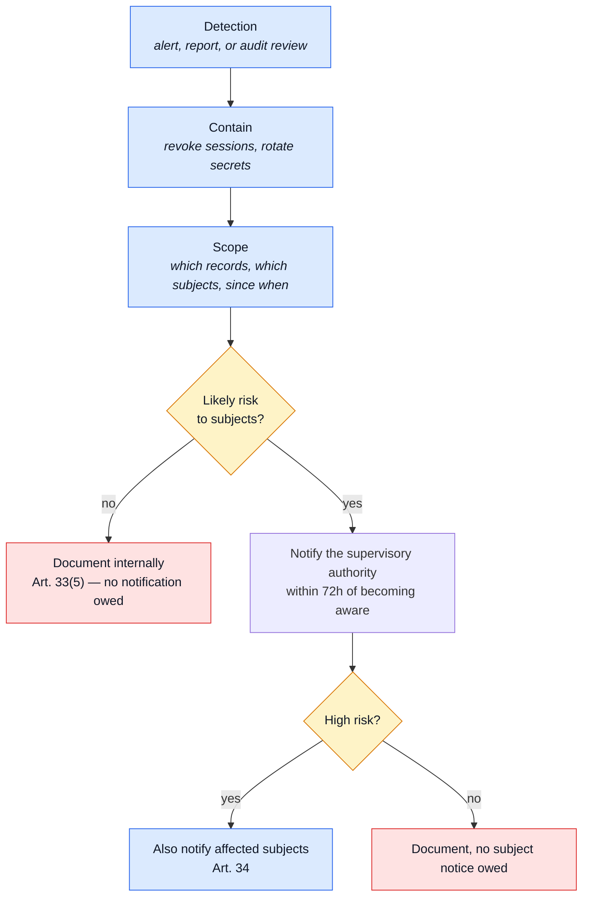

# Data Protection

GDPR binds a **controller** — whoever deploys this, decides why data is processed, and answers to
a supervisory authority — not a repository. So this page is not a compliance certificate; it is
the record a controller needs to have, assembled from what the code actually does. Every row below
is derived from a specific file, not aspirational.

Any deployment serving people in the EU/EEA is in scope from its first signup: this processes
email, username, phone, postal addresses with names and phone numbers, IP addresses, user-agents,
order history, and payment metadata.

## Processing register (Art. 30)

One row per collection that carries personal data.

| Collection                                                        | Personal data                                                                                                                                                           | Purpose                                                                                 | Lawful basis (Art. 6)                                                        | Retention                                                                                                                                                                                                                                                                                                                                                            | What erases or anonymises it                                                                                                                                                                                                                                                                                                                                                |
| ----------------------------------------------------------------- | ----------------------------------------------------------------------------------------------------------------------------------------------------------------------- | --------------------------------------------------------------------------------------- | ---------------------------------------------------------------------------- | -------------------------------------------------------------------------------------------------------------------------------------------------------------------------------------------------------------------------------------------------------------------------------------------------------------------------------------------------------------------- | --------------------------------------------------------------------------------------------------------------------------------------------------------------------------------------------------------------------------------------------------------------------------------------------------------------------------------------------------------------------------- |
| `users`                                                           | email, username, phone, website, profile image, `analyticsConsent`                                                                                                      | account identity and authentication                                                     | Contract (6.1.b)                                                             | until deletion, or `NODE_INACTIVE_ACCOUNT_DAYS` of no activity (disabled by default); activity = a login or an API-key use                                                                                                                                                                                                                                           | `DELETE /account` (self), admin `?hardDelete=true`, `npm run reap:inactive-accounts`; after `NODE_INACTIVE_MINIMISE_DAYS` (1095d) of no activity the same job [minimises](./data-retention.md#inactive-accounts-minimise-don-t-delete) the account instead of deleting it                                                                                                   |
| `orders`                                                          | email, `shippingAddress` and `billingAddress` (name, street, phone), `notes`; the addresses and notes are AES-256-GCM at rest                                           | fulfilling and evidencing a sale                                                        | Contract (6.1.b); tax records (6.1.c)                                        | row kept indefinitely (invoice); personal fields kept while the account is alive and active; `NODE_ORDER_PII_RETENTION_DAYS` (3650d, the EU-wide maximum — [per country](./data-retention.md#how-long-a-deployment-must-keep-the-records)) from the order's OWN `createdAt`, counted from account erasure, inactivity minimisation, or that date, whichever is later | `userId` detached immediately on erasure (kept on minimisation), and a never-paid order is cancelled (stock released); `npm run reap:orders` replaces the email and unsets both addresses and the notes once due                                                                                                                                                            |
| `payments`                                                        | `userId`, truncated card (`cardLast4` only — no full PAN ever stored)                                                                                                   | payment record for the sale                                                             | Contract (6.1.b); legal obligation (6.1.c)                                   | a settled payment is tied to the owning order; an attempt that never settled is deleted after `NODE_PAYMENT_ABANDONED_RETENTION_DAYS` (30d)                                                                                                                                                                                                                          | `userId` detached immediately on erasure, alongside the order; `npm run reap:payments` deletes abandoned attempts                                                                                                                                                                                                                                                           |
| `invoices`, `creditnotes`                                         | the buyer's billing address (name, street, phone) frozen at issue, encrypted at rest                                                                                    | the legal record of a sale and of each refund                                           | Legal obligation (6.1.c)                                                     | kept indefinitely — tax law; no link to the account, only to the order                                                                                                                                                                                                                                                                                               | not erased with the account, by design; the rendered PDF cache is cleared by `npm run reap:invoice-pdfs` after `NODE_INVOICE_PDF_RETENTION_DAYS` (30d)                                                                                                                                                                                                                      |
| `carts`                                                           | `userId`, line items                                                                                                                                                    | resuming an in-progress session                                                         | Contract / legitimate interest (6.1.b/f)                                     | `NODE_CART_RETENTION_DAYS` (365d), TTL restarts on every edit                                                                                                                                                                                                                                                                                                        | Mongo TTL index; cascades on account deletion                                                                                                                                                                                                                                                                                                                               |
| `wishlists`                                                       | `userId`, line items                                                                                                                                                    | saved-items convenience                                                                 | Legitimate interest (6.1.f)                                                  | kept until deleted                                                                                                                                                                                                                                                                                                                                                   | cascades on account deletion                                                                                                                                                                                                                                                                                                                                                |
| `notifications`                                                   | `userId`, a message code and the product names it quotes                                                                                                                | telling the user a list of theirs changed                                               | Legitimate interest (6.1.f)                                                  | newest `NODE_NOTIFICATIONS_MAX_PER_USER` (100) kept; deleted by the user, never by time                                                                                                                                                                                                                                                                              | cascades on account deletion                                                                                                                                                                                                                                                                                                                                                |
| `addressbooks`                                                    | `userId`, saved shipping addresses (name, street, phone)                                                                                                                | checkout convenience — resolving a shipping address                                     | Contract / legitimate interest (6.1.b/f)                                     | kept until deleted, or until the account is minimised after `NODE_INACTIVE_MINIMISE_DAYS` of no activity                                                                                                                                                                                                                                                             | cascades on account deletion; deleted on minimisation                                                                                                                                                                                                                                                                                                                       |
| `accountexports`                                                  | `userId`, and a file holding the account's whole export                                                                                                                 | giving the subject a copy of their own data                                             | Legal obligation (6.1.c) — Art. 15 and 20                                    | `NODE_ACCOUNT_EXPORT_TTL_DAYS` (7d) from when it is ready                                                                                                                                                                                                                                                                                                            | Deleted with the account (row in the erasure's transaction, file after its commit); `npm run reap:account-exports` deletes it when due                                                                                                                                                                                                                                      |
| `apikeys`                                                         | `createdByUserId`, the credential's own `name`                                                                                                                          | machine-to-machine authentication the account minted                                    | Contract / legitimate interest (6.1.b/f)                                     | kept until revoked or the account is erased                                                                                                                                                                                                                                                                                                                          | cascades on account deletion                                                                                                                                                                                                                                                                                                                                                |
| `memberships`                                                     | `userId`, tenant, role                                                                                                                                                  | who may act as whom, in which tenant                                                    | Contract (6.1.b)                                                             | kept for the life of the membership                                                                                                                                                                                                                                                                                                                                  | revoked outright on account deletion; no restore, no last-admin guard (`93917986`)                                                                                                                                                                                                                                                                                          |
| `shipments`                                                       | none directly — `orderId`, lines, carrier tracking code, status, dates                                                                                                  | fulfilment tracking                                                                     | Contract (6.1.b)                                                             | tied to the owning order                                                                                                                                                                                                                                                                                                                                             | reachable only through its order; exported by `POST /account/export`; nothing to scrub on its own                                                                                                                                                                                                                                                                           |
| `fulfillmentorders`                                               | none directly — `orderId`, lines, status, dates, hold reason; staff's hold **note** is free text                                                                        | deciding what leaves together, and when                                                 | Contract (6.1.b)                                                             | row tied to the owning order; the hold note unset by `npm run reap:delivery` once the fulfillment order has not changed for `NODE_HOLD_NOTE_RETENTION_DAYS` (365d) — [why](./data-retention.md#free-text-on-holds)                                                                                                                                                   | reachable only through its order; exported through the order's `fulfillmentOrders` section without the note (not the buyer's data); nothing else to scrub                                                                                                                                                                                                                   |
| `feedbackrequests`                                                | name, email, message                                                                                                                                                    | responding to a contact/support request                                                 | Legitimate interest (6.1.f) — often pre-account, so consent is not the basis | `NODE_FEEDBACK_RETENTION_DAYS` (730d)                                                                                                                                                                                                                                                                                                                                | Mongo TTL index. **Deliberately not cascaded** on account deletion — a ticket can predate the account that later claims the same email (`feedback/module.ts`)                                                                                                                                                                                                               |
| `auditlogs`                                                       | `actorUserId`, `actorRole`, `ip`, `userAgent`, free-form `metadata`                                                                                                     | security monitoring, accountability, breach forensics                                   | Legal obligation / legitimate interest (6.1.c/f), integrity (5.1.f)          | `NODE_AUDIT_RETENTION_DAYS` (90d) for the queryable collection; Loki's own `retention_period` (7d locally) for the log lines                                                                                                                                                                                                                                         | Mongo TTL index (collection); Loki retention (log lines); the Mongo copy keeps the raw `ip` for its 90 days, on purpose: forensics needs the address, GitHub, Auth0 and Stripe keep theirs the same way, and GDPR recital 49 counts network and information security as a legitimate interest. Only the Loki log lines hash personal fields, per `NODE_LOG_PERSONAL_FIELDS` |
| `users.tokens` entries                                            | a sha256 digest of each token, its type and expiry, session metadata                                                                                                    | keeping a session signed in; recognising a replayed token as theft                      | Contract / legitimate interest (6.1.b/f), security (5.1.f)                   | until it expires; a rotated-away entry survives `NODE_TOKEN_REUSE_WINDOW_MS` (24h) so reuse is still recognised                                                                                                                                                                                                                                                      | `npm run reap:expired-tokens` drops expired and out-of-window entries; the login and refresh paths prune their own account; goes with the account                                                                                                                                                                                                                           |
| `reservations`                                                    | none directly — `orderId`, the held lines and status; no `userId` on the hold                                                                                           | holding stock for a checkout in progress                                                | Contract (6.1.b)                                                             | no TTL index; a hold carries its own `expiresAt` and `npm run sweep:reservations` expires it                                                                                                                                                                                                                                                                         | `npm run sweep:reservations` expires it; reachable only through its order                                                                                                                                                                                                                                                                                                   |
| `returns`                                                         | none directly — keyed by `orderId`, never by `userId`; the customer's own `note`, staff's `declineReason`, and the line snapshot                                        | evidencing a consumer-rights act and its refund                                         | Legal obligation (6.1.c); legal claims (17.3.e)                              | row kept indefinitely; `note` and `declineReason` unset by `npm run reap:returns` once the return has not changed for `NODE_RETURN_TEXT_RETENTION_DAYS` (1095d) — [why](./data-retention.md#free-text-on-returns)                                                                                                                                                    | not unlinked from an account because it holds no `userId`; exported by `POST /account/export` through the order, `declineReason` included (`returns/services/personal-data.ts`)                                                                                                                                                                                             |
| `webhookdeliveries`                                               | the attempt's status and the event `payload`, which can carry personal data depending on the event (never served by the API)                                            | the delivery log of a webhook subscription                                              | Legitimate interest (6.1.f)                                                  | `NODE_WEBHOOK_DELIVERY_RETENTION_DAYS` (30d)                                                                                                                                                                                                                                                                                                                         | Mongo TTL index                                                                                                                                                                                                                                                                                                                                                             |
| payment webhook events                                            | none — the provider's event id and a timestamp                                                                                                                          | recognising a provider's retry so inventory and events fire once                        | Legitimate interest (6.1.f)                                                  | `NODE_PAYMENT_WEBHOOK_EVENT_RETENTION_DAYS` (30d)                                                                                                                                                                                                                                                                                                                    | Mongo TTL index                                                                                                                                                                                                                                                                                                                                                             |
| `idempotencyrecords`                                              | the key, the caller (the user id, or the full IP address for an anonymous request), and the stored response `body`, which can carry whatever the guarded route answered | answering a retried write with its first result                                         | Legitimate interest (6.1.f)                                                  | `NODE_IDEMPOTENCY_RETENTION_HOURS` (24h)                                                                                                                                                                                                                                                                                                                             | Mongo TTL index                                                                                                                                                                                                                                                                                                                                                             |
| outbox                                                            | none directly — the event envelope a transaction committed                                                                                                              | delivering an event exactly as committed                                                | Legitimate interest (6.1.f)                                                  | `NODE_OUTBOX_RETENTION_DAYS` (7d) once published; a dead row stays                                                                                                                                                                                                                                                                                                   | Mongo TTL index                                                                                                                                                                                                                                                                                                                                                             |
| `leases`                                                          | none — a job name and the holder                                                                                                                                        | one scheduled job at a time                                                             | Not personal data                                                            | kept until deleted by hand when a job is retired                                                                                                                                                                                                                                                                                                                     | deleted by hand with the job (the row is the staleness alert)                                                                                                                                                                                                                                                                                                               |
| files on disk (quarantine, mail spool, invoice PDF cache)         | an uploaded image, a mail attachment, a rendered invoice                                                                                                                | a file in transit between two steps, or a cache of a document                           | Contract / legitimate interest (6.1.b/f)                                     | quarantine `NODE_QUARANTINE_RETENTION_HOURS` (24h); mail spool `NODE_MAIL_SPOOL_RETENTION_HOURS` (1h); invoice PDFs `NODE_INVOICE_PDF_RETENTION_DAYS` (30d)                                                                                                                                                                                                          | `npm run reap:quarantine`, `reap:mail-spool`, `reap:invoice-pdfs`                                                                                                                                                                                                                                                                                                           |
| backups (a restic repository: database dump, uploads, mail spool) | everything the database and those files hold, including accounts erased after the snapshot                                                                              | recovering the shop from a loss or an attack                                            | Legitimate interest (6.1.f)                                                  | the keep knobs: 24 hourly, 7 daily, 4 weekly, 6 monthly, so up to about six months                                                                                                                                                                                                                                                                                   | ageing out of the keep window; after a restore, every erasure since the snapshot is re-applied by hand ([Data retention](./data-retention.md#backups-and-erasure)). Held on the second machine, encrypted client-side                                                                                                                                                       |
| analytics events                                                  | `distinctId` and event properties, captured only with consent                                                                                                           | product usage patterns                                                                  | Consent (6.1.a)                                                              | the provider's own retention (Umami/PostHog), outside this database                                                                                                                                                                                                                                                                                                  | `analyticsConsent: false` stops capture; unset or pre-login traffic is dropped, never identified                                                                                                                                                                                                                                                                            |
| browser error and trace telemetry (Faro → Alloy → Loki/Tempo)     | the page URL without query or fragment, user agent, an error's message and stack, W3C trace ids; the receiver also sees the IP. **No session id** before consent        | finding and fixing crashes, and following a slow request across the browser and the API | Legitimate interest (6.1.f), Recital 49 (network and information security)   | Loki `retention_period` (7d), Tempo `block_retention` (24h): `docker/observability`                                                                                                                                                                                                                                                                                  | nothing links it to an account before consent, so there is nothing to erase by user; it expires                                                                                                                                                                                                                                                                             |

Why each window is as long as it is: [Data Retention](./data-retention.md). This table is the one place every retention window is listed; the TTL-index caveat and the mechanics of each window are in [ops: Data retention](../reference/ops.md#data-retention).

## Before consent: what the browser stores and sends

The rule: **before the visitor accepts analytics, nothing identifies or measures them.** Only
technical, anonymous data is allowed. The backend half is that `emitAnalyticsEvent` drops every
event without consent (see [Product analytics](../tools/analytics.md#consent)); the browser half is
the table below, swept across both repositories. What the browser adds after consent is Faro's
web-vitals, performance and navigation measurement and Umami's tracker.

| Where                          | What                                                                                              | Why it is allowed without consent                                                           |
| ------------------------------ | ------------------------------------------------------------------------------------------------- | ------------------------------------------------------------------------------------------- |
| Cookies `isAuth`, `rememberMe` | the signed-in flag and the stay-signed-in choice (the refresh token itself is an httpOnly cookie) | strictly necessary: keeps a login the visitor asked for (ePrivacy Art. 5(3) exemption)      |
| Cookie `analyticsConsent`      | the visitor's own answer                                                                          | strictly necessary: remembers the choice so the banner does not ask again                   |
| Cookie `themePreference`       | light or dark                                                                                     | a preference the visitor set; identifies no one                                             |
| `localStorage`                 | the guest cart                                                                                    | strictly necessary: the cart the visitor is building; stays in their browser                |
| `localStorage`                 | `umami.disabled`                                                                                  | the opt-out switch itself                                                                   |
| `sessionStorage`               | the stale-deploy retry mark, the checkout draft, the checkout attempt                             | strictly necessary for the page or the purchase in progress; cleared with the tab           |
| Request headers                | `Accept-Language`, a per-request `traceparent`, an `Idempotency-Key` on a write                   | none identifies a person: the trace id and the key are random per request                   |
| `X-Analytics-Consent`          | sent only once the guest has granted                                                              | it carries the grant, so it exists only after one                                           |
| Faro                           | errors, console, CSP violations, views, tracing                                                   | crash reports are legitimate interest (see the register); **no session id** is generated    |
| Server logs and audit          | IP and user agent                                                                                 | legitimate interest (6.1.f) in security; see the `auditlogs` register row and its retention |

No third-party font, script or image is loaded by the app shell. The sweep is a table, not a test:
a new `localStorage` key, cookie or header belongs in it in the same change.

## Sub-processor list

Every third party in the data path a controller signs a DPA with, or decides not to because it
stays inside their own infrastructure.

| Sub-processor                                  | Role                | Data it receives                                                               | DPA needed?                                                                                                                                                                                                |
| ---------------------------------------------- | ------------------- | ------------------------------------------------------------------------------ | ---------------------------------------------------------------------------------------------------------------------------------------------------------------------------------------------------------- |
| Analytics provider (`NODE_ANALYTICS_PROVIDER`) | Product analytics   | `distinctId`, event properties, dropped unless the consent gate below passes   | Self-hosted Umami (the default) stays inside the controller's own infra. Hosted PostHog is a genuine third party — its region (`NODE_POSTHOG_HOST`, EU vs. US) is a real decision, not a default to accept |
| SMTP provider (`NODE_SMTP_HOST`)               | Transactional email | recipient address, message content                                             | Yes                                                                                                                                                                                                        |
| Loki                                           | Log aggregation     | request metadata; personal fields already hashed by `NODE_LOG_PERSONAL_FIELDS` | Only if hosted externally — the shipped `docker-compose` stack runs it in the controller's own infra                                                                                                       |

No object storage sub-processor: uploaded images are written under `NODE_PUBLIC_PATH` on the app
server's own disk, not a third-party bucket. A deployment that adds one (S3, R2, …) adds a row
here.

## Subject-request runbook (Art. 15–21)

| Right                  | Article | Endpoint                                                                                    | Who may call it                       | What it does not cover                                                                                                                                                                                                                                                                                                                                       |
| ---------------------- | ------- | ------------------------------------------------------------------------------------------- | ------------------------------------- | ------------------------------------------------------------------------------------------------------------------------------------------------------------------------------------------------------------------------------------------------------------------------------------------------------------------------------------------------------------ |
| Access & portability   | 15, 20  | `POST /account/export`, then `GET /account/export/{id}` (the mailed link)                   | the subject only, fresh-auth guarded  | feedback tickets, opt-in via `NODE_EXPORT_INCLUDE_FEEDBACK` (a shared email is a guess, not a proven match)                                                                                                                                                                                                                                                  |
| Erasure                | 17      | `DELETE /account` (self, emailed confirmation) or admin `DELETE /users/:id?hardDelete=true` | the subject, or an admin              | `orders`/`payments` are anonymised on a delay (`NODE_ORDER_PII_RETENTION_DAYS`), not deleted — invoices are kept for tax law. A **soft** delete (`hardDelete` unset) is reversible and does **not** discharge an erasure request — only `hardDelete=true` does. Honoured even for a shop's last `admin`, leaving the shop with no administrator (`93917986`) |
| Rectification          | 16      | `PUT /account`                                                                              | the subject only                      | —                                                                                                                                                                                                                                                                                                                                                            |
| Objection to profiling | 21      | `analyticsConsent: false` via `PUT /account`, or the `X-Analytics-Consent` header pre-login | the subject, or anonymous per-request | does not retroactively delete events already sent to the provider — that is the provider's own deletion tooling                                                                                                                                                                                                                                              |

The export is a background job that mails a link ([account: data export](../modules/account.md#data-export)),
built one section at a time. Each paged collection it walks (api keys, orders, delivery, feedback)
goes through the shared `readAll(fetchPage, pageSize)` helper until a short page signals done, so
there is no row ceiling and no silently truncated answer. The audit trail reads by cursor instead,
so a long one costs a pass rather than a count and a skip per page.

## Breach runbook (Art. 33 — 72 hours)

**Scoping the incident** — the queries that establish who and what, both already indexed for
exactly this:

- `GET /observability/audit?actor=<id>` — everything one account did or had done to it.
- `GET /observability/audit?action=<action>` — every occurrence of one action across accounts, for
  the audit vocabulary each module owns (`account/audit.ts`, `users/audit.ts`, …). `auth.login`,
  `admin.user.erased` and `auth.data_export.downloaded` are usually the first three worth checking.
- The Winston log lines in Loki (the actor is `user.id`, the address `client.address`; see
  [Winston](../tools/winston.md#field-names-in-the-log-line)), same actor or time window, once the queryable collection's
  90-day window (`NODE_AUDIT_RETENTION_DAYS`) is not enough — Loki's own retention is longer or
  shorter depending on how the stack is configured, see [ops: Data retention](../reference/ops.md#data-retention).

The clock in Art. 33 starts at **becoming aware**, not at confirming scope — contain and notify in
parallel, don't wait for a complete picture.

## Deployer's checklist

Environment variables this plan introduces or depends on. **Bold** rows must be set to a real,
non-placeholder value before serving EU/EEA traffic; the rest ship safe defaults. Retention
windows are not repeated here — they live in the [processing register](#processing-register-art-30).

| Variable                             | Default | What it governs                                                                                                              |
| ------------------------------------ | ------- | ---------------------------------------------------------------------------------------------------------------------------- |
| **`NODE_TOKEN_ACCESS`**              | —       | Access-token signing secret. The app refuses to boot on the shipped placeholder                                              |
| **`NODE_TOKEN_REFRESH`**             | —       | Refresh-token signing secret. Same boot-time check                                                                           |
| `NODE_TOKEN_ROTATION_GRACE_MS`       | `10000` | Refresh-token rotation grace window                                                                                          |
| `NODE_REAUTH_TIME_CRITICAL`          | `300`   | Step-up freshness window for money/destructive routes                                                                        |
| `NODE_REAUTH_TIME_SENSITIVE`         | `900`   | Step-up freshness window for identity/session/export routes                                                                  |
| `NODE_LOG_PERSONAL_FIELDS`           | `hash`  | How `email`/`ip`/`phone`/etc. are treated on the way into logs                                                               |
| `NODE_EXPORT_INCLUDE_FEEDBACK`       | `false` | Whether `POST /account/export` guesses at feedback tickets by email                                                          |
| **`NODE_ANALYTICS_REQUIRE_CONSENT`** | `true`  | Whether analytics capture is gated on `analyticsConsent`. Turning this off is a decision to document, not a default to relax |

## What this page is not

- Not legal advice. It states what the code does; whether that satisfies a specific controller's
  obligations is a question for that controller's own counsel.
- Not complete forever. A new collection that stores personal data, or a new sub-processor, earns
  a row here in the same commit that adds it — the same habit [the file glossary](../reference/index.md#keeping-this-page-true) asks for.
