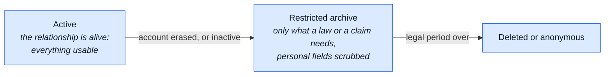
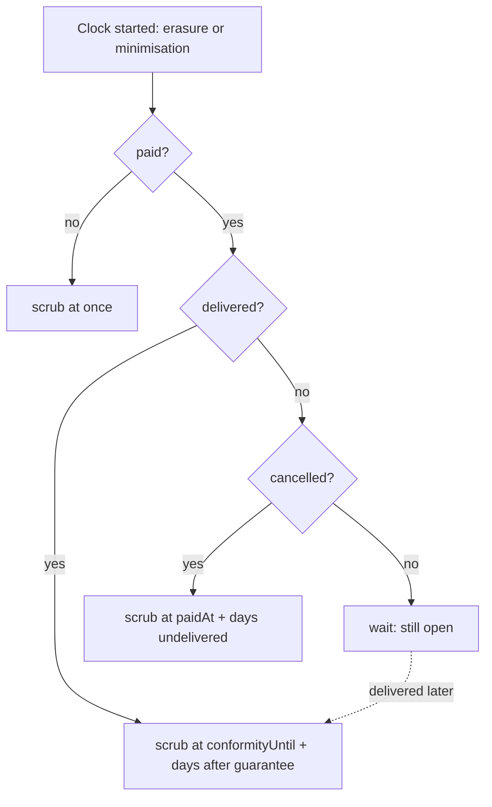
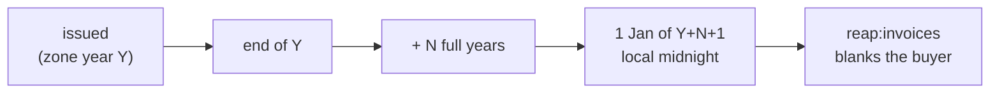
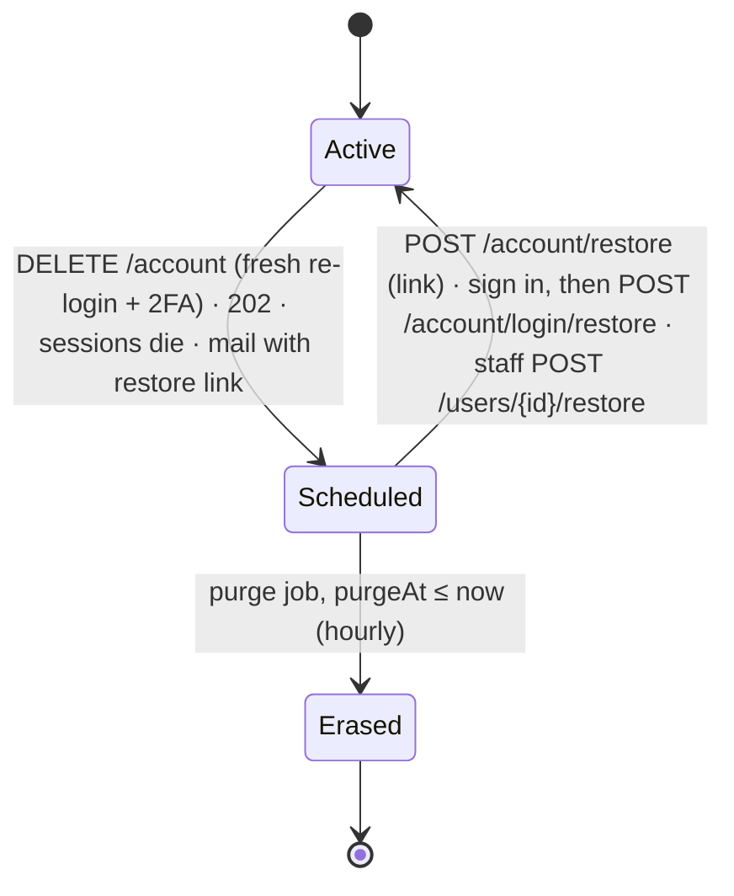
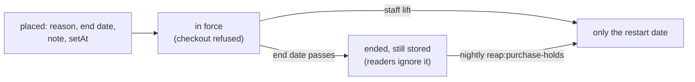

# Data Retention

The [processing register](./data-protection.md#processing-register-art-30) lists every retention
window. This page says **why** each window is as long as it is, and what the industry does.

Not legal advice — the same caveat as [Data Protection](./data-protection.md#what-this-page-is-not).

## The rule: one clock per purpose

| GDPR article          | Says                                                               | Here it means                    |
| --------------------- | ------------------------------------------------------------------ | -------------------------------- |
| Art. 5(1)(c)          | collect only what the purpose needs                                | shrink what is stored            |
| Art. 5(1)(e)          | keep it only as long as the purpose needs it                       | every piece of data gets an end  |
| Art. 17(3)(b) and (e) | a legal obligation or a legal claim can outlive an erasure request | invoices, returns, the order row |

- Both duties apply at once. Collecting less never removes the need for an end date.
- Retention is judged **per piece of data**, not per account. An account can live on while one of
  its fields has run out of purpose.

## Three tiers

The model CNIL (the French supervisory authority) describes for customer data, and the one this
repo follows:

| Tier               | Order, as an example                                                                  |
| ------------------ | ------------------------------------------------------------------------------------- |
| Active             | full order: addresses, notes, email — shown in order history                          |
| Restricted archive | `userId` detached, the row kept, addresses still there until the per-order clock ends |
| Deleted/anonymous  | addresses and notes unset, email replaced — the accounting row stays forever          |

## Orders: kept while the account lives

| Situation         | What happens                                                                      | Why                                                                                               |
| ----------------- | --------------------------------------------------------------------------------- | ------------------------------------------------------------------------------------------------- |
| Account is alive  | the order keeps its personal fields                                               | order history is part of the contract the customer is using (Art. 6(1)(b))                        |
| Account is erased | `userId` detached at once; personal fields scrubbed when the per-order clock ends | the order is evidence for a tax audit or a legal claim, never a reason to keep the street forever |
| Never paid        | scrubbed at once after erasure                                                    | no tax record exists, so no exemption applies                                                     |

**What others do with a live customer's orders:** Shopify, WooCommerce and Amazon all keep order
history for as long as the account exists. None of them scrubs a live customer's orders on a timer.

**What the tax record actually needs:** the invoice, which keeps its own encrypted copy of the
billing address. Cross-border EU sales (OSS) also need the place of delivery — a country, not a
street, a phone or a note.

## Orders after the account

Once erasure or inactivity minimisation has started an order's clock, `reap:orders` scrubs the buyer
(email, both addresses with their country, notes) when the order is past its claim window. The due date
is derived on every run from the order's current fields, so an order delivered after the erasure follows
its delivery.

| Order                                              | Due                                                           |
| -------------------------------------------------- | ------------------------------------------------------------- |
| never paid                                         | at once                                                       |
| delivered                                          | `conformityUntil` + `NODE_ORDER_PII_DAYS_AFTER_GUARANTEE` (0) |
| paid, ended without delivery (cancelled, refunded) | `paidAt` + `NODE_ORDER_PII_DAYS_UNDELIVERED` (540)            |
| paid, still open                                   | not due: it still has to be shipped, delivered or returned    |

**Why these dates.** The invoice already keeps the tax copy of the buyer (and the place of supply for
OSS), so the order's copy has no tax purpose (Art. 5(1)(c)(e)). What still needs the buyer on the order is
a claim: the EU legal guarantee (Directive 2019/771; Italy art. 132 bars claims 26 months after delivery,
which `conformityUntil` stores), the 14-day withdrawal inside it, and card disputes (Visa's ceiling is about
540 days, which is why an undelivered paid order gets that long). Solidus keeps order PII forever; Shopify's
roughly six months is shorter than the guarantee, so the law decides here.

**Knobs.** `NODE_ORDER_PII_DAYS_AFTER_GUARANTEE` extends the delivered row where national law keeps
claims open longer (a 10-year limitation period, say). `NODE_ORDER_PII_DAYS_UNDELIVERED` is the card-dispute
ceiling for the undelivered row.

### How long a deployment must keep the records

The invoice buyer clock (`NODE_INVOICE_BUYER_RETENTION_YEARS`) defaults to the longest common EU
period, so the boilerplate is safe anywhere in the EU. A single-country shop may lower it.

| Where        | Bookkeeping period                 | Source                                                                                                                                                                                                 |
| ------------ | ---------------------------------- | ------------------------------------------------------------------------------------------------------------------------------------------------------------------------------------------------------ |
| EU OSS sales | 10 years                           | [VAT Directive art. 369k](https://vat-one-stop-shop.ec.europa.eu/one-stop-shop/record-keeping-and-audits-oss_en)                                                                                       |
| Italy        | 10 years                           | Codice civile art. 2220                                                                                                                                                                                |
| France       | 10 years                           | [Code de commerce L123-22](https://bofip.impots.gouv.fr/bofip/2837-PGP.html)                                                                                                                           |
| Germany      | 8 years for vouchers, 10 for books | [BEG IV, §147 AO](https://www.haufe.de/steuern/gesetzgebung-politik/viertes-buerokratieentlastungsgesetz_168_613390.html)                                                                              |
| Netherlands  | 7 years                            | AWR art. 52                                                                                                                                                                                            |
| Spain        | 6 years                            | [Código de Comercio art. 30](https://sede.agenciatributaria.gob.es/Sede/en_gb/impuesto-sobre-sociedades/gestion-impuesto-sobre-sociedades/obligaciones-contables-registrales/conservacion-libros.html) |

Check the current figure for the country before relying on it: these change (Germany did in 2025).

## Invoices: the tax clock

An invoice or credit note is the legal record of a sale, so it outlives the order, the account and
the order's own PII clock. What it does not need forever is the buyer. Once the tax period ends,
`reap:invoices` blanks the buyer block (name, street, city, zip, country) and keeps the numbered
document: seller, lines, every amount, the order link, and a credit note's link to its invoice.
The stats read revenue from these rows, so they stay.

| Part                         | After the clock ends                                    |
| ---------------------------- | ------------------------------------------------------- |
| buyer block                  | removed; `buyerErasedAt` records when                   |
| number, dates, seller, lines | kept                                                    |
| amounts, VAT summary         | kept                                                    |
| cached PDF                   | deleted at once; the next render prints a one-line note |

**The clock.** `NODE_INVOICE_BUYER_RETENTION_YEARS` (default 10, the longest EU period: IT art.
2220 c.c.; DE books 10, invoices 8). It counts from the END of the issue year, in the time zone
frozen on the document, as tax authorities count. A document is due at local midnight of 1 January
of issue year + N + 1. An invoice issued on 31 December 2015 at 23:30 UTC is already a 2016 invoice
in Rome, so it is due on 1 January 2027, not 2026. Counting `issuedAt + N * 365 days` would run up
to a year early. A credit note has its own clock, on its own issue date.

**What others do.** WooCommerce anonymises completed orders. Shopify keeps what was sold, the date
and the value. Amasty GDPR (Magento) deletes the personal data on invoices and credit memos and
keeps the documents. Odoo cannot delete a posted invoice; it anonymises the partner. None deletes
the numbered document.

A shorter country period lowers the knob; a pending tax audit raises it. The job reads the
`invoices_issuedAt` index for a coarse bound, then applies the exact year-end rule per row.

## Inactive accounts: minimise, don't delete

| Who                | What happens to an inactive account                                                              |
| ------------------ | ------------------------------------------------------------------------------------------------ |
| Google, Microsoft  | the whole account deleted after about 2 years                                                    |
| Amazon, most shops | kept forever, order history included                                                             |
| WooCommerce        | inactive-account cleanup exists, off by default                                                  |
| CNIL               | fined Carrefour and Spartoo (2020), partly for keeping long-inactive customers' data with no end |

Deleting a real person's account is the controller's call, so full deletion here is opt-in
(`NODE_INACTIVE_ACCOUNT_DAYS`, disabled by default — see
[`reap:inactive-accounts`](../reference/ops.md#scheduled-jobs)). Keeping everything forever is
the CNIL risk. The middle road is to **minimise**: after a long silence, drop what serves no
purpose any more, and keep the login. That step is on by default.

| Dial                          | Default       | Past it                                |
| ----------------------------- | ------------- | -------------------------------------- |
| `NODE_INACTIVE_MINIMISE_DAYS` | 1095 days, on | the account is minimised (table below) |
| `NODE_INACTIVE_ACCOUNT_DAYS`  | 0, disabled   | warned, then soft-, then hard-deleted  |

**Activity** is the latest signed-in session use (a login, a refresh, any request not marked
passive) or the latest API-key use. An account driven only through its API keys is a live
integration, not an idle account.

| Data on an inactive account | Its purpose                  | On inactivity                                                             |
| --------------------------- | ---------------------------- | ------------------------------------------------------------------------- |
| login (email, password)     | letting the person come back | kept                                                                      |
| profile, wishlist           | the account's own content    | kept                                                                      |
| saved address book          | a faster next checkout       | deleted — re-entered on the next order                                    |
| orders' addresses and notes | showing order history        | the [claim-window clock](#orders-after-the-account) starts, as on erasure |
| invoices                    | the tax record               | untouched ([own clock](#invoices-the-tax-clock))                          |
| return free text            | the legal-claims window      | its own clock, below                                                      |

A banned account is minimised like any other: minimising drops data and deletes nothing, so a ban is no
reason to keep the address book.

Each module says what it drops through its `personalData.minimise` hook, the twin of the erase
hook ([modules](./modules.md)). No warning mail: nothing goes that the customer cannot re-enter.
An account that comes back and goes quiet again is minimised again.

What this leaves forever: an email and a password hash, for an account nobody uses. Small, with a
clear purpose, and what Amazon does. A controller who wants more turns full deletion on.

## Self-deletion: a grace under one month

`DELETE /account` does not delete anything at once, and it does not wait for a click either. It
**locks** the account now and **erases** it later, at a date it states in the answer. The big players
do the same (Microsoft Graph keeps a deleted user restorable for 30 days, Google Workspace 20, Discord
about 14); a hijacked session or a mistake is undone before anything is lost.

| Question                       | Answer                                                                                                                                                           |
| ------------------------------ | ---------------------------------------------------------------------------------------------------------------------------------------------------------------- |
| How long has the shop to act?  | Art. 12(3): "without undue delay and in any event within one month of receipt"                                                                                   |
| How is a month counted?        | Reg. 1182/71, as the EDPB reads it (Guidelines 01/2022 v2, para 160): 5 March runs until 5 April (Ex. 32); 31 August until 30 September (Ex. 33)                 |
| Does the immediate lock count? | **No.** The lock is a restriction (Art. 4(3), Art. 18), not the erasure that was asked for. The `202` and the mail are the "information on action taken" at once |
| So what discharges Art. 17?    | Only the purge. `purgeAt` is capped at one calendar month, at 00:00 UTC of that date, so no time zone sees it pass late and the hourly job fits inside           |
| Why `min(N days, one month)`?  | 30 or 31 days overrun a month whenever February is in the window (31 January + 30 days is 2 March), so both bounds apply                                         |

The grace is `NODE_ACCOUNT_DELETION_GRACE_DAYS` (30 by default, 1 to 31). `purgeAt` is **stored**, not
derived, so changing the knob never moves a date already promised (the AIP-164 `purge_time`).

| While the account is locked | What happens                                                                                                                                                                   |
| --------------------------- | ------------------------------------------------------------------------------------------------------------------------------------------------------------------------------ |
| sessions, refresh           | dead at once (the session epoch moves in the same save)                                                                                                                        |
| API keys                    | suspended, back on restore, erased at the purge                                                                                                                                |
| cart, wishlist              | kept intact, restored or erased with the account                                                                                                                               |
| orders in flight            | untouched; transactional mails continue (Art. 6(1)(b)); the purge cancels the never-paid ones and detaches the paid ones ([when they are scrubbed](#orders-after-the-account)) |
| optional mails              | none (stock alerts, the example notice)                                                                                                                                        |
| password reset              | still works; it does not restore by itself                                                                                                                                     |
| signup with the same email  | refused until the purge                                                                                                                                                        |

Three ways back, all conditional on `purgeAt > now`: the mailed link, signing in (the answer is a
`DeletionPending` claim check, redeemed at `POST /account/login/restore`), and staff
(`POST /users/{id}/restore`, the same `delete:User` key as any restore, with a confirm in the admin).
The purge's first write is a claim on `purgeAt <= now`, so a restore and a purge can never both match.

**Third parties.** Every hard erasure, the purge included, also asks the PostHog provider (when it is
configured for erasure) to delete the person and its events:
[Erasure in PostHog](../tools/analytics.md#erasure-in-posthog).

**Backups.** A snapshot restore must re-apply `auth.account_delete.scheduled` and `.cancelled` since
the snapshot, or the purge erases an account the person restored:
[Erasures after a restore](../tools/backups.md#erasures-after-a-restore).

## The previous email after a change

A confirmed email change keeps the old address in `previousEmail`, for one purpose: the 7-day undo
link mailed to that old address. When the link lapses the purpose is over, so the address goes.

- **Who clears it:** the nightly `reap:previous-emails` job, under its own lease.
  It unsets `previousEmail` on every account that holds one and has no live undo token.
- **Why that test:** the link's own expiry is the window, so the clock is the one the user was told.
  A link that was spent or revoked ends the window early, and the same test catches that too.
- **The undo itself** still clears it at once; the sweep only covers the case nobody undid.

The states are in [Proving an address](../modules/account.md#proving-an-address).

## Free text on the order timeline

An order's [timeline](../modules/orders.md#the-timeline) holds one free-text field, `text`: the
reason a staff member gave for an override. Everything else on a row is an id, a code or a number.

| Rule                             | Why                                                                                                       |
| -------------------------------- | --------------------------------------------------------------------------------------------------------- |
| Own clock, from the row          | The order's clock starts only at erasure, so a live customer's text would never go.                       |
| `npm run job reap:orders` unsets | The row, its type and its codes stay: they are the accounting trail.                                      |
| Never copy a sibling's text      | `reap:returns` clears a return's `note` while a copy here would live on. Ids and codes only.              |
| Export carries it                | A staff assessment of a person is that person's data (the Nowak ruling above).                            |
| No staff name to the buyer       | Neither the screen nor the export names the staff member (Pankki S); the export keeps the buyer's own id. |

## Free text on returns

A return carries a required `reason` (`withdrawal`, `defective`, `wrong_item`, `other`) and two
free-text fields:

| Field            | Written by | Example risk                         |
| ---------------- | ---------- | ------------------------------------ |
| `note`           | customer   | "call me on 333…" typed into the box |
| `declineMessage` | staff      | an opinion about the customer        |

**The decline reason is a dropdown.** A decline carries a code (`return_period_ended`, `not_returnable`, `no_defect_found`, `other`), the buyer's mail turns it into one translated sentence, and a shop can count it. The code is a vocabulary, not a person typing, so it stays when the text goes; only the optional `declineMessage` (required for `other`) is wiped. Unlike a hold's `message`, which is dropped with the hold and never scrubbed because it is something the shop told a customer on a live order, a decline's message is staff's opinion kept on a finished record, so it has an end date.

**Why not just a dropdown for the rest.** Every large shop keeps an "Other" box (Amazon, Shopify's `OTHER`
reason), and a defect has to be described. Free text shrinks; it never reaches zero. So it needs
an end date of its own.

**What happens to it.** `npm run job reap:returns` unsets both fields once the return has not changed
for `NODE_RETURN_TEXT_RETENTION_DAYS` (3 years by default). Status, lines, amounts and dates stay:
they are the accounting trail.

**Why the text is kept for a while.** It is evidence in a consumer-rights claim:

| Claim              | How long it can come                                                                                                              |
| ------------------ | --------------------------------------------------------------------------------------------------------------------------------- |
| EU legal guarantee | at least 2 years from delivery ([Dir. 2019/771](https://eur-lex.europa.eu/eli/dir/2019/771/oj)), plus national limitation periods |
| card chargeback    | months after the payment, by card-network rules                                                                                   |

**Why its own clock, not the order's.** The order's clock starts only when an account is erased.
Tied to it, a live customer's note would never go.

**Why "since the last change", not "since closing".** An `approved` return whose goods never
arrive can never close (only a `received` return can), so a closing-based clock would keep its
text forever.

**Why staff text is the customer's data too.** A staff assessment of a person is that person's
data ([CJEU Nowak, C-434/16](https://www.scl.org/10098-cjeu-exam-answers-and-examiner-s-comments-are-personal-data/)).
So the right of access (Art. 15) covers `declineMessage` and the decline code beside it, and the data export carries both. The
staff member's own identity is not disclosed (CJEU Pankki S, C-579/21); it stays in the audit log.

**Not wiped early on erasure.** The text carries the same Art. 17(3)(e) basis as the rest of the
return.

**Less typed in the first place.** The return form asks for a description of the item and warns
against contact details; the box stays optional for every reason.

**What never leaves the database.** The `return.requested` webhook carries the `reason` code, never
the `note` (`returns/module.ts`).

## A shipment's address copy

Each shipment keeps a copy of the address it went to (`destination`, encrypted under the shipment's
own id), so redirecting the rest of an order never rewrites where an earlier parcel went. The copy
is the same personal data as the order's address, on the same clock: when retention scrubs the
order's address (`order.redacted`), `delivery` unsets every shipment's copy in answer. Lines, number,
tracking code and dates stay. The copy is in `POST /account/export`.

## Free text on holds

Staff can put a fulfillment order on hold, with a reason from a closed set and an optional **note**
(`holdNote`, up to 1000 characters). The reason is a vocabulary; the note is a person typing about a
person: "customer rang twice, sounded drunk", "address looks like a reseller". That is the same shape
of risk as a return's `declineMessage`, so it gets the same treatment: an end date of its own.

**What happens to it.** `npm run job reap:delivery` unsets `holdNote` once the fulfillment order has not
changed for `NODE_HOLD_NOTE_RETENTION_DAYS` (one year by default). Lines, status, reason and dates stay:
they are the record of what was promised and what left. The wipe does not move `updatedAt`, so the
clock it reads does not reset, and a rerun matches nothing.

**Why one year, not three.** A hold is operational, not evidence in a consumer-rights claim: the
return's note has to outlive the two-year legal guarantee, a hold's has only to outlive the chargeback
window. **Why its own clock.** The order's clock starts only when an account is erased; tied to it, a
live customer's note would never go. **Why "since the last change", not "since closing".** A
fulfillment order held for ever never closes.

The note is in `POST /account/export`, the same rule as a return's `declineMessage`: staff's assessment of a
person is that person's data (CJEU Nowak, C-434/16). Who wrote it is not (CJEU Pankki S, C-579/21), and the
fulfillment order records no staff id, so none is exported.

## The purchase hold

A hold is a protective pause on one account's checkout after repeated cancellations, or by hand. It
stores a reason, an end date, an optional note staff wrote for the buyer, who set it and when. The
mechanics are in [the purchase hold](../modules/orders.md#the-purchase-hold). An automatic hold lasts
at most 7 days, so a machine's decision stays temporary, and it also flags the account for a person
to look at (`purchaseHoldFlaggedAt`, a timestamp and nothing else).

**What is kept, and for how long.** While the hold is in force, all of it. After it ends, only one
date: the nightly `reap:purchase-holds` reduces an ended hold to `purchaseHoldResetAt` (the later of
the hold's own `setAt` and the account's last staff lift) and removes the hold itself, note and staff
id included. That date is what stops the same cancellations triggering a second hold, so it has a
purpose; the note and the staff member's id do not outlive the hold's end (Art. 5(1)(e)). The data
export carries the hold while it is stored. Who set it is never exported (CJEU Pankki S, C-579/21);
the audit log keeps that for 90 days. The review flag is kept until a staff member sets or lifts a hold
on the account (the review is the purpose; it is a timestamp, no text and no staff id), and the data
export carries it with the rest of the profile.

**Legitimate-interest assessment (Art. 6(1)(f), [EDPB 1/2024](https://www.edpb.europa.eu/our-work-tools/documents/public-consultations/2024/guidelines-12024-processing-personal-data-based_en)).**

| Test      | Answer                                                                                                                                                                                                                                                                                    |
| --------- | ----------------------------------------------------------------------------------------------------------------------------------------------------------------------------------------------------------------------------------------------------------------------------------------- |
| Purpose   | Stop one account from holding stock and refunds in a loop, or a bot from doing it; a real interest (recital 47).                                                                                                                                                                          |
| Necessity | A pause after a count of the buyer's own UNPAID cancellations (never paid ones, which are statutory withdrawals and only flag the account) is a narrow way to do it. A flag for a person to review first is narrower still, and is a choice the operator may prefer (see the note below). |
| Balancing | The effect is that a new order is refused for at most seven days. It ends by itself, never blocks paying an order already placed, cancelling, a withdrawal, a return or the account's data rights, and is explained.                                                                      |

**Art. 22 is a separate scope question.** Whether the automatic pause is a decision "with similarly
significant effect" is open (see [orders](../modules/orders.md#the-purchase-hold)). If it is, no
exception fits (a refusal is not necessary to enter a contract, and a flag for review is a less
intrusive way), so the way out is a human in the loop before the pause, not a safeguard after it.
That is a product choice the operator owns, and the demo ships the automatic pause with the Art. 22(3)
safeguards: the reason, a way to ask a person, a person who can lift it, and a pause capped at 7
days that flags the account so a person reviews it.

**DPIA screening ([WP248](https://ec.europa.eu/newsroom/article29/items/611236)).** Of the nine
criteria one is plausibly met (an automated decision with a similarly significant effect, above). One
criterion is not a presumption of high risk; the count is one shop, one rule and a few accounts. Screen
again if you raise `NODE_PURCHASE_HOLD_WINDOW_DAYS`, add signals to the rule, or share it across shops.

**The right to object (Art. 21).** The basis is legitimate interest, so the person may object at any
time and the operator must stop unless it shows compelling grounds. The mail names the right in its own
paragraph (Art. 21(4)) and points to the contact page, which reaches staff who can lift the hold; the
privacy notice names it too. The operator decides what a compelling ground is, with its lawyer.

## Backups and erasure

A backup is a copy of everything, kept for as long as the keep knobs say (24 hourly, 7 daily, 4 weekly,
6 monthly by default, so up to about six months). It therefore holds accounts that were erased _after_
the snapshot was taken.

| Question                                   | Answer                                                                                                                                               |
| ------------------------------------------ | ---------------------------------------------------------------------------------------------------------------------------------------------------- |
| Must an erasure reach the backups at once? | No. The ICO and CNIL both accept that a backup keeps the data until it ages out, **if** it is "beyond use": nobody reads it to serve the subject     |
| What keeps it "beyond use"?                | Backups are encrypted (restic, client side), reachable only through the restore path, and never queried for live work                                |
| What is promised after a restore?          | **Every erasure since the snapshot is re-applied.** An erased account does not come back to life                                                     |
| Who re-applies it, and how?                | A person, by the runbook: [Erasures after a restore](../tools/backups.md#erasures-after-a-restore). There is no automatic re-application, on purpose |
| Where does the list come from?             | The `auditlogs` events, taken **before** the restore (the restored database only knows older erasures), or the Winston lines in Loki                 |

The audit log keeps 90 days (`NODE_AUDIT_RETENTION_DAYS`) and the backups up to six, so restoring a
snapshot older than 90 days needs Loki for the older part. If neither source survives (the whole host
lost), the runbook says to record it in the incident log, as the
[Art. 33 runbook](./data-protection.md#breach-runbook-art-33-72-hours) already asks.

**Why not erase from the backups themselves.** restic repositories are immutable by design (and the
second machine is append-only on purpose): rewriting history to remove one person would remove the
property that makes the backup worth having. Ageing out is the standard.
