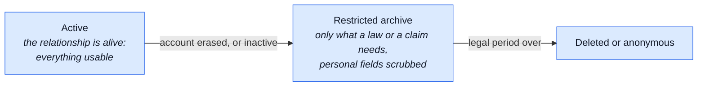

# Data Retention

The [processing register](./data-protection.md#processing-register-art-30) lists every retention
window. This page says **why** each window is as long as it is, and what the industry does.

Not legal advice — the same caveat as [Data Protection](./data-protection.md#what-this-page-is-not).

## The rule: one clock per purpose

| GDPR article          | Says                                                               | Here it means                    |
| --------------------- | ------------------------------------------------------------------ | -------------------------------- |
| Art. 5(1)(c)          | collect only what the purpose needs                                | shrink what is stored            |
| Art. 5(1)(e)          | keep it only as long as the purpose needs it                       | every piece of data gets an end  |
| Art. 17(3)(b) and (e) | a legal obligation or a legal claim can outlive an erasure request | invoices, returns, the order row |

- Both duties apply at once. Collecting less never removes the need for an end date.
- Retention is judged **per piece of data**, not per account. An account can live on while one of
  its fields has run out of purpose.

## Three tiers

The model CNIL (the French supervisory authority) describes for customer data, and the one this
repo follows:

| Tier               | Order, as an example                                                                  |
| ------------------ | ------------------------------------------------------------------------------------- |
| Active             | full order: addresses, notes, email — shown in order history                          |
| Restricted archive | `userId` detached, the row kept, addresses still there until the per-order clock ends |
| Deleted/anonymous  | addresses and notes unset, email replaced — the accounting row stays forever          |

## Orders: kept while the account lives

| Situation         | What happens                                                                      | Why                                                                                               |
| ----------------- | --------------------------------------------------------------------------------- | ------------------------------------------------------------------------------------------------- |
| Account is alive  | the order keeps its personal fields                                               | order history is part of the contract the customer is using (Art. 6(1)(b))                        |
| Account is erased | `userId` detached at once; personal fields scrubbed when the per-order clock ends | the order is evidence for a tax audit or a legal claim, never a reason to keep the street forever |
| Never paid        | scrubbed at once after erasure                                                    | no tax record exists, so no exemption applies                                                     |

The clock is `NODE_ORDER_PII_RETENTION_DAYS`, counted from the order's own `createdAt`; the
default and the mechanics are in the [register](./data-protection.md#processing-register-art-30).

**What others do with a live customer's orders:** Shopify, WooCommerce and Amazon all keep order
history for as long as the account exists. None of them scrubs a live customer's orders on a timer.

**What the tax record actually needs:** the invoice, which keeps its own encrypted copy of the
billing address. Cross-border EU sales (OSS) also need the place of delivery — a country, not a
street, a phone or a note.

### How long a deployment must keep the records

The default window is the longest common EU period, so the boilerplate is safe anywhere in the EU.
A single-country shop may lower it.

| Where        | Bookkeeping period                 | Source                                                                                                                                                                                                 |
| ------------ | ---------------------------------- | ------------------------------------------------------------------------------------------------------------------------------------------------------------------------------------------------------ |
| EU OSS sales | 10 years                           | [VAT Directive art. 369k](https://vat-one-stop-shop.ec.europa.eu/one-stop-shop/record-keeping-and-audits-oss_en)                                                                                       |
| Italy        | 10 years                           | Codice civile art. 2220                                                                                                                                                                                |
| France       | 10 years                           | [Code de commerce L123-22](https://bofip.impots.gouv.fr/bofip/2837-PGP.html)                                                                                                                           |
| Germany      | 8 years for vouchers, 10 for books | [BEG IV, §147 AO](https://www.haufe.de/steuern/gesetzgebung-politik/viertes-buerokratieentlastungsgesetz_168_613390.html)                                                                              |
| Netherlands  | 7 years                            | AWR art. 52                                                                                                                                                                                            |
| Spain        | 6 years                            | [Código de Comercio art. 30](https://sede.agenciatributaria.gob.es/Sede/en_gb/impuesto-sobre-sociedades/gestion-impuesto-sobre-sociedades/obligaciones-contables-registrales/conservacion-libros.html) |

Check the current figure for the country before relying on it: these change (Germany did in 2025).

## Inactive accounts: minimise, don't delete

| Who                | What happens to an inactive account                                                              |
| ------------------ | ------------------------------------------------------------------------------------------------ |
| Google, Microsoft  | the whole account deleted after about 2 years                                                    |
| Amazon, most shops | kept forever, order history included                                                             |
| WooCommerce        | inactive-account cleanup exists, off by default                                                  |
| CNIL               | fined Carrefour and Spartoo (2020), partly for keeping long-inactive customers' data with no end |

Deleting a real person's account is the controller's call, so full deletion here is opt-in
(`NODE_INACTIVE_ACCOUNT_DAYS`, disabled by default — see
[`reap:inactive-accounts`](../reference/ops.md#scheduled-jobs)). Keeping everything forever is
the CNIL risk. The middle road is to **minimise**: after a long silence, drop what serves no
purpose any more, and keep the login. That step is on by default.

| Dial                          | Default       | Past it                                |
| ----------------------------- | ------------- | -------------------------------------- |
| `NODE_INACTIVE_MINIMISE_DAYS` | 1095 days, on | the account is minimised (table below) |
| `NODE_INACTIVE_ACCOUNT_DAYS`  | 0, disabled   | warned, then soft-, then hard-deleted  |

**Activity** is the latest login or the latest API-key use. An account driven only through its
API keys is a live integration, not an idle account.

| Data on an inactive account | Its purpose                  | On inactivity                             |
| --------------------------- | ---------------------------- | ----------------------------------------- |
| login (email, password)     | letting the person come back | kept                                      |
| profile, wishlist           | the account's own content    | kept                                      |
| saved address book          | a faster next checkout       | deleted — re-entered on the next order    |
| orders' addresses and notes | showing order history        | the per-order clock starts, as on erasure |
| invoices                    | the tax record               | untouched                                 |
| return free text            | the legal-claims window      | its own clock, below                      |

Each module says what it drops through its `personalData.minimise` hook, the twin of the erase
hook ([modules](./modules.md)). No warning mail: nothing goes that the customer cannot re-enter.
An account that comes back and goes quiet again is minimised again.

What this leaves forever: an email and a password hash, for an account nobody uses. Small, with a
clear purpose, and what Amazon does. A controller who wants more turns full deletion on.

## Free text on returns

A return carries a required `reason` (`withdrawal`, `defective`, `wrong_item`, `other`) and two
free-text fields:

| Field           | Written by | Example risk                         |
| --------------- | ---------- | ------------------------------------ |
| `note`          | customer   | "call me on 333…" typed into the box |
| `declineReason` | staff      | an opinion about the customer        |

**Why not just a dropdown.** Every large shop keeps an "Other" box (Amazon, Shopify's `OTHER`
reason), and a defect has to be described. Free text shrinks; it never reaches zero. So it needs
an end date of its own.

**What happens to it.** `npm run reap:returns` unsets both fields once the return has not changed
for `NODE_RETURN_TEXT_RETENTION_DAYS` (3 years by default). Status, lines, amounts and dates stay:
they are the accounting trail.

**Why the text is kept for a while.** It is evidence in a consumer-rights claim:

| Claim              | How long it can come                                                                                                              |
| ------------------ | --------------------------------------------------------------------------------------------------------------------------------- |
| EU legal guarantee | at least 2 years from delivery ([Dir. 2019/771](https://eur-lex.europa.eu/eli/dir/2019/771/oj)), plus national limitation periods |
| card chargeback    | months after the payment, by card-network rules                                                                                   |

**Why its own clock, not the order's.** The order's clock starts only when an account is erased.
Tied to it, a live customer's note would never go.

**Why "since the last change", not "since closing".** An `approved` return whose goods never
arrive can never close (only a `received` return can), so a closing-based clock would keep its
text forever.

**Why staff text is the customer's data too.** A staff assessment of a person is that person's
data ([CJEU Nowak, C-434/16](https://www.scl.org/10098-cjeu-exam-answers-and-examiner-s-comments-are-personal-data/)).
So the right of access (Art. 15) covers `declineReason`, and the data export carries it. The
staff member's own identity is not disclosed (CJEU Pankki S, C-579/21); it stays in the audit log.

**Not wiped early on erasure.** The text carries the same Art. 17(3)(e) basis as the rest of the
return.

**Less typed in the first place.** The return form asks for a description of the item and warns
against contact details; the box stays optional for every reason.

**What never leaves the database.** The `return.requested` webhook carries the `reason` code, never
the `note` (`returns/module.ts`).

## Backups and erasure

A backup is a copy of everything, kept for as long as the keep knobs say (24 hourly, 7 daily, 4 weekly,
6 monthly by default, so up to about six months). It therefore holds accounts that were erased _after_
the snapshot was taken.

| Question                                   | Answer                                                                                                                                               |
| ------------------------------------------ | ---------------------------------------------------------------------------------------------------------------------------------------------------- |
| Must an erasure reach the backups at once? | No. The ICO and CNIL both accept that a backup keeps the data until it ages out, **if** it is "beyond use": nobody reads it to serve the subject     |
| What keeps it "beyond use"?                | Backups are encrypted (restic, client side), reachable only through the restore path, and never queried for live work                                |
| What is promised after a restore?          | **Every erasure since the snapshot is re-applied.** An erased account does not come back to life                                                     |
| Who re-applies it, and how?                | A person, by the runbook: [Erasures after a restore](../tools/backups.md#erasures-after-a-restore). There is no automatic re-application, on purpose |
| Where does the list come from?             | The `auditlogs` events, taken **before** the restore (the restored database only knows older erasures), or the Winston lines in Loki                 |

The audit log keeps 90 days (`NODE_AUDIT_RETENTION_DAYS`) and the backups up to six, so restoring a
snapshot older than 90 days needs Loki for the older part. If neither source survives (the whole host
lost), the runbook says to record it in the incident log, as the
[Art. 33 runbook](./data-protection.md#breach-runbook-art-33-72-hours) already asks.

**Why not erase from the backups themselves.** restic repositories are immutable by design (and the
second machine is append-only on purpose): rewriting history to remove one person would remove the
property that makes the backup worth having. Ageing out is the standard.
