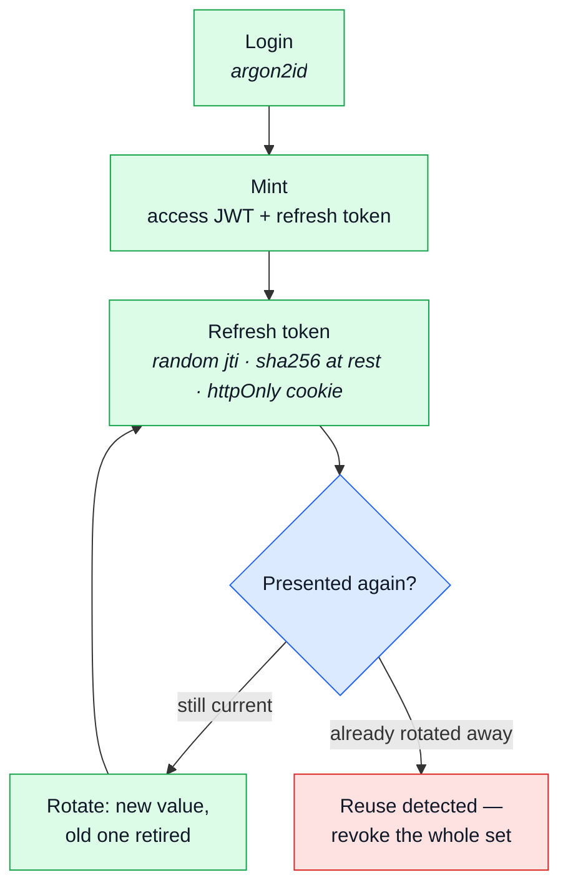

# Authentication

Proving who you are. Mostly flaws — missing controls — and the attacks are the ways credentials
and sessions get taken. This is the largest family in the catalog and the one this codebase has
spent the most on, so it is grouped by **what the attacker is after**: the credential, the
session, the recovery path, or the second factor.

## How a session is held, and why that shape

The access token is stateless and short-lived; the refresh token is **stored**, so it can be
revoked. That single asymmetry is what closes most of the JWT rows below.

That is the default, `jwt` mode. A deployment may run `cookie` mode instead (`NODE_SESSION_MODE`):
one random session id, stored hashed and carried in an HttpOnly cookie, with no JWT at all. The two
defend differently:

| Defence                         | `jwt` mode                                                                   | `cookie` mode                                                                                                   |
| ------------------------------- | ---------------------------------------------------------------------------- | --------------------------------------------------------------------------------------------------------------- |
| A leaked credential is detected | refresh-token reuse: a replay of a rotated-away token signs every device out | not detected: a stolen id works until the owner ends that session, signs out everywhere or changes the password |
| Cross-site request forgery      | the few routes the cookie alone authenticates check the `Origin`             | every write the cookie authenticates checks the `Origin` (`kernel/middlewares/authorizations.ts#getAuth`)       |
| Script reading the credential   | the access token is readable for up to ten minutes                           | nothing is readable: the id is HttpOnly                                                                         |

The rows below describe `jwt` mode unless they say otherwise; [Two ways to stay signed
in](../sessions.md) sets the two side by side.

## Guessing the credential

| Attack                           | How it works                                                          | This boilerplate                                                                                                                                                                                                                                                                                                                                                                                                                                                                                                                                                                                                                                                                                  |
| -------------------------------- | --------------------------------------------------------------------- | ------------------------------------------------------------------------------------------------------------------------------------------------------------------------------------------------------------------------------------------------------------------------------------------------------------------------------------------------------------------------------------------------------------------------------------------------------------------------------------------------------------------------------------------------------------------------------------------------------------------------------------------------------------------------------------------------- |
| Brute force                      | no lockout, no rate limit, no MFA                                     | `credentialLimiters` — independent budgets per account, per address and per address block, each in its own 15-minute window and spent only by FAILURES, so an honest user never pays. The per-account lockout doubles each time the same account trips it again (up to 8x) — `account/rate-limits.ts#credentialLimiters`, `infrastructure/http/middlewares/rate-limit-store.ts#escalatingStore`                                                                                                                                                                                                                                                                                                   |
| Credential stuffing              | leaked pairs replayed at scale                                        | The same budgets, plus `loginChallengeGate`: once the identity budget is half spent, login demands a human challenge — see [Automation and abuse](automation-and-abuse.md#the-ladder)                                                                                                                                                                                                                                                                                                                                                                                                                                                                                                             |
| Password spraying                | one common password across many accounts, evading per-account lockout | The per-ADDRESS budget is the one that bites here, since a spray is many accounts from few sources. The block-keyed rung above it is the real answer — see [the ladder](automation-and-abuse.md#the-ladder)                                                                                                                                                                                                                                                                                                                                                                                                                                                                                       |
| Default / hard-coded credentials | `admin/admin`, demo users, credentials in the repo                    | The seed interlock refuses production outright, and refuses everywhere else too when any seed account is still logging in with its committed, public fallback password — `scenarios/apply.ts`, `scenarios/accounts.ts`                                                                                                                                                                                                                                                                                                                                                                                                                                                                            |
| Weak password policy             | short, common or breached passwords accepted                          | `PasswordNew` in the contract bars the LENGTH only (8 to 128; NIST SP 800-63B-4 asks for no composition rules, so a long lowercase passphrase is fine); what keeps a weak one out is the breached-password check on every SET path (signup, reset or setup link, change) — a committed list of ~20k previously-breached passwords, plus, only when `NODE_PASSWORD_BREACH_HIBP` is turned on (it defaults to `false`), the HIBP k-anonymity range API for the tail; both fail open — `infrastructure/security/breached-passwords`. `POST /account/password/check` is an advisory-only preview of both, and the paired frontend adds a `zxcvbn` strength meter as a third, non-blocking suggestion. |
| Account lockout as DoS           | the attacker locks victims out by guessing at their username          | The per-account budget CAN be spent by a stranger, so the owner has a way around it: a successful login sets an HMAC-signed familiar-device cookie (`NODE_DEVICE_COOKIE_SECRET`, one token per account, up to five accounts per browser) and a browser holding it skips that budget, never the per-address or per-block ones. A forged cookie spends its own small budget. The throttle lifts by itself after the window (15 minutes, doubling on a repeat) — `account/session/device-cookie.ts`                                                                                                                                                                                                  |

## Knowing an account exists

| Attack                      | How it works                                                        | This boilerplate                                                                                                                                                                                                                                                                                                                                                                                         |
| --------------------------- | ------------------------------------------------------------------- | -------------------------------------------------------------------------------------------------------------------------------------------------------------------------------------------------------------------------------------------------------------------------------------------------------------------------------------------------------------------------------------------------------- |
| User / account enumeration  | different messages, status codes or timing on login, signup, reset  | Closed on login and reset, DELIBERATELY OPEN on signup — see below. The reset request answers 200 at once, before the lookup, token write and mail enqueue that only a registered address has, so the response time says nothing either; a failure behind it is logged, never answered — `account/controllers/post-reset-request.ts`, `account/services/password-reset-request.ts#requestPasswordReset`. |
| Timing attack on comparison | a non-constant-time compare leaks a secret byte by byte             | A login miss compares against a dummy argon2id hash computed once at import, so an unknown email costs the same as a wrong password — `account/services/login.ts#DUMMY_PASSWORD_HASH`                                                                                                                                                                                                                    |
| Credential leakage          | passwords or tokens in URLs, logs, error pages, analytics, referrer | Password hashes, live tokens and (configurably) personal fields are redacted or hashed before a log line is written — `infrastructure/adapters/logger.ts#SENSITIVE_FIELDS`. See [Information disclosure](disclosure.md#logs-and-telemetry).                                                                                                                                                              |

### Signup answers whether the address is taken, and that is a decision

Login answers one shape for "no such email" and "wrong password", and the reset endpoint answers
the same 200 whether or not the address exists. `POST /account/signup` does NOT: a registered
address gets `409`, a fresh one `201`. That is a one-request enumeration oracle and it is
deliberate.

Why it stays:

- Telling someone they already have an account is the only way they find out at the moment they
  need to know. The alternative — a uniform "check your email" screen — makes the common case
  (a person who forgot they registered) strictly worse to serve a threat model the rate limiter
  already addresses.
- It is what Shopify, Stripe and GitHub all do at signup.
- Closing it here changes little while login stays uniform: an attacker with a list of addresses
  gains a bounded, rate-limited oracle, not an account.

What it costs, stated plainly: an address can be tested for membership. If a deployment's threat
model makes membership itself sensitive — a medical or legal product, say — fold signup into the
same non-committal 200 the reset endpoint uses and deliver the outcome by email instead. That is
a product decision, not a code defect, and nothing here assumes it stays this way.

Recorded because a pentest raises it every time. `src/modules/account/openapi.yaml`'s own comment
on the signup route documents the `409` as the intended response.

## Taking the session

| Attack                          | How it works                                                         | This boilerplate                                                                                                                                                                                                                                                                                                                                                                                                                                                                                                                                                                                                                                                                                                                                                             |
| ------------------------------- | -------------------------------------------------------------------- | ---------------------------------------------------------------------------------------------------------------------------------------------------------------------------------------------------------------------------------------------------------------------------------------------------------------------------------------------------------------------------------------------------------------------------------------------------------------------------------------------------------------------------------------------------------------------------------------------------------------------------------------------------------------------------------------------------------------------------------------------------------------------------- |
| Session fixation                | an id accepted from the URL or a cookie and not rotated at login     | No session id is ever accepted from the caller. A session exists only as a token this server minted.                                                                                                                                                                                                                                                                                                                                                                                                                                                                                                                                                                                                                                                                         |
| Session hijacking / sidejacking | XSS, network sniffing, log exposure, malware                         | Rotating the refresh token's value on every exchange makes a stolen cookie DETECTABLE on its next presentation rather than silently reusable for the rest of its life — `account/session/jwt.ts#rotateRefreshToken`                                                                                                                                                                                                                                                                                                                                                                                                                                                                                                                                                          |
| Predictable session tokens      | sequential, timestamp-based or weak-PRNG identifiers                 | A random `jti` per mint, from `node:crypto`, so two logins in the same second cannot collide into one revocable session — `account/session/jwt.ts#mintRefreshToken`                                                                                                                                                                                                                                                                                                                                                                                                                                                                                                                                                                                                          |
| Insufficient session expiry     | no idle timeout, no absolute timeout, no server-side revocation      | A deactivated or soft-deleted account stops authenticating on its very NEXT request, not at its next login — `users/repository.ts#findAuthenticatableById`, `account/module.ts#resolve`                                                                                                                                                                                                                                                                                                                                                                                                                                                                                                                                                                                      |
| Missing invalidation            | logout, password change or role change do not revoke existing tokens | Logout-everywhere, a password change or reset, a 2FA factor change, an email change and detected refresh reuse each move the account's session epoch (`tokensValidAfter`) AND drop every refresh token, so an access token already handed out dies too; a password change or reset, and an email change undone as "not me", also purge pending one-time tokens and MFA challenges. Deactivation and soft-delete drop the refresh tokens, move the epoch in the same save so an unban or a restore never revives an old token, and stop the resolver at its next read. Plain single-device logout deliberately does not move it — `account/domain/revocation.ts` (the table), `account/services/revocation.ts`, `account/session/epoch.ts`, `users/services/update.ts#update` |
| Cookie flag omissions           | missing `HttpOnly`, `Secure`, `SameSite`; over-broad `Domain`/`Path` | The refresh cookie (`__Host-session`) is `httpOnly`, `sameSite: 'lax'`, and `Secure` in every environment (browsers accept it on localhost), with `Path=/` and no `Domain`, which the `__Host-` prefix makes a browser enforce: a sibling subdomain can neither set nor overwrite it. Refresh is a `POST`, and refresh, logout and the SSE streams refuse a foreign `Origin` (`infrastructure/http/middlewares/origin.ts`). The `isAuth` UI hint set alongside it is deliberately none of those — it carries no credential — `account/session/cookies.ts#createRefreshCookie`, `#createLoggedCookie`                                                                                                                                                                         |
| Cookie tossing                  | an attacker-controlled subdomain sets a cookie the parent trusts     | The refresh cookie is verified by SIGNATURE and by presence on the user document, so a tossed value is not merely wrong, it is unknown — `account/session/jwt.ts#verifyRefreshToken`                                                                                                                                                                                                                                                                                                                                                                                                                                                                                                                                                                                         |
| Insecure "keep me logged in"    | `isLoggedIn=true` or a role in a cookie, trusted by the server       | `isAuth` is read by the frontend to decide what to render and by nothing on this server. Authorization reads the verified token, never a cookie flag.                                                                                                                                                                                                                                                                                                                                                                                                                                                                                                                                                                                                                        |
| Remember-me token flaws         | predictable, non-rotating, not revoked                               | The "remember me" tiers set the refresh cookie's own LIFETIME only (unticked: a browser-session cookie, still bounded server-side by the `short` tier). They do not exempt a sensitive action from the freshness check — a long-lived session still has to step up — `account/session/config.ts#RefreshTokenExpiryTime`                                                                                                                                                                                                                                                                                                                                                                                                                                                      |

## JWT specifically

| Attack                          | How it works                                                | This boilerplate                                                                                                                                                                                                                                                                                                                                                                                                                                                                                                              |
| ------------------------------- | ----------------------------------------------------------- | ----------------------------------------------------------------------------------------------------------------------------------------------------------------------------------------------------------------------------------------------------------------------------------------------------------------------------------------------------------------------------------------------------------------------------------------------------------------------------------------------------------------------------- |
| `alg: none`                     | the library accepts an unsigned token                       | `{ algorithms: ['HS256'] }` pinned on every verify — `account/session/jwt.ts`                                                                                                                                                                                                                                                                                                                                                                                                                                                 |
| Key confusion                   | an RS256 public key used as an HMAC secret                  | Same pin. One algorithm is accepted, and it is symmetric, so there is no public key to confuse with a secret.                                                                                                                                                                                                                                                                                                                                                                                                                 |
| Weak secret                     | a short or dictionary HMAC key brute-forced offline         | The app refuses to start if `NODE_TOKEN_ACCESS` / `NODE_TOKEN_REFRESH` are unset, too short, or still the shipped placeholder — `infrastructure/config/define.ts`                                                                                                                                                                                                                                                                                                                                                             |
| `kid` / `jku` / `x5u` injection | the verifier fetches attacker-controlled key material       | No surface: the secret is read from config, never from the token's own header.                                                                                                                                                                                                                                                                                                                                                                                                                                                |
| Missing claims validation       | `exp`, `aud`, `iss`, `nbf` not checked                      | `jose` verifies `exp`, `iss`, `aud` (one per token kind) and `typ`, and this app requires each, plus `sub`, `iat` and `jti` — [Sessions](../../modules/account-sessions.md#token-claims). `nbf` is never set. `auth_time` and `amr` are carried claims read by the freshness guard.                                                                                                                                                                                                                                           |
| No revocation                   | a stolen stateless token stays valid until it expires       | Refresh tokens are checked against the live, stored set on every use, not merely signature-verified, and a rotated-away (superseded) entry is refused as a credential — only the rotation itself still reads it, for the two-tab grace and reuse detection — `account/session/jwt.ts#verifyRefreshToken`, `users/repository.ts`. The access token is short-lived, and the resolver also compares its `auth_time` with the account's session epoch, so a compromise event cuts it off at once — `account/session/resolver.ts`. |
| Refresh-token misuse — reuse    | stored accessibly, not rotated, family not revoked on reuse | A refresh token replayed after it was rotated away revokes the account's ENTIRE refresh set — `account/session/jwt.ts#rotateRefreshToken`, `TokenReuseError`                                                                                                                                                                                                                                                                                                                                                                  |
| Cross-purpose key use           | one key for access and refresh, signing and encryption      | Separate secrets per purpose — `NODE_TOKEN_ACCESS`, `NODE_TOKEN_REFRESH`, `NODE_TOTP_ENCRYPTION_KEY` for the second factor (the full list of five is in [Cryptography](crypto-and-secrets.md#randomness-and-keys)) — each required at boot. The two token kinds also carry their own `typ` header (`at+jwt`, `rt+jwt`, RFC 9068 / RFC 8725 §3.11) and each verifier demands its own, so a refresh token presented as a bearer is refused even where two secrets were set equal — `account/session/jwt.ts`.                    |

## Recovery, and changing the credential

| Attack                               | How it works                                                     | This boilerplate                                                                                                                                                                                                                                                                                                                                                         |
| ------------------------------------ | ---------------------------------------------------------------- | ------------------------------------------------------------------------------------------------------------------------------------------------------------------------------------------------------------------------------------------------------------------------------------------------------------------------------------------------------------------------ |
| Password-reset poisoning             | the link is built from `Host` / `X-Forwarded-Host`               | Every link is `NODE_FRONTEND_URL` plus a route, with the token in the URL fragment (`#token=`, which a browser never sends to a server); no header is read — `account/emails.ts`. Same answer as [Host header injection](injection.md#into-a-path-or-a-model).                                                                                                           |
| Weak reset tokens                    | short, predictable, non-expiring, not single-use                 | 16 random bytes from `node:crypto`, stored as a sha256 digest, time-boxed, SPENT on use, and ONE live link per account (issuing replaces the older one in a single atomic upsert, backed by a partial unique index) — `account/services/tokens.ts#issueToken`, `account/services/password-reset-request.ts#issueResetToken`, `account/services/tokens.ts#spendLiveToken` |
| Reset via security questions         | knowledge-based recovery with guessable answers                  | No surface: there are no security questions.                                                                                                                                                                                                                                                                                                                             |
| Email-change without re-verification | the address is swapped without confirming old and new            | Changing the email demands proof of a RECENT session, not merely a valid one — `kernel/middlewares/authorizations.ts#requireFreshAuth`, mounted in `account/routes.ts`                                                                                                                                                                                                   |
| Magic-link flaws                     | reusable, long-lived, leaked through referrer, no device binding | No surface: there is no magic-link login. The same single-use token mechanism backs reset and the 2FA challenge instead.                                                                                                                                                                                                                                                 |

### Step-up authentication

The freshness guard is the reason several rows above are one line. Changing the email, deleting
the account, managing sessions, checking out and confirming a payment all demand a session that
proved itself RECENTLY.

`auth_time` and `amr` are carried claims, never derived from the clock — so a token minted before
step-up existed reads as infinitely old and is asked to re-prove itself, rather than sliding
through a guard that was not there when it was issued.

For an account with a second factor armed, the identity routes (email, password, delete) demand
more than recency: an `otp` in the fresh session's `amr`. A re-authentication claims only what it
proved, so a password-only one does not carry the login's `otp` over; the `401 REAUTH_REQUIRED`
names the missing proof in `details.methods`. An email change can also be undone for 7 days from the
old address's link, through a password change — `account/services/verification.ts#undoEmailChange`.

Mounted per-route in `account/routes.ts`, `cart/routes.ts` and `payments/routes.ts`; enumerated by
`tests/cross-cutting/step-up-auth-routes.test.ts` so a new sensitive route cannot quietly skip it.

## The second factor

| Attack                                | How it works                                            | This boilerplate                                                                                                                                                                                                                                                                                                                                                                                                                                                                                                                                                                                                                                                                                                         |
| ------------------------------------- | ------------------------------------------------------- | ------------------------------------------------------------------------------------------------------------------------------------------------------------------------------------------------------------------------------------------------------------------------------------------------------------------------------------------------------------------------------------------------------------------------------------------------------------------------------------------------------------------------------------------------------------------------------------------------------------------------------------------------------------------------------------------------------------------------ |
| OTP / 2FA bypass — attempt cap        | no rate limit on code guesses                           | Two caps. A limiter bounds guesses against ONE still-live login challenge (keyed on the challenge cookie for an OAuth login) — `account/rate-limits.ts#mfaChallengeLimiter`. And a per-ACCOUNT counter on the user (10 wrong codes lock the checks for 15 minutes), reserved before the code is compared so parallel guesses cannot outrun it, covers every place a code is typed — `account/two-factor/lockout.ts` (the policy), `users/repository.ts#reserveMfaAttempt` (the atomic write), `account/services/two-factor-lockout.ts`                                                                                                                                                                                   |
| OTP / 2FA bypass — response tampering | rewriting a client-visible `{"ok":false}` into `true`   | The challenge is server-verified end to end; there is no intermediate answer a caller could rewrite — `account/services/two-factor-challenge.ts#verifyLoginChallenge`                                                                                                                                                                                                                                                                                                                                                                                                                                                                                                                                                    |
| OTP / 2FA bypass — replay             | the same code accepted twice                            | The RFC 6238 time step of the last accepted code is claimed with a conditional write (only a later step wins), so two concurrent requests carrying one code cannot both pass; a delivered code (and the step-up code) is spent by a write conditional on the same digest, expiry and attempt count, so the same code twice works once, and parallel wrong guesses are each counted by `$inc` — `account/two-factor/methods/totp.ts`, `users/repository.ts#claimTotpStep`, `#spendDeliveredCode`, `#recordDeliveredMiss`; the 2FA persist writes a per-method diff and never sets that step, so a slow request cannot write a stale one back ([concurrent writes](../../modules/account-two-factor.md#concurrent-writes)) |
| OTP / 2FA bypass — step skipping      | calling the post-2FA step directly                      | The login challenge is not a JWT at all — it is a single-use, revocable, hashed-at-rest token, so it fails ordinary token verification outright, and a right code SPENDS it before a session is minted (only the request whose own write removed it may mint) — proven by the bypass test in `tests/integration/two-factor.test.ts`                                                                                                                                                                                                                                                                                                                                                                                      |
| Secrets at rest in plaintext          | a database dump hands over every device secret          | A device secret is AES-256-GCM encrypted under a versioned key; a delivered code is an HMAC under the same key, since six digits fall to a bare digest; backup codes are salted `scrypt`, since 40 bits falls to a bare digest too — `account/two-factor/`                                                                                                                                                                                                                                                                                                                                                                                                                                                               |
| MFA fatigue / push bombing            | repeated push prompts until one is approved             | Out of reach by construction: there is no push factor to bomb.                                                                                                                                                                                                                                                                                                                                                                                                                                                                                                                                                                                                                                                           |
| SIM swap                              | the carrier is social-engineered into moving the number | Out of reach by construction: there is no SMS factor. Email and SMS codes mostly re-verify a channel an attacker may already hold — the mailbox especially, since it is already the reset path.                                                                                                                                                                                                                                                                                                                                                                                                                                                                                                                          |

**What 2FA newly exposes.** A defence that lists only what it stops is marketing. Adding TOTP
makes "OTP / 2FA bypass" a real row against this codebase in the way it is against any TOTP
implementation — the attempt cap and the replay tracking above are what keep it closed, not what
makes it not apply. WebAuthn / passkeys is the acknowledged next step, and the reason `amr` is
carried as an ARRAY rather than a boolean: a future `amr: ['hwk']` is a new value, not a new guard.

## Federated login

| Attack                                   | How it works                                                                                                         | This boilerplate                                                                                                                                                                                                                                                                                                                                                                                                                                                                                                                                                                                                                                                          |
| ---------------------------------------- | -------------------------------------------------------------------------------------------------------------------- | ------------------------------------------------------------------------------------------------------------------------------------------------------------------------------------------------------------------------------------------------------------------------------------------------------------------------------------------------------------------------------------------------------------------------------------------------------------------------------------------------------------------------------------------------------------------------------------------------------------------------------------------------------------------------- |
| OAuth — missing `state`                  | the attacker's code delivered to the victim's callback (login CSRF)                                                  | A double-submit `state` cookie, minted and set in the same response that hands it to the provider; the callback rejects a mismatch with 400 — `account/oauth/state.ts`, `account/controllers/get-oauth-callback.ts`                                                                                                                                                                                                                                                                                                                                                                                                                                                       |
| OAuth — `redirect_uri` manipulation      | loose matching, an open redirect on an allowed domain, traversal                                                     | The redirect URI and the post-login frontend URL's ORIGIN are both derived from server config (`NODE_URL`, `NODE_FRONTEND_URL`), never from the request or the provider's answer — `account/oauth/config.ts#oauthRedirectUri`. The one request-derived piece is the optional `?continue=` path appended to the frontend redirect, saved as a cookie across the round trip and checked against the same same-origin-relative rule at both ends — `account/oauth/state.ts#isSameOriginPath`                                                                                                                                                                                 |
| OAuth — implicit flow token leakage      | an access token in the URL fragment leaks via referrer and history                                                   | No surface: the authorization-code flow is the only one implemented.                                                                                                                                                                                                                                                                                                                                                                                                                                                                                                                                                                                                      |
| OAuth — missing PKCE                     | an intercepted authorization code is redeemable                                                                      | S256 PKCE ships beside `state`, not instead of it — the client secret already covers a confidential client, this covers the code leaking before the secret does — `account/oauth/state.ts`, `account/oauth/providers/`                                                                                                                                                                                                                                                                                                                                                                                                                                                    |
| OAuth — scope / consent abuse            | scope upgrade, or consent phishing with a look-alike app                                                             | This application is the OAuth CLIENT, never the provider, so there is no consent screen here to phish. The requested scopes are fixed in `account/oauth/providers/`.                                                                                                                                                                                                                                                                                                                                                                                                                                                                                                      |
| OAuth — account linking confusion        | an unverified email from the provider trusted for matching                                                           | A provider identity is linked to an existing email only once the provider reports that address as VERIFIED; an unverified address is rejected, whether it would link or sign up — `account/services/oauth.ts#loginOrCreateFromOAuth`                                                                                                                                                                                                                                                                                                                                                                                                                                      |
| OAuth — 2FA bypass via a linked provider | an armed second factor guarded only the password path; signing in with the linked provider minted a session directly | The callback checks `twoFactorEnabledAt` exactly like `postLogin`'s 2FA branch and issues the same login challenge instead of a session. The challenge crosses the redirect in a short-lived httpOnly cookie, never the URL — `account/controllers/get-oauth-callback.ts`, `account/oauth/mfa-redirect.ts`; behind it, `startSession` refuses any first session for an armed account whose `amr` lacks `otp`, so a login path that forgets the branch fails instead of minting ([the mint guard](../../modules/account-sessions.md#the-mint-guard))                                                                                                                       |
| SAML — signature wrapping                | an assertion altered yet still "valid"                                                                               | No surface: no SAML.                                                                                                                                                                                                                                                                                                                                                                                                                                                                                                                                                                                                                                                      |
| SSO misconfiguration                     | issuer or audience not pinned, so any tenant's users are accepted                                                    | Each provider's token and profile endpoints are hard-coded — `account/oauth/providers/`. See [SSRF](ssrf.md#making-the-server-fetch).                                                                                                                                                                                                                                                                                                                                                                                                                                                                                                                                     |
| Pre-account-takeover                     | the attacker registers the victim's address before they do                                                           | Two halves, both closed. Signup is bounded — an unproven address is an `unverified` audience and holds no `cart.self.checkout`. And the LINK now demands verification of BOTH sides: `loginOrCreateFromOAuth` refuses to attach a provider identity to an account that never proved the address itself, so the victim's own Google sign-in cannot drop them into a squatter's account. An owner can also see every connected provider and remove one (`GET`/`DELETE /account/oauth/links`), and the reset mail lists what is still connected. Their way in is the password reset, which proves the same mailbox — `account/services/oauth.ts#OAuthAccountUnverifiedError` |

**A banned or soft-deleted account is refused before the link, not after.** An address that matches
such an account would otherwise get a provider link and an `AUTH_OAUTH_LINKED` audit row, with the
session refused only afterwards, and the link would outlive an unban or a restore. The callback
answers `provider_error` (the frontend has no new case, and the caller learns nothing about the
account's state) and writes nothing. The "may this account authenticate" rule is one specification,
the filter and the predicate in `users/authenticatable.ts`, shared by the lookups, the token mint and
the inactivity reaper. A provider the account already holds is not linked twice: the write is
guarded on `oauthAccounts.provider`, and only a link that landed is audited.

## Related

- [Authorization](authorization.md) — what a proven identity is then allowed to do
- [Crypto and secrets](crypto-and-secrets.md) — the hashing and randomness these controls rest on
- [Email](email.md) — the channel every recovery flow runs through
- [Automation and abuse](automation-and-abuse.md) — the limits that bound guessing
