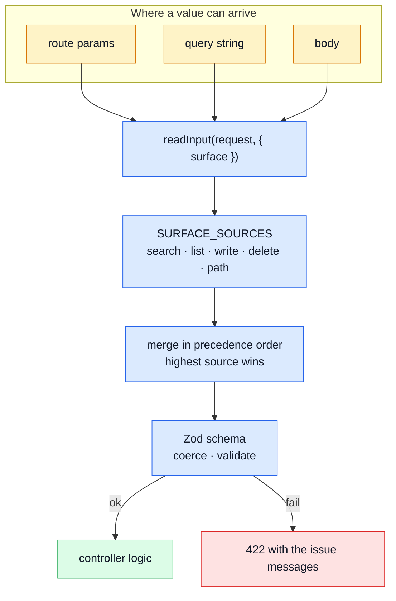

# Request Input

A value an endpoint needs may arrive as a route param, a query-string entry or a body field, and
the same endpoint often accepts more than one of those. That is deliberate: it lets a single
controller serve `GET /products?text=x` and `POST /products/search {"text":"x"}` without
duplicating the handler, which is what keeps long filter sets out of URLs.

What is _not_ deliberate is re-deriving the rules of that polymorphism at every call site. This
page is the single written statement of which sources each endpoint reads, in what order, and what
happens to the value on the way in.

## The shape in one picture



The load-bearing part is the middle: a controller names **which surface it is**, not which sources
to read. That is what keeps precedence a property of the endpoint's kind rather than of whichever
array the newest controller happened to pass.

## The table

Read "sources" left-to-right as precedence, highest first — with one declared exception,
`hardDelete`, whose sources are OR'd instead (see the rules below). A controller does not spell this array:
it names the **surface** it is (`search`, `list`, `write`, `create`, `delete`, `path`) and
`SURFACE_SOURCES` in `@infrastructure/http/request` maps that to the row below. The set is closed,
so precedence is a property of the surface rather than of whichever array the newest controller
happened to pass — and a seventh combination has to be added there deliberately, where it can be
reviewed against the spec. `tests/contract/request-sources.test.ts` pins the set for exactly that
reason: adding one fails that test once, which is the prompt to update this page alongside it.

| Surface  | Sources (highest first) | Used by                                                                  |
| -------- | ----------------------- | ------------------------------------------------------------------------ |
| `search` | body, query             | the four endpoints with a `POST …/search` sibling                        |
| `list`   | query                   | the four GET-only collection reads, which have no such sibling           |
| `write`  | params, body            | `updateProduct`, cart PUT                                                |
| `create` | body                    | `createProduct`, and the PUT/PATCH factory's body (its id is read apart) |
| `delete` | params, query, body     | the three soft/hard delete controllers                                   |
| `path`   | params                  | `DELETE /cart/{productId}`, which declares no body; `writeOrders`        |

`search` and `list` differ on one question: **is there a route that can carry a body?** A GET
cannot — RFC 9110 §9.3.1 gives content on a GET no defined semantics and the Fetch spec refuses to
send it, so the paired frontend could never use one — which makes `search` on a GET-only route a
claim about a source no client has. Where such a route is also cached the claim is worse than
decorative: `setCache` keys on the declared **query** parameters, so a body-borne filter is
invisible to the key. Give a collection read a real DTO form by adding `POST /x/search`, not by
declaring a body on its GET.

| Endpoint(s)                                                             | Parameter                                       | Sources (highest first)                    | Treatment                                                                                 |
| ----------------------------------------------------------------------- | ----------------------------------------------- | ------------------------------------------ | ----------------------------------------------------------------------------------------- |
| `GET /products`, `POST /products/search`                                | `id`                                            | body, query                                | `stringArrays` — merged, not collapsed; a batch filter, `$in`                             |
|                                                                         | `category`, `tag`                               | body, query                                | merged, then `coerceStringArray(...)[0]`                                                  |
|                                                                         | `page`, `pageSize`                              | body, query                                | merged, then the shared pagination schema                                                 |
|                                                                         | `text`, `minPrice`, `maxPrice`                  | body, query                                | merged, then Zod                                                                          |
| every `GET x`, `POST x/search` pair                                     | `sort`                                          | body, query                                | `csvLists` — a query CSV is split, a body array is taken as sent; blank query is absent   |
| `GET /users`, `POST /users/search`                                      | `id`                                            | body, query                                | `stringArrays` — merged, not collapsed; a batch filter, `$in`                             |
|                                                                         | `active`                                        | body, query                                | merged, then Zod `value === 'true'`                                                       |
|                                                                         | `page`, `pageSize`, `text`, `email`, `username` | body, query                                | merged, then Zod (pagination shared)                                                      |
| `GET /orders`, `POST /orders/search`                                    | `id`                                            | body, query                                | `stringArrays` — merged, not collapsed; a batch filter, `$in`                             |
|                                                                         | `userId`                                        | body, query                                | merged; **ignored unless the caller holds the key**                                       |
|                                                                         | `page`, `pageSize`, `productId`, `email`        | body, query                                | merged, then Zod (pagination shared)                                                      |
| `DELETE /products`, `DELETE /products/:id`, `DELETE /products/:id/hard` | `id`                                            | params, query, body                        | `requireId`: a malformed path id is a 404, a malformed query or body id a 422 naming `id` |
|                                                                         | `hardDelete`                                    | params, query, body — **OR'd, not ranked** | boolean; any `true` wins; 422 for anything that is not one                                |
| `DELETE /users`, `DELETE /users/:id`, `DELETE /users/:id/hard`          | `id`                                            | params, query, body                        | `requireId`: a malformed path id is a 404, a malformed query or body id a 422 naming `id` |
|                                                                         | `hardDelete`                                    | params, query, body — **OR'd, not ranked** | boolean; any `true` wins; 422 for anything that is not one                                |
| `DELETE /orders`, `DELETE /orders/:id`, `DELETE /orders/:id/hard`       | `id`                                            | params, query, body                        | `requireId`: a malformed path id is a 404, a malformed query or body id a 422 naming `id` |
|                                                                         | `hardDelete`                                    | params, query, body — **OR'd, not ranked** | boolean; any `true` wins; 422 for anything that is not one                                |
| `POST /orders`, `PUT /orders/:id`                                       | `id`                                            | params                                     | absent means create                                                                       |
|                                                                         | everything else                                 | body                                       | untouched                                                                                 |
| `PUT /products/:id`, `PATCH /products/:id`                              | `id`                                            | params                                     | from the path only, through the shared factory's `requireId` (404 when malformed)         |
| `POST /products`, `PUT /products/:id`, `PATCH /products/:id`            | `active`                                        | body                                       | boolean; decoded only on `multipart/form-data`                                            |
|                                                                         | `categories`, `tags`                            | body                                       | string array; decoded only on multipart                                                   |
|                                                                         | everything else                                 | body                                       | untouched                                                                                 |
| `POST /users`                                                           | `active`                                        | body                                       | boolean; decoded only on multipart                                                        |
|                                                                         | everything else                                 | body                                       | untouched                                                                                 |
| `POST /cart`                                                            | `productId`, `quantity`                         | body                                       | `parseBody`: Zod, and a `productId` that is not an ObjectId is a 422 naming it            |
| `PUT /cart/:productId`                                                  | `productId`                                     | params                                     | `requireId` (404 when malformed)                                                          |
|                                                                         | `quantity`                                      | body                                       | Zod                                                                                       |
| `DELETE /cart/:productId`                                               | `productId`                                     | params, body                               | first non-empty wins, then `requireId`: 404 from the path, 422 from the body              |
| `GET /feedback`, `POST /feedback/search`                                | `page`, `pageSize`                              | body, query                                | merged, then the shared pagination schema                                                 |
|                                                                         | `text`, `email`, `status`                       | body, query                                | merged, passed through as strings                                                         |
| `GET /inventory/levels`                                                 | `page`, `pageSize`, `lowOnly`                   | query                                      | `lowOnly` decoded as a boolean, then Zod                                                  |
| `GET /inventory/movements`                                              | `productId`                                     | query                                      | first non-empty wins                                                                      |
|                                                                         | `page`, `pageSize`, `reason`                    | query                                      | then Zod                                                                                  |
| `GET /locales/{locale}/entries`                                         | `page`, `pageSize`, `text`, `tenant`            | query                                      | then the shared pagination schema                                                         |
| `GET /locales/{locale}/tenants/{tenant}/entries`                        | `tenant`                                        | params                                     | overrides any `?tenant=`; the rest as above                                               |
| `GET /observability/audit`                                              | `actor`, `action`, `outcome`, `since`           | query                                      | then Zod; a repeated key is a 422                                                         |
|                                                                         | `page`, `pageSize`                              | query                                      | then the shared pagination schema                                                         |

Pagination has exactly two authorities, and they answer different questions. `@infrastructure/http/schemas`
owns the **bounds** — `openapi.yaml` declares `minimum: 1` / `maximum: 100`, and every one of the
four search endpoints answers 422 for anything outside that, `GET /feedback` included.
`normalizePagination` (`@infrastructure/persistence/search`) owns the **defaults** — page 1, ten per page, or
`NODE_SETTINGS_PAGINATION_PAGE_SIZE` — and it runs on every search, which is why a controller
leaves an unspecified page absent rather than filling it in. Neither clamps: an out-of-range
request is rejected, not quietly turned into a different request.

## The rules behind the table

**Precedence goes by presence.** The highest source that carries a key wins, whatever its
value: `false`, `0`, `""` and `null` all count as stated. So `?title=` on a route that also has
a body `title` reads the query's empty string, not the body's. Declared `ids` are the one
exception, a `||` chain: an empty id falls through to the next source, because a blank id names
nothing. No endpoint's contract distinguishes the two for anything but ids.

**Explicit `undefined` keys are dropped.** An object spread _keeps_ a key whose value is
`undefined`, and such a key handed to Mongoose becomes a `field: undefined` filter clause rather
than being ignored. The merge therefore does a second pass to remove them.

**Absent is not empty.** A field nobody sent comes back `undefined`, never `false` or `[]`. The
service layer assigns anything defined, so defaulting here would turn a partial update into a full
overwrite and silently wipe whatever the caller did not mention.

**Only the string transports are decoded.** A route param and a query entry are strings by
construction — `?active=false` is the _string_ `'false'`, which is truthy, and a repeated key is
what stands in for an array — so there is no type in them to destroy and a declared boolean coming
from either is always decoded. A body is decoded only when it is `multipart/form-data`, which has
the same problem for the same reason. A JSON body is passed through untouched, and that asymmetry
is load-bearing: coercing JSON too is how `{"active": "not-a-boolean"}` reached the validator as a
perfectly good `true` and answered 201 where the contract promises 422.
`tests/contract/request-contract.test.ts` is the guard.

**Decoding is not validation.** Whatever the decoder could not recognise is passed through
unchanged, so `?hardDelete=maybe` reaches a schema and answers 422 rather than being guessed at.
The schemas for the scalars more than one endpoint accepts live in `@infrastructure/http/schemas`.

**`anyTrue` fields are OR'd, not ranked.** The one declared exception to precedence, and today it
has one member: `hardDelete`.

| Sources say             | Result                                                      |
| ----------------------- | ----------------------------------------------------------- |
| any of them `true`      | `true`                                                      |
| all `false`             | `false`                                                     |
| none of them (or blank) | absent — the schema applies the contract's `default: false` |
| any of them undecodable | passed through → 422, never outvoted by a `true` elsewhere  |

Precedence asks which source is the more explicit statement of intent. For `hardDelete` that
question has no honest answer, because `false` is the default and therefore a value nobody
normally types: a `false` that only means "unset" would outrank a `true` a caller deliberately
spelled, purely on the strength of its transport. OR has no such asymmetry — the only way to get
a hard delete is for someone to have asked for one, and the only way to avoid one is for nobody
to have.

**An unparseable enum filter narrows; an unparseable enum on a write is refused.** The same input,
two dispositions, because the safe direction differs:

| Where           | Value outside the closed set                                   |
| --------------- | -------------------------------------------------------------- |
| absent          | the filter is not applied                                      |
| a READ's filter | matches nothing — never widened to "return everything"         |
| a WRITE's field | 422, from the generated Zod enum, before any handler code runs |

A read can fail closed and still answer; a write has no safe narrowing of a value it cannot
understand, only a rejection. `status` on feedback is the live pair — `toFeedbackStatus` in
`src/modules/feedback/service.ts` for the read, `update-feedback-status.ts` for the write.

## Declaring it

`readInput` (`@infrastructure/http/request`) takes the row of the table above as an argument:

```ts
const input = readInput(request, {
    // which surface this is; the sources and their precedence follow from it
    surface: 'delete',
    ids: ['id'],
    booleans: ['active'],
    // OR'd across the sources instead of ranked, and decoded as a boolean without also
    // appearing above
    anyTrue: ['hardDelete'],
    stringArrays: ['categories', 'tags']
});
```

- `surface` — which route surface this is, and therefore which of `params`/`body`/`query` it reads
  and in what order (see the surface table above). Every key found in any of them ends up on the
  result; the categories below only change how _specific_ keys are resolved or typed.
- `ids` — real identifiers, and only those. The `||` chain above applies: an empty value falls
  through to the next source. A repeated key stays the array it arrived as, so the id check answers
  422 instead of silently picking an entry. Nothing is validated here.
  A repeated key on any other scalar parameter reaches the schema as an array and is a 422 too.
- `csvLists` — fields (`sort`) whose query form is a comma-separated list: split on the query
  transport, taken as sent from a JSON body.
- `booleans` / `stringArrays` — fields whose type survives a JSON body but not a string transport.
  Decoded per the rule above. Anything unrecognisable is passed through so the validator
  downstream rejects it rather than this layer inventing a value.
- `anyTrue` — booleans resolved by OR across the sources rather than by the surface's precedence,
  per the table above. Listing a field here decodes it too, so it does not also belong in
  `booleans`.

One route may also state a flag in its path rather than as a value. `DELETE /products/:id/hard`
means what `DELETE /products/:id?hardDelete=true` means; the `routeFlag('hardDelete')` middleware
(`@infrastructure/http/middlewares/route-flag`) writes it onto `request.params` so the controller keeps a single
declaration instead of growing a second entry point. Being a param, it does **not** thereby
outrank a query or body entry that contradicts it: `hardDelete` is declared `anyTrue`, so
`/products/:id/hard` carrying `{"hardDelete": false}` hard-deletes because one source said
`true` — not because the path won a ranking.

Every domain that deletes a persisted record offers the same three spellings, and offers them for
the same reason: the shape is a property of the domain, not a decision three route files each make.
Products, users and orders all do. Cart and feedback do not, and that is a decision rather than an
omission — a cart line is session-scoped, so there is no record to keep, and `deleteCartItem`
narrows its declaration to `['params']` to say so.

Two helpers in `@infrastructure/http/ids` deliberately stay outside `readInput`:

- `isValidObjectId` — an `id is string` type guard, which is a different job from extraction.
- `requireId` — it _responds_ as well as extracting: 404 for a malformed path id, 422 naming the
  field for a body or query one ([the rule](request-flow.md#a-malformed-id-has-one-answer-per-position)).
  It is built on `readInput` internally.

## What is deliberately not done yet

`openapi.yaml` already states, per operation, where every parameter lives — `in: path`,
`in: query`, `requestBody`. That is the same information the declarations above carry by hand, so
generating them from the spec would make the discrepancies below _unwritable_: a controller could
not read a source the contract does not declare, because nobody would be writing the source list.

It is not done, and the order matters. Four things stand in the way, none fatal: one controller
serves several operations (`writeOrders` covers two operationIds with two different declared
bodies), so a generated per-operation declaration would have to be wired per route rather
than per controller; `booleans`/`stringArrays` derive from the `multipart` schema variant, not the
JSON one; `GET /products` and `POST /products/search` are two operations deliberately sharing one
controller, so their declarations would need unioning; and orval generates clients and schemas,
not server-side input declarations, so this would be new machinery to own.

The cheaper first move is a **test**, not a generator, and it exists:
`tests/contract/request-sources.test.ts`. It recovers the route table statically — `src/modules.ts` and each
`module.ts` for the enabled modules and their base paths, `src/app/routes.ts` for the system
router it still mounts by name, the router files for each mounted path and its controller — reads
that controller's `readInput` declarations, and asserts they are a subset of what `openapi.yaml`
allows. Whether the two sets of routes match is a different test's job —
`tests/contract/route-spec-parity.test.ts` reads the live routers, not the source text, and
compares them with the spec both ways.

The comparison is per **controller**, against the union of every route it serves, and that is the
concession the first obstacle above forces. `getProducts` serves `GET /products` (query) and
`POST /products/search` (body) from one `surface: 'search'`; asserting that declaration
against either route alone would report the other's source as undeclared. What survives the union
is the real defect — a controller reading a source **no** route it serves declares, which is the
shape of all five closed discrepancies below. Splitting the declaration per operation is what
would let it tighten to per-route, and is the remaining work.

**A subset assertion over an empty set passes,** so the test carries a tripwire: it asserts it
recovered the surface table (`SURFACE_SOURCES`, parsed from `request.ts` itself) and a declaration
from more than ten controllers, and `$ref`'d parameters resolve against `components.parameters`
rather than by their reference name. A GET-only list controller declares `list`, never `search`,
since it would otherwise read a body no route of its own declares.

That test is also what makes generating the router safe. Routes written by hand sit next to a spec
written by hand, so a mismatch at least shows up in a diff; routes generated from a descriptor do
not, and a typo would silently mount something the spec never declared and orval never generated a
client for.

## Known discrepancies

None outstanding: `openapi.yaml` and the declarations agree, and `tests/contract/request-sources.test.ts`
keeps it that way.

What remains is a granularity, not a discrepancy. The comparison is per controller against the union
of its routes, so a source declared on one route it serves excuses that source on all of them. A
collection delete (`DELETE /users`) shares its controller with the `{id}` forms, so the `hardDelete`
query parameter has to be declared on every one of them — it is a shared `HardDeleteParam` for that
reason. Per-operation declarations are what would remove the blind spot.
