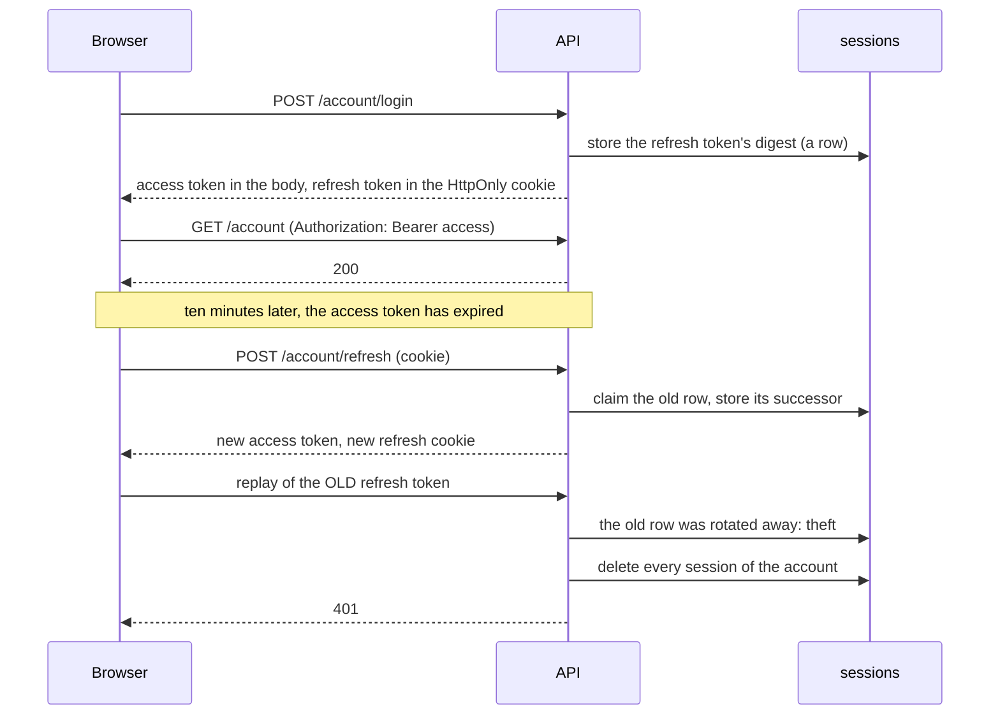
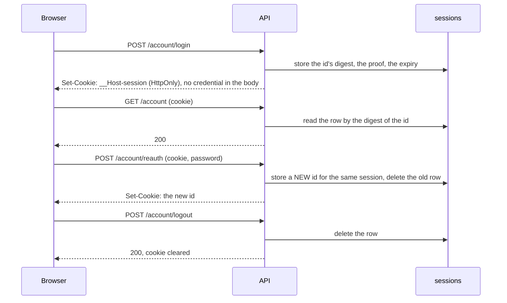
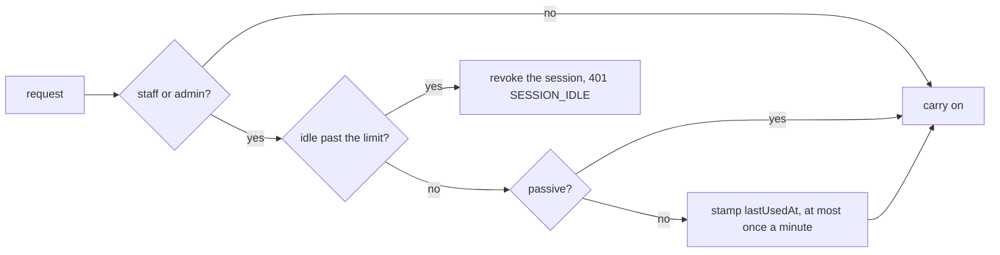

# Two ways to stay signed in

A deployment keeps people signed in in one of two ways. A setting picks which, and everything above
the login code, from the frontend to the permission guards, behaves the same either way.

::: tip At a glance
**The switch** — `NODE_SESSION_MODE=jwt|cookie`, default `jwt`. A frontend reads `GET /account/session-config` at boot and needs no switch of its own.
**Same in both** — login, logout, logout everywhere, revoking one device, the session list, the password check before money or deletion, the second factor.
**Different** — what the browser holds, and what a stolen credential costs.
**Changing it** signs everyone out: a session belongs to the mode that made it.
:::

## Which one to pick

| Mode            | Pick it when                                                                                                                                                                                       |
| --------------- | -------------------------------------------------------------------------------------------------------------------------------------------------------------------------------------------------- |
| `jwt` (default) | another service must verify a login without reading our database and you trust it with the signing secret (with HS256, whoever verifies can also mint), or you want today's audited code untouched |
| `cookie`        | the usual case: one site and its own single-page app. Fewer moving parts, and logout is a row delete                                                                                               |

Neither is the "secure" one. Both are standard patterns with a documented threat model, and each
defends against what the other leaves open (see [what each defends against](#what-each-defends-against)).

## `jwt` mode: a pair of tokens

The browser holds a ten-minute **access token** in memory and sends it as a Bearer header. A second,
longer-lived **refresh token** sits in an HttpOnly cookie the page cannot read. When the access token
expires the client swaps the refresh token for a new pair, and the old refresh token stops working.

A refresh token replayed after it was rotated away is the signal that it leaked, so one replay signs
every device out. Two tabs refreshing in the same instant are not theft, and a short grace window
keeps them apart. The mechanism is in [Sessions](../modules/account-sessions.md#refresh-rotation).

## `cookie` mode: one random id

A login makes one random 256-bit id and keeps only its hash in the database. A browser carries it in
one HttpOnly, `Secure`, `SameSite=Lax` cookie, `__Host-session`; the page holds nothing it could
read. A client with no cookie jar (a script, a mobile app) logs in with `transport: "bearer"` instead:
no cookie is set, the response carries the id as `ses_…`, and the client sends it back as
`Authorization: Bearer ses_…`.

There is no refresh and nothing to rotate: `POST /account/refresh` answers 404. The id is replaced
whenever the person proves themselves again (OWASP: renew the id on a privilege change), and the
session keeps its public id, its sign-in time and its expiry across the swap.

### The cookie asks for a check on every write

A cookie travels with a request the user never meant to make. So in this mode a request that
changes something (anything but `GET`, `HEAD`, `OPTIONS`) and is authenticated **by the cookie** must
name an allowed `Origin`, or it is answered 403 before anything runs — a request naming no `Origin` at all (curl, a health check) is not a browser's cross-origin call and passes. This is on top of
`SameSite=Lax`, which stops cross-site requests but not ones from a sibling subdomain.

The check lives in the one place a caller is resolved (`getAuth`), so no route can be added that a
cookie reaches and the check does not. A request authenticated by a `ses_…` **header** is not
checked: nothing rides along with a header. In `jwt` mode the check stays where it was, on the routes the
cookie alone authenticates (refresh, logout and the two SSE streams).

## Asking for the password again

A session that has merely been kept alive is not a fresh login. Money, destruction, identity and
session changes ask for the password (or a code) again once the last proof is older than
`NODE_REAUTH_TIME_CRITICAL` (5 minutes) or `NODE_REAUTH_TIME_SENSITIVE` (15 minutes). Both modes
obey the same windows:

| Mode     | Where the time of the last proof lives | What keeps it from refreshing itself                        |
| -------- | -------------------------------------- | ----------------------------------------------------------- |
| `jwt`    | the `auth_time` claim of the tokens    | a refresh copies it forward and never reads the clock       |
| `cookie` | `authTime` on the session row          | only `POST /account/reauth` writes it; plain use never does |

Re-proving replaces the credential in both modes: a new token pair, or a new id, in the same session family with the same start and absolute expiry. A re-proof proves who you are again; it never stretches how long the sign-in lasts.

## The staff idle timeout

A staff or admin session that sees no real request for `NODE_SESSION_IDLE_TIME_STAFF` seconds (30
minutes by default, `0` switches it off) ends: the next request answers `401 SESSION_IDLE`, the
session is revoked and the refusal is audited. A shopper's session never idles out (NIST AAL1 "MAY";
Shopify and Amazon do not either); NIST AAL2 asks at most an hour of inactivity of staff, and OWASP
asks that the server enforce it, so a client timer is only a courtesy.

One limit for every staff role, the administrator included: NIST sets limits by login strength, not
by job role, and the dangerous acts already need a login within the last five minutes (step-up).

What counts as activity is a real request. What does not: a request sent with
`X-Session-Passive: true` (a poll, a keep-alive), the 30-second recheck of an open event stream, and
a refresh, which renews a token and carries the clock over unchanged. A refresh is still judged: a staff family idle past the limit gets `401 SESSION_IDLE` from `POST /account/refresh` and the family is removed. `POST /account/session/touch`
counts and answers the clock, which is how a client asks "still there?" from server numbers.

## The staff lifetime cap

An idle timeout does not bound a stolen session that is kept in use: a script that polls every few
minutes lives the full 7 or 30 days. So a staff or admin session also ends `NODE_SESSION_LIFETIME_STAFF`
seconds after sign-in (24 hours by default, `0` switches it off), however busy it is. The next
request answers an ordinary `401`, the family is removed, and the person signs in again.

| Source                          | Rule                                                                          |
| ------------------------------- | ----------------------------------------------------------------------------- |
| NIST SP 800-63B-4 §2.2.3 (AAL2) | reauthentication SHOULD be at most 24 hours; idle at most an hour             |
| OWASP ASVS 5.0 7.1.1 / 7.3.2    | document both limits and justify a deviation from NIST                        |
| Google Workspace                | an admin sets a fixed reauthentication of 1 to 24 hours for the Cloud console |

A shopper keeps the 1, 7 and 30-day tiers: a shopper session is password-only (AAL1, 30 days at
most) and the shop's money acts already ask for a fresh login. The cap is read on every request from
the account's stored roles, so a customer promoted mid-session is capped from the next request, and
the session list shows the earlier end. An everyday cost of the cap is nearly zero, since the idle
timeout already signs out anyone away for half an hour.

## What each defends against

| Threat                              | `jwt`                                                                                                                                      | `cookie`                                                                                          |
| ----------------------------------- | ------------------------------------------------------------------------------------------------------------------------------------------ | ------------------------------------------------------------------------------------------------- |
| A script reads the credential (XSS) | the access token is in memory, readable for up to ten minutes; the refresh cookie is not                                                   | nothing is readable: the id is HttpOnly                                                           |
| A stolen credential is replayed     | a refresh token that was already swapped is detected, and every device is signed out                                                       | a stolen id works until the owner ends that session, signs out everywhere or changes the password |
| Cross-site request forgery          | most routes take a header, so there is little to forge; the few that take the cookie check the origin                                      | every write the cookie authenticates checks the origin                                            |
| Logging out                         | the whole session family goes at once, and so does its access token (it names its session)                                                 | the row goes at once, and so does the access                                                      |
| Another service must verify a login | possible with the access token's signature, but a verifier holds the secret and so can also mint (HS256); asymmetric keys would avoid that | not possible: only this API can read the row                                                      |

Both modes share the **session epoch**: logging out everywhere, a password reset and an undone email
change move one timestamp on the account, and every session whose proof is older than it is refused.
An API key (`sk_…`) is untouched by either mode.

## What it costs a deployment

- **`jwt`** needs two signing secrets (`NODE_TOKEN_ACCESS`, `NODE_TOKEN_REFRESH`), and keeps one row
  per refresh token for a day after it is rotated away, so a replay is still recognised.
- **`cookie`** needs no signing secret. Its rows are one per sign-in and are deleted by their own
  expiry date.

Trade-offs left as they are, on purpose:

- **A lost refresh response, retried after the grace window, reads as token reuse** and revokes
  every session of the account, as Auth0's reuse interval and Okta's grace period do (RFC 9700
  §4.14.2). Choose `NODE_TOKEN_ROTATION_GRACE_MS` for the slowest client you serve to retry in.
- **The session epoch compares timestamps** that two instances stamped on their own clocks. One host
  with NTP is assumed.
- **`SameSite` stays `Lax`.** `Strict` drops the cookie on the OAuth callback and on arrival from an
  email link; `Lax` plus the origin check is the OWASP default.
- **Signup takes no `transport`.** A bearer client signs in with `POST /account/login` afterwards.

Neither mode saves the account lookup: both read the account and its roles on every request, so a
"stateless" token saves nothing here. `cookie` adds one indexed read of the session row, where
`jwt` verifies a signature instead.

## Related pages

- [Sessions](../modules/account-sessions.md) — the files, the storage and the switch, step by step
- [Authentication defences](./defences/authentication.md) — what each mode defends against, in the
  threat catalogue's terms
- [Authorization](./authorization.md) — what consumes the proof of identity
- [Data protection](./data-protection.md) — what a session row holds, and for how long
