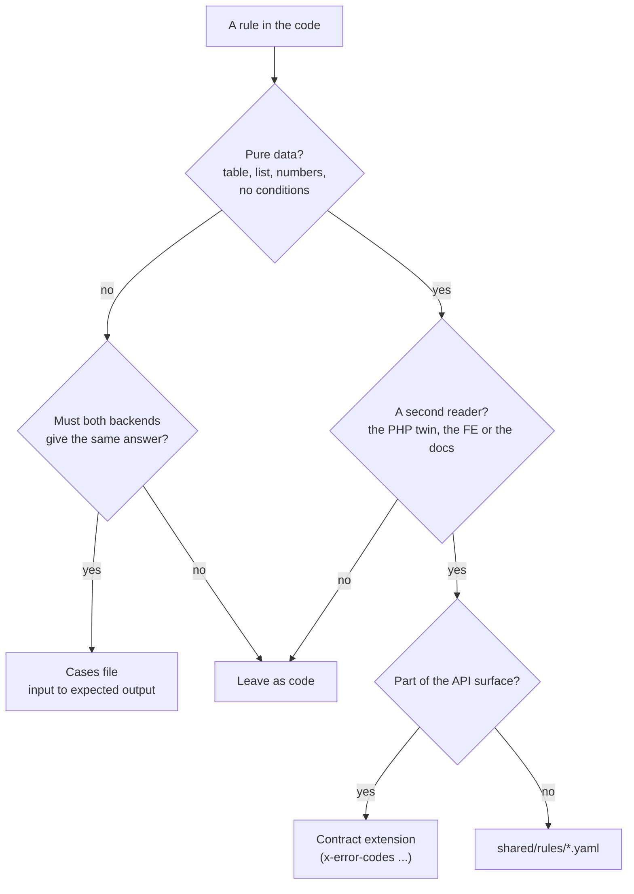
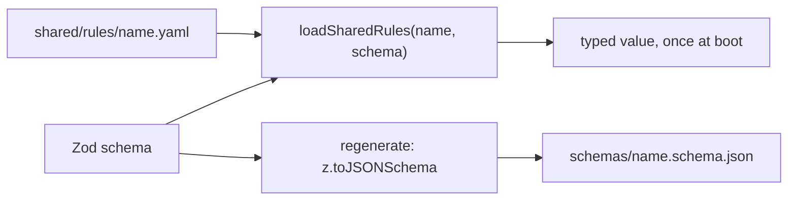

# Shared rules

A rule that is really **data** (a list, a table, a few numbers) is written once, in a file both
backends read. Logic that must stay code gets a **cases file** instead: input to expected output,
run by both backends' tests. This page is what goes where, and how to add one.

The first instance is older than this page: `shared/authorization-{keys,roles,conformance}.yaml`.
CASL reads them here, Laravel reads them in the twin. Shared rules extend that pattern.

## 1 · What goes where

Hard limits, enforced by each file's schema rather than by review:

- A rules file never holds an expression, a condition or a formula. Strings, numbers, booleans,
  lists and maps only. A field that wants an `if` is code plus a cases file; otherwise YAML grows
  into a bad programming language.
- Env var names stay per twin. A rules file holds the default; the env still overrides it.
- Key generators, `run` functions and library calls stay code. Only their data fields move.
- Prefer a cases file. It adds tests and changes no code.

## 2 · Is this standard?

| Name                                     | Examples                                                                                                 |
| ---------------------------------------- | -------------------------------------------------------------------------------------------------------- |
| Rules as data / table-driven design      | Symfony Workflow (YAML), xstate configs, SCXML, CASL / OPA / Cedar policy files, OMG DMN decision tables |
| Shared test vectors / conformance suites | JSON Schema Test Suite, CommonMark spec tests, Wycheproof, RFC 6238 TOTP vectors, CloudEvents SDKs       |

## 3 · Layout

| What            | Where                                                                               |
| --------------- | ----------------------------------------------------------------------------------- |
| Rule data       | `shared/rules/<name>.yaml`                                                          |
| Its schema      | Zod, in `src/infrastructure/config/shared-rules/<name>.ts`, listed in `registry.ts` |
| Its JSON Schema | `shared/rules/schemas/<name>.schema.json`, generated, committed                     |
| Cases           | `shared/cases/<name>.cases.yaml`                                                    |
| Cases test      | `tests/cross-cutting/<name>-conformance.test.ts`, through `tests/support/cases.ts`  |
| Moved verbatim  | `shared/rules/breached-passwords.txt`                                               |

`shared/**` is byte-identical in both repos. The twin picks the files up from there; nothing here
writes to the twin.

## 4 · How it loads

`loadSharedRules` parses with `yaml`, validates with the schema and returns `z.infer` of it. It runs
once at import, so a broken file fails the boot, never a request. The JSON Schema export lets the
twin validate the same file without Zod; `npm run check` refuses a stale one.

## 5 · Adding a rule

1. Write `shared/rules/<name>.yaml`, with a comment on every list saying why it is shaped that way.
2. Write the Zod schema (`z.strictObject`, so an unknown field fails) and add it to `registry.ts`.
3. Read it with `loadSharedRules` where the constant used to be. Values do not change in a move.
4. `npm run regenerate` writes the JSON Schema.

## 6 · Adding a case

1. Write `shared/cases/<name>.cases.yaml`. Each case has a `name` (one sentence) and an `expect`.
   Put every `allow` next to the `deny` that bounds it.
2. Write the test with `describeCases(file, caseSchema, count, run)`. The count is **pinned
   exactly**: a file that loads zero cases, or loses some, fails.
3. A case that fails on this backend is a bug here. Fix it in the same change.

## 7 · Today

| File                             | Read by                                                 |
| -------------------------------- | ------------------------------------------------------- |
| `rules/log-redaction.yaml`       | `adapters/logger.ts`, `runtime/otel-sdk.ts`             |
| `rules/password-hash.yaml`       | `security/password-hash.ts`                             |
| `rules/breached-passwords.txt`   | `security/breached-passwords`                           |
| `cases/log-redaction.cases.yaml` | `tests/cross-cutting/log-redaction-conformance.test.ts` |
