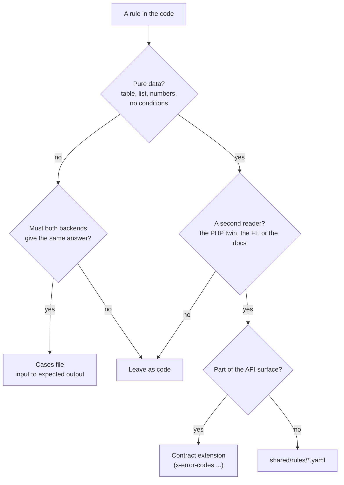
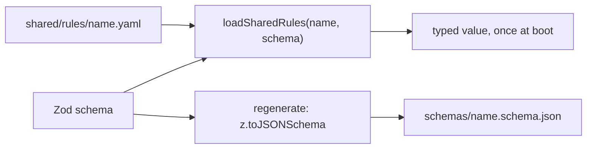
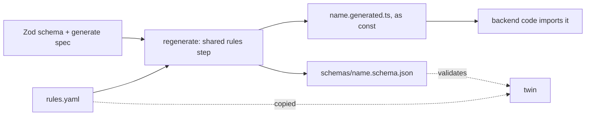

# Shared rules

A rule that is really **data** (a list, a table, a few numbers) is written once, in a file both
backends read. Logic that must stay code gets a **cases file** instead: input to expected output,
run by both backends' tests. This page is what goes where, and how to add one.

The first instance is older than this page: `shared/authorization-{keys,roles,conformance}.yaml`.
CASL reads them here, Laravel reads them in the twin. Shared rules extend that pattern.

## 1 · What goes where

Hard limits, enforced by each file's schema rather than by review:

- A rules file never holds an expression, a condition or a formula. Strings, numbers, booleans,
  lists and maps only. A field that wants an `if` is code plus a cases file; otherwise YAML grows
  into a bad programming language.
- Env var names stay per twin. A rules file holds the default; the env still overrides it.
- Key generators, `run` functions and library calls stay code. Only their data fields move.
- Prefer a cases file. It adds tests and changes no code.

Two things deliberately do **not** go to YAML:

- **Module lifecycles stay code.** A status machine is a typed TypeScript event table read by
  `defineLifecycle` (`src/domain-primitives/lifecycle.ts`); the contract carries only the status enum
  and the `actions` flags, and clients read `actions`. No mature API publishes its transition graph.
- **Shop-only tables stay code until a second reader exists.** Order events, status traits, VAT and
  shipping tables belong to the commerce modules; moving them early would build a reader for nobody.

## 2 · Is this standard?

| Name                                     | Examples                                                                                                 |
| ---------------------------------------- | -------------------------------------------------------------------------------------------------------- |
| Rules as data / table-driven design      | Symfony Workflow (YAML), xstate configs, SCXML, CASL / OPA / Cedar policy files, OMG DMN decision tables |
| Shared test vectors / conformance suites | JSON Schema Test Suite, CommonMark spec tests, Wycheproof, RFC 6238 TOTP vectors, CloudEvents SDKs       |

## 3 · Layout

| What            | Where                                                                               |
| --------------- | ----------------------------------------------------------------------------------- |
| Rule data       | `shared/rules/<name>.yaml`                                                          |
| Its schema      | Zod, in `src/infrastructure/config/shared-rules/<name>.ts`, listed in `registry.ts` |
| Its JSON Schema | `shared/rules/schemas/<name>.schema.json`, generated, committed                     |
| Its TS (opt-in) | `<out>.generated.ts`, an `as const` file built from the YAML, committed             |
| Cases           | `shared/cases/<name>.cases.yaml`                                                    |
| Cases test      | `tests/cross-cutting/<name>-conformance.test.ts`, through `tests/support/cases.ts`  |
| Moved verbatim  | `shared/rules/breached-passwords.txt`, `shared/locales/*.json`                      |

`shared/**` is byte-identical in both repos. The twin picks the files up from there; nothing here
writes to the twin.

## 4 · How it loads

`loadSharedRules` parses with `yaml`, validates with the schema and returns `z.infer` of it. It runs
once at import, so a broken file fails the boot, never a request. The JSON Schema export lets the
twin validate the same file without Zod; `npm run check` refuses a stale one.

### Rule data the twin will need: YAML + generated TS

Data that types a literal union (audit action names) or holds plain numbers (retry delays, 2FA
limits) is not read at boot. `regenerate` turns the YAML into a committed `as const` file, so the
type is a real union and the code imports a constant. The twin copies the YAML and never sees the TS.

- A shared file opts in with `generate: { out, exportName, shape }` in `registry.ts`.
- A module-owned file is `src/modules/<m>/rules.yaml` + `rules.schema.ts` (exports `rulesSchema`,
  `rulesGenerate`) and is found by the generator, not listed.
- A block in a module's `module.yaml` (`rateLimits:`, `jobs:`) is found the same way. The generator
  keeps one table of such blocks, `{ key, schema, file, exportName }`: a new block is one row.
- Data that sits in another shared document (the `stepUp:` windows in
  `authorization-keys.yaml`) is listed in the generator beside the registry's entries.
- `shape` is `verbatim` (dump the parsed data) or `keyed-list` (`{ value, description }` rows become
  `{ KEY: 'value' }` with a JSDoc per key).
- The generated files are excluded from Stryker and staged by the pre-commit hook.

## 5 · Adding a rule

1. Write `shared/rules/<name>.yaml`, with a comment on every list saying why it is shaped that way.
2. Write the Zod schema (`z.strictObject`, so an unknown field fails) and add it to `registry.ts`.
3. Read it with `loadSharedRules` where the constant used to be. Values do not change in a move.
4. `npm run regenerate` writes the JSON Schema.

## 6 · Adding a case

1. Write `shared/cases/<name>.cases.yaml`. Each case has a `name` (one sentence) and an `expect`.
   Put every `allow` next to the `deny` that bounds it.
2. Write the test with `describeCases(file, caseSchema, count, run)`. The count is **pinned
   exactly**: a file that loads zero cases, or loses some, fails.
3. A case that fails on this backend is a bug here. Fix it in the same change.

## 7 · Today

| File                                        | Read by                                                                                                                                                                                                                                                                         |
| ------------------------------------------- | ------------------------------------------------------------------------------------------------------------------------------------------------------------------------------------------------------------------------------------------------------------------------------- |
| `rules/frontend-links.yaml`                 | `http/frontend-link.ts`, read by account, users, orders, sitemap; handed to the frontend, whose router spec walks it                                                                                                                                                            |
| `scenarios/personas.yaml`                   | `scenarios/accounts.ts`, `users.ts`, `config.ts`; the generated account tables in `docs/tools/demo-profile.md`                                                                                                                                                                  |
| `rules/log-redaction.yaml`                  | `adapters/logger.ts`, `runtime/otel-sdk.ts`                                                                                                                                                                                                                                     |
| `rules/cookies.yaml`                        | `http/cookies.generated.ts`, read by `kernel/cookies.ts` and the account module's session, device and OAuth cookies; its `secret` names join `log-redaction.yaml`'s list in `adapters/logger.ts` (the twin does the same); the cookie table in `docs/theory/data-protection.md` |
| `rules/audit-actions.yaml`                  | `observability/audit-actions.generated.ts`, imported by `observability/audit.ts`                                                                                                                                                                                                |
| `modules/account/rules.yaml`                | `account/rules.generated.ts`, read by `two-factor/lockout.ts`, `delivered-codes.ts`                                                                                                                                                                                             |
| `modules/webhooks/rules.yaml`               | `webhooks/domain/rules.generated.ts`, read by `domain/backoff.ts`                                                                                                                                                                                                               |
| `modules/example/rules.yaml`                | `example/rules.generated.ts`, read by `example/audit.ts`, `analytics.ts`                                                                                                                                                                                                        |
| `rules/rate-limits.yaml`                    | `http/middlewares/rate-limits.generated.ts`, read by `rate-limit.ts` (the browsing, api-key and upload budgets)                                                                                                                                                                 |
| `modules/<m>/module.yaml` `rateLimits:`     | `<m>/rate-limits.generated.ts`, read by `<m>/rate-limits.ts` (account, cart, example, invoicing, orders, payments, returns, tickets)                                                                                                                                            |
| `rules/outbox.yaml`                         | `kernel/outbox.generated.ts`, read by `kernel/config.ts` (env defaults) and `kernel/outbox.ts` (backoff)                                                                                                                                                                        |
| `authorization-keys.yaml` `stepUp:`         | `kernel/step-up.generated.ts`, read by `kernel/config.ts` (`NODE_REAUTH_TIME_*` defaults)                                                                                                                                                                                       |
| `rules/defaults.yaml`                       | `config/defaults.generated.ts`, read by the http, persistence and adapters configs (cache, idempotency, page size, images, uploads)                                                                                                                                             |
| `rules/metrics.yaml`                        | `observability/metrics.generated.ts`, turned into constructor options by `observability/metric-config.ts`                                                                                                                                                                       |
| `rules/semantic-log-names.yaml`             | `adapters/semantic-log-names.generated.ts`, read by `adapters/semantic-names.ts`                                                                                                                                                                                                |
| `rules/images.yaml`                         | `adapters/images.generated.ts`, read by `image-signatures.ts`, `image-store.ts`, `image.ts`, `image.worker.ts`                                                                                                                                                                  |
| `rules/jobs.yaml`                           | `app/jobs.generated.ts`, read by `app/jobs.ts` (the kernel jobs)                                                                                                                                                                                                                |
| `modules/<m>/module.yaml` `jobs:`           | `<m>/jobs.generated.ts`, read by `<m>/jobs.ts` (every module with a job, `notifications` included)                                                                                                                                                                              |
| `locales/*.json`                            | `infrastructure/i18n/catalog.ts` (the app-level dictionaries; each module's own sit in its `locales/`)                                                                                                                                                                          |
| `rules/password-hash.yaml`                  | `security/password-hash.ts`                                                                                                                                                                                                                                                     |
| `rules/breached-passwords.txt`              | `security/breached-passwords`                                                                                                                                                                                                                                                   |
| `cases/log-redaction.cases.yaml`            | `tests/cross-cutting/log-redaction-conformance.test.ts`                                                                                                                                                                                                                         |
| `cases/crypto.cases.yaml`                   | `tests/cross-cutting/crypto-conformance.test.ts`                                                                                                                                                                                                                                |
| `cases/env-booleans.cases.yaml`             | `tests/cross-cutting/env-booleans-conformance.test.ts`                                                                                                                                                                                                                          |
| `cases/money.cases.yaml`                    | `tests/cross-cutting/money-conformance.test.ts`                                                                                                                                                                                                                                 |
| `cases/normalize-email.cases.yaml`          | `tests/cross-cutting/normalize-email-conformance.test.ts`                                                                                                                                                                                                                       |
| `cases/outbox-backoff.cases.yaml`           | `tests/cross-cutting/outbox-backoff-conformance.test.ts`                                                                                                                                                                                                                        |
| `cases/permission-model-version.cases.yaml` | `tests/cross-cutting/permission-model-version-conformance.test.ts`                                                                                                                                                                                                              |
| `cases/rate-limit-keys.cases.yaml`          | `tests/cross-cutting/rate-limit-keys-conformance.test.ts`                                                                                                                                                                                                                       |
| `cases/request-headers.cases.yaml`          | `tests/cross-cutting/request-headers-conformance.test.ts`                                                                                                                                                                                                                       |
| `cases/security-headers.cases.yaml`         | `tests/cross-cutting/security-headers-conformance.test.ts`                                                                                                                                                                                                                      |
| `cases/ssrf.cases.yaml`                     | `tests/cross-cutting/ssrf-conformance.test.ts`                                                                                                                                                                                                                                  |
