# Tactical DDD

**The half of Domain-Driven Design this repo takes selectively** — value objects, invariants,
aggregates. [Strategic DDD](./strategic-ddd.md) covers the other half, which is adopted wholesale.

Two tactical patterns are in the code. Both live in `src/modules/orders/domain/`, both are plain
data with functions in front of them, and both exist for the same reason: a rule needed in more than
one place gets one owner, so the copies cannot disagree.

Everything else — aggregates, domain repositories, mappers, a read model — is deliberately absent,
worth the cost only once a real core domain argues, by hand, about rules a plain function can no
longer keep straight.

## Why these two and not the rest

The usual failure mode is adopting the shape without the pressure that justifies it. The test used
here is narrow: **is the rule already duplicated, and do the copies disagree?**

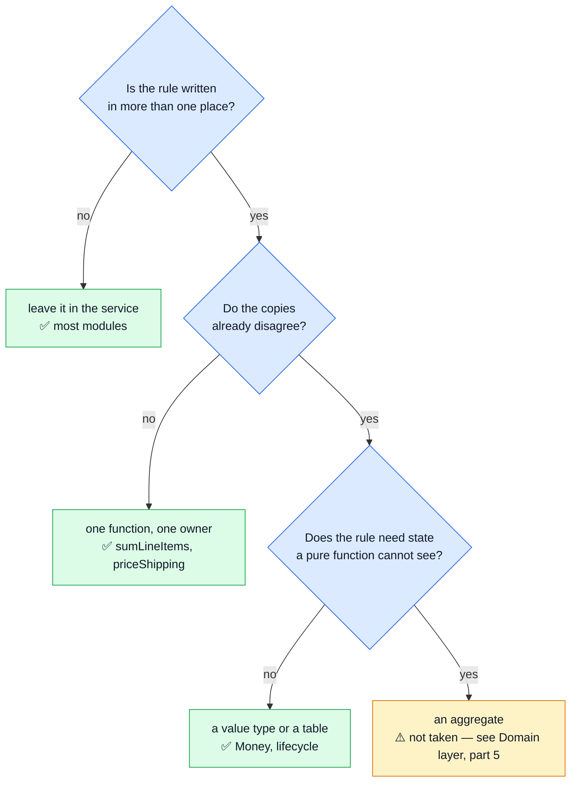

Both patterns below cleared the middle branch. Nothing in the codebase has cleared the right one.

---

## 1. The order lifecycle

`src/modules/orders/domain/lifecycle.ts` — which status may follow which, and who may make the move.

### What it does and does not own

The **set** of statuses is not its business. `OrderStatus` is generated from `openapi.yaml` into
`@api/models`, so the six values are contract-first and single-sourced. What the enum cannot carry
is the **edges** between them, and the **actor** each edge belongs to.

The table is keyed by **event**, not by status: `pay`, `start`, `ship`, `deliver`,
`fulfilmentComplete` (the digital `processing -> delivered` edge, also a remainder cancel that
completes the order), `expire`, `cancel`, `cancelInFulfilment` and `cancelUnanswered` (a preorder's
buyer never answered the question a late date asks; its own actor, `fulfilment`, so the expiry sweep
still stops at `pending`). Each entry carries its `from`
set, its `to` and its actors, so a service names the event and the conditional write is handed the
event's own `from` — nothing is derived from a neighbouring column.

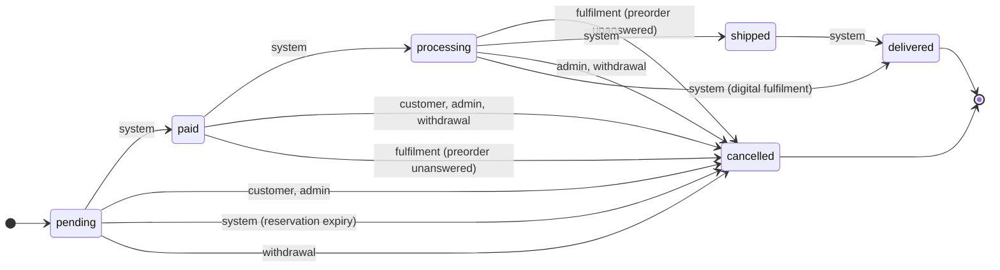

Three absences are load-bearing:

- **Nothing reaches `paid` but `system`.** An operator cannot mark an order paid by hand — money
  landing is a fact from outside the application. the table is where it holds.
- **A customer's cancel stops at `paid`.** The refund listener is what makes `paid` cancellable;
  past that the order is in the fulfilment queue and cancelling becomes an operator's decision (the
  EU withdrawal right is its own actor, `withdrawal`, which can also cancel from `processing`).
- **`shipped` has no cancel edge at all.** Goods in transit come back as a return, which is a flow
  of its own rather than a status the order rewinds into.

An admin override (below) can still force any of these moves forward with a reason — the diagram
above is the ORDINARY lifecycle, the one no override is involved in.

### Who writes the status

Two rules, and they are different rules. **Only `orders` writes a `status` field** — every other
module that causes a move (`payments` on settlement, `delivery` on a parcel event) asks `orders` to
make it, through `markPaid`/`markShipped`/`markDelivered`, and never touches the document itself.
That is a placement rule: it says WHERE the write happens. **The table above is a permission rule:**
it says WHO may ask for which move, `admin`/`customer`/`system` on each edge.

`system` is not "no human involved" — every `system` move follows from a recorded fact a human (or
an external service) already caused: money landing at the payment processor, a warehouse operator
recording a parcel's handover. `system` means "this application did not decide it, it is reporting
it" — the recording is what makes the move happen, not a person editing a field.

The full move/actor/door table lives on
[Who writes the status](../modules/orders.md#who-writes-the-status) — one home for it, since a
second copy here is exactly the kind of duplicate that drifted before. What that table does not
say: WHAT records the fact before `orders` ever hears about it — the payment processor confirming
a charge, a warehouse operator scanning a parcel, an operator's own typed reason for an override.
`orders` only ever reports a fact something else already caused.

One reported move, end to end — the warehouse records a handover, `delivery` owns the shipment, and
`orders` is the only thing that ever writes the status. Everything below commits in ONE transaction
(the shipment, the units leaving the shelf, the order's summary, the status move, the outbox events):

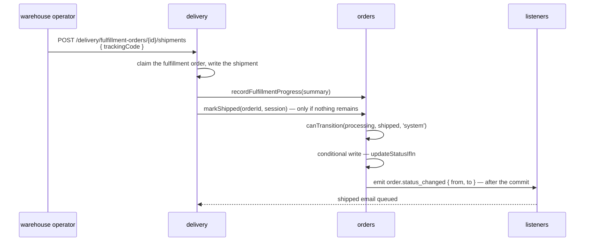

`delivery` never assigns `order.status` itself — `markShipped`/`markDelivered`/`markFulfilmentComplete`
(`services/status.ts`) are the ordinary doors, each taking the act's own session so the move commits with
the shipment. A `forced` shipment skips a step but writes the same moves and leaves its history row
through `recordForcedFulfilment`. A third door, `overrideStatus`, moves the status alone and
announces it, so `delivery` keeps its records in step — see
[Who writes the status](../modules/orders.md#who-writes-the-status) for all three.

### The actor is part of the table, not beside it

"Which status may follow `paid`" has no single answer — it depends on who is asking. Splitting the
actor into a second table would let the two disagree, so it rides on the edge itself.

`system` is not a privilege level above `admin`. It is **narrower**: the moves an operator may never
make by hand, because something outside the application has to have happened first. Money landing
is one; fulfilment starting (`paid → processing`) is the other, recorded through `delivery`'s own
start action (`POST /delivery/order/{orderId}/start`) — see "Action endpoints execute" below.

### What the table prevents

Lifecycle knowledge in several places that can disagree is how an unguarded status write becomes a
refund on delivered goods:

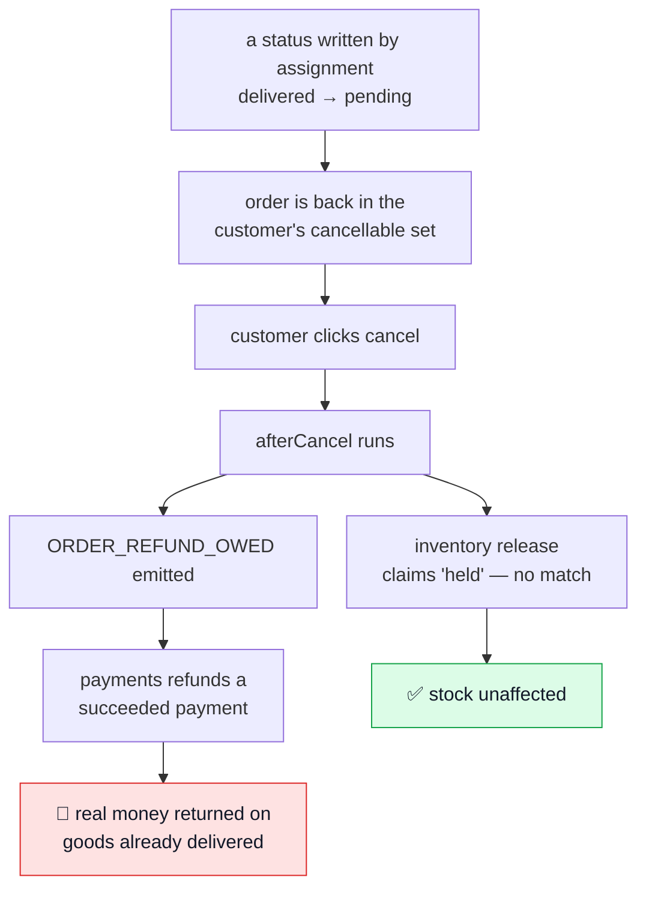

Every individual write site is defensively coded, which is why only one half of that sequence would
cause damage: `inventory` claims the reservation conditionally, so a stale release finds nothing,
while `payments` guards the refund on the payment's own status — and that payment really was
`succeeded`, so the guard passes. The table closes it at the source: no write site asserts a
lifecycle edge of its own, they all ask.

### How it is enforced

| Call site                                                                               | Question asked                                                                                                                                  |
| --------------------------------------------------------------------------------------- | ----------------------------------------------------------------------------------------------------------------------------------------------- |
| `orders/services/cancel.ts` — `cancelById`                                              | `statusesLeadingTo(cancelled, actorOf(caller))`                                                                                                 |
| `orders/services/status.ts` — `markPaid`/`markProcessing`/`markShipped`/`markDelivered` | the named event's own `from` and `to` (`ORDER_EVENTS.ship`, ...), read off the table rather than restated as a literal                          |
| `payments/services/intent.ts`/`offline.ts`/`settlement.ts`/`view.ts`                    | `isPayable(status)` — asks `orders` the one question every payment door needs, never the table directly (see "One function, three doors" below) |
| `orders/services/override.ts`                                                           | `canOverrideTo(from, to)` — its OWN rule, deliberately not `canTransition`: an override exists to skip the gate the ordinary table enforces     |

`cancelById` asks as the CALLER's actor, because the table answers differently for each: a customer
may cancel from `pending` and `paid`, an operator also from `processing`.

### Action endpoints execute; `update` does not decide

`orders/services/crud.ts`'s `update` carries no status logic at all: `UpdateOrderByIdRequest`
declares `email` only, so there is no move left for it to refuse or apply, and no partial-write
window between an email save and a status move to guard against — impossible by construction
rather than guarded.

`POST /orders/{id}/cancel` is the one path that runs a cancellation, for a customer and an operator
alike: the hold is released, `ORDER_CANCELLED` is announced for the fact, and — separately —
`ORDER_REFUND_OWED` is announced when one is due, so `payments` refunds. A plain field write could
never do that — a paid order set to `cancelled` by assignment would end with the customer's money
kept and the stock held until the sweep.

`shipped`/`delivered` are never a field an admin assigns either — they follow a parcel event
`delivery` records, through `markShipped`/`markDelivered` (see "Who writes the status" above).
`paid → processing` follows a fulfilment-start fact the same way, through `markProcessing`.
The admin override (`POST /orders/{id}/status-override`) is the door for a mis-scanned parcel or a
manual correction. `items`/`userId` are not in
`UpdateOrderByIdRequest` at all either — they stay `POST /orders` (create)-only. Rewriting a
document that already carries a sequential invoice number has no safe meaning: EU VAT practice
corrects an issued invoice with a credit note, not a rewrite, and a real order-edit flow (stock
delta, refund/charge, tax) is a feature of its own.

### Deciding and enforcing stay separate

The table decides. `updateStatusIfIn` in `src/modules/orders/repository.ts` still enforces, and is
unchanged — it is the conditional write that makes exactly one racing writer win. The table only
decides which `from` set that write is handed.

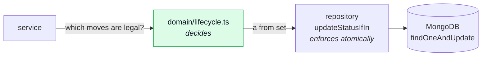

A refusal to a move the table does not have answers **409**: `ORDER_NOT_CANCELLABLE` from
`cancelById` with no further detail, `ORDER_OVERRIDE_NOT_ALLOWED` from `overrideStatus` carrying
`details: { from, to }`. Neither lists which moves ARE still open — a client wanting that reads
`orderActionsFor`'s own `transitions` field on the order instead. Every guard runs before any field
is assigned, so a refused request is never a partial write.

### Compensation is policy, and it travels with the fact

A cancellation has consequences — the stock comes back, and usually the money does too. Who decides
which, and where that decision lives, is a separate question from which moves are legal.

`order.cancelled` carries a `refund` flag rather than the listener inferring one — but the flag is
for the record (and the customer-facing webhook), not for driving the refund itself. That is a
second, separate event, `order.refund_owed`, emitted only when one is due: re-announcing
`order.cancelled` to retry a stuck refund would re-deliver that webhook to every subscriber each
time the sweep ran.

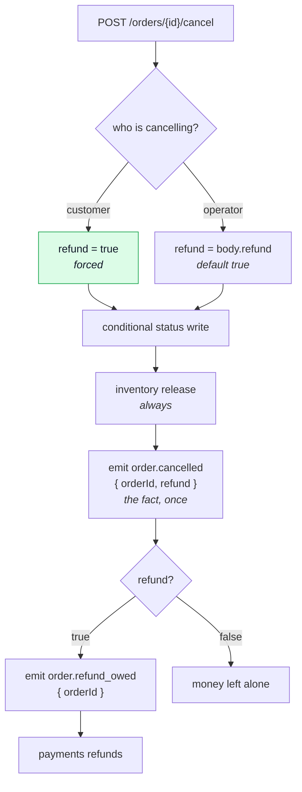

Three things this shape buys. A customer cannot waive their own refund, because `paid` is
cancellable precisely on the promise that the money comes back — the flag is overwritten, not
trusted. An operator can cancel without refunding, which is the replacement-going-out case. And
`order.cancelled` fires either way, so the record of what happened does not depend on what was
compensated; suppressing it for the no-refund case would make `order.cancelled` mean "cancelled and
refunded", which is not what it says. `order.refund_owed`, by contrast, fires only when there is
something to retry — its very existence IS the fact, so a stuck refund can be retried by
re-announcing it alone, without touching anyone else who heard about the cancellation.

Returning money on its own is a separate route, `POST /payments/order/{orderId}/refund`, because it
is a separate act: a goodwill refund leaves the order where it is. It lives in `payments` rather
than `orders` for a structural reason — `payments` already depends on `orders`, so an order module
reaching back for a refund would close a cycle `check:dependencies` refuses.

### What is still NOT modelled

The three effects have one owner: `cancelById` moves the status, releases the hold and announces the
refund policy, and no caller can reach the state while skipping the consequences — `update` refuses a
plain move to `cancelled` for exactly that reason. What the conditional write buys is that **at most
one caller runs the sequence**; a double-click and the reservation sweep cannot both proceed.

What it does not buy is atomicity. The three steps run in order, not together, so a crash between the
status write and `releaseForOrder` leaves a cancelled order holding stock until the sweep reclaims
it. An aggregate would close that window by making the three one act; so would a transaction, which
is what the SQL twin has. It is a real gap and a small one.

---

## 2. Capabilities: the server answers what a client may do

A client has to decide what controls to show. Doing that from the record alone means
re-implementing the rules — a status dropdown listing every enum value, a cancel button testing for
`pending` or `paid`, a pay form testing for `pending`. Three copies of server rules, in a separately
deployed codebase, with nothing able to notice when they drift.

So the server sends the answer. `Order.actions` and `PaymentActions` are computed per REQUEST, not
stored:

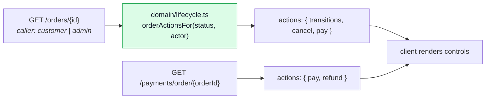

**Why per caller.** The answer depends on the role: a customer may cancel a paid order, an operator
may also advance it, and nobody may mark it paid by hand. A stored field could not say that. The
response cache keys on the user, so an operator's answer is never served to a customer.

**Why the split across two modules.** Each answers for what it owns. `orders` says which status
moves are open and whether the order still awaits payment; `payments` says whether money can come
back. Neither guesses at the other's half, and no new dependency edge is created — which matters,
because `payments` already depends on `orders` and the reverse would be a cycle
`dependency-cruiser` rejects at lint time, in `check:dependencies`.

**Why `pay` appears on both.** They answer different questions. `Order.actions.pay` is "this order
still awaits payment", which is what decides whether to offer a card form on an order with no
payment record yet. `PaymentActions.pay` is "this specific intent can be confirmed", which already
folds the order's status in — so once a payment exists, its own answer is the one that counts, and
the panel flips the instant a charge lands rather than waiting for the order to be re-read.

**Why `paid` is never in `transitions`.** No request may make that move; it follows a confirmed
charge. Publishing it as a capability while withholding it as a transition is the distinction
between "you may see this is possible" and "you may do this".

**One function, three doors.** `domain/lifecycle.ts`'s `isPayable(status)` is the single answer to
"can this order still be paid" — `pending` only, the one status with a `system` edge into `paid`.
Every door that moves money asks it instead of comparing a status literal:

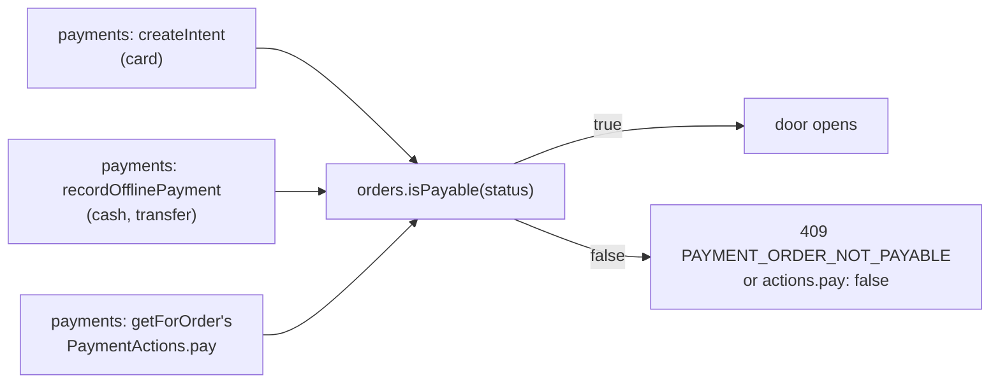

A settlement arriving twice (a webhook retry) finds the order no longer `pending`, so the
conditional write matches nothing: no table says "staying put is allowed", and no door treats it
as a second offer to pay.

The client's side of the bargain is to decide nothing. A control is enabled when the server says so
and disabled otherwise, which is what makes a rule change on the API move the interface without the
interface being edited.

---

## 3. Money

`src/modules/orders/domain/money.ts` — a branded integer count of minor units.

### The boundary, which is the whole design

`openapi.yaml` types every monetary field `number`/`double`, and nothing about that moved. What
changed is the arithmetic _between_ the boundaries.

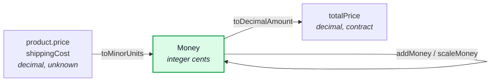

Two functions in (`toMinorUnits`, `toDecimalAmount`, both taking the currency they convert for),
one out. Every intermediate is an integer, so the sum is exact and
order-independent — no accumulator can round differently depending on the sequence it saw the lines
in. The rounding rule exists once, in this file.

`money.ts` owns ROUNDING; `totals.ts` owns COMPOSITION. `orderTotal({ items, shippingCost })` is
what the customer owes, and its callers — the order serializer, `payments.createIntent` and
the confirmation email — all read it rather than adding the two numbers themselves, so the payment
intent cannot charge the lines and forget the shipping.

### Why a brand rather than a class

A class would give the domain layer an object identity to maintain, a `toJSON` every serialization
path must know about, and a shape Mongoose would try to store. A branded number is **the same
integer at runtime** and a distinct type at compile time — which is the whole benefit:
`toDecimalAmount` is the only way back to a plain `number`, so an amount cannot be summed with a raw
price by accident or written to a document without passing the boundary that rounds it.

### Totality is checked at every step, not at the end

`Number.MAX_VALUE` is a finite price whose product with a quantity is not. Once one term is
`Infinity`, a later negative term makes the running total `NaN` — which reaches the customer as a
blank price. So every construction point funnels through one private `asMoney`, which answers
"nothing owed" for anything non-finite, and normalises `-0` away as a second spelling of an amount
with one meaning.

That is a property over every possible input, which is why
`src/modules/orders/tests/unit/money.property.test.ts` is property-based rather than a table of
examples. It found the `-0` case.

### Why it lives in `orders`, and why a shared kernel was not an option

`orders` is the only module that does money **arithmetic**. `cart` reads `sumLineItems` and
`payments` reads `orderTotal`, both through the orders barrel; `delivery` returns flat rates from a
table. The modules
that look like they share the concept share a _function_, and that function already has an owner.

There is also a hard constraint. The domain layer may not import `@kernel/*`, `@infrastructure/*`,
`@modules/*` or even `../*` — see the folder rule in `eslint.config.ts`. A jointly-owned value type,
the textbook **Shared Kernel**, would have to sit somewhere no `domain/` folder can reach it.

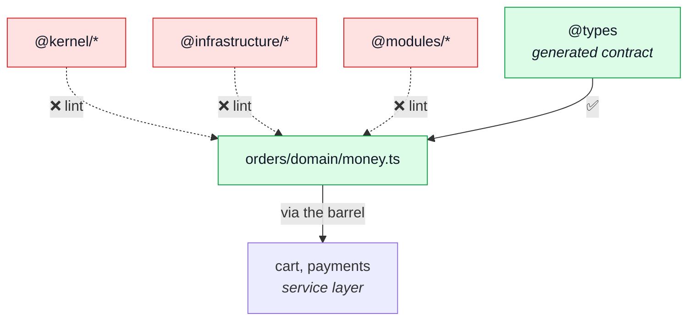

If a type is ever genuinely shared across contexts, that rule needs revisiting first. That is a
design decision, not a config edit.

### Per-rate VAT, and where shipping's own split goes

`orders/domain/tax.ts`'s `orderTaxBreakdown` answers three questions from the same pass over an
order's frozen lines, not three separate ones:

- **Per line** (`lines[]`) — goods only, what `netTotal` sums. `taxTotal` does not stay goods-only:
  it folds in shipping's own apportioned tax on top of the lines' — see `shippingNetAmount`/
  `shippingTaxAmount` below for the goods/shipping split `netTotal` keeps but `taxTotal` doesn't.
- **Shipping's own split** (`shippingNetAmount`/`shippingTaxAmount`) — delivery carries no VAT
  rate of its own; it is taxed as ancillary to what it delivers, apportioned pro-rata across the
  lines by their own gross value (`apportion`, the same "remainder to the largest weight" rule
  `money.ts` uses elsewhere), then taxed at _each line's own rate_. Two lines at different rates
  split shipping's cost between them and pay two different amounts of tax on their own halves.
- **Per rate** (`taxSummary[]`) — one row per DISTINCT rate charged on the order, goods and
  shipping folded into the same row, since shipping was never a rate of its own to begin with.
  This is what an invoice actually has to print: a customer does not care which line shipping's
  22%-taxed share came from, only that the 22% column reconciles.

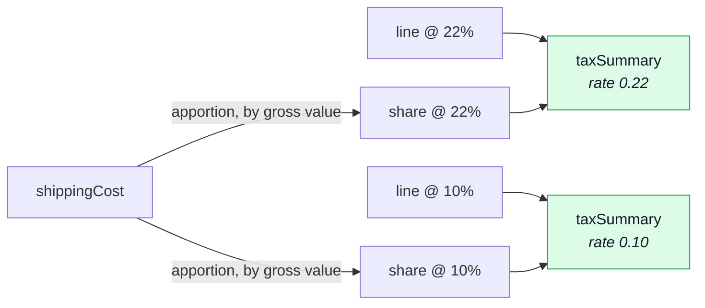

VAT is rounded ONCE per rate, on that rate's whole gross total (EN 16931 BR-CO-17), and only then
split down to shipping and lines by the same `apportion` rule. Summing per-line rounded amounts
would drift: three 0.10 lines at 22% carry 0.05 of VAT, not 0.06. The order response and the
invoice call the same function, so they cannot disagree.

Reconciliation is exact, in integer minor units, never approximated: summed `taxSummary.netAmount`
is `netTotal + shippingNetAmount`, summed `taxAmount` is `taxTotal`, and summed `grossAmount` is
the order's own `totalPrice` — `orders/tests/unit/tax.test.ts` asserts both reconciliations with a
fixed multi-rate, multi-line example each, not a single hand-picked total.

The invoice needs a fourth shape `orderTaxBreakdown` also returns but the wire contract never
sees: `shippingByRate`, shipping's slice of `taxSummary` broken back OUT per rate — "shipping,
taxed at 22%: €4.10 net, €0.90 tax" as its own printed row. `model.ts` does not copy it onto a
serialized order; only `invoicing/emails.ts`'s invoice builder reads it, straight off its own call to
`orderTaxBreakdown`.

### Currency is an argument, not part of the type

A currency's minor unit is not always a hundredth (JPY has none, KWD has three), so
`toMinorUnits(value, currency)` and `toDecimalAmount(amount, currency)` take the code they convert
for, and `orderTotal` takes the order's own `currency`. The `Money` brand itself carries no
currency, so `addMoney` cannot refuse a mismatch: the shop is single-currency per deployment
(`NODE_DEFAULT_CURRENCY`), and a tag on the type would have one possible value.

The day two currencies mix in one sum, the currency belongs **on this type** rather than beside
the amount — an `addMoney` that refuses a mismatch is precisely the reason to put it there.

---

## 4. What is still absent

| Concept                              | Today                                                          |
| ------------------------------------ | -------------------------------------------------------------- |
| Entity                               | none — a Mongoose document is the model                        |
| Value object                         | `Money` only, internal to the arithmetic                       |
| Aggregate root                       | implicit only                                                  |
| Repository returning domain objects  | no — returns `OrderDocument`                                   |
| Invariants at construction           | no — schema validators, plus the lifecycle table on the writes |
| Read model separate from write model | no — one model, one search spec                                |

One tell that the pressure is real: `clearLinesIfUnchanged` in `cart/repository.ts` writes
conditionally on the `__v` it read the cart at. That is **aggregate versioning** with no aggregate to
hang it on — the need exists, only the vocabulary is missing.

It is the only one. `updateStatusIfIn` here and `claimStatus` in `inventory/repository.ts` look
similar and are a different pattern: they key on `status`, naming the state a move comes _from_ so
that exactly one of N concurrent callers wins. That is an exactly-once primitive, correct as it
stands, and an aggregate would not simplify it. Worth keeping straight, since it is the thing that
would decide whether a future aggregate slice is real pressure or a shape imposed for its own
sake: count `__v`, not `status`.

The line this repo draws: a value type or a rules table where the rule is real and already
duplicated, and no aggregate until something needs state a pure function cannot see.

## Related pages

- [Domain layer](./domain-layer.md) — what earns a place in `domain/`, and the lint rule; §5 covers
  what an aggregate slice would cost, and the conditions that would make it the right call
- [Strategic DDD](./strategic-ddd.md) — the half adopted wholesale
