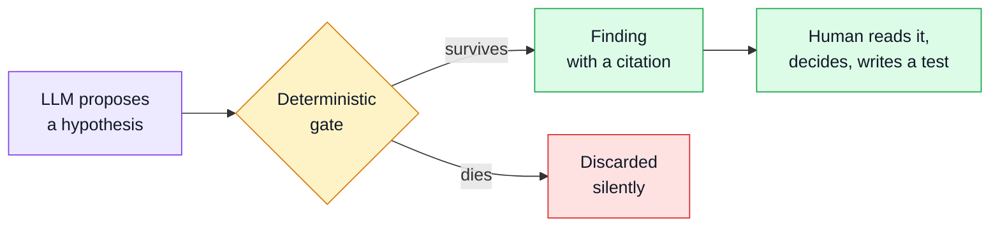
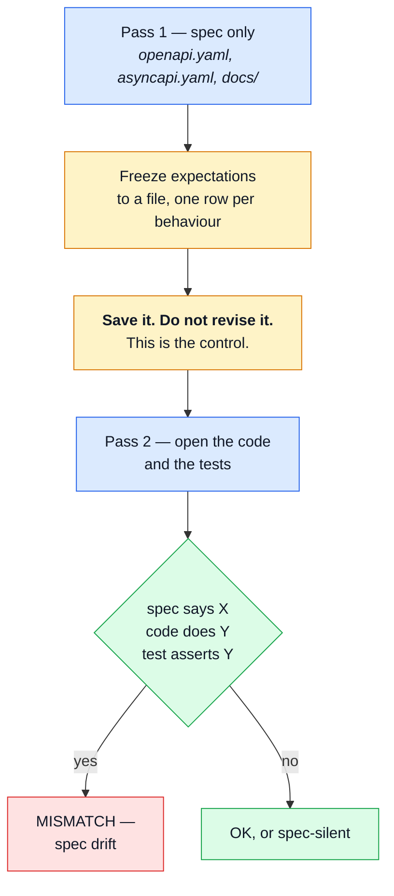
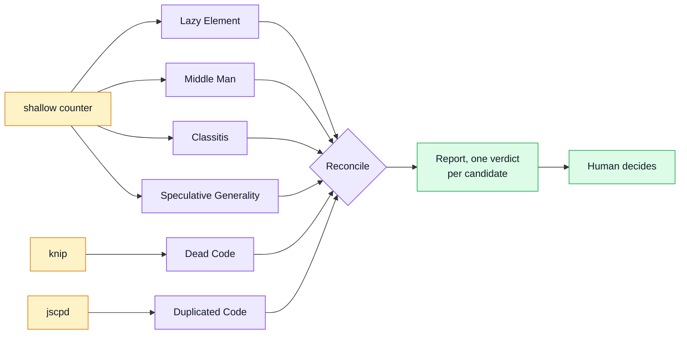
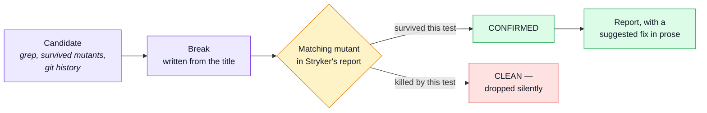

# AI Auditing

Every other instrument in this repo compares the system **to itself**: code to schema, mutant to
suite, response to contract. That is what makes them deterministic, and it is also their ceiling.
Stryker cannot read `docs/theory/domain-layer.md`. Schemathesis cannot read a ticket. CodeQL cannot
notice that the docs promise a rule the contract never encodes.

**Prose ↔ code is the gap**, and it is the one place a language model beats a program rather than
approximating one. This repo has ~56 files under `docs/` stating rules no schema enforces.

`scripts/audit/` holds the prompts that work in that gap, plus two that judge something else:
`code-shape` judges design, `test-honesty` judges whether a test can fail at all. They are plain
markdown, run by hand against an LLM, and they write reports — never code.

## The one rule

> The model proposes. A deterministic oracle disposes.

Two consequences, both non-negotiable:

- **Nothing AI-generated gates CI.** A red build must be reproducible by re-running it. An LLM
  verdict is not, so these report and never block.
- **A finding without a citation is not a finding.** Either a `file:line` in the spec, or nothing.
  Prose confidence is not evidence.

## The prompts

| File                                         | Asks                                                                                                                                                                                                                                                                                         | Writes to                                |
| -------------------------------------------- | -------------------------------------------------------------------------------------------------------------------------------------------------------------------------------------------------------------------------------------------------------------------------------------------- | ---------------------------------------- |
| `scripts/audit/spec-drift/SKILL.md`          | Which tests assert what the **code** does rather than what the **spec** says?                                                                                                                                                                                                                | `tmp/reports/audit/spec-drift/`          |
| `scripts/audit/spec-gaps/SKILL.md`           | Which business rules and security boundaries have **zero** coverage?                                                                                                                                                                                                                         | `tmp/reports/audit/spec-gaps/`           |
| `scripts/audit/suite-bloat/SKILL.md`         | Which tests cost CI time and discriminate nothing?                                                                                                                                                                                                                                           | `tmp/reports/audit/suite-bloat/`         |
| `scripts/audit/compliance-backend/SKILL.md`  | Which rules in the shared compliance registry (consent, privacy pages, data security, accessibility, …) does this backend violate, and which don't apply here?                                                                                                                               | `tmp/reports/audit/compliance-backend/`  |
| `scripts/audit/compliance-frontend/SKILL.md` | The same registry, filtered to the paired frontend's half of responsibility.                                                                                                                                                                                                                 | `tmp/reports/audit/compliance-frontend/` |
| `scripts/audit/reachability/SKILL.md`        | Which defences are correct where they are tested and unreachable through the real mounted path?                                                                                                                                                                                              | `tmp/reports/audit/reachability/`        |
| `scripts/audit/rate-limit-keys/SKILL.md`     | Which rate-limit budgets bucket callers by something the attacker supplies or rotates for free?                                                                                                                                                                                              | `tmp/reports/audit/rate-limit-keys/`     |
| `scripts/audit/test-honesty/SKILL.md`        | Which tests stay green when the behaviour they claim to check is broken? See [below](#test-honesty-a-test-is-innocent-once-it-has-failed).                                                                                                                                                   | `tmp/reports/audit/test-honesty/`        |
| `scripts/audit/code-shape/SKILL.md`          | Which functions, files and options don't earn their place, and which code is dead or copy-pasted? See [below](#code-shape-the-tools-count-the-model-judges).                                                                                                                                 | `tmp/reports/audit/code-shape/`          |
| `scripts/audit/ddd-drift/SKILL.md`           | Where has the code drifted from the DDD the docs describe — who drives whose state, who reads a sibling's table, where a rule lives — and which side is wrong? Mirrors `../boilerplate-vue-frontend/scripts/audit/ddd-drift/SKILL.md`; C1 (BE) and F2 (FE) are one rule seen from each side. | `tmp/reports/audit/ddd-drift/`           |

All of them take one argument — a module (`orders`), a path, or `--diff` for whatever the working
tree touched. The two compliance prompts and `ddd-drift` default an empty argument to the **whole repo** rather
than the touched modules — a compliance gap or a DDD drift is rarely introduced by the change that happens to
surface it.

### Each repo keeps the prompts its own stack needs

The two repos do **not** hold one set. `reachability` and
`rate-limit-keys` both reason about a mounted Express request path, which the paired frontend
has no equivalent of — and its own
`boilerplate-vue-frontend/scripts/audit/accessibility-manual/SKILL.md` has no counterpart here.

Only `spec-drift`, `spec-gaps`, `suite-bloat` and `test-honesty` exist on both sides, because what
they ask — does the test agree with the spec, is anything uncovered, is anything redundant, can the
test fail at all — is about specs and suites rather than about a runtime. `code-shape` exists only here.

Nothing keeps even those four in step, and nothing should try. None is in `SHARED_FILES`, whose
rule is that a shared file must be owned by one side and regenerated. Improve one where you find
it; carry the improvement across when it applies, and expect the two to drift in between. Reading
an audit prompt as a spec for its sibling is the mistake to avoid — it is a prompt, and the copy
in the other repo has its own history.

`scripts/audit/compliance-rules.yaml` is not a shared copy either. It lives **here, once**, and both
compliance prompts read this one file — `compliance-frontend` runs from this repo against the
paired checkout rather than from inside it. So a rule spanning both repos, like the mandatory
signup-consent checkbox, has exactly one home and no second copy to drift from.

This page is per-repo in the same way. It names this repo's own tools, its own `docs/` count and
its own findings, so the frontend's copy is _expected_ to differ and must not be reconciled.

### Naming the scope

The argument decides the filename, one way only:

| Argument | `<SCOPE>`                                       |
| -------- | ----------------------------------------------- |
| a module | the module name — `orders`                      |
| a path   | slugged, `src/` dropped — `infrastructure-http` |
| `--diff` | the current branch name, slugged                |

`orders.findings.md` tells the next reader what it covers. A batch number does not — never invent <!-- doc-paths:ignore -->
one.

### The reports are disposable

`tmp/` is gitignored, and that is the intended end state, not an oversight. A report is working
evidence: once its conclusions land as a fixed test, a commit message or a tracked issue, the file
has done its job. Audit paperwork that outlives the audit goes stale silently and misleads the next
reader — the prompts are the durable asset here, not their output.

## The two-pass method

`spec-drift` is the one worth understanding, because its **ordering is the method**. Spec
drift is a test and an implementation sharing one wrong reading of the spec — CI is
green, and the test proves only that the test agrees with the code.

You cannot find that by reading the test, because the test looks correct. You find it by deriving
what the behaviour _should_ be **before** the implementation can contaminate you.

Writing the expectations down before opening `src/` is not ceremony — it is the only thing keeping
the control uncontaminated. Skip it and the audit degrades into a code review that agrees with
whatever it just read.

The freeze is procedural, not cryptographic: the file is gitignored, so nothing stops you editing it
after the fact. Nothing except the fact that doing so destroys the only reason the second pass is
worth running. If a pass-1 row turns out to be wrong, add a pass-2 row saying so — do not quietly
rewrite the control to match what you just learned.

## `code-shape`: the tools count, the model judges

The other prompts look for gaps between prose and code. `code-shape` judges **shape**: does a
function, a file or an option earn its place? Its rules, the names the literature gives each shape
(Fowler's _Refactoring_, Ousterhout's _A Philosophy of Software Design_) and the legitimate reasons
to keep one live in the prompt itself. `CLAUDE.md` § Function design states the short form.

It applies [the one rule](#the-one-rule) from the other side: three deterministic tools produce
every candidate, and the model only judges them. A model counting call sites by text search misses
an import alias or a re-export, and a wrong count is a wrong verdict.

| Tool                                         | Lists                                                                                                     | Configured in     | Run with                           |
| -------------------------------------------- | --------------------------------------------------------------------------------------------------------- | ----------------- | ---------------------------------- |
| [knip](https://knip.dev)                     | unused files, exports, types and dependencies                                                             | `knip.config.ts`  | `npm run audit:unused`             |
| [jscpd](https://github.com/kucherenko/jscpd) | copy-pasted blocks, exact and near-miss                                                                   | `.jscpd.json`     | `npm run audit:duplicates`         |
| `generate-shallow-candidates.ts`             | small functions with 1–2 users, pass-throughs, optional parameters never passed, files with 1–2 importers | its own constants | `npm run audit:shallow -- <paths>` |

The third is ours: knip and jscpd never count how often a _used_ function is called, and nothing
maintained on npm reports these shapes. It reads the TypeScript checker, so an alias, a re-export
or a shorthand property still counts as a use. It lives in `scripts/audit/code-shape/scripts/`.

Each shape gets its own reviewer, so one list never crowds out another. The reconcile step exists
because the two directions disagree: jscpd says "extract", the shallow counter says "inline". It
stops the report from telling you to do both to the same code.

None of the three is a gate, by design:

- **knip** — barrel exports are unused on purpose. `knip.config.ts` declares the barrels as entry
  points, but a new false positive deserves a judgement, not a red build.
- **jscpd** — two handlers can look alike because the contract makes them look alike, with no
  shared logic to extract.
- **The shallow counter** — a threshold cannot tell `isRefundable(order)` from `add(a, b)`.

## How to run one

Each prompt is an [Agent Skill](https://agentskills.io): a folder holding a `SKILL.md` an AI reads
and follows, plus any `scripts/` it runs. The format is open, so the prompts are not tied to one
tool:

| Layer                          | What it holds                                                 |
| ------------------------------ | ------------------------------------------------------------- |
| `scripts/audit/<name>/`        | the prompt and its scripts — the only copy                    |
| `.claude/skills/audit-<name>/` | a three-line pointer that registers it as a Claude Code skill |

- **Claude Code** — `/audit-spec-drift orders`, `/audit-code-shape --diff`, and so on. The pointer
  passes the argument through as the scope.
- **Any other AI tool** — _"Read `scripts/audit/spec-drift/SKILL.md` and follow it, scope
  `orders`."_ It needs to be able to read the repo; an audit that cannot open `openapi.yaml` has
  nothing to compare against.

The pointer's `allowed-tools` is Claude Code's permission list: `Read`, `Glob`, `Grep`, `Write` and
a few `Bash` verbs, with no `Edit`. These prompts report; they never touch source.

::: tip Which model
Claude for `spec-drift` and `spec-gaps` — long-context reasoning over prose vs. code is exactly
where small local models confabulate citations most confidently, and a fabricated `file:line` costs
more than the finding was worth.

`suite-bloat` is the exception. It is bookkeeping over `tmp/reports/mutation/mutation.json`, and a local
Ollama model handles it.
:::

## `test-honesty`: a test is innocent once it has failed

The fear it answers: tests written to raise a number, or to agree with whoever wrote the code, that
stay green whatever the code does. Mutation testing finds some of them. This audit finds the rest,
and names the shape — coverage padding, a mocked subject, a swallowed failure, a title that lies, an
input that cannot discriminate.

It applies [the one rule](#the-one-rule) with Stryker as the oracle. For each suspect test, the
model writes down what the test's title claims, and the smallest `src/` change that would break
that claim. Then it looks that change up in Stryker's report, which records per mutant which tests
ran it and which failed on it. Stryker breaks the code in a sandbox copy; this audit never does.

The break comes from the title, never from the assertions. One chosen by reading the assertions
proves only that they agree with themselves.

Like every prompt here it only reports. The fix is a human's, written from the report's suggested
fix and the spec it cites.

## Reading the output

### `spec-drift`'s verdicts

A findings table uses four verdicts, and only one of them is a bug:

| Verdict           | Means                                                                              |
| ----------------- | ---------------------------------------------------------------------------------- |
| **MISMATCH-CODE** | Spec says X, code does Y, the test asserts Y. The thing this audit exists to find. |
| **TAUTOLOGY**     | The assertion cannot fail — the expected value is produced by the code under test. |
| **SPEC-SILENT**   | A sensible assertion no document actually requires. Worth knowing, not a defect.   |
| **OK**            | Test and spec agree.                                                               |

`TAUTOLOGY` is the quiet one. `expect(f(x)).toEqual(g(x))` where `g` is a sibling export, or a
`Record<Enum, …>` whose totality TypeScript already enforces, is a test that cannot fail and
therefore proves nothing. Stryker finds some of these; the audit finds the rest.

### `compliance`'s verdicts

`compliance-backend` and `compliance-frontend` share one registry
(`scripts/audit/compliance-rules.yaml`) but use a different four verdicts, since a compliance rule
either applies here or it doesn't — there is no code/test pair to compare:

| Verdict              | Means                                                                                                                                                               |
| -------------------- | ------------------------------------------------------------------------------------------------------------------------------------------------------------------- |
| **VIOLATION**        | The rule applies and this side's evidence fails it — including a `both`-responsibility rule broken on this side alone.                                              |
| **SATISFIED**        | The rule applies and this side's evidence meets it in full.                                                                                                         |
| **NOT-APPLICABLE**   | The rule's `applies_when` condition is false for this app today, with the reason cited.                                                                             |
| **NEEDS-BOTH-SIDES** | A `both`-responsibility rule whose own-side half is fine but whose closure depends on the paired prompt's report — see the other side by rule `id`, never restated. |

Every rule in scope gets exactly one row, `NOT-APPLICABLE` included — an audit that only reports
violations can't be told apart from one that silently skipped half the registry.

## Does it work?

The first batch ran over six scopes — order lifecycle and money, inventory reservations, cart and
checkout, payments, account and auth, and the per-operation `security:` blocks. Expectations were
frozen and committed first, one commit per scope.

It produced fixes, not a report nobody read: an order accepting a same-value `paid` write that
should have 409'd, a shipping-absence case, account endpoints answering the wrong status, an
admin-delete audit action that conflated hard and soft deletes, and a duplicated union-registration
check. One of its own rollups was wrong and got corrected too, which is the honest version of this
story.

Run them before a refactor, after a contract change, or when a module's docs and tests have drifted
apart — not on a schedule.

---

## Footnote: the tools we evaluated, and why none were adopted

Checked **2026-09-03**. Treat that as an expiry date, not a warranty — the whole reason this
footnote exists is that the previous round of claims had quietly gone stale.

| Tool                                 | State                                | Why not                                                                                                                                                                        |
| ------------------------------------ | ------------------------------------ | ------------------------------------------------------------------------------------------------------------------------------------------------------------------------------ |
| **Mutahunter** (LLM mutants)         | Dead — last release 2025-04-17       | Also removed its coverage-driven mode in 1.3.2, the one feature that made it fit here.                                                                                         |
| **LLMorpheus** (LLM mutants, JS)     | Archived 2025-02-03                  | The only JS-native equivalent, and it stopped.                                                                                                                                 |
| **Qodo Cover / Cover-Agent**         | Unmaintained notice since 2025-06-15 | Gates generated tests on coverage and pass/fail, never the spec — so every test it keeps agrees with the code by construction. That is the defect `spec-drift` exists to find. |
| **CodeRabbit / PR-Agent / Greptile** | Alive and healthy                    | Duplicate review surface. `/code-review` and `/security-review` already cover the diff, and there is no PR workflow here for a bot to attach to.                               |
| **promptfoo**                        | Alive, MIT, weekly releases          | ~600 MB and 524 packages for a YAML runner — 513 MB of it a local ONNX inference runtime we would never call.                                                                  |

Two notes worth keeping, because they outlived the tools:

- **The reason for rejecting the review bots changed.** It used to be "a hosted bot cannot read
  `CLAUDE.md`". That is no longer true — CodeRabbit reads that exact filename by default now. They
  are rejected on redundancy and cost, which is a different argument, and the old one should not be
  repeated.
- **Nothing in this niche is alive.** StrykerJS has not added LLM-authored mutants either.
  Meta run the idea in production internally, but it is not a product. If that changes, the
  prompt files here are the thing that would be replaced.

## Related

- [Mutation Testing](./mutation-testing.md) — the deterministic instrument this one complements
- [Coverage & Confidence](./coverage-and-confidence.md) — what a score does and does not mean
- [Testing & Docs](./testing-and-docs.md) — every layer, and which question each answers
- [Data Protection](../theory/data-protection.md) — the GDPR record `compliance-backend` cites
  as evidence for this app's data-handling rules; the compliance registry is broader than GDPR
  alone and does not replace it
