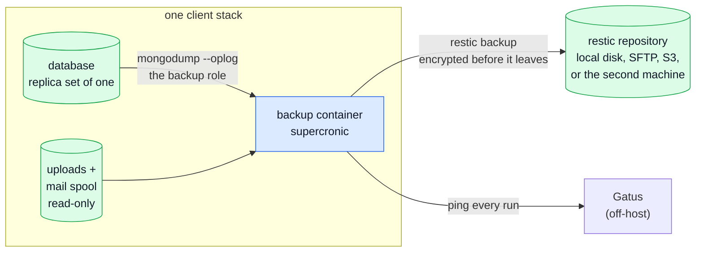

# Backups

The production compose file ships a `backup` service: a small container that dumps the database
and copies the uploaded files into an encrypted [restic](./restic.md) repository, on a schedule.
It is **off until you ask for it** (the `backup` profile) and **dormant until you name a
repository** (`BACKUP_REPOSITORY`).

A backup you have never restored is a hope, not a backup: restore it on a calendar, into a scratch
database, not on good intentions.

## The design



| Piece          | What                                                                                                                            |
| -------------- | ------------------------------------------------------------------------------------------------------------------------------- |
| Image          | `docker/Dockerfile.backup`: restic, the [MongoDB Database Tools](./mongodb-database-tools.md), supercronic. Non-root, read-only |
| Service        | `backup` in `docker-compose.production.yml`, `profiles: [backup]`. One per client stack                                         |
| Mounts         | `uploads` and `storage` volumes **read-only**, the Mongo CA certificate. **No Docker socket**                                   |
| Secrets        | `restic_password`, `mongo_backup_password`, `restic_repository_env`: this container holds them, the app and `cron` do not       |
| Scheduler      | supercronic builds its crontab at start from the knobs below (`docker/backup/entrypoint.sh`). It serves `/health` for the check |
| Why not `cron` | the `cron` container runs the app image with the app's keys. Backups need other secrets, and each secret lives in one container |

Start it by adding `backup` to the stack's profiles and creating the three secret files:

```bash
# in clients/acme/.env
COMPOSE_PROFILES=bundled,backup
BACKUP_REPOSITORY=/repo            # a local disk; see "The knobs" for the others

# once, next to the other secrets (docs/getting-started-production.md#secrets)
openssl rand -hex 32 > clients/acme/secrets/restic_password
openssl rand -hex 32 > clients/acme/secrets/mongo_backup_password
: > clients/acme/secrets/restic_repository_env     # empty for a local disk
```

**Keep the restic password somewhere that is not this host.** It encrypts every snapshot: lose it
and every backup is unreadable.

## One run

`docker/backup/backup.sh`, on `BACKUP_SCHEDULE`. In order:

1. **The dump.** `mongodump --oplog --archive --numParallelCollections=1`, streamed into restic.
   No gzip: restic compresses and deduplicates raw bytes, and a gzip stream defeats both.
   restic runs the command itself (`--stdin-from-command`) and refuses the snapshot if the dump
   exits non-zero, so a half-written dump is never kept.
2. **The counts.** The dump's own log says how many documents each collection had
   (`done dumping api.users (4100 documents)`). They are saved as a tiny snapshot of the same run
   (tagged `counts`), for a restore to compare against.
3. **The files.** The uploads and the mail spool, as plain files. The rendered invoice PDFs are
   left out: regenerable.
4. **Forget.** `restic forget` per the keep knobs, unless `BACKUP_PRUNE=false`.
5. **The heartbeat.** Green when all of it worked, red with the reason when any step failed.

All snapshots of one run share a `run:<timestamp>` tag. Each stack labels its snapshots with its own
`--host` (the compose project name), so two stacks sharing one repository never prune each other.

The first run creates the repository (`restic init`) when it does not exist yet; any other failure
to open it (wrong password, unreachable server) stays a failure.

### Why the dump is one stream

`mongodump --oplog` is the only way to a copy that is **consistent across collections** while orders
keep arriving: an order, its payment and its stock reservation are captured together or not at all.
It refuses to run scoped to one database ("`--oplog mode only supported on full dumps`"), so the
dump covers the whole deployment: `admin`, the client's database and the few `config` collections it
keeps. `local` is skipped by design.

Measured against a real replica set: an unchanged database stores **zero** new
bytes on the second run. A small change costs about the ~1 MiB restic chunks it touches: 100 added
documents (2.5%) stored 1.5 MiB on a 6 MiB database. That is chunk granularity, not a failure of
deduplication, and it shrinks in proportion as the database grows.

### The database login

The dump logs in as `backup`, never as root. `docker/mongo-init.js` creates it on the first boot of an
empty volume, from the `mongo_backup_password` secret, in the `admin` database with MongoDB's built-in
[`backup` role](https://www.mongodb.com/docs/manual/reference/built-in-roles/#backup). The role reads
everything a full `--oplog` dump needs (the oplog included) and **can neither write nor delete**: a
compromised backup container cannot drop the database, which root could.

`mongo-init.js` runs only against an empty data directory. On an existing volume, create the account
once by hand, then add the secret file:

```js
db.getSiblingDB('admin').createUser({
    user: 'backup',
    pwd: '<the contents of mongo_backup_password>',
    roles: [{ role: 'backup', db: 'admin' }]
});
```

The Database Tools take the password from a `0600` config file in the container's tmpfs, so it never
appears in `ps` or in `/proc/*/cmdline`.

## The knobs

All in the client's `.env` (the block is in `.env-example`, Part D6). The compose file passes them
to the container; none reaches the app.

| Knob                                                     | Default                     | Meaning                                                                                               |
| -------------------------------------------------------- | --------------------------- | ----------------------------------------------------------------------------------------------------- |
| `BACKUP_REPOSITORY`                                      | empty                       | Any restic repository. **Empty = dormant**: the container idles, healthy, runs nothing, no warning    |
| secret `restic_password`                                 | -                           | Encrypts the repository                                                                               |
| secret `restic_repository_env`                           | empty file                  | The repository's own login as `NAME=value` lines (`RESTIC_REST_USERNAME`, `AWS_SECRET_ACCESS_KEY`...) |
| `BACKUP_SCHEDULE`                                        | `0 * * * *`                 | Cron expression (UTC). Hourly: cheap once deduplication works                                         |
| `BACKUP_KEEP_HOURLY` / `_DAILY` / `_WEEKLY` / `_MONTHLY` | 24 / 7 / 4 / 6              | How many snapshots to keep. The only "size" control restic has; a hard cap is the storage's quota     |
| `BACKUP_PRUNE`                                           | `true`                      | `false` when the repository is append-only: that side deletes, this one only adds                     |
| `BACKUP_CHECK_SCHEDULE` / `BACKUP_CHECK_SUBSET`          | `30 3 * * 0` / `5%`         | The [weekly upkeep](#integrity-check)                                                                 |
| `BACKUP_DATABASE`                                        | `true`                      | `false` when the database is not in this stack (a managed Mongo): the files are still backed up       |
| `BACKUP_HEARTBEAT_URL` / `_TOKEN`                        | empty                       | The [off-host freshness check](#the-heartbeat)                                                        |
| `MONGO_BACKUP_USER`                                      | `backup`                    | The database account name                                                                             |
| `BACKUP_IMAGE`                                           | `boilerplate-backup:latest` | The image tag                                                                                         |

`BACKUP_PRUNE` defaults to `true` on purpose. Forgotten `false` on a plain disk or S3 repository, the
repository grows forever, silently. Forgotten `true` on an append-only server, `forget` is refused,
the run goes red and the heartbeat alerts: loud on day one, one line to fix.

**Which repository:**

| `BACKUP_REPOSITORY`                        | What it is                                                                                             |
| ------------------------------------------ | ------------------------------------------------------------------------------------------------------ |
| `/repo`                                    | The `backup-repo` volume. Same host as the stack: a convenience, **not** an off-site copy              |
| `rest:https://host:8000/<client>/`         | The second machine ([Backup server](./backup-server.md)): append-only, off-site, tamper-proof          |
| `sftp:user@host:/path`, `s3:...`, `b2:...` | restic's other backends. Credentials go in `restic_repository_env`; SFTP keys need a mount of your own |

[Where to run it](./hosting.md) is a choice a deployment makes, never one this repo makes for it.

No size cap exists in restic. The keep knobs bound the number of snapshots, and because identical
data is stored once, the repository grows with what _changed_, not with how often you back up.

**An external database** (`bundled` profile off): the provider backs it up. Set `BACKUP_DATABASE=false`:
the dump is skipped, the uploads and mail spool are still backed up.

## The second machine

A backup on the same machine dies with the machine, and an attacker who owns the server finds the restic
password on it, deletes every backup, then encrypts the database: encryption does not help, they have the
key. The answer is a repository on **another machine that refuses deletes**: the
[Backup server](./backup-server.md), shipped as `docker-compose.backup-server.yml`.

On the client side it is two knobs: `BACKUP_REPOSITORY=rest:https://<host>:8000/<client>/` and
`BACKUP_PRUNE=false`. The cleaning up (`forget --prune`, the keep knobs) then runs **on the second machine**,
weekly, against its own disk. It stays dormant until someone starts it there.

## The heartbeat

`BACKUP_HEARTBEAT_URL` is a [Gatus](./gatus.md) external endpoint, with `?success=true` in it, the
same shape as `ALERT_HEARTBEAT_URL`. Every run pings it: green on success, red (`success=false`
and the reason) on failure. Gatus raises the alarm when a ping is **late** too, so a dead container,
a dead host and a failing job all end in the same alert.

```yaml
# on the Gatus machine: a second external endpoint per client (docs/tools/gatus.md)
- name: acme-backup
  group: clients
  token: ANOTHER_LONG_RANDOM_TOKEN
  heartbeat:
      interval: 2h # hourly schedule; one missed run is an alert
  alerts:
      - type: ntfy
```

Gatus has no "started" signal, so there is no start ping: the endpoint only knows finished runs.
Left empty, nothing is sent and nothing warns.

## Integrity check

`restic check --read-data-subset=5%`, on `BACKUP_CHECK_SCHEDULE` (weekly). Each run reads a
different 5% slice of the stored data, so a corrupted pack is found weeks before the day you
restore. The same weekly job first runs `restic prune` when `BACKUP_PRUNE=true`, to reclaim what the
hourly `forget` released. A failure turns the heartbeat red; the next good backup turns it green.

## Uploaded images and the mail spool

The dump covers the database only. Two named volumes hold durable state of their own: `uploads`
(uploaded images) and the `mail-spool/` directory of `storage` (queued outbound mail a restart must
not lose). A restore that skips them brings back rows pointing at files that no longer exist, so the
backup container mounts both read-only and backs them up as plain files.

**`storage/documents/` is deliberately left out.** It holds rendered invoice and credit-note PDFs, a
regenerable copy of the frozen rows: losing it costs a re-render, never data.

**Moving to a new host:** restore the files snapshot onto the new host's volumes before the new
stack's first boot (`restic restore latest --tag files --target <dir>`, then copy into the volumes).
Skipping this looks fine until a customer clicks a broken image or the reaper finds no mail queued
that a customer swears was sent.

## The tools

| Tool                                                                   | Role                                        | Page                                          |
| ---------------------------------------------------------------------- | ------------------------------------------- | --------------------------------------------- |
| [restic](https://restic.net)                                           | encrypted, deduplicating snapshots          | [restic](./restic.md)                         |
| [MongoDB Database Tools](https://www.mongodb.com/docs/database-tools/) | `mongodump`, `mongorestore`                 | [Database Tools](./mongodb-database-tools.md) |
| [supercronic](https://github.com/aptible/supercronic)                  | the scheduler, also in the `cron` container | [Health checks](./health-checks.md)           |

Considered and not used: **resticprofile** (restic now does natively what it added: `--stdin-from-command`,
`--retry-lock`, `RESTIC_*` variables; one maintainer), **Percona Backup for MongoDB** (see
[When you outgrow this](#when-you-outgrow-this)) and **kopia / S3 object lock** (would replace restic;
the append-only server needs no S3).

## When you outgrow this

`mongodump` reads the whole database on every run and evicts the working set; MongoDB calls it a tool
for small deployments. Past tens of GB, or when minutes of data loss matter:

- **[Percona Backup for MongoDB](https://docs.percona.com/percona-backup-mongodb/index.html)**:
  logical backups with point-in-time recovery (needs a real replica set, not one node). Physical
  backups need Percona Server, not the stock MongoDB this stack runs.
- **Disk snapshots** (LVM or ZFS) of the data volume.

## Where to go next

| You want to                                   | Read                                        |
| --------------------------------------------- | ------------------------------------------- |
| Understand the replica set this backs up      | [Two Client Stacks](./two-client-stacks.md) |
| See every index/data-migration concept        | [Data](../reference/data.md)                |
| Pick where the restic repository itself lives | [Hosting](./hosting.md)                     |
