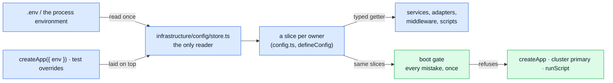
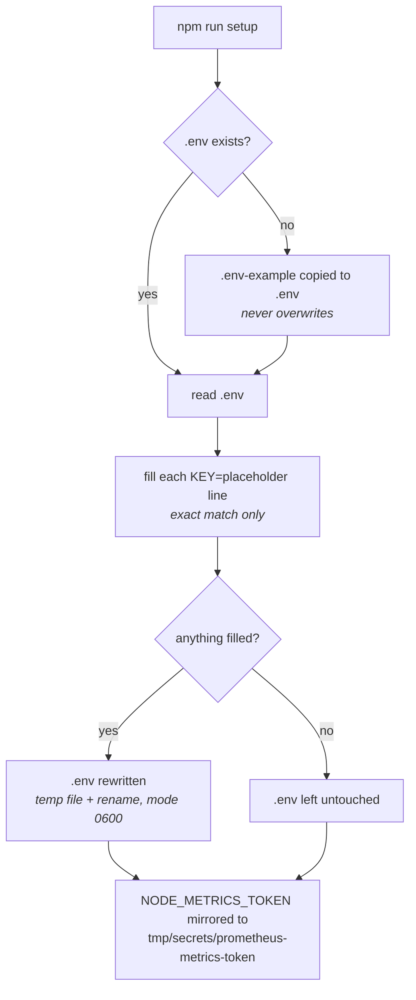
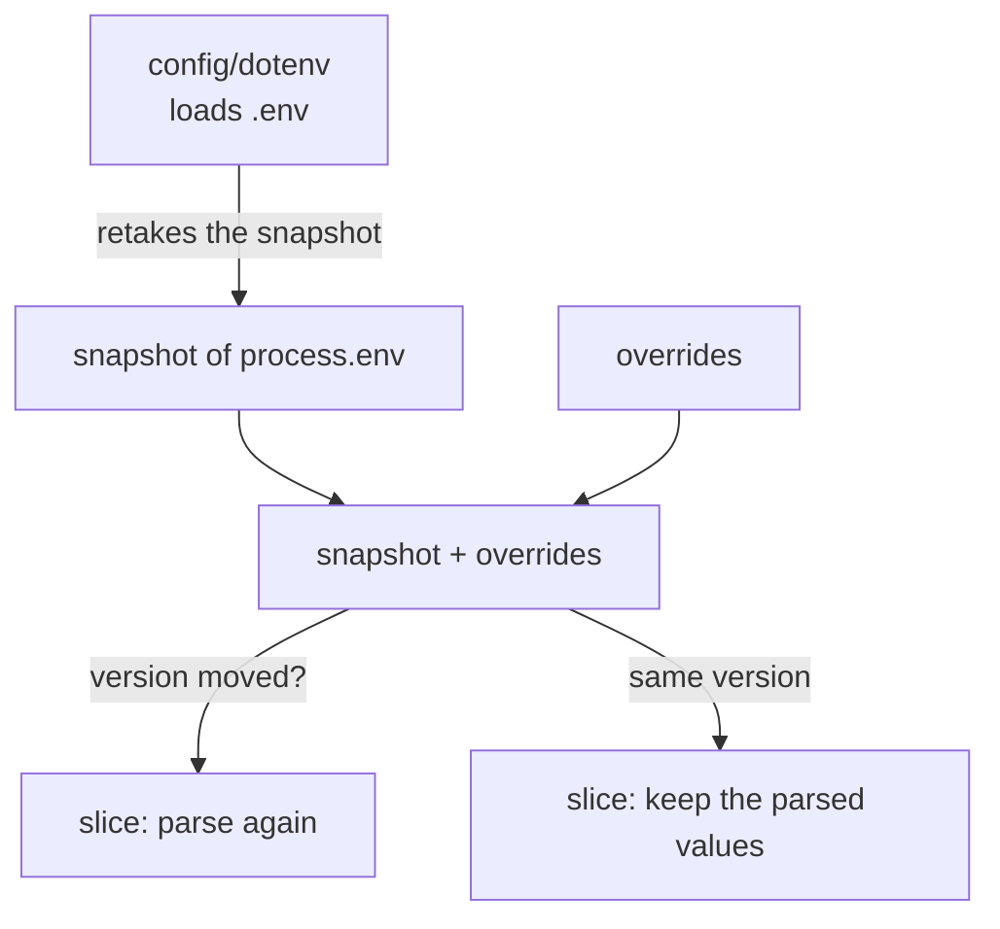
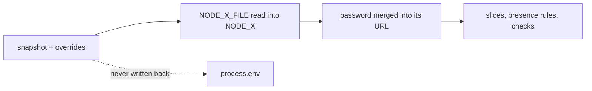

# Configuration

Every environment variable is read in **one layer**, checked **once at boot**, and handed to the
rest of the code as a **typed, frozen object**.



## The standard

Laravel, AdonisJS, NestJS and Spring Boot all converge on it. This repo follows it on Zod 4, which
was already a dependency.

| Rule                                  | Where it is enforced here                                                           |
| ------------------------------------- | ----------------------------------------------------------------------------------- |
| Read the environment in one layer     | `no-restricted-properties` on `process.env` in `src/`, off only in `config.ts`      |
| Validate once at boot, list every one | `assertConfig` from `registerModules`, `runScript` and the cluster primary          |
| Parse once, expose a frozen object    | The store snapshots `process.env` at the first read; a slice parses once per change |
| Everything else reads that object     | Getters such as `vatRateDefault()` are the read door; their body reads the slice    |
| Tests override config through a seam  | `tests/support/environment.ts`; lint refuses a `process.env` write in a test        |

A junk value **refuses to boot**. It never falls back to the default:
`NODE_MAX_UPLOAD_BYTES=5mb` stops the boot; it is not read as 5 MB or as the default. Blank counts as unset.

## Who owns what

| Layer          | File                                                               | Holds                                                        |
| -------------- | ------------------------------------------------------------------ | ------------------------------------------------------------ |
| Seam           | `src/infrastructure/config/{fields,define,store}.ts`               | Field builders, `defineConfig`, the gate, the one env reader |
| Infrastructure | `src/infrastructure/<dir>/config.ts`                               | The adapters' variables, one slice per adapter               |
| Kernel         | `src/kernel/config.ts`                                             | Step-up windows, outbox retry                                |
| App tier       | `src/app/config.ts`                                                | Server bounds, security.txt, **the list of every slice**     |
| A module       | `src/modules/<name>/config.ts` + `config: [slice]` on the manifest | Its own variables; deleting the module deletes its gate      |

## Add a variable

1. Put it in **its owner's** `config.ts`, with a builder.
2. Add a getter with a plain signature; read the slice inside it.
3. A module lists the slice on its manifest (`config: [mySlice.slice]`). Infrastructure and app
   slices are listed in `src/app/config.ts`.
4. Add its line to [`.env-example`](#env-example), in the section it belongs to, unless something
   else sets it (npm, a script).

```ts
// src/modules/products/config.ts
export const productsConfig = defineConfig({
    name: 'products',
    shape: {
        NODE_VAT_RATE_DEFAULT: decimal({
            default: 0.22,
            min: 0,
            lessThan: 1,
            required: { minLength: 1 }
        })
    }
});
export const vatRateDefault = (): number => productsConfig().NODE_VAT_RATE_DEFAULT;
```

| Builder                        | Reads                                                                |
| ------------------------------ | -------------------------------------------------------------------- |
| `int` / `decimal`              | A whole-string number, with `min` / `max` / `lessThan`               |
| `flag`                         | `1 true yes on` and `0 false no off`, either case                    |
| `choice`                       | One of a closed set (a function for a registry filled later)         |
| `text` / `secret`              | Trimmed text; `secret` is never echoed and can carry a presence rule |
| `csv`                          | A comma-separated list, blank members dropped                        |
| `keyRing` / `versionedKeyRing` | A rotation ring, newest first; `version:key` for the second          |

## `.env-example`

Hand-written, and the one list of variables an operator reads: `npm run setup` copies it into
`.env`. It carries what a slice cannot: sections, `MUST SET` warnings, invented values, who else
reads a variable. Nothing checks it against the slices. A required variable it forgets still
refuses boot, by name.

## First run: `npm run setup`

One command takes a fresh clone to a `.env` the boot gate accepts. Source: `scripts/setup/`.



- **Which keys.** Read off the enabled modules' config slices and the app tier, not a list kept
  here. A new module's secret is covered the day it declares one.
- **Exact match only.** A line is replaced when it reads exactly `KEY=<placeholder>`. A value
  already filled, or set to anything else, is never touched.
- **Left to the operator.** A field with no placeholder (`NODE_URL`, `NODE_CORS_ORIGIN`) names no
  wrong value to replace, only a missing one.
- **Metrics token file.** Always written, even when `.env` needed nothing, so the Prometheus bind
  mount finds a real file. An absent one is silently created as a directory by Docker/Podman.
- **Output.** Key names are printed, never values.
- **Re-running.** Once nothing reads a placeholder, `.env` is left as it is; the token file is
  rewritten with the same value.

`tests/unit/scripts/setup/first-run.test.ts` fills every placeholder a slice refuses at boot,
straight from `.env-example`.

## Two kinds of rule

| Kind         | Example                                        | Applied                                  |
| ------------ | ---------------------------------------------- | ---------------------------------------- |
| **Shape**    | Is it a number? Is it in the set?              | Every read, every environment, tests too |
| **Presence** | Length, still the placeholder, production-only | At boot, skipped under `NODE_ENV=test`   |

Presence is not a shape rule because an unset secret is a correct state on a developer machine.
`isRelaxedEnvironment()` (development or test, nothing else) decides who is a developer.

Cross-field rules (`NODE_TOKEN_REUSE_WINDOW_MS` must exceed `NODE_TOKEN_ROTATION_GRACE_MS`; an SMTP
host needs its credentials) are a slice's `check`, and run at boot with the parsed values.

A **provider selector** (`NODE_PAYMENT_PROVIDER`, `NODE_ANTIBOT_PROVIDER`, …) is plain text in its
slice, because the valid names live in a registry that imports the slice. A shape-less
`…ProviderProbe` slice, next to the registry, runs the resolver once at boot instead.

## Read once, override on top

The store copies `process.env` the **first** time anything asks, and never again. What changes the
answer afterwards is an **override**: a layer of names and values on top of that copy. A slice
parses its variables once and keeps the result until the store changes.



| Who writes an override          | How                                                            |
| ------------------------------- | -------------------------------------------------------------- |
| `createApp({ env })`            | `installEnvironment`: for the life of the process              |
| The demo and scenario launchers | `installEnvironment`, before the app is imported               |
| A test                          | `tests/support/environment.ts`, below; undone after every case |

`createApp({ env })` is the injection point: the variables are laid over the process environment,
pass through the same parser and boot gate, and `process.env` is never written. The slices are
process-wide, so the last app built wins. A setting read at **import** time (a rate limiter's
budget) only sees it if it was installed before the first import of `src/app.ts`, which is why the
launchers install theirs first.

Every entry point imports `config/dotenv` instead of `dotenv/config`. It loads `.env` and tells the
store, so a read that happened earlier (tracing, a launcher) does not freeze a snapshot without it.

## Secrets as files

`NODE_X_FILE=/run/secrets/x` stands in for `NODE_X=<the secret>`. A secret in the environment shows in
`docker inspect` and in every child process; a file mounted into one container does neither. The
store resolves it while it builds the merged environment, so every slice, presence rule and
cross-field check sees the value and nothing downstream knows a file existed.



| Rule                     | Why                                                                                  |
| ------------------------ | ------------------------------------------------------------------------------------ |
| The file wins            | Both set is a deployment mid-move, not a mistake worth refusing                      |
| An empty file is unset   | A managed service has no secret to put in a file compose insists on mounting         |
| A trailing newline goes  | Only the one `echo` or an editor adds; any other whitespace is the secret's          |
| `NODE_*` only            | `GIT_INDEX_FILE` and friends name a file for another tool, not a secret for this app |
| Never into `process.env` | That would hand the value to every child process again                               |
| An unreadable file stops | The error names the variable and path, never a value                                 |

**Connection URLs carry no password.** The URL stays in plain config; each password is its own
variable, and the loader merges it into the URL, replacing any it carried:

| URL                         | Password                         | Its file form                         |
| --------------------------- | -------------------------------- | ------------------------------------- |
| `NODE_DB_URI`               | `NODE_DB_PASSWORD`               | `NODE_DB_PASSWORD_FILE`               |
| `NODE_REDIS_URL`            | `NODE_REDIS_PASSWORD`            | `NODE_REDIS_PASSWORD_FILE`            |
| `NODE_RABBITMQ_URL`         | `NODE_RABBITMQ_PASSWORD`         | `NODE_RABBITMQ_PASSWORD_FILE`         |
| `NODE_RATE_LIMIT_REDIS_URL` | `NODE_RATE_LIMIT_REDIS_PASSWORD` | `NODE_RATE_LIMIT_REDIS_PASSWORD_FILE` |

The merge uses a standard parser, not hand-written parsing. A Mongo URI (`mongodb://`,
`mongodb+srv://`) goes through `mongodb-connection-string-url`, the parser the `mongodb` driver
itself uses: the WHATWG `URL` refuses a multi-host replica-set string
(`mongodb://a:27017,b:27017/db`). Every other URL goes through Node's `URL`. Both percent-encode
the password, keep the user the URL names, and a URL that does not parse is left as it was.

Every `NODE_*` secret has a file form. How the production stack uses this:
[docs/getting-started-production.md](../getting-started-production.md).

## In tests

`tests/support/setup-environment.ts` gives every worker a set of `??=` defaults. It is the first
import of `setup.ts`, so they land before the store's first read. Jest gives each test **file** its
own copy of `process.env`, so a file starts from the same snapshot whatever ran before it.

A test never writes `process.env`: the store would not see it. `no-restricted-syntax` refuses an
assignment, a `delete` or an `Object.assign` onto it in `tests/` and every `src/modules/*/tests/`,
and names the helper. Overrides last **one case**: a `setupFilesAfterEnv` hook resets them after
every test, back to what the file began with (the file sandbox's directories).

| Helper                                                | Use                                                                                    |
| ----------------------------------------------------- | -------------------------------------------------------------------------------------- |
| `setEnvironment({ NAME: 'x', OTHER: undefined })`     | Override for the rest of the case; `undefined` unsets                                  |
| `withEnvironment` / `withEnvironmentOverrides`        | Override for a body, restore after                                                     |
| `withoutEnvironment` / `withoutEnvironmentInThisFile` | Unset for the body, or before every case of the file                                   |
| `setProcessEnvironment({ NAME: 'x' })`                | The REAL `process.env`, for a script or library that reads it; restored after the case |
| `slice.slice.inspect(env)`                            | Judge a plain object against a slice, no process                                       |
| `assertConfigIn(slices, env)`                         | The whole gate against a plain object                                                  |

Set a value in a `beforeEach`, not a `beforeAll`: the reset runs after the first case. A suite that
re-imports a module (`jest.resetModules()`) keeps its overrides, because the store's state lives on
`globalThis`, not in the module.

## Libraries

| Library                 | Why                                                                                                                          |
| ----------------------- | ---------------------------------------------------------------------------------------------------------------------------- |
| [Zod](https://zod.dev/) | Already the validation library. `z.stringbool`, `z.preprocess` and aggregated issues cover what envalid or t3-env would add. |

envalid and t3-env are maintained but each is a thin wrapper; t3-env parses at import, which is the
side effect `createApp()` removed. Fail-closed environment switches are
[Security](./security.md#one-environment-switch).
