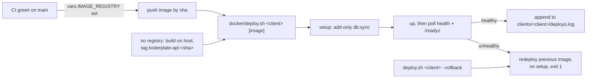

# Deploy and rollback

One command ships a release, checks it came up healthy, and puts the previous release back when it
did not. No orchestrator is needed: it is a bash script over the production compose file.

```bash
docker/deploy.sh acme                      # build here, tag with the git sha, start, check
docker/deploy.sh acme registry.example/api@sha256:…   # run a pushed image by digest
docker/deploy.sh acme --rollback           # run the previous good image again
```

`acme` is the client: the directory under `clients/` that holds its `.env` and `secrets/`
([First run](../getting-started-production.md#first-run)). `CONTAINER_ENGINE` picks `podman`
(default) or `docker`, the same switch `npm run compose` uses.

## What a deploy does



A deploy is **good** only when all of these hold:

- `setup` (indexes and the shop's row) exited 0;
- `app` and `cron` are running, have not restarted, and report `healthy`;
- `/readyz` answers from inside `app` (it checks Mongo, not just the process).

Anything else is a failed deploy: a `setup` that exits non-zero, a container that exits or restarts,
an `unhealthy` check, or no good state within `DEPLOY_TIMEOUT` (240 s). The script then prints the
last log lines of `setup`, `app` and `cron`, redeploys the previous good image with
`up -d --no-deps app cron` (**without** `setup`, so a rollback never touches the data) and exits 1.

| Exit code | Meaning                                                                                  |
| --------- | ---------------------------------------------------------------------------------------- |
| 0         | The new image is running and healthy.                                                    |
| 1         | The new image failed; the previous good image is running again.                          |
| 2         | Nothing healthy is running: there was no previous image, or the rollback failed as well. |

## The two image sources

| Source          | How you call it               | What happens                                                                                                                                                               |
| --------------- | ----------------------------- | -------------------------------------------------------------------------------------------------------------------------------------------------------------------------- |
| **No registry** | `docker/deploy.sh acme`       | `build app`, tagged `boilerplate-api:<git short sha>` (`-dirty` when the tree has changes). Old tags are pruned: only the last 5 good ones stay.                           |
| **A registry**  | `docker/deploy.sh acme <ref>` | `pull` (skipped when the exact ref is already on the host), then run it. Pass the **digest**, which never changes. A registry keeps its own history, so nothing is pruned. |

`APP_IMAGE` has no default in `docker-compose.production.yml` any more. The old `latest` tag was
overwritten by every build, so there was nothing to go back to. The script sets it; set it by hand
only when you run compose yourself.

## The log

Every good state is appended to `clients/<client>/deploys.log` (`clients/` is gitignored):

```text
2026-10-20T09:14:02Z deploy boilerplate-api:3f9c2ab
2026-10-20T11:40:51Z deploy boilerplate-api:b71e0d4
2026-10-20T11:52:10Z auto-rollback boilerplate-api:3f9c2ab
```

That file is the whole record. `--rollback` runs the newest entry whose image differs from the last
one, so two rollbacks in a row swap between the same two releases, like `kubectl rollout undo`.

## What a rollback does not undo

A rollback replaces the code. It does not replace anything else:

| Not undone              | Why                                                                                                                                                                |
| ----------------------- | ------------------------------------------------------------------------------------------------------------------------------------------------------------------ |
| **Data**                | Rows written by the newer release stay. A script under `scripts/ops/` that changed fields is not reversed; whether to roll back across one is the deployer's call. |
| **Indexes**             | `db:sync` is [add-only](../reference/data.md#it-adds-and-drops-only-what-it-was-told-to), so the newer release's indexes stay and the older release ignores them.  |
| **Retired index names** | Dropped by the release that retired them; an older release that still declares one rebuilds it on its next `setup`.                                                |
| **Secrets and `.env`**  | They are the client's, not the image's.                                                                                                                            |

The frontend and the backend deploy independently, so a rollback of one never needs the other.

## Why the script polls instead of using `up --wait`

`podman-compose` 1.6 accepts `up -d --wait --wait-timeout n` but exits **0** for a container that
crashed or went unhealthy (checked with a container that exits after two seconds and one whose
check always fails). `docker compose` does what the flag says, but the script has to work with the
default engine, so it reads `inspect` itself and treats a restart as a failure too. `up` runs with
`--no-build`: compose must never rebuild over the image the deploy chose.

## The drill

`npm run deploy:drill` (`docker/deploy-drill.sh`) proves all of this on the real production compose
file, with a throwaway client and generated secrets:

1. deploy the image built here: healthy, `/livez` answers, the log records it;
2. deploy a broken image (the same image with a `CMD` that exits): refused, the first image is
   running again, the log ends in `auto-rollback`, exit code 1;
3. deploy a second good image, then `--rollback`: the first image runs again, `setup` was not
   recreated, the log ends in `rollback`.

The stack, its volumes, the drill images and the client directory are removed at the end, whatever
happened. Needs Docker or Podman; set `DEPLOY_DRILL_PORT` if 3996 is taken.
