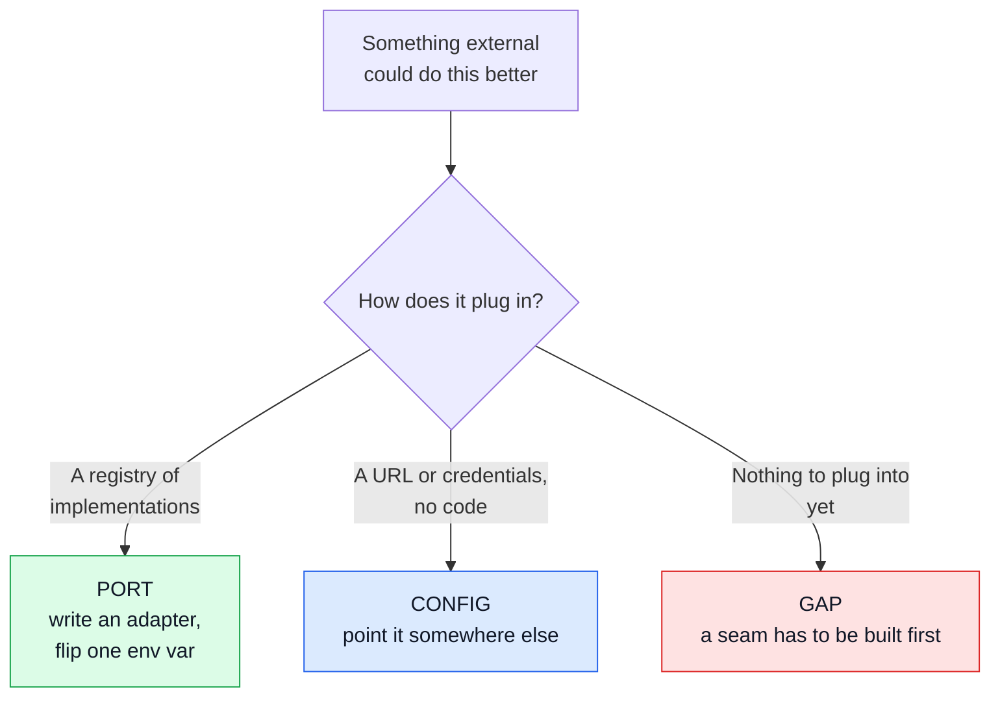

# External Services

Which third-party services this app can use, where each one plugs in, and **what you lose by
plugging in nothing**.

This boilerplate is **provider-neutral, deliberately** — the same stance
[Hosting](./hosting.md) takes. Every seam below either ships with a working provider-free default
or degrades to a documented gap. Nothing here is a recommendation of a vendor; the vendors are
listed as _categories with examples_, so a reader can go shopping knowing what to shop for.

::: warning Facts, not verdicts
Vendor names are examples of a category, not endorsements, and vendors change. The **code** side of
each row — the port, the default, the gap — is read off this repo and is the part that stays true.
:::

## 1 · The three kinds of seam

Not everything swaps the same way, and the difference decides how much work a swap is.

| Kind       | What it means                                                                       |
| ---------- | ----------------------------------------------------------------------------------- |
| **PORT**   | A registry of named implementations. Add a file, register it, set one env var       |
| **CONFIG** | A standard protocol. Point the URL at someone else's server; no code changes at all |
| **GAP**    | No seam exists. Something has to be designed before a vendor can be attached        |

## 2 · The catalogue

### PORT — a registry is already there

Five concerns resolve a named provider at runtime. Each registry re-checks configuration on every
call, so a provider is active when its variables are set in the environment the process started
with (or a test override), and the registry holds no copy of its own to go stale.

| Concern               | Registry                                         | Ships with                                             | What a vendor adds                                                                                          |
| --------------------- | ------------------------------------------------ | ------------------------------------------------------ | ----------------------------------------------------------------------------------------------------------- |
| **Payments**          | `src/modules/payments/providers/`                | nothing — `fake` is a [test double](./test-doubles.md) | Actually taking money. Also a fraud engine you cannot build (see below)                                     |
| **Social login**      | `src/modules/account/oauth/providers/`           | `google`, `github`                                     | More identity providers; any OIDC-shaped one fits the same port                                             |
| **Human challenge**   | `src/infrastructure/adapters/antibot-providers/` | `none`, `altcha`, `turnstile`                          | Managed bot scoring. **`altcha` is self-hosted** — no vendor needed                                         |
| **Product analytics** | `src/infrastructure/observability/analytics/`    | `none`, `umami`, `posthog`                             | Hosted retention, funnels, session replay — see [Analytics](./analytics.md)                                 |
| **E-invoicing**       | `src/modules/invoicing/providers/`               | `pdf`                                                  | Transmitting the invoice to a tax authority — see [Invoicing](../modules/invoicing.md#the-e-invoicing-port) |

**The human-challenge row is the one worth studying**, because it is the shape the others should
grow towards: three providers, one of them a real defence that phones nobody
(`altcha` — proof-of-work in the browser), and `none` as an honest default rather than a stub.

### Where to shop, per port

Examples of each category, checked 2026-10. Not endorsements: compare pricing, data residency
and GDPR terms yourself before picking one.

| Port                  | Kind of service                                    | Examples                                                            |
| --------------------- | -------------------------------------------------- | ------------------------------------------------------------------- |
| **Payments**          | card / wallet processor                            | Stripe, Adyen, Mollie, PayPal                                       |
| **Social login**      | OAuth 2 / OIDC identity provider                   | Apple, Microsoft, GitLab, any OIDC issuer (Keycloak, Authentik)     |
| **Human challenge**   | self-hosted proof-of-work                          | ALTCHA (shipped), mCaptcha, Cap                                     |
|                       | managed, invisible or proof-of-work                | Cloudflare Turnstile (shipped), Friendly Captcha (EU), hCaptcha     |
| **Product analytics** | self-hostable, cookieless                          | Umami (shipped), Plausible, Matomo                                  |
|                       | hosted product analytics                           | PostHog (shipped)                                                   |
| **E-invoicing**       | Italy: an SdI intermediary with an API             | A-Cube, or any intermediary accredited by the Agenzia delle Entrate |
|                       | EU cross-border: a Peppol access point with an API | Storecove, B2BRouter, Digiteal                                      |

Each one plugs in the same way: [§ 4](#_4-adding-a-provider-to-a-port).

### CONFIG — standard protocols, no code

Nothing to write. These already speak a protocol somebody else's server also speaks.

| Concern                     | Protocol                 | Default                                                                            | Where to read                                 |
| --------------------------- | ------------------------ | ---------------------------------------------------------------------------------- | --------------------------------------------- |
| **Transactional email**     | SMTP (nodemailer)        | any SMTP host; a JSON transport under test, and the demo outbox in demo mode       | [Email & PDF](./email-and-rendering.md)       |
| **Cache**                   | Redis                    | in-memory when no URL is set                                                       | [Redis Cache](./redis-cache.md)               |
| **Rate-limit counters**     | Redis                    | in-memory; its own Redis instance (`noeviction`), so a cache flood cannot evict it | [Security](./security.md)                     |
| **Message queue**           | AMQP 0-9-1 (amqplib)     | RabbitMQ in the compose stack                                                      | [RabbitMQ](./rabbitmq.md)                     |
| **Database**                | MongoDB 8 wire           | the bundled container                                                              | [MongoDB](./mongodb-mongoose.md)              |
| **Logs · metrics · traces** | Loki · Prometheus · OTLP | the bundled Grafana stack                                                          | [Observability](./observability-reference.md) |

Every one of these is a managed offering somewhere. The point of the column is that **choosing a
managed one is a URL change**, not a migration — and that the self-hosted default is a complete
answer, not a placeholder.

### GAP — no seam yet

Honest entries. Each is a decision someone has to make before a vendor can help.

| Concern                  | What is missing                                                                                                                        | Where it is tracked                                                                      |
| ------------------------ | -------------------------------------------------------------------------------------------------------------------------------------- | ---------------------------------------------------------------------------------------- |
| **Object storage**       | uploads land on a local disk; no S3-shaped port exists                                                                                 | [a recipe in Deployment Hardening](./deployment-hardening.md#object-storage-for-uploads) |
| **Fraud / risk scoring** | nothing consumes a third-party risk verdict; per-account velocity and decline limits (`payments/rate-limits.ts`) are the whole defence | —                                                                                        |

## 3 · What you actually give up by choosing nothing

The column that matters, and the reason this page is not just a list of vendors.

| Choose nothing for… | And you still have                                                                                         | But you do not have                                                                                                      |
| ------------------- | ---------------------------------------------------------------------------------------------------------- | ------------------------------------------------------------------------------------------------------------------------ |
| Payments            | checkout by bank transfer, the order lifecycle, refunds — and, in dev, all of it against the `fake` double | card payments. Production has no provider until you write one; `fake` is never in the image                              |
| Human challenge     | rate limits, the antibot ladder, and `altcha` if you enable it                                             | managed bot scoring — but `altcha` closes most of the gap without a vendor                                               |
| Analytics           | audit logs, Prometheus counters, structured logs                                                           | funnels and retention                                                                                                    |
| E-invoicing         | a numbered PDF invoice                                                                                     | transmission to SdI or Peppol: required in Italy for every invoice issued, and for B2B in a growing list of EU countries |
| Fraud scoring       | per-account velocity and decline limits, once they are built                                               | cross-merchant signal. Nobody can build that alone — it is the one category where a vendor is genuinely irreplaceable    |
| Object storage      | uploads, on one disk, for one instance                                                                     | horizontal scaling of the upload path                                                                                    |
| Managed email       | SMTP to anything, including your own server                                                                | deliverability reputation — see [Email authentication](./deployment-hardening.md#email-authentication-spf-dkim-dmarc)    |

## 4 · Adding a provider to a port

The five ports share a shape, so the work is the same each time:

1. **Write the adapter** next to its siblings, implementing that port's interface.
2. **Add it to the port's list** — one entry in the registry in that folder's `index.ts` (payments:
   one `registerPaymentProvider` call). A new provider is a change to this repo, not a plug-in.
   An env var naming a provider the build does not have is handled per port: payments, human
   challenge, analytics and e-invoicing throw; social login treats an unconfigured one as absent.
3. **Set the env var.** The switches live in `.env-example`; that file is the list an operator
   reads, so this page does not copy the names.
4. **Leave the default alone.** A provider-free default is a feature: it is what makes the repo
   clone-and-run, and what the test suite runs against.

A provider that cannot be configured must behave as if the route did not exist — loud (a 404 or a
clear refusal), never silently wrong. That rule is why an unset payment provider is a hard failure
rather than a checkout that quietly succeeds.

For the payment port, [Writing a payment adapter](../modules/payments.md#writing-a-payment-adapter) lists
what a card adapter must map, defend and not assume.

## See also

- [Hosting](./hosting.md) — what a host must offer, same provider-neutral stance
- [Deployment Hardening](./deployment-hardening.md) — the defences that live in DNS, CI or a proxy
- [Dependency Vetting](./dependency-vetting.md) — what earns a place in `package.json`
- [Security](./security.md) — the guardrails that ship in the box
