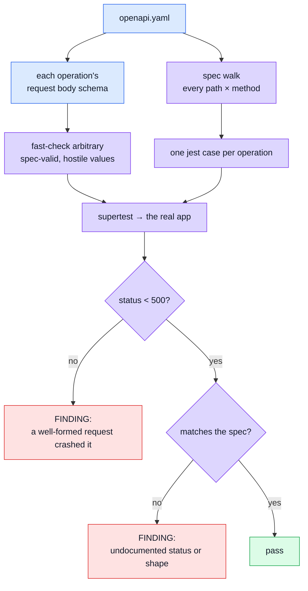
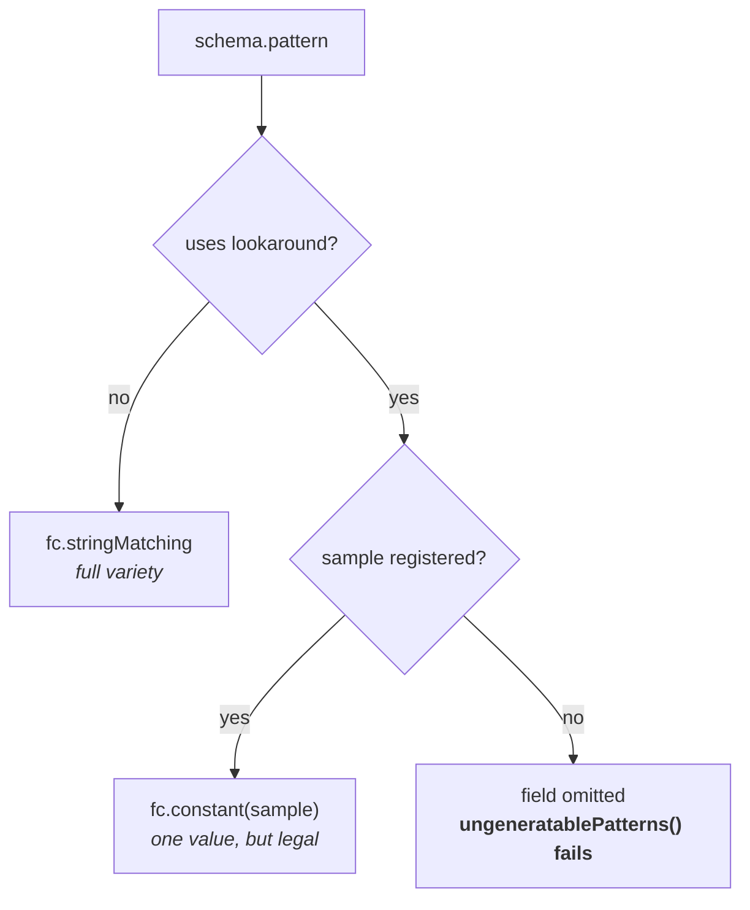

# Spec-Driven Fuzzing

Every other suite tests endpoints somebody thought about. This one tests the endpoints **nobody thought about** — including the ones added after it was written.

It walks `openapi.yaml`, generates requests for every operation it finds, throws them at the real app, and asserts two things: the server never answers **5xx**, and every response **matches the contract**.

## The idea

A test suite has a blind spot shaped exactly like its author's imagination. You write cases for the endpoint you just built, the bug you just fixed, the edge you happen to remember. Nothing writes a case for the endpoint a colleague added last month, or for the field you have never once sent as an empty string.

Fuzzing removes the author from the loop. The list of what to test comes from the contract, and the values come from a generator.

## Why the endpoint list is derived, never written

This is the property that makes it worth having, and it is why the suite does not contain a list of URLs.

A hand-maintained list rots. Somebody adds `PATCH /products/{id}`, nobody adds it to the fuzz list, and the suite reports green over a shrinking fraction of the API — the worst possible outcome, because it _looks_ like coverage.

`listOperations()` reads the spec. Add a route to `openapi.yaml` and it is fuzzed on the next run.

That auto-discovery is what an off-the-shelf contract fuzzer offers. It is assembled here instead, because this is a **boilerplate**: every project derived from it would inherit a Python toolchain alongside Node, for a capability that can be assembled from four things the repo already has — the spec, `fast-check`, `supertest`, and the orval-generated, per-status Zod schemas `tests/support/response-contract.ts` judges a response against.

## Spec-valid, but hostile

The generated values are **legal per the contract** and **nasty within it**. Both halves matter, and getting this backwards is the usual way a fuzzer ends up testing nothing.

Generating outright garbage would mostly re-test the validator: every write endpoint parses its body with a generated Zod schema and answers 422. A wall of expected 422s is where a genuine 500 goes to hide.

So the generator honours `minLength`, `maximum`, `pattern`, `enum`, `format` and `minItems`, and then heads for the edges of what those allow:

| Kind     | What it reaches for                                                                                                                                    |
| -------- | ------------------------------------------------------------------------------------------------------------------------------------------------------ |
| strings  | empty, whitespace, `'null'`, `'undefined'`, emoji, right-to-left marks, 1000 characters, regex metacharacters, traversal and injection shapes          |
| numbers  | exactly `minimum`, exactly `maximum`, `0`, `1` — each only where the bounds allow it                                                                   |
| objects  | optional properties genuinely omitted — "absent" is a different case from "empty"                                                                      |
| arrays   | `minItems` respected, so the request is not rejected before it reaches the handler                                                                     |
| nullable | `null` drawn on purpose for every field whose `type` lists `'null'` (or is `'null'` alone) — "cleared" is a different case from "absent" and from `''` |
| maps     | an `additionalProperties` schema (translations keyed by locale) draws up to three entries of its value schema                                          |

These are weighted rather than uniform. Uniform random strings essentially never produce an empty one.

The same generator fills **query parameters** from each operation's `in: query` declarations —
required ones always, optional ones sometimes, an array as a repeated key. **Path parameters**
name real rows where the path says which kind: a product, an order and a second user are seeded
before each operation, so `/orders/{id}/cancel` reaches the cancel rather than stopping at a 404.
A path whose resource is not seeded still gets a well-formed id nothing holds.

### `allOf` is folded, not flattened

The contract wraps a shared schema in `allOf: [$ref]` wherever a field needs a sibling keyword
(`default`), because the generator needs the wrapper. `resolveSchema()` folds the parts and the
siblings into one node: keywords merge, `properties` union, `required` unions, the node's own
siblings win. A nullable `$ref` is `oneOf: [{ $ref }, { type: 'null' }]` (OpenAPI 3.1), which
`resolveSchema()` folds into the referenced node with `'null'` added to its `type`. An earlier
version rebuilt every `allOf` as an empty object, so a nullable string like `locale` was drawn as `{}` and the operation was refused at the edge on every
run, 11 of them (the `PUT`/`PATCH` of `/account`, `/users/{id}`, `/products/{id}`, translations,
`POST /products`, `POST /cart/checkout`, `POST /orders/{id}/status-override`). Green, and testing
the validator. `tests/unit/support/spec-walk.test.ts` pins the fold.

## The merge-patch body

A `PATCH` that declares `application/merge-patch+json` is also fuzzed with it (12 operations, admin
caller). Same field schemas, different content type and a different reading of `null` (clear), so
it is its own route through the body parser. A test asserts the set is non-empty and all `PATCH`,
the same guard the multipart set has.

## Three callers

Each operation is fuzzed three times over:

| Caller           | What it proves                                                               |
| ---------------- | ---------------------------------------------------------------------------- |
| an admin         | the deepest code paths never 5xx and always answer on-contract               |
| a plain customer | the surface refused to a customer is refused on-contract, never with a crash |
| no credentials   | every operation the spec marks as secured answers exactly 401, never a 5xx   |

The two refused callers run a quarter of the requests: a refusal rarely depends on the body.

## The two assertions

**No 5xx.** A malformed request deserves a 4xx. A 5xx means a well-formed request reached an unhandled throw — a correctness bug and an availability signal at once, especially on a public endpoint.

**The response matches the spec**, via `assertResponseMatchesContract` (`tests/support/response-contract.ts`). This checks the status code as well as the body, against the ONE Zod schema orval generated for that exact operation+status, and it is sharp here because most schemas are `additionalProperties: false` — an undeclared field fails, and so does an undocumented status.

## The tripwires on itself

The obvious objection to a hand-rolled spec walk is: _who maintains it?_

The answer is that it maintains itself, loudly. `SUPPORTED_KEYWORDS` lists every JSON Schema keyword the generator honours, and a test fails when the spec starts using one that is missing.

That matters because the failure mode is otherwise **silent and green**: an unknown keyword means the generator stops constraining that field, the endpoint rightly rejects every request as 422, and the suite passes while testing the validator instead of the handler.

It has already fired once, for `minItems`.

When it fails, there are exactly two honest responses:

1. teach the generator the keyword, or
2. conclude the spec has outgrown a hand-rolled walk and reach for a real OpenAPI tool.

Silencing it is not on the list.

### The second tripwire: patterns it cannot build

A keyword can be understood and its **value** still be beyond the generator. `pattern` is the case: `fc.stringMatching` compiles most regexes, but throws `Assertions of kind Lookahead not implemented yet!` on lookaround — which is exactly what "a lowercase letter, an uppercase letter, a digit and a symbol, in any order" needs.

The failure mode is the same silent-and-green one, so the answer is the same shape. `tests/support/pattern-samples.ts` holds a hand-written sample per pattern, keyed on the regex source, and `ungeneratablePatterns()` fails the suite when the spec declares a lookaround pattern with no sample registered.

One table, two readers: `tests/support/contract-data.ts` reads it too, so a tricky pattern is registered once rather than once per generator. The two differ only in how they refuse — `contract-data.ts` throws at generation time, because it builds a payload that is meant to be valid; the fuzzer degrades to omitting the field and lets the assertion above be the loud part, because it walks far more schema shapes per run.

## What it does not cover

`multipart/form-data` operations are skipped. Their bodies are files, and `fast-check` has nothing useful to say about a PNG; the upload path is covered by `tests/integration/upload-security.test.ts`, which drives real magic-byte checks. A test asserts that the skipped set stays small, so "skipped" cannot quietly become "skipped everything".

It also drives **one request at a time**. `create order → pay → cancel → pay again` is a real class of bug — a status check that only runs on the happy path, a reservation released twice — and nothing above can see it, because nothing above remembers the response of one request while building the next.

## Sequences and cross-user access

Neither is fuzzed. Each is covered by a test that builds the state it needs:

- **Sequences:** the lifecycle tests in each module's `tests/contract/` and `tests/integration/`, which walk an order through pay, ship, deliver, refund and return over real HTTP.
- **Cross-user access:** `tests/contract/ownership-contract.test.ts` and `ownership-shop.contract.test.ts`. Customer B sends every id customer A owns, in the path, the body or a list filter, and must get the same answer as for an id that does not exist. The list of such ids is derived from the routes and the contract, so a route added tomorrow is caught.

## Where the per-request fuzzer runs

Twice, at two depths. `npm run test` includes `test:fuzz`, so every PR's `container-gate` runs a
shallow pass at `TEST_FUZZ_RUNS`' default. `.github/workflows/fuzz.yml` runs the deep one nightly,
with many more requests per operation and a fresh seed — that is the hunter, and a red night is a
**finding** for a person to read. The seed is printed first; `RANDOM_DATA_SEED=<seed>` reproduces it.

The limiters stay mounted, with budgets raised in `tests/support/setup-environment.ts`: the shared
credential address bucket takes about 29 failures per `TEST_FUZZ_RUNS`, so the 10000 there lasts to
roughly 300. Past that, raise the credential budgets too: a 429 is declared by every operation, so
it passes the oracle, but it locks `authenticateAs` out and the fuzzing quietly turns shallow.

## File map

| Path                                 | Contents                                                                                                   |
| ------------------------------------ | ---------------------------------------------------------------------------------------------------------- |
| `tests/fuzz/endpoints.fuzz.test.ts`  | The driver: three callers per operation, the two assertions, the self-tripwire                             |
| `tests/support/spec-walk.ts`         | Parses `openapi.yaml`, resolves `$ref` and folds `allOf`, enumerates operations, owns `SUPPORTED_KEYWORDS` |
| `tests/support/spec-world.ts`        | The seeded rows a path parameter names, shared with the request-contract walk                              |
| `tests/support/spec-arbitraries.ts`  | JSON Schema → `fast-check` arbitrary, and the hostile-value tables                                         |
| `tests/support/http.ts`              | The supertest harness and `authenticateAs`, shared with the integration and contract suites                |
| `tests/support/response-contract.ts` | `assertResponseMatchesContract` — judges one response against its operation+status Zod schema              |
| `.github/workflows/fuzz.yml`         | The nightly schedule and manual dispatch                                                                   |

## Commands

| Command                                   | Effect                                                 |
| ----------------------------------------- | ------------------------------------------------------ |
| `npm run test:fuzz`                       | Run the whole fuzz suite. Also part of `npm run test`. |
| `npx jest tests/fuzz -t 'POST /products'` | Fuzz one operation while working on it                 |

The run is **seeded**, so a failure is reproducible rather than a story about something that happened once. A counterexample printed by `fast-check` can be pasted straight into a regression test.

## Related pages

- [Contract Testing](./contract-testing.md) — the same `assertResponseMatchesContract` judge, driven by hand-written cases
- [Contract-Derived Request Data](./contract-request-data.md) — generation from the zod side rather than the spec side
- [Property Testing](./property-testing.md) — the same generate-don't-enumerate idea, applied to pure functions
- [Mutation Testing](./mutation-testing.md) — the other hunter, and the other nightly
- [Testing & Docs](./testing-and-docs.md) — the map
