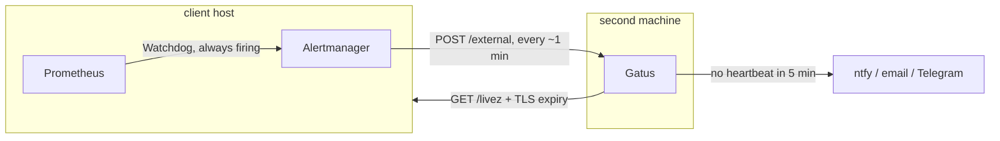

# Gatus

## What it is

Gatus is the **off-host heartbeat service**: a small status-page and health-check server (Apache-2.0) that
lives on a **different machine** from the stack it watches.

It does two jobs:

- **Heartbeat.** Alertmanager pushes the always-firing `Watchdog` alert to it every minute or so. When the
  pings **stop**, Gatus raises the alarm. That is the only way to notice that the host, Prometheus,
  Alertmanager or the network is dead, because a dead pipeline cannot report itself.
- **Outside checks.** It calls each client's `/livez` and reads the TLS certificate from the outside, which
  nothing on the host can do.

One Gatus watches every client. Its own alert channel must **not** go through the host it watches.



## Where it runs

| Where                | How                                                                                 |
| -------------------- | ----------------------------------------------------------------------------------- |
| Local stack          | the `gatus` container in the `observability` profile, mailing mailpit (below)       |
| Production           | **not shipped**: run it on another machine from the example config below            |
| A hosted alternative | any service that accepts an HTTP push and alerts on silence works; set the URL knob |

Dormant until it exists: an empty `ALERT_HEARTBEAT_URL` sends `Watchdog` to `null`, with no boot warning.

## The local drill

The `observability` profile starts Gatus beside Alertmanager (config:
`docker/observability/gatus.dev.config.yaml`). Mailpit lives in the `integrations` profile, so start both.

1. `npm run compose -- --profile observability --profile integrations up -d` (status page: `http://localhost:3071`)
2. `npm run compose -- stop alertmanager`.
3. Within about 3 minutes Gatus mails mailpit (`http://localhost:8025`) that `alertmanager-heartbeat` is missing.
4. `npm run compose -- start alertmanager`: the next ping resolves it, and Gatus mails the resolution.

The other drill, stopping `api` and watching `ApiDown` arrive, is in
[Alert routing](./prometheus.md#the-local-drill).

## Production: the second machine

One config for every client. Replace the values in capitals.

```yaml
# gatus/config.yaml
storage:
    type: sqlite # survives a restart; `memory` forgets every incident
    path: /data/gatus.db

alerting:
    # Any provider Gatus supports: https://github.com/TwiN/gatus#alerting
    ntfy:
        topic: YOUR_TOPIC
        url: https://ntfy.sh
        default-alert:
            failure-threshold: 1
            send-on-resolved: true

external-endpoints:
    # One per client. `ALERT_HEARTBEAT_URL` on that client is
    # https://GATUS_HOST/api/v1/endpoints/clients_acme-heartbeat/external?success=true
    # and `ALERT_HEARTBEAT_TOKEN` is the token below.
    - name: acme-heartbeat
      group: clients
      token: A_LONG_RANDOM_TOKEN
      heartbeat:
          interval: 5m # the Watchdog pings every ~1 min; 5 missed pings is a dead pipeline
      alerts:
          - type: ntfy

endpoints:
    # From the outside: is the app answering, and is the certificate going to renew in time?
    - name: acme-livez
      group: clients
      url: https://app.acme.example/livez
      interval: 1m
      conditions:
          - '[STATUS] == 200'
          - '[CERTIFICATE_EXPIRATION] > 336h' # two weeks: Traefik renews at 30 days
      alerts:
          - type: ntfy
    # Ready to serve: also red when the app has lost its database.
    - name: acme-readyz
      group: clients
      url: https://app.acme.example/readyz
      interval: 1m
      conditions:
          - '[STATUS] == 200'
      alerts:
          - type: ntfy
    # The real read path a shopper hits first, with no login.
    - name: acme-products
      group: clients
      url: https://app.acme.example/products?pageSize=1
      interval: 5m
      conditions:
          - '[STATUS] == 200'
      alerts:
          - type: ntfy
```

No login or cart check: that would need a shopper's password stored on the watcher, for a path
the staging walk already covers.

Run it:

```bash
docker run -d --name gatus --restart unless-stopped \
  -p 8080:8080 \
  -v "$PWD/gatus/config.yaml:/config/config.yaml:ro" \
  -v gatus-data:/data \
  twinproduction/gatus:v5.37.0
```

Put it behind TLS (Caddy or Traefik on that machine) before opening port 8080: the heartbeat token travels
in a header.

## Backup freshness

The `backup` container pings Gatus after every run, so the same service that watches the alert pipeline
also notices a backup that stopped: one more external endpoint per client, beside the heartbeat above.

```yaml
external-endpoints:
    - name: acme-backup
      group: clients
      token: ANOTHER_LONG_RANDOM_TOKEN
      heartbeat:
          interval: 2h # hourly schedule: one missed run raises the alarm
      alerts:
          - type: ntfy
```

The client's `BACKUP_HEARTBEAT_URL` is
`https://GATUS_HOST/api/v1/endpoints/clients_acme-backup/external?success=true` and
`BACKUP_HEARTBEAT_TOKEN` is the token above. A finished run pings green; a failed one pings
`success=false` with the reason, so a failing job, a dead container and a dead host all end in the same
alert. The second machine's weekly upkeep can have its own endpoint the same way
([Backup server](./backup-server.md#the-upkeep)). See [Backups](./backups.md#the-heartbeat).

## Related pages

- [Prometheus](./prometheus.md#alert-routing): the routing and the knobs
- [Grafana](./grafana.md)
- [Docker & Podman](./docker-and-podman.md)
- [Backups](./backups.md#the-heartbeat)

## External references

- [Gatus: external endpoints](https://github.com/TwiN/gatus#external-endpoints)
- [Gatus: alerting](https://github.com/TwiN/gatus#alerting)
