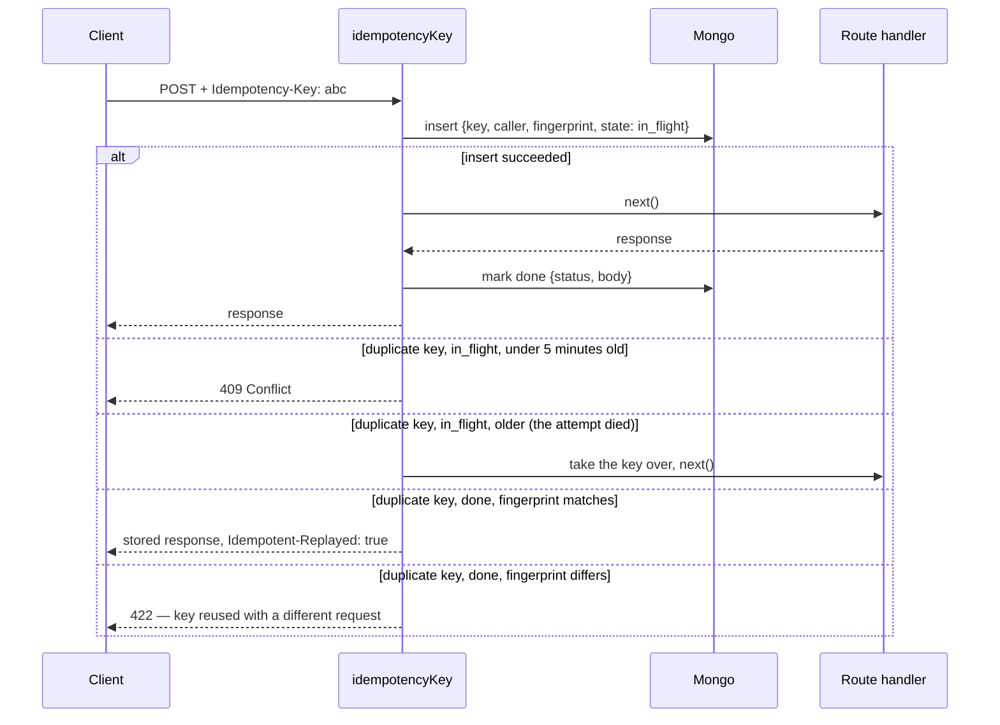

# Idempotency

## The problem it solves

HTTP clients retry. A mobile app POSTs `/orders`, the server commits, and the connection drops
before the response arrives. The client retries — correctly, by its own lights. Two orders, one
charge each. The same happens with a load balancer's retry policy, a `fetch` wrapper with
backoff, or a user double-tapping a submit button. This is the default behaviour of every
network, not an edge case.

The repo already has plenty of DOMAIN idempotency — a reservation keyed on a reservation id, a
provider callback keyed on its own reference — but none of it helps a client retrying a request
the server has never seen before, because the client's own "this is the same attempt" fact is
one only the client holds. `Idempotency-Key` is how it hands that fact to the server.

## How it works

The key is accepted in two forms, and both name the same record: the draft's quoted String
(`Idempotency-Key: "abc"`, §2.1 and RFC 9651 §3.3.3) and the bare token every Stripe-style client
sends (`Idempotency-Key: abc`). The stored key is the inner value. It is 1-200 characters of
`A-Za-z0-9_-`; anything else, an unclosed quote included, answers 422, never "ignored".

The fingerprint is the method, the **concrete** path and the canonicalised body. The path, not
the route template: two refunds of different orders share a template and an empty body, and must
not share an answer.

It is stored as a keyed digest, never a bare hash: `POST /signup` bodies carry the plaintext
password. See [Pseudonymised identifiers](./security.md#pseudonymised-identifiers).

`src/infrastructure/http/middlewares/idempotency.ts` is the middleware; the schema lives beside
it in `idempotency-model.ts`. Mounted per route — never globally, the same way
`src/infrastructure/http/middlewares/cache.ts`'s `setCache` is — and a no-op when the caller
sends no header at all: on most routes the feature is a courtesy the client opts into. Where a
repeat would move money twice (the refund) the key is required, and no header is a 400.

The lock is one atomic insert against a unique index on `(key, caller)`. Whoever's insert lands
first runs the handler; every other insert collides with `E11000`, and that collision — not a
second lookup — is what decides which of the outcomes above a retry gets. An `in_flight` record
older than five minutes belongs to an attempt that crashed; a retry takes it over with a
conditional update, so of two racing retries exactly one wins. "Caller" is the
authenticated account id, or the request's address for a public route with no account yet
(signup, the contact form) — scoping by caller is what stops one person from reading another's
cached reply merely by guessing or observing their key.

## Why Mongo, not Redis

`docker-compose.yml` runs the cache with `--maxmemory-policy allkeys-lru`: under memory
pressure Redis evicts **any** key, including one written seconds ago with hours left on its TTL.
An evicted idempotency record does not fail loudly — it silently becomes a duplicate write, at
exactly the moment the system is under load and least able to notice. An idempotency ledger is a
source of truth, so — like every other durable, TTL-bound collection in this repo
(`auditlogs`, `carts`, `tasks`) — it lives in Mongo.

## Where it is mounted

| Route                                                                                                | Why                                                                                                                                                                                       |
| ---------------------------------------------------------------------------------------------------- | ----------------------------------------------------------------------------------------------------------------------------------------------------------------------------------------- |
| `POST /orders`                                                                                       | Admin order creation; a retried request must replay the same order, not mint a second one.                                                                                                |
| `POST /cart/checkout`                                                                                | Places the order; a retry after a lost response must replay it, never place a second.                                                                                                     |
| `POST /cart/merge`                                                                                   | A retry must not add the guest's quantities twice.                                                                                                                                        |
| `POST /cart/items`, `POST /cart/reorder`                                                             | A retry after a lost answer must not grow the line twice. A deliberate second click carries a new key and adds again.                                                                     |
| `POST /payments/{id}/confirm`                                                                        | Charges the card.                                                                                                                                                                         |
| `POST /orders/{id}/payments`                                                                         | An admin recording money by hand; a repeat must not record it twice.                                                                                                                      |
| `POST /payments/{id}/refunds`                                                                        | Returns money — a double submit must refund once. The key is REQUIRED: no header, a 400.                                                                                                  |
| `POST /payments/{id}/refunds/{refundId}/cancel`                                                      | Voids a refund; the key is optional, a second cancel is refused by the record (409).                                                                                                      |
| `POST /payments/{id}/refunds/{refundId}/settle`                                                      | Books a refund the provider could not settle; a repeat must not book it twice.                                                                                                            |
| `POST /delivery/fulfillment-orders/{id}/shipments`, `POST /delivery/fulfillment-orders/{id}/fulfill` | A partial ship creates a NEW shipment, so no state machine catches a retry: it would cut a second parcel and take the stock twice. Both shipment doors take the key so they answer alike. |
| `POST /returns`, `POST /returns/{id}/receive`                                                        | A retried return request or receipt must replay, not open or receive twice.                                                                                                               |
| `POST /inventory/levels/{productId}/receive`, `POST /inventory/levels/{productId}/adjust`            | Stock never moves twice for one delivery or one correction.                                                                                                                               |
| `POST /account/signup`                                                                               | Sybil accounts aside, a retried signup must not create two.                                                                                                                               |
| `POST /examples`                                                                                     | The template's idempotent create: a retried create replays the first answer, not a second draft.                                                                                          |
| `POST /tasks`                                                                                        | The public contact form has no other identity to dedupe a retry on.                                                                                                                       |
| `POST /orders/{id}/timeline/notes`, `POST /tasks/{id}/notes`                                         | A retry after a lost answer must not write the same note twice. A task note has no delete door, so a duplicate would stay for good.                                                       |
| `POST /products`                                                                                     | A product with no SKU has no other key: a retry would put a second live product in the shop, and the opening stock would land on the copy. See the limits below.                          |
| `POST /account/addresses`                                                                            | A retry must not write a duplicate entry that burns a slot of the address cap.                                                                                                            |

### The product create is multipart

`POST /products` takes its key after `upload.image()`, because multipart fields exist only once
multer has parsed them. Three limits come with that:

- The image is not in the fingerprint (`fingerprintOf` hashes the method, the path and
  `request.body`): the same key with a different image replays the first product.
- `translations` arrive as one JSON string in a multipart body. A byte-identical retry matches; a
  client that re-serialises it gets the mismatch refusal (422).
- A replayed 201 leaves its upload behind: `releaseUnclaimedUpload` cleans only on a 4xx or 5xx. The
  orphan sweep (files older than an hour) and the quarantine reaper (24 hours) remove it. The SKU
  index stays the secondary key.

The refund uses `requireIdempotencyKey`: the IETF Idempotency-Key draft makes a missing key on a
non-idempotent write a client error, and a refund repeated by a retry returns the money twice. Its
contract parameter is `RequiredIdempotencyKeyHeader`, and the error code `IDEMPOTENCY_KEY_REQUIRED`.

## Named exceptions

Every POST or PATCH whose repeat would write again accepts an optional key
([write methods](../api/write-methods.md#retrying-a-post)). The ones that take none are listed
here, each with the reason a repeat is safe, because the IETF draft asks that an exception be
published:

| Class                                 | Why a retry is safe                                   | Examples                                                                                                                                                                                                                                                                    |
| ------------------------------------- | ----------------------------------------------------- | --------------------------------------------------------------------------------------------------------------------------------------------------------------------------------------------------------------------------------------------------------------------------- |
| a state-guarded transition            | the repeat is refused with a 409 by the state machine | `POST /orders/{id}/cancel`, `/shipments/{id}/deliver`, `/shipments/{id}/lost`, `POST /users/{id}/lift-purchase-hold`, `POST /tasks/{id}/unassign`                                                                                                                           |
| a secondary key                       | the domain refuses a duplicate (Zalando 231)          | `POST /users` (unique email)                                                                                                                                                                                                                                                |
| an answer carrying a one-time secret  | the ledger would store the secret and replay it       | `POST /payments` (`clientSecret`; asking again refreshes the same intent), `POST /api-keys`, `POST /webhooks/subscriptions`, 2FA setup and backup codes, `POST /account/refresh` (its answer is a fresh token; a retry past the rotation grace is read as theft, by design) |
| keyed on the provider's own reference | the provider's id is the key                          | `POST /payments/{id}/sync`, `POST /payments/webhook/{provider}`                                                                                                                                                                                                             |
| the receiver's own key                | the partner de-duplicates on the same `webhook-id`    | webhook replay: the same delivery row and the same `webhook-id`; a replay already in flight answers 409                                                                                                                                                                     |
| nothing is stored here                | the event is passed on as a count                     | `POST /analytics/events`: our client sends once and never retries, and a key would cost one ledger row per page view on a public route                                                                                                                                      |
| a repeat that is harmless             | running it twice leaves the same state                | password reset, email change, `DELETE /account`; a cooldown send (a mail resend) answers its second call 429                                                                                                                                                                |

`POST /payments` and `POST /payments/{id}/sync` share one per-account hourly budget instead
(`NODE_PAYMENT_INTENT_RATE_LIMIT_MAX`, 30).

## What a failure stores

Every finished attempt is stored, a server fault (5xx) included, and replayed for the
[retention](#retention) window with `Idempotent-Replayed: true`. So a retry under the same key
re-sends the failure without running the handler again; only a new key runs it.

The replay carries the stored status, body, `Content-Type` and the `Location`, `Retry-After`,
`WWW-Authenticate`, `Allow` and `ETag` headers the original answer had.

This is Stripe's v1 rule. The alternative, dropping the record on a 5xx so the same key retries
for real, is safe only when every handler is atomic. They are not: a stock receipt commits and
then a read fails with a 500, so a rerun counts the delivery twice; a partial refund refused
after the provider moved the money would pay twice. The client therefore:

- keeps its key only after a lost connection or `409 IDEMPOTENCY_IN_FLIGHT`;
- spends it on any other answer, a 5xx included, and re-reads what the call was about (the
  payment, the stock level) before offering the button again;
- scopes the key to one operation on one subject (a refund of order A never shares a key with a
  refund of order B).

Proven by `tests/integration/idempotency-server-fault.test.ts`.

## A body-less answer is captured too

The ledger records a response through `json`, and a bodiless one (`202` from `acceptedResponse`,
`204` from `noContentResponse`) through `end`. A replay of a bodiless outcome is bodiless too: the
stored status, no content type, no bytes. `POST /tasks` is the keyed route that answers this way.

An answer that ends with bytes any other way (`send`, or `write` then `end`) is not recorded: the
key stays in flight and a warning is logged, because a body-less record would replay it truncated.
A keyed route answers through `json` or with no body.

## Retention

`NODE_IDEMPOTENCY_RETENTION_HOURS` (default 24) backs a TTL index on `createdAt`, the same
pattern as every other retained collection — see
[Data retention](../reference/data.md#ttl-windows) for the caveat on changing it after the index
already exists.
