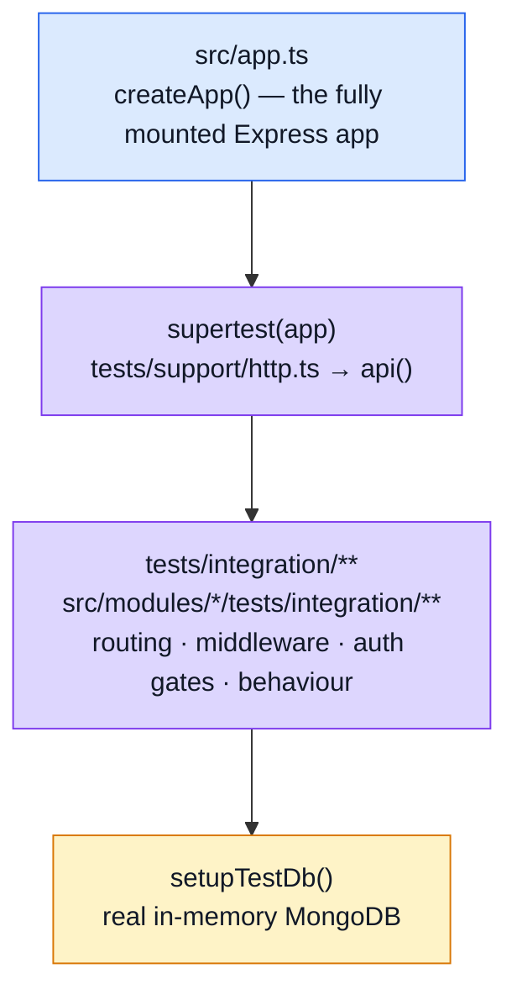

# Integration Testing

The layer that answers: **are the units actually wired together?** A service, its repository and its Mongoose model can each be individually correct (see [Unit Testing](./unit-testing.md)) while the router that's supposed to connect them to the outside world mounts the wrong middleware, or mounts nothing at all. This layer drives the real Express app, and the real database, to check the wiring and the behaviour that only shows up when the pieces meet.

::: tip These specs are what covers the service layer
A module's `service.ts` and `repository.ts` are tested mostly here, not in the unit suite.

`stryker.json` runs these specs too, so a service or repository's mutation score reflects what this
suite actually kills. The mutation score is not a pass rate — every test
in every suite must pass regardless. See
[Tests → Three numbers](../reference/tests.md#three-numbers-and-they-are-not-the-same-question).
:::

## Tools

| Tool                                            | Role                                                                                                           |
| ----------------------------------------------- | -------------------------------------------------------------------------------------------------------------- |
| [Jest](https://jestjs.io/)                      | Same runner as the unit suite, different scope — run in band, sharded per [Weak Machines](./weak-machines.md)  |
| [supertest](https://github.com/ladjs/supertest) | Drives `src/app.ts` over real HTTP semantics (headers, status codes, streaming) without binding an actual port |

## Where it sits

Same harness (`api()` from `tests/support/http.ts`) as [Contract Testing](./contract-testing.md) and [Contract-Derived Request Data](./contract-request-data.md) — the difference is what each layer asserts on the response, not how the request is sent. Integration asks "did the right middleware run" (status code, header presence); contract testing asks "does the _shape_ match `openapi.yaml`".

## Why `src/app.ts` and not a hand-assembled test app

A hand-assembled stand-in risks passing against a middleware stack the real app doesn't have. `api()` wraps the app `createApp()` builds, so it cannot drift from itself.

`createApp()` builds the app synchronously and does not listen, so importing it here starts no server and no queue consumer. The database is the test's own business: a spec that needs one calls `setupTestDb()`.

## What it covers

Everything that needs the real stack, in `tests/integration/` (the system) and `src/modules/<module>/tests/integration/` (one module). The `run-suite.ts` pattern list is the source of truth for what counts. Typical shapes:

- **Routing and gates** — `app-health.test.ts` (`GET /`, unknown route, the observability routes without auth answering `401`, not `404` or `500`), `access.test.ts`, `cors.test.ts`, `security-middleware.test.ts`
- **Money and stock across modules** — `checkout-money-reconciliation.test.ts`, `refund-webhook.test.ts`
- **Races** — `tests/integration/concurrency/`, see [Concurrency Testing](./concurrency-testing.md)
- **Persistence and the outbox** — `tests/integration/persistence/`, `tests/integration/kernel/`
- **Scenarios and scripts** — `tests/integration/scenarios/`, `tests/integration/scripts/`

The response _shape_ against `openapi.yaml` is [Contract Testing](./contract-testing.md)'s question, not this layer's.

## The other half: `src/modules/*/tests/integration/`

Not everything in this tier drives HTTP. A module's own repository or service test that needs to
prove real Mongoose behaviour — schema validation, defaults, an index — calls `setupTestDb()` and
talks to the model directly, no `supertest`, no app boot. It sits in this tier rather than in
[Unit Testing](./unit-testing.md) for the same reason: a spec that
can reach a database does not belong under `tests/unit`, full stop —
`unit-layer-stays-database-free` in `.dependency-cruiser.cjs` enforces that boundary regardless of
what any test runner happens to execute. See
[Mutation Testing → why a naming rule](./mutation-testing.md#one-ruler) for the
mutation-specific cost this boundary also happens to avoid.

## File map

| Path                                 | Contents                                                                         |
| ------------------------------------ | -------------------------------------------------------------------------------- |
| `tests/integration/**`               | System-level specs, one file per concern                                         |
| `src/modules/*/tests/integration/**` | One module's repository, service and route specs                                 |
| `tests/support/http.ts`              | `api()` — the shared `supertest(app)` wrapper, also used by both contract layers |
| `src/app.ts`                         | `createApp()` — the app under test, built without listening                      |

## Commands

| Command                    | Effect                                                                          |
| -------------------------- | ------------------------------------------------------------------------------- |
| `npm run test:integration` | `scripts/testing/run-suite.ts integration` — sharded, in band within each shard |

## Related pages

- [Testing](./testing-and-docs.md) — suite overview
- [Unit Testing](./unit-testing.md) — the layer below this one
- [Contract Testing](./contract-testing.md) — same HTTP harness, asserts shape instead of wiring
