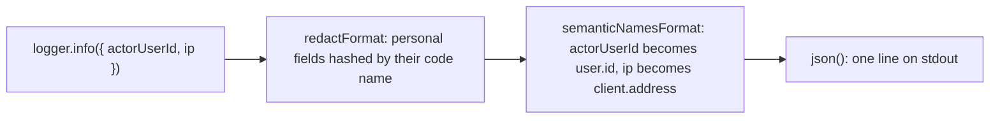

# Winston & Audit Logs

## Two log streams

| Stream        | Purpose                                                               | Format                                          |
| ------------- | --------------------------------------------------------------------- | ----------------------------------------------- |
| `logger`      | normal application logs (request access logs, errors, warnings)       | JSON in production/test, pretty + colour in dev |
| `auditLogger` | security/admin events (login attempts, role checks, token cleanup, …) | always JSON                                     |

Both write to **stdout**, which Docker captures. There is no Loki transport bundled — adding one later is a few lines in `src/infrastructure/adapters/logger.ts`.

## What an access log looks like

One slim line per request, only the fields that actually help:

```json
{
    "level": "info",
    "message": "GET /products 200 12.4ms",
    "service.name": "api",
    "app.request.id": "1b2c3d…",
    "trace_id": "4bf92f3577b34da6a3ce929d0e0e4736",
    "http.request.method": "GET",
    "http.route": "/products",
    "http.response.status_code": 200,
    "app.request.duration_ms": 12.4
}
```

The `trace_id` is the bridge to Grafana → Tempo: paste it in Explore to see the full request timeline, every DB query, every error attribute.

## What an error log looks like

One line per error, no stack trace bloat — the stack lives on the OTel span:

```json
{
    "level": "error",
    "message": "ValidationError: name is required",
    "service.name": "api",
    "app.request.id": "1b2c3d…",
    "trace_id": "4bf92f3577b34da6a3ce929d0e0e4736",
    "http.response.status_code": 422,
    "exception.type": "ValidationError",
    "exception.message": "name is required"
}
```

## Field names in the log line

Code logs camelCase fields (`actorUserId`, `statusCode`). `semanticNamesFormat`, the last step of
the transport format, renames them to [OpenTelemetry semantic-convention](https://opentelemetry.io/docs/specs/semconv/)
names, so a dashboard or alert written against the standard works here unchanged. Mongo and the API
keep the camelCase; only the log line changes.



Redaction runs first on purpose: its lists know the names code writes.

| In code                                                                                 | On the line                                                          | Convention                      |
| --------------------------------------------------------------------------------------- | -------------------------------------------------------------------- | ------------------------------- |
| `service`                                                                               | `service.name`                                                       | resource attribute              |
| `traceId`, `spanId`                                                                     | `trace_id`, `span_id`                                                | Logs Data Model (trace context) |
| `method`, `route`, `statusCode`                                                         | `http.request.method`, `http.route`, `http.response.status_code`     | HTTP semconv                    |
| `ip`, `userAgent`                                                                       | `client.address`, `user_agent.original`                              | client / user-agent semconv     |
| `actorUserId`, `actorRole`                                                              | `user.id`, `user.roles` (a one-entry list)                           | user semconv                    |
| `action`                                                                                | `event.name`                                                         | event semconv                   |
| `error` (an `Error` or a string)                                                        | `exception.type`, `.message`, `.stacktrace`, `.cause`                | exception semconv               |
| `requestId`, `clientRequestId`, `durationMs`                                            | `app.request.id`, `app.request.client_id`, `app.request.duration_ms` | custom, `app.` namespace        |
| `outcome`, `actorRoleName`, `actorCredentialId`, `actorScope`, `targetType`, `targetId` | `app.audit.outcome`, `app.actor.*`, `app.target.*`                   | custom, `app.` namespace        |

The map lives in `src/infrastructure/adapters/semantic-names.ts`. Only top-level fields are renamed:
`metadata` and a nested `error.cause` keep the call site's own shape. In LogQL, `| json` turns a dot
into an underscore: read `user.id` as `user_id`. Promtail and Alloy extract the `service` label from
`service.name`.

## Audit events

`emitAuditEvent` (in `src/infrastructure/observability/audit.ts`) is the only entry point for auditable actions. Each event has a stable `action` (`auth.login`, `admin.user.erased`, …), an `outcome` (`success` / `failure`), and a `level` derived from the outcome.

```json
{
    "level": "info",
    "log_type": "audit",
    "event.name": "auth.login",
    "user.id": "user-123",
    "user.roles": ["user"],
    "app.actor.scope": "tenant",
    "app.audit.outcome": "success",
    "client.address": "hmac:3f9a1c0b7d2e",
    "app.request.id": "…",
    "trace_id": "…"
}
```

The `action` vocabulary is a closed union, not free strings — an alert built on
`auth.login` cannot be defeated by a typo at a call site.

It is assembled rather than declared in one place. Each module owns its own actions in
`src/modules/<name>/audit.ts` as an `as const` object and augments core's `IAuditActionMap`, the
same way modules declare domain events; `infrastructure` keeps only the `security.*` actions the guards emit about requests that never
reached a domain. A module's own attack action (a forged webhook, a wrong scrape token) lives in
its `audit.ts` and registers its counter series with `registerSecurityEvents`. So the union narrows when
you delete a module, and `infrastructure` never names one. `tests/cross-cutting/audit-actions.test.ts` is
what keeps two modules from claiming the same string, or inventing one that breaks the dotted
convention log backends filter on.

### Every action

`npm run docs:audit-actions`, checked by `npm run check:docs-audit-actions`. Every action this
build can emit, its owning module, and — where a call site names one — the `targetType` it
audits. `—` means no call site attaches a target; `(varies)` means the action is fired against more
than one, from a generic helper that takes the target as a runtime parameter.

<!-- audit-actions:start -->

| Module           | Action                                       | Value                                        | Target type            |
| ---------------- | -------------------------------------------- | -------------------------------------------- | ---------------------- |
| `access`         | `ROLE_ASSIGNED`                              | `access.role.assigned`                       | —                      |
| `access`         | `ROLE_REVOKED`                               | `access.role.revoked`                        | —                      |
| `account`        | `AUTH_2FA_BACKUP_CODES_REGENERATED`          | `auth.two_factor.backup_codes_regenerated`   | —                      |
| `account`        | `AUTH_2FA_CHALLENGE_FAILED`                  | `auth.two_factor.challenge_failed`           | —                      |
| `account`        | `AUTH_2FA_CODE_SENT`                         | `auth.two_factor.code_sent`                  | —                      |
| `account`        | `AUTH_2FA_DISABLED`                          | `auth.two_factor.disabled`                   | —                      |
| `account`        | `AUTH_2FA_ENROLLED`                          | `auth.two_factor.enrolled`                   | —                      |
| `account`        | `AUTH_ACCOUNT_DELETE_COMPLETED`              | `auth.account_delete.completed`              | —                      |
| `account`        | `AUTH_ACCOUNT_DELETE_REQUESTED`              | `auth.account_delete.requested`              | —                      |
| `account`        | `AUTH_DATA_EXPORT_DOWNLOADED`                | `auth.data_export.downloaded`                | `account_export`       |
| `account`        | `AUTH_DATA_EXPORT_REQUESTED`                 | `auth.data_export.requested`                 | `account_export`       |
| `account`        | `AUTH_EMAIL_CHANGE_CANCELLED`                | `auth.email_change.cancelled`                | —                      |
| `account`        | `AUTH_EMAIL_CHANGE_COMPLETED`                | `auth.email_change.completed`                | —                      |
| `account`        | `AUTH_EMAIL_CHANGE_REQUESTED`                | `auth.email_change.requested`                | —                      |
| `account`        | `AUTH_EMAIL_CHANGE_RESENT`                   | `auth.email_change.resent`                   | —                      |
| `account`        | `AUTH_EMAIL_CHANGE_UNDONE`                   | `auth.email_change.undone`                   | —                      |
| `account`        | `AUTH_EMAIL_VERIFY_COMPLETED`                | `auth.email_verify.completed`                | —                      |
| `account`        | `AUTH_EMAIL_VERIFY_REQUESTED`                | `auth.email_verify.requested`                | —                      |
| `account`        | `AUTH_LOGGED_OUT`                            | `auth.logout`                                | —                      |
| `account`        | `AUTH_LOGGED_OUT_EVERYWHERE`                 | `auth.logout_all`                            | —                      |
| `account`        | `AUTH_LOGIN`                                 | `auth.login`                                 | `login_identifier`     |
| `account`        | `AUTH_OAUTH_FAILED`                          | `auth.oauth.failed`                          | —                      |
| `account`        | `AUTH_OAUTH_LINKED`                          | `auth.oauth.linked`                          | —                      |
| `account`        | `AUTH_OAUTH_UNLINKED`                        | `auth.oauth.unlinked`                        | —                      |
| `account`        | `AUTH_ONE_TIME_TOKEN_REJECTED`               | `auth.one_time_token.rejected`               | —                      |
| `account`        | `AUTH_PASSWORD_CHANGED`                      | `auth.password.changed`                      | —                      |
| `account`        | `AUTH_PASSWORD_RESET_COMPLETED`              | `auth.password_reset.completed`              | —                      |
| `account`        | `AUTH_PASSWORD_RESET_REQUESTED`              | `auth.password_reset.requested`              | —                      |
| `account`        | `AUTH_PROFILE_UPDATED`                       | `auth.profile.updated`                       | —                      |
| `account`        | `AUTH_REAUTH_CODE_SENT`                      | `auth.reauth.code_sent`                      | —                      |
| `account`        | `AUTH_REAUTHENTICATED`                       | `auth.reauth`                                | —                      |
| `account`        | `AUTH_REFRESH_TOKEN_REUSE_DETECTED`          | `auth.refresh_token.reuse_detected`          | —                      |
| `account`        | `AUTH_SESSION_REVOKED`                       | `auth.session.revoked`                       | —                      |
| `account`        | `AUTH_SIGNED_UP`                             | `auth.signup`                                | —                      |
| `account`        | `AUTH_TOKEN_REFRESHED`                       | `auth.token.refreshed`                       | —                      |
| `api-keys`       | `ADMIN_API_KEY_MINTED`                       | `admin.api_key.minted`                       | `api_key`              |
| `api-keys`       | `ADMIN_API_KEY_REVOKED`                      | `admin.api_key.revoked`                      | `api_key`              |
| `api-keys`       | `SYSTEM_API_KEYS_REVOKED_ON_COMPROMISE`      | `system.api_keys.revoked_on_compromise`      | `user`                 |
| `cart`           | `USER_CART_ITEM_REMOVED`                     | `user.cart.item_removed`                     | `product`              |
| `cart`           | `USER_CART_REORDERED`                        | `user.cart.reordered`                        | —                      |
| `delivery`       | `ADMIN_FULFILLMENT_ORDER_HELD`               | `admin.fulfillment_order.held`               | —                      |
| `delivery`       | `ADMIN_FULFILLMENT_ORDER_RELEASED`           | `admin.fulfillment_order.released`           | —                      |
| `delivery`       | `ADMIN_ORDER_DELIVERED`                      | `admin.order.delivered`                      | `order`                |
| `delivery`       | `ADMIN_ORDER_FULFILLED`                      | `admin.order.fulfilled`                      | `order`                |
| `delivery`       | `ADMIN_ORDER_FULFILMENT_STARTED`             | `admin.order.fulfilment_started`             | `order`                |
| `delivery`       | `ADMIN_ORDER_SHIPPED`                        | `admin.order.shipped`                        | `order`                |
| `delivery`       | `ADMIN_SHIPMENT_TRACKING_EDITED`             | `admin.shipment.tracking_edited`             | `order`                |
| `delivery`       | `BUYER_WAIT_CONFIRMED`                       | `fulfillment_order.wait_confirmed`           | `order`                |
| `example`        | `EXAMPLE_COVER_CHANGED`                      | `example.cover_changed`                      | `example`              |
| `example`        | `EXAMPLE_CREATED`                            | `example.created`                            | `example`              |
| `example`        | `EXAMPLE_DELETED`                            | `example.deleted`                            | `example`              |
| `example`        | `EXAMPLE_UPDATED`                            | `example.updated`                            | `example`              |
| `feedback`       | `ADMIN_FEEDBACK_DELETED`                     | `admin.feedback.deleted`                     | `feedback`             |
| `feedback`       | `ADMIN_FEEDBACK_STATUS_UPDATED`              | `admin.feedback.status_updated`              | `feedback`             |
| `feedback`       | `ADMIN_FEEDBACK_VIEWED`                      | `admin.feedback.viewed`                      | —                      |
| `infrastructure` | `SECURITY_API_KEY_REVOKED`                   | `security.api_key.revoked`                   | —                      |
| `infrastructure` | `SECURITY_FORBIDDEN`                         | `security.forbidden`                         | `user`                 |
| `infrastructure` | `SECURITY_RATE_LIMIT_HIT`                    | `security.rate_limit_hit`                    | —                      |
| `infrastructure` | `SECURITY_REAUTH_REQUIRED`                   | `security.reauth_required`                   | —                      |
| `infrastructure` | `SECURITY_TOKEN_INVALID_SIGNATURE`           | `security.token.invalid_signature`           | —                      |
| `infrastructure` | `SECURITY_TOKEN_MALFORMED`                   | `security.token.malformed`                   | —                      |
| `infrastructure` | `SECURITY_UNAUTHORIZED`                      | `security.unauthorized`                      | —                      |
| `inventory`      | `ADMIN_COMMIT_ORPHANED`                      | `admin.commit.orphaned`                      | `order`                |
| `inventory`      | `ADMIN_PREORDER_LIMIT_SET`                   | `admin.preorder.limit.set`                   | `product`              |
| `inventory`      | `ADMIN_RESERVATIONS_SWEPT`                   | `admin.reservations.swept`                   | `reservation`          |
| `inventory`      | `ADMIN_STOCK_ADJUSTED`                       | `admin.stock.adjusted`                       | —                      |
| `inventory`      | `ADMIN_STOCK_RECEIVED`                       | `admin.stock.received`                       | —                      |
| `invoicing`      | `ADMIN_CREDIT_NOTE_VIEWED`                   | `admin.credit_note.viewed`                   | `credit_note`          |
| `invoicing`      | `ADMIN_INVOICE_VIEWED`                       | `admin.invoice.viewed`                       | `invoice`              |
| `locales`        | `ADMIN_LOCALE_CREATED`                       | `admin.locale.created`                       | `locale`               |
| `locales`        | `ADMIN_LOCALE_DELETED`                       | `admin.locale.deleted`                       | `locale`               |
| `locales`        | `ADMIN_LOCALE_ENTRY_CREATED`                 | `admin.locale_entry.created`                 | `locale_entry`         |
| `locales`        | `ADMIN_LOCALE_ENTRY_DELETED`                 | `admin.locale_entry.deleted`                 | `locale_entry`         |
| `locales`        | `ADMIN_LOCALE_ENTRY_IMPORTED`                | `admin.locale_entry.imported`                | `locale`               |
| `locales`        | `ADMIN_LOCALE_ENTRY_UPDATED`                 | `admin.locale_entry.updated`                 | `locale_entry`         |
| `locales`        | `ADMIN_LOCALE_UPDATED`                       | `admin.locale.updated`                       | `locale`               |
| `locales`        | `ADMIN_TRANSLATION_UPDATED`                  | `admin.translation.updated`                  | —                      |
| `observability`  | `SECURITY_METRICS_TOKEN_INVALID`             | `security.metrics_token.invalid`             | —                      |
| `orders`         | `ADMIN_ORDER_VIEWED`                         | `admin.order.viewed`                         | `order`                |
| `orders`         | `ADMIN_ORDERS_EXPORTED`                      | `admin.orders.exported`                      | `order`                |
| `orders`         | `ORDER_CANCELLED`                            | `order.cancelled`                            | `order`                |
| `orders`         | `ORDER_CREATED`                              | `order.created`                              | `order`                |
| `orders`         | `ORDER_DELETED`                              | `order.deleted`                              | `order`                |
| `orders`         | `ORDER_RESTORED`                             | `order.restored`                             | `order`                |
| `orders`         | `ORDER_STATUS_OVERRIDDEN`                    | `order.status_overridden`                    | `order`                |
| `orders`         | `ORDER_UPDATED`                              | `order.updated`                              | `order`                |
| `payments`       | `ADMIN_ORDER_LOOKED_UP`                      | `admin.order.looked_up`                      | `order`                |
| `payments`       | `ADMIN_PAYMENT_REFUNDED`                     | `admin.payment.refunded`                     | `order`                |
| `payments`       | `PAYMENT_AMOUNT_MISMATCH`                    | `payment.amount_mismatch`                    | `payment`              |
| `payments`       | `PAYMENT_CONFIRMED`                          | `payment.confirmed`                          | —                      |
| `payments`       | `PAYMENT_FAILED`                             | `payment.failed`                             | —                      |
| `payments`       | `PAYMENT_RECORDED_OFFLINE`                   | `payment.recorded_offline`                   | `order`                |
| `payments`       | `PAYMENT_REFUND_OWED_BY_HAND`                | `payment.refund_owed_by_hand`                | `order`                |
| `payments`       | `SECURITY_PAYMENT_WEBHOOK_INVALID_SIGNATURE` | `security.payment_webhook.invalid_signature` | —                      |
| `products`       | `ADMIN_PRODUCT_CREATED`                      | `admin.product.created`                      | `product`              |
| `products`       | `ADMIN_PRODUCT_DELETED`                      | `admin.product.deleted`                      | `product`              |
| `products`       | `ADMIN_PRODUCT_RESTORED`                     | `admin.product.restored`                     | `product`              |
| `products`       | `ADMIN_PRODUCT_UPDATED`                      | `admin.product.updated`                      | `product`              |
| `returns`        | `ADMIN_RETURN_APPROVED`                      | `admin.return.approved`                      | `return`               |
| `returns`        | `ADMIN_RETURN_DECLINED`                      | `admin.return.declined`                      | `return`               |
| `returns`        | `ADMIN_RETURN_RECEIVED`                      | `admin.return.received`                      | `return`               |
| `returns`        | `ADMIN_RETURN_VIEWED`                        | `admin.return.viewed`                        | `return`               |
| `returns`        | `RETURN_REQUESTED`                           | `return.requested`                           | `return`               |
| `users`          | `ADMIN_USER_BANNED`                          | `admin.user.banned`                          | —                      |
| `users`          | `ADMIN_USER_CREATED`                         | `admin.user.created`                         | `user`                 |
| `users`          | `ADMIN_USER_ERASED`                          | `admin.user.erased`                          | `user`                 |
| `users`          | `ADMIN_USER_RESTORED`                        | `admin.user.restored`                        | `user`                 |
| `users`          | `ADMIN_USER_SOFT_DELETED`                    | `admin.user.soft_deleted`                    | `user`                 |
| `users`          | `ADMIN_USER_UNBANNED`                        | `admin.user.unbanned`                        | —                      |
| `users`          | `ADMIN_USER_UPDATED`                         | `admin.user.updated`                         | —                      |
| `users`          | `ADMIN_USER_VIEWED`                          | `admin.user.viewed`                          | `user`                 |
| `users`          | `SYSTEM_USER_ERASED`                         | `system.user.erased`                         | `user`                 |
| `users`          | `SYSTEM_USER_SOFT_DELETED`                   | `system.user.soft_deleted`                   | `user`                 |
| `webhooks`       | `ADMIN_WEBHOOK_DELIVERY_REPLAYED`            | `admin.webhook_delivery.replayed`            | `webhook_delivery`     |
| `webhooks`       | `ADMIN_WEBHOOK_SUBSCRIPTION_CREATED`         | `admin.webhook_subscription.created`         | `webhook_subscription` |
| `webhooks`       | `ADMIN_WEBHOOK_SUBSCRIPTION_DELETED`         | `admin.webhook_subscription.deleted`         | `webhook_subscription` |
| `webhooks`       | `ADMIN_WEBHOOK_SUBSCRIPTION_SECRET_REMOVED`  | `admin.webhook_subscription.secret_removed`  | `webhook_subscription` |
| `webhooks`       | `ADMIN_WEBHOOK_SUBSCRIPTION_SECRET_ROTATED`  | `admin.webhook_subscription.secret_rotated`  | `webhook_subscription` |
| `webhooks`       | `ADMIN_WEBHOOK_SUBSCRIPTION_UPDATED`         | `admin.webhook_subscription.updated`         | `webhook_subscription` |
| `webhooks`       | `SYSTEM_WEBHOOK_SUBSCRIPTION_AUTO_DISABLED`  | `system.webhook_subscription.auto_disabled`  | `webhook_subscription` |

<!-- audit-actions:end -->

### Where an audit entry ends up

Two destinations, from the single `emitAuditEvent` call:

| Destination            | Role                                                                                            | Fails how                                                     |
| ---------------------- | ----------------------------------------------------------------------------------------------- | ------------------------------------------------------------- |
| `auditLogger` → stdout | the compliance record — append-only, shipped to [Loki](./loki.md)                               | a broken logger is a real problem                             |
| Mongo `auditlogs`      | the queryable copy behind `GET /observability/audit` and the `audit-logs` module's `GET /audit` | silently, into a warning — never fails the triggering request |

The Mongo write goes through an `AuditSink` port that the `audit-logs` module registers
(`registerAuditSink`) when it boots. `src/infrastructure/**` may not import `@modules/*`, so the dependency is inverted rather
than smuggled — and the call sites that reach `recordAudit` know about neither destination.

### Retention

| Env var                     | Effect                                                                                                      |
| --------------------------- | ----------------------------------------------------------------------------------------------------------- |
| `NODE_AUDIT_RETENTION_DAYS` | how long the Mongo copy survives before its TTL index removes it (def. 90, read by the `audit-logs` module) |

Only the queryable copy expires — log retention is [Loki](./loki.md)'s business.

::: warning Changing the retention window
Mongo will not alter an existing TTL index's `expireAfterSeconds` in place. After changing
`NODE_AUDIT_RETENTION_DAYS`, a restart **fails the boot** — `autoIndex` asks for the new window and
Mongo refuses the conflicting options. `npm run db:sync` drops the index and rebuilds it, which is
why `db:bootstrap` syncs before the server starts.
:::

## Configuration

| Env var                    | Effect                                                                                                                                                                                                     |
| -------------------------- | ---------------------------------------------------------------------------------------------------------------------------------------------------------------------------------------------------------- |
| `NODE_LOG_LEVEL`           | logger level (`error`, `warn`, `info`, `debug`, …). Defaults to `info` in production, `debug` elsewhere.                                                                                                   |
| `NODE_SERVICE_NAME`        | tag on every log entry. Useful when several services ship logs to the same aggregator.                                                                                                                     |
| `NODE_LOG_PERSONAL_FIELDS` | `hash` (default), `redact`, or `plain` — see [Personal data](#personal-data) below.                                                                                                                        |
| `NODE_PSEUDONYM_KEY`       | Root secret for `hash` mode (and every other [pseudonymised identifier](./security.md#pseudonymised-identifiers)). Required: unset, every digest throws (the dev preload and the test setup each set one). |

## Redaction

`redactSensitiveFields` replaces values of well-known sensitive keys (`password`, `token`, `cookie`, `authorization`, …) with `[REDACTED]` before logging. It runs on every log entry and on every audit event.

## Personal data

A second, separate list — `PERSONAL_FIELDS` (`email`, `to`, `ip`, `phone`, `street`, `zip`, `fullname`) — covers fields that are personal data without being credentials. Data minimisation applies to logs the same as it applies to collections, and these flow into Winston, and from there into [Loki](./loki.md), same as everything else.

Kept apart from `SENSITIVE_FIELDS` on purpose: a credential is always replaced outright, never kept in any form. A personal field defaults to **hashed** instead (`NODE_LOG_PERSONAL_FIELDS=hash`, HMAC-SHA256 under the `log` subkey of `NODE_PSEUDONYM_KEY`, truncated to 12 hex characters, `hmac:`-prefixed — not `sha256:`, since the algorithm name alone can't tell a reader the digest is keyed) — the same input always produces the same digest, so a trace stays followable ("did this user's requests all fail the same way") without the log line being readable on its own. The hash is keyed rather than bare: an unkeyed `sha256(email)` or `sha256(ip)` is brute-forced from a breach list or the whole IPv4 space in seconds, which is GDPR pseudonymisation in name only. `redact` drops it entirely, like a credential; `plain` leaves it untouched, for local development where the log never leaves the machine.

The private setting (`hash`) is the default deliberately: a boilerplate's default config is the one most deployments never revisit.

**Rotating `NODE_PSEUDONYM_KEY` breaks correlation across the change.** The same user's digest before and after a rotation is two different values — by design, since the whole point of keying the hash is that nobody without the key can link one either. Rotate it only alongside a reason to, and expect an operator tracing an incident spanning the rotation to see it as two different "users".

## Works with

- **[OpenTelemetry](./opentelemetry.md)** — the OTel SDK automatically injects the active `trace_id` into Winston's logging context on every request. You write nothing; every log line just has it. → full explanation: [How logs and traces correlate](./opentelemetry.md#how-logs-and-traces-correlate)
- **[Loki](./loki.md)** — Winston writes JSON to stdout; Promtail tails those lines and ships them to Loki. The `trace_id` on each line is what enables jumping from a log entry straight to a Tempo trace. → [Trace ↔ log correlation](./loki.md#trace-log-correlation)

## External references

- [OWASP Logging Cheat Sheet](https://cheatsheetseries.owasp.org/cheatsheets/Logging_Cheat_Sheet.html) — guidance for what audit/security logs should capture
- [winston-loki transport](https://github.com/JaniAnttonen/winston-loki) — drop-in if you want to push logs directly to [Loki](./loki.md) instead of via Promtail

## Related pages

- [Events & Logging](./events-and-logging.md) — how these two streams relate to analytics, metrics and queue jobs
- [OpenTelemetry](./opentelemetry.md)
- [Tempo](./tempo.md)
- [Grafana](./grafana.md)
