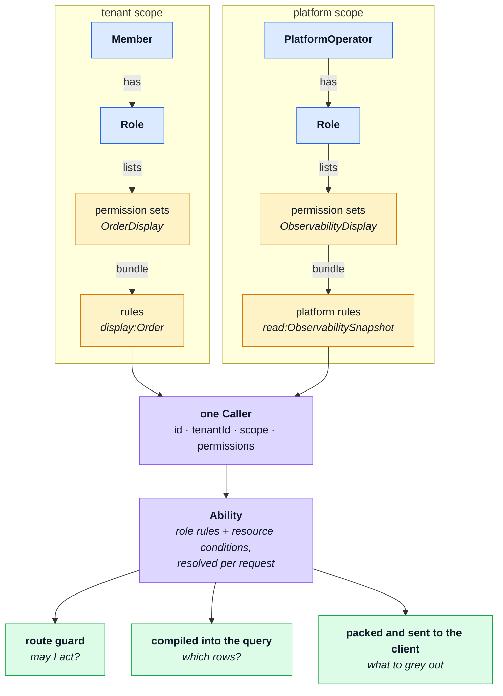

# Authorization: the model

The permission model in full.

## The model

**RBAC scoped by tenant, with conditions on the resource.** The role decides whether you may act,
the conditions its rules carry decide which rows, and those conditions compile into the query so the
rule above survives. One boolean cannot do that job: two callers can be administrators of
_different_ things, and `admin: true` cannot say which.

Read it as one sentence: **a role is a list of permission sets, a caller is one scope's worth of rules, and
the ability those rules produce is used in three places that can never disagree — because there is
only one of it.**

The third arrow is the one people miss. The frontend gets the _same_ rules the server enforces, so
"what to grey out" stops being a hand-maintained duplicate that drifts. It still has no authority:
it decides what to render, never what is allowed, and every request is re-evaluated server-side.

### Rule, permission set, role

This is the CanCan model as [Solidus](https://github.com/solidusio/solidus) uses it, three layers
and no more:

| Layer              | What it is                                                         | Example                            | Declared in                              |
| ------------------ | ------------------------------------------------------------------ | ---------------------------------- | ---------------------------------------- |
| **Rule**           | one `action` on one `subject`, optionally narrowed by conditions   | `display:Order`, `create:Refund`   | the owning module's `authorization.yaml` |
| **Permission set** | a named bundle of rules, per module                                | `OrderDisplay`, `PaymentRefunding` | the same file, beside its rules          |
| **Role**           | a list of sets, nothing else: no level, no rank, no inherited bits | `support`, `moderator`             | `shared/rules/authorization-roles.yaml`  |

A rule's id is `<action>:<subject>` and no two rules share one. A guard asks for an action on a
subject, `requirePermission('display', 'Order')`; it never names a set or a role, and a route
never names a rule by a string made up for it.

**There is no `self` or `any` in a name.** "My own rows" is a **condition** on a rule
(`userId: $caller.id`), as in Solidus' `DefaultCustomer`. What tells a staff door from a customer's
own-rows rule is the **action**, and that is why the vocabulary has two staff actions:

| Plain action (the caller's own rows, or the public ones) | Staff action (every row) | Implies            |
| -------------------------------------------------------- | ------------------------ | ------------------ |
| `read:Order`, `read:Payment`, `read:Product`             | `display`                | `read`             |
| `update:Example`, `delete:Example`                       | `admin`                  | `update`, `delete` |

Every signed-in account holds `read:Order`, so a guard that accepted it for the staff list would
let every customer in. The staff door asks `display:Order`, which no customer holds. A holder of
`display:Order` also passes a plain `read` check, because the ability emits the implied rule beside
it (`implies:` in `shared/authorization-keys.generated.yaml`): one query serves a customer's own rows and a
staff member's every row. A subject with no own-rows rule keeps plain `read`, so `read:Task` is
the staff door of the inbox.

**There is no wildcard of any kind.** No `manage`, no `all`. `admin` lists every declared tenant
set **by name** (bar the ones every signed-in account already gets from its
[audience](./authorization.md#everyone-is-a-customer-first)), spelled out in `shared/rules/authorization-roles.yaml` like
every other role, so a set a new module needs is a line added to that file. The conformance suite
refuses a declared rule the list omits. See the file's own header note for why.

**A subject needs a concrete rule for every action a route asks about.** Every action a route can
gate on is its own declared rule, so a read-only role can never satisfy a guard meant for a minter.
`holds` (`kernel/ability.ts`) asks for the literal rule, or the staff action that implies it.
`heldRules` enumerates what a caller holds.

**A rule is tenant or platform, by its declared `scope`.** That is the whole safety property:

> A tenant rule can never be satisfied by a platform-scope caller, and a platform rule can never be
> satisfied by a tenant-scope caller.

A platform operator administers shared reference data and is **not** a super-member — they cannot
read one tenant's content. Mapping that person onto a single `admin` flag is one line to write, passes
every test that exists today, and is a total confidentiality failure. The `scope` field makes it
unrepresentable rather than discouraged.

Three supporting rules: ids are stored in credentials, so an action and a subject are **stable**
(renaming one is a migration); a **module declares its own rules and sets**, so deleting a module
deletes them; and **roles are data, permissions are code** — a role's sets live in
`shared/rules/authorization-roles.yaml` alone, the one definition every deployment and the PHP twin share,
and a deployment may never invent a rule, because a rule nothing checks grants nothing while looking
like it grants something. A role's ASSIGNMENT — who holds it, where — is the one thing the database
stores; see [Where it lives](./authorization.md#where-it-lives).

## Read next

- [authorization](./authorization.md): the hub this page belongs to.
