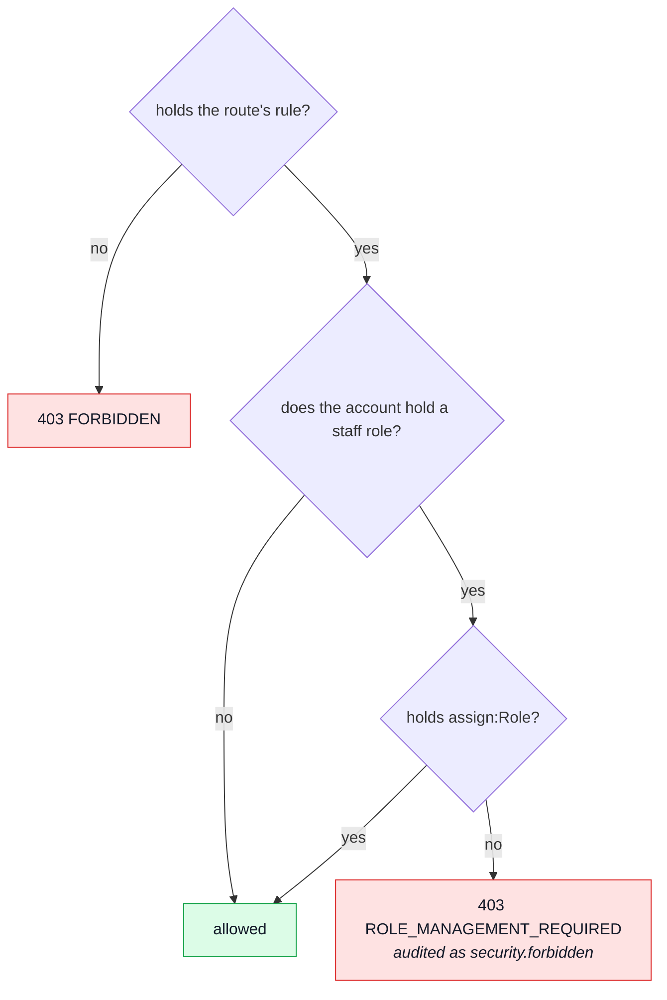

# Authorization: protecting people

Rules that stop one person acting on another.

## Protecting people

A rule says _what kind_ of thing you may touch. It does not say _whose_. Without a second rule, a
support agent who holds `update:User` may edit the administrator's account, which is a
privilege escalation with extra steps. So one permission, `assign:Role`, protects people:

> **R1.** An account that holds a staff role may be changed — edited, banned, erased, restored, or
> have its role taken away — only by a holder of `assign:Role`. Otherwise the answer is
> `403 ROLE_MANAGEMENT_REQUIRED`. The same permission is the only way to hand a staff role out.

Of the preset roles only `admin` (and `system`, its alias) holds it. Staff without it change
customers only: a moderator who may erase accounts erases customers, never the administrator.

Five details carry the rule:

- **Your own account is not exempt.** A staff member without `assign:Role` changes their own
  profile at `/account`, not at `/users/{id}`. An API key shares its minter's id, so a key acting
  on the account that minted it is refused the same way.
- **A role is only a list of sets.** There is no `level`, no rank between staff roles, and no
  "outranks": what a role can do is exactly the rules its sets bundle.
- **An API key never manages staff.** `assign:Role` is `credential: false`, so no key can be minted
  with it and none can change a staff account, whoever minted it (Stripe and Shopify keep team
  management out of API keys the same way). The role door is mounted behind `isAuth` rather than
  `isAuthOrCredential`, so a key reaching it is refused `401` before any permission is asked.
- **Changing who holds powers asks for a fresh session.** The role door (`POST /users/{id}/assign-role`
  and `/revoke-role`) is gated by its key: `assign:Role` carries `stepUp: critical`, the tier minting
  an API key asks, and `deniedCode: ROLE_MANAGEMENT_REQUIRED`. `POST /users` that names a role (or
  creates the account deactivated) and `POST /users/{id}/activate` / `deactivate`, while the caller
  holds `assign:Role`, are gated by `requireFreshAuthWhen` at the same tier. A stolen session cannot
  quietly make a second administrator, activate an old one, or lock every other administrator out.
  A write that names no role is never prompted, and neither is a moderator deactivating a customer.
  `system` is never handed out at all.
- **An administrator may change another administrator**, and may hand out or take away any role,
  their own included. Locking the shop out of its last administrator is a technician's edit of the
  database to repair, by decision.

**Where it is applied.** `mayChangeAccount` (the pure rule), `canChangeAccount` and `roleProtectedRefusal` in
`@modules/access` answer it; `users` asks before it edits, erases or restores an account, and `assignRole` refuses a grant
from a caller without the rule. The read side tells a client the same thing: the `actions` block on
a user already has the protection applied, so a screen renders only what would be accepted.

Orders, payments, returns and parcels have **no rank at all**: holding the permission is enough, on
a customer's order, a staff member's or one's own. Revoking someone else's API key is not protected
either: it only takes access away, so any administrator may revoke a fellow administrator's leaked
key (Stripe and GitHub work the same way).

**Credentials belong to their owner.** A password, a second factor and a sign-in email are never
written by anyone else, whatever their rules: `POST /users` takes no password and always
mails a setup link, and there is no admin reset of a second factor. Switching an account off is
its own rule (`ban:User`), because a role that edits a customer's phone should not by that
alone lock them out.

## Read next

- [authorization](./authorization.md): the hub this page belongs to.
