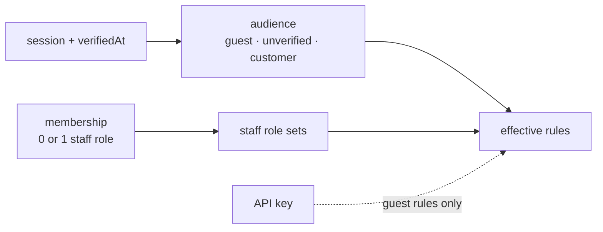

# Authorization

**Who may act, how strongly they proved it, and which rows they see.** Three separate questions,
answered by three separate things — and confusing them is how a system ends up with forty roles.

[Web attack defences](../understand/defences/index.md) covers keeping the wrong person out.
This page is about what the right person is allowed to do once they are in.

## The three axes

| Axis                            | Answers                             | Where it lives                                                         |
| ------------------------------- | ----------------------------------- | ---------------------------------------------------------------------- |
| **Who they are**                | may this caller act at all?         | the rules their role's sets hold — `holds`, behind `requirePermission` |
| **How strongly they proved it** | did they prove it _recently_?       | `amr` on the token + the freshness guards                              |
| **Which rows**                  | of the things they may read, which? | `kernel/access/query.ts` — the same rules, compiled into the filter    |

The middle axis is the one most applications never build. This one has it: the `amr` claim
(RFC 8176) and a `stepUp` tier let a high-risk action demand a recently proved session rather than
merely a valid one. The tier is declared on the RULE, so a new route guarding that rule inherits it
instead of having to remember it.

## The rule that everything else is arranged around

> The restriction has to ride **IN** the read.

Fetching a row and _then_ checking its owner is how a scoped find turns into a leak. It opens a
window between the check and whatever uses the document, and it lets _"not yours"_ and _"does not
exist"_ answer differently — which is a disclosure on its own, because a 403 confirms the row is
there.

So `accessibleFilter` returns a **query fragment**, not a verdict, and every scoped read spreads it
into its own find. That property is what picks the library: `@casl/ability` rules compile straight
into a Mongo query, and anything that answers yes/no about a document already in memory is a
downgrade.

The fail-closed detail is worth ten seconds. Rules that match nothing compile to CASL's
`EMPTY_RESULT_QUERY` — a filter matching no row — never to an absent filter, which every caller
downstream would read as "unrestricted". **A gap here returns an empty list, never somebody else's
data.**

## The model

**RBAC scoped by tenant, with conditions on the resource.** The role decides whether you may act,
the conditions its rules carry decide which rows, and those conditions compile into the query so the
rule above survives. One boolean cannot do that job: two callers can be administrators of
_different_ things, and `admin: true` cannot say which.

### Rule, permission set, role

This is the CanCan model as [Solidus](https://github.com/solidusio/solidus) uses it, three layers
and no more.

Full detail: [The model](./authorization-model.md).

## Everyone is a customer first

**Every signed-in account is a customer, staff included.** A request's _audience_ is computed, never
stored or granted, and unioned with the one staff role the account may hold:

| Audience     | When                                       | Holds                                              |
| ------------ | ------------------------------------------ | -------------------------------------------------- |
| `guest`      | no session                                 | the storefront: published products, the dictionary |
| `unverified` | a session, the account has no `verifiedAt` | the above, plus its own orders, payments, basket   |
| `customer`   | a session, the account has `verifiedAt`    | the above, plus `checkout:Cart`                    |

So a staff role lists only the staff sets it adds, and the audience roles in
`shared/rules/authorization-roles.yaml` hold every own-rows rule of the shop. A rule an account holds
twice would say one thing in two places, so `tests/unit/kernel/permissions.test.ts` refuses a staff
role that lists an audience rule. Verifying an address is one write (`verifiedAt`), with nothing to
promote; an operator who types an address in sets it the same way.

**The staff role is the one part that can be switched off.** It contributes nothing while the
account has no authenticator app armed, so an account that holds `admin` and no app is a customer
that can enrol. See
[Staff need an authenticator app](../modules/account-two-factor.md#staff-need-an-authenticator-app).

Using a basket needs no rule: every signed-in account shops, staff included, so the cart routes,
a reorder and a wishlist's move into the cart ask only for a signed-in session. Placing an order
and the card steps ask `checkout:Cart`, which answers an unproven address with `EMAIL_NOT_VERIFIED` ("confirm your email") instead of a bare
permissions error. An order's `actions.pay` is offered only to a caller who holds the checkout rule.

## Protecting people

A rule says _what kind_ of thing you may touch. It does not say _whose_. Without a second rule, a
support agent who holds `update:User` may edit the administrator's account, which is a
privilege escalation with extra steps. So one permission, `assign:Role`, protects people.

Full detail: [Protecting people](./authorization-people.md).

## Your own money

There is no rule against handling one's own order. A staff member is a customer too, so the
permission they hold is trusted wherever they act: recording a payment by hand, refunding it,
approving and receiving a return, or cancelling the remainder of an order all work on one's own
order exactly as on anyone's.

What the system adds is a record, not a refusal. The audit rows of the steps that move money out or
in — `payment.recorded_offline`, `admin.payment.refund_requested` and `admin.payment.refunded`
(which also cover a return's refund and a remainder cancel), `order.canceled`, and a return's
approval and receipt — carry `ownOrder: true` when the caller is the buyer (`ownOrderFlag` in
`@modules/access`). The request row is written when a refund's record opens, before the provider is
asked: a provider that refuses leaves the record to the sweep, which has no caller, so without that
row an own-order refund finished later would carry no evidence at all.

Why trust and record rather than refuse: no shop platform ships a self-refund rule (Shopify, Stripe
and Saleor leave it to the merchant, as do Solidus and WooCommerce), and a refusal for a one-person
shop blocks its owner. Two things the record does **not** do, so they are not oversold:

- **The card is not the control.** A refund goes back to the card that paid, which stops a stolen
  session diverting money elsewhere. It does not stop self-dealing: on one's own order the paying
  card is one's own. The basis is a trusted role plus a record.
- **The flag catches the careless case**, not a second account or collusion. It is a review aid.

The most exposed step is the hand-recorded payment (`payment.recorded_offline`): a trusted operator
can record cash that never arrived and the goods ship. The control for that is **bank
reconciliation**, not the flag: the invoice and `GET /payments?method=` list what was
recorded (filter by `method`: `bank_transfer`, `cash`, `other`), to be matched against the bank statement. A refund started in the provider's own
dashboard is outside the app and invisible to it.

There is no refund cap: this app has no unreferenced refunds — every one is tied to a payment's
`providerRef` and can never exceed what is left of it, the property whose absence makes a limit
worth having ([Adyen](https://docs.adyen.com/point-of-sale/basic-tapi-integration/refund-payment/unreferenced)
offers one only for unreferenced refunds; [Stripe](https://docs.stripe.com/refunds) never refunds
above the charge, to the same method). Auditing is what NIST SP 800-53 AC-5 lists as an example of a
compensating control where separation of duties is wanted. A shop that wants it edits
`authorization-roles.yaml` (for example, take `PaymentRecording` from the moderator).

## Who can do what, per module

Each module's page carries a **Who can do what** table, generated from the model and not written by
hand: one row per rule the module declares, the set that bundles it, and a column per role as the
evaluator answers it (`own` where a condition pins the rule to the caller's own rows, `⚡` where a
freshly proved session is demanded, and whether an API key can be minted with it).
`npm run regenerate` rewrites them; `npm run check` fails the build on drift.

| Module                                             | Module                                               | Module                                                              |
| -------------------------------------------------- | ---------------------------------------------------- | ------------------------------------------------------------------- |
| [products](../modules/products.md#who-can-do-what) | [cart](../modules/cart.md#who-can-do-what)           | [orders](../modules/orders.md#who-can-do-what)                      |
| [payments](../modules/payments.md#who-can-do-what) | [inventory](../modules/inventory.md#who-can-do-what) | [delivery](../modules/delivery.md#who-can-do-what)                  |
| [returns](../modules/returns.md#who-can-do-what)   | [tasks](../modules/tasks.md#who-can-do-what)         | [locales](../modules/locales.md#who-can-do-what) (and translations) |
| [users](../modules/users.md#who-can-do-what)       | [access](../modules/access.md#who-can-do-what)       | [audit-logs](../modules/audit-logs.md#who-can-do-what)              |
| [webhooks](../modules/webhooks.md#who-can-do-what) | [api-keys](../modules/api-keys.md#who-can-do-what)   | [observability](../modules/observability.md#who-can-do-what)        |
| [stats](../modules/stats.md#who-can-do-what)       | [the role matrix](../use-the-shop/start.md)          |                                                                     |

## Where it lives

The model is stored, evaluated, compiled into every scoped read, published to the client and
enforced per rule.

- **`shared/authorization-keys.generated.yaml`** — every rule and permission set, with each rule's subject, scope, conditions and step-up
  tier, and the `implies:` map of the staff actions. **`shared/rules/authorization-roles.yaml`** — the presets both seeders read.
  **`shared/cases/authorization.cases.yaml`** — dozens of cases, most of them denials, run by both backends. All three byte-identical in the PHP twin.
- **`kernel/permissions.ts`** turns an account's audience and its two role names into the rules for
  ONE scope, expanding sets; **`kernel/ability.ts`** builds the CASL ability and answers `holds`.
- **`@modules/access`** stores the ASSIGNMENT half — tenants and memberships, never a role's own
  permissions — with the invariants as refusals: only a holder of `assign:Role` hands out a
  role, and `customer`, `unverified` and `guest` are never granted because they are computed.
  Removing a shop's last administrator is allowed. It also answers the protection of staff
  accounts (`canChangeAccount`). Routeless — `account`, `api-keys`, `users` and the modules that
  write on a buyer's behalf are its consumers.
- **`kernel/access/query.ts`** compiles the rules into the Mongo filter every scoped read spreads,
  so a rule that grants more returns more without anybody editing a fragment.
- **`abilities` on `GET /account`** (and on the sign-in and refresh answers) publishes the packed rules; the frontend evaluates _those_, not a
  copy of them.
- Route guards take an action and a subject. `delete:User` and `create:Refund` carry `stepUp: critical`, and the
  guard demands the fresh session and audits that it did.

**Where the boilerplate stops short, on purpose.** It ships one shop, so most collections carry no
`tenantId` column and `accessibleFilter` drops that condition — the model is tenant-aware and its
conformance cases prove it, while these tables are not partitioned. See
[Tenancy](./tenancy.md) for why, and what a pooled deployment would actually have to change.

## The twins

The PHP backend answers all of this **identically** — same roles, same scopes, same rule shape,
same wire format — with different tools, because the idiomatic library on each side is different
and forcing one abstraction over both makes both worse.

| Same in both, on purpose                                                                                            | Allowed to differ                              |
| ------------------------------------------------------------------------------------------------------------------- | ---------------------------------------------- |
| The vocabulary: `action`, `subject`, `conditions`, `fields`, `Caller` (no `manage`, no `all`: there is no wildcard) | The library doing the evaluating               |
| The permission rules and sets, and the preset roles seeded on day one                                               | How rules become a query                       |
| The scope model: `tenant` \| `platform`, never both, never derived from a flag                                      | `guard_name`, which only the PHP package needs |
| The wire format of `abilities`                                                                                      | Everything else about the implementation       |
| The conformance suite — one fixture file, identical bytes, run by both                                              | —                                              |

Here that is `@casl/ability`, whose rules compile straight into a Mongo query and can be shipped to
the browser as the same rules. There it is `spatie/laravel-permission` for the storage half only —
which roles exist and who holds them, in which shop — with the evaluation and the query fragment
hand-written over it, because a package that answers "does this name appear" cannot answer "in this
scope, on rows matching these conditions".

The suite is what keeps them honest, and it holds the **deny** cases rather than the happy path: a
widened scope does not fail a test that only checks the right thing is allowed.

## Read next

- [Authorization: the model](./authorization-model.md): the permission model in full.
- [Two ways to stay signed in](./sessions.md)
- [Security](./security.md)
