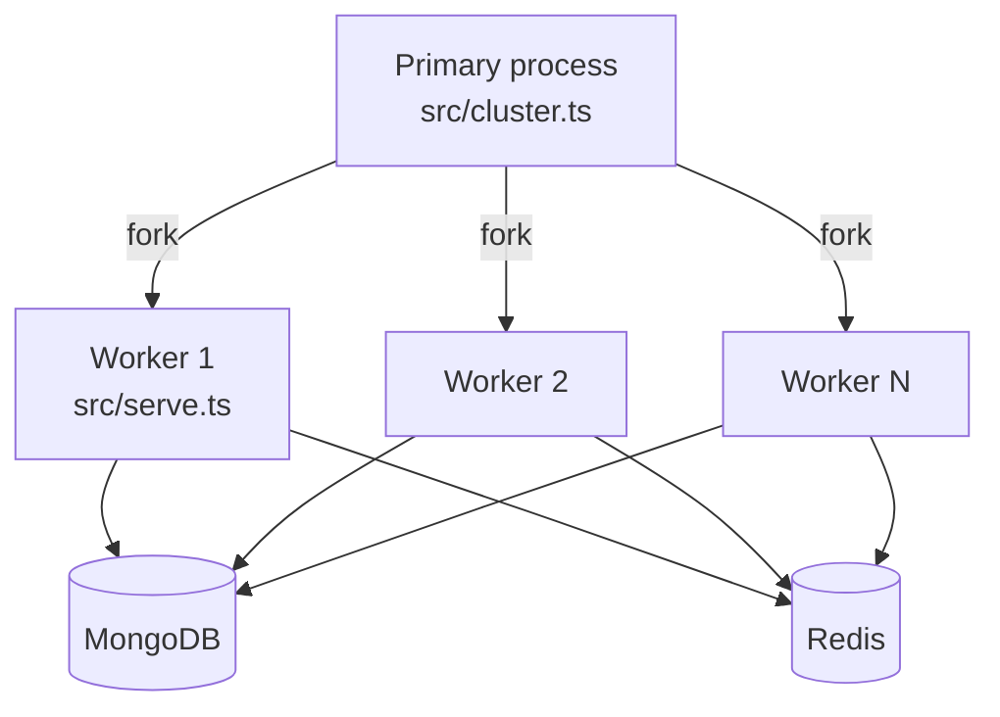
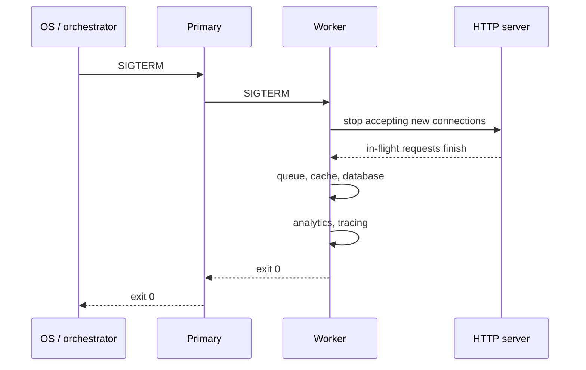

# Clustering & Graceful Shutdown

This page explains how the app boots, how to scale it, and how it shuts down cleanly.
The relevant files are `src/main.ts` (the default entry: one process), `src/cluster.ts` (the
optional supervisor, `npm run start:cluster`), `src/app.ts` (`createApp()`: the
HTTP app + its `boot`/`start`/`stop` lifecycle) and `src/serve.ts` (calls `start()`, wires
`stop()` to the process signals — the file `main.ts`, or a cluster worker, actually runs).

## Two ways to run it

| Where                            | Command                                  | Scale with                                                                 |
| -------------------------------- | ---------------------------------------- | -------------------------------------------------------------------------- |
| Containers, production, dev      | `npm start` (`src/main.ts`, one process) | orchestrator replicas, each with its own address; the platform restarts it |
| A bare VM without PM2 or systemd | `npm run start:cluster`                  | one worker per CPU, the primary restarts                                   |
| A bare VM with PM2               | `pm2 start "npm start" -i max`           | PM2 forks and restarts                                                     |

`main.ts` loads `.env`, starts OTel, then imports `serve.ts`. The default is one process because
the platform already restarts and scales; a second supervisor inside the container is two layers
of process management.

### Cluster mode limits

- `/metrics` is per copy: each scrape hits a different worker, nothing aggregates them.
- The `ApiRestarting` alert is unreliable: `process_start_time_seconds` jumps between workers.
- SSE caps (per-user and global stream limits) are counted per copy, so the real ceiling is cap × workers.
- Rate-limit budgets are per process without a `limits` Redis, so `start:cluster` refuses to boot with 2+ workers and no `NODE_RATE_LIMIT_REDIS_URL`. PM2 and orchestrator replicas are not detected: set the URL yourself.

## Why a primary + workers (cluster mode)

- One **primary** supervises the cluster: forks workers, watches exits, and coordinates shutdown.
- One **worker per available CPU** by default (`os.availableParallelism()`, which honours a container's CPU limit), each running the full Express app.
- Before forking, the primary judges the whole environment once (`assertProcessConfig`). A bad variable is one clean error and exit 1, not N workers crash-looping.
- Workers are independent processes; they do not share memory. State must live in Mongo or Redis.
- Every worker opens its own connection to each, but they address the **same** database and the
  **same** Redis keyspace — which is why a cache invalidation done by one worker needs no
  broadcast to the others. → [Redis and the workers](redis-cache.md#redis-and-the-workers)

## Configuration

| Env var                              | Effect                                                                                                                                                                                                                                      |
| ------------------------------------ | ------------------------------------------------------------------------------------------------------------------------------------------------------------------------------------------------------------------------------------------- |
| `NODE_ENABLE_CLUSTERING`             | A flag (`1 true yes on`): true enables the primary/worker mode. `npm run start:cluster` sets it. Otherwise `src/cluster.ts` imports `src/serve.ts` in its own process — no fork.                                                            |
| `NODE_CLUSTER_WORKERS`               | Number of workers; 0 or unset = one per available CPU (minimum 1).                                                                                                                                                                          |
| `NODE_CLUSTER_CRASH_WINDOW_MS`       | Sliding window for counting crashes (default 60 000 ms).                                                                                                                                                                                    |
| `NODE_CLUSTER_CRASH_BACKOFF_BASE_MS` | Base delay before respawning after a crash (default 500 ms, doubled per crash).                                                                                                                                                             |
| `NODE_CLUSTER_CRASH_BACKOFF_MAX_MS`  | Maximum respawn delay (default 30 000 ms).                                                                                                                                                                                                  |
| `NODE_CLUSTER_CRASH_LIMIT`           | Crashes in one window before the primary gives up and exits 1 (default 10).                                                                                                                                                                 |
| `NODE_CLUSTER_SHUTDOWN_TIMEOUT_MS`   | A floor for the primary's hard kill during shutdown (default 15 000 ms). The kill never fires before `NODE_SHUTDOWN_DELAY_MS` + `NODE_GRACEFUL_SHUTDOWN_TIMEOUT_MS` + 5 s, so the default alone waits 20 s; raise this only to wait longer. |
| `NODE_GRACEFUL_SHUTDOWN_TIMEOUT_MS`  | Worker-side teardown budget (default 15 000 ms), read by `registerSignalHandlers`; the drain steps below take shares of it.                                                                                                                 |
| `NODE_SHUTDOWN_DELAY_MS`             | Lame-duck delay before the teardown (default 0). The primary's kill timer counts it, so any value is safe in cluster mode.                                                                                                                  |

## Crash backoff

When a worker exits unexpectedly the primary respawns it with **exponential backoff**, capped at `NODE_CLUSTER_CRASH_BACKOFF_MAX_MS`. This avoids tight crash loops when something is broken at startup (bad config, missing DB, …). Past `NODE_CLUSTER_CRASH_LIMIT` crashes inside one window the primary stops respawning and exits with code 1, so the supervisor sees a failure instead of a primary that stays up with no workers.

## Graceful shutdown

Each worker's shutdown sequence lives in `createApp()`'s `stop` (`src/app.ts`, wired to the
process signals by `src/serve.ts`):

1. `GET /readyz` is marked draining (503) the moment the signal arrives, by `registerSignalHandlers` (`src/infrastructure/runtime/server-lifecycle.ts`) before `stop` runs. Every response now says `Connection: close`, queue consumers are cancelled, and the worker waits `NODE_SHUTDOWN_DELAY_MS` (see [Health checks](../operate/health-checks.md#shutting-down-behind-a-load-balancer)). A second signal is ignored.
2. End the SSE streams (each told when to reconnect), then close the HTTP server: no new connections, idle keep-alive sockets dropped, in-flight requests drain. Anything still open at its share of the budget is cut.
3. Stop the locale-override refresh timer, then let started PDF renders and event deliveries
   finish (`settleRenders`, `settleInFlight`).
4. `stopQueue()` before `stopCache()`: a running job would otherwise reopen the cache connection. It waits for running handlers, up to their share of the budget.
5. `stopLimitsRedis()`, then `stopDatabase()` — disconnect the stores.
6. `shutdownAnalytics()` — flush PostHog if configured.
7. `shutdownTracing()` — flush remaining OTel spans to Tempo.

The `stop*` steps swallow their own failure, so a broken Redis cannot stop the database from closing. `shutdownAnalytics` and `shutdownTracing` do not swallow theirs, which is part of why they run last.
The order lives in `shutdownInfra` (`src/infrastructure/runtime/server-lifecycle.ts`).

If shutdown takes longer than the timeout, the worker (or the primary) force-exits.

## Why this matters

- Workers are stateless: anything you store in memory dies on the next deploy or crash.
- Background timers must be cleared in `stop` (or the `stop*` helper it calls), otherwise the process never exits.
- OTel must be initialised **before** any other import; that is why both `src/main.ts` and `src/cluster.ts` call `startTracing()` before importing `serve.ts`.

## Useful links

- [Node.js `cluster` module](https://nodejs.org/api/cluster.html)
- [Node.js `process` events (`SIGTERM`, `SIGINT`)](https://nodejs.org/api/process.html#signal-events)
- [Graceful shutdown best practices (DigitalOcean)](https://www.digitalocean.com/community/tutorials/how-to-scale-node-js-applications-with-clustering)
- [The Twelve-Factor App — Disposability](https://12factor.net/disposability)

## Read next

- [Architecture](./architecture.md)
- [Request Flow](./request-flow.md)
- [Runtime](runtime.md)
- [OpenTelemetry](../operate/opentelemetry.md)
