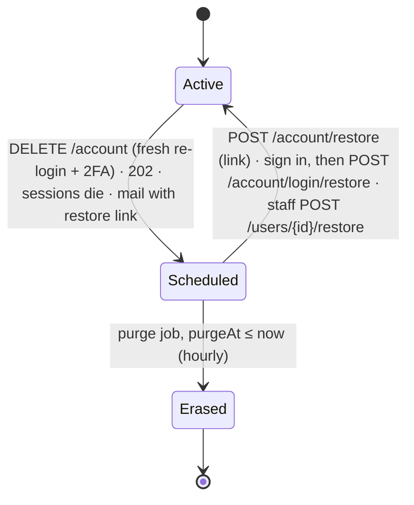

# Data retention: accounts

Inactive accounts and self-deletion.

## Inactive accounts: minimise, don't delete

| Who                | What happens to an inactive account                                                              |
| ------------------ | ------------------------------------------------------------------------------------------------ |
| Google, Microsoft  | the whole account deleted after about 2 years                                                    |
| Amazon, most shops | kept forever, order history included                                                             |
| WooCommerce        | inactive-account cleanup exists, off by default                                                  |
| CNIL               | fined Carrefour and Spartoo (2020), partly for keeping long-inactive customers' data with no end |

Deleting a real person's account is the controller's call, so full deletion here is opt-in
(`NODE_INACTIVE_ACCOUNT_DAYS`, disabled by default — see
[`reap:inactive-accounts`](../reference/ops.md#scheduled-jobs)). Keeping everything forever is
the CNIL risk. The middle road is to **minimise**: after a long silence, drop what serves no
purpose any more, and keep the login. That step is on by default.

| Dial                          | Default       | Past it                                |
| ----------------------------- | ------------- | -------------------------------------- |
| `NODE_INACTIVE_MINIMISE_DAYS` | 1095 days, on | the account is minimised (table below) |
| `NODE_INACTIVE_ACCOUNT_DAYS`  | 0, disabled   | warned, then soft-, then hard-deleted  |

**Activity** is the latest signed-in session use (a login, a refresh, any request not marked
passive in `cookie` mode; `jwt` mode stamps it at login and refresh only) or the latest API-key use. An account driven only through its API keys is a live
integration, not an idle account.

| Data on an inactive account | Its purpose                  | On inactivity                                                                                |
| --------------------------- | ---------------------------- | -------------------------------------------------------------------------------------------- |
| login (email, password)     | letting the person come back | kept                                                                                         |
| profile, wishlist           | the account's own content    | kept                                                                                         |
| saved address book          | a faster next checkout       | deleted — re-entered on the next order                                                       |
| orders' addresses and notes | showing order history        | the [claim-window clock](./data-retention.md#orders-after-the-account) starts, as on erasure |
| invoices                    | the tax record               | untouched ([own clock](./data-retention.md#invoices-the-tax-clock))                          |
| return free text            | the legal-claims window      | its own clock, below                                                                         |

A banned account is minimised like any other: minimising drops data and deletes nothing, so a ban is no
reason to keep the address book.

Each module says what it drops through its `personalData.minimise` hook, the twin of the erase
hook ([modules](./modules.md)). No warning mail: nothing goes that the customer cannot re-enter.
An account that comes back and goes quiet again is minimised again.

What this leaves forever: an email and a password hash, for an account nobody uses. Small, with a
clear purpose, and what Amazon does. A controller who wants more turns full deletion on.

## Self-deletion: a grace under one month

`DELETE /account` does not delete anything at once, and it does not wait for a click either. It
**locks** the account now and **erases** it later, at a date it states in the answer. The big players
do the same (Microsoft Graph keeps a deleted user restorable for 30 days, Google Workspace 20, Discord
about 14); a hijacked session or a mistake is undone before anything is lost.

| Question                       | Answer                                                                                                                                                           |
| ------------------------------ | ---------------------------------------------------------------------------------------------------------------------------------------------------------------- |
| How long has the shop to act?  | Art. 12(3): "without undue delay and in any event within one month of receipt"                                                                                   |
| How is a month counted?        | Reg. 1182/71, as the EDPB reads it (Guidelines 01/2022 v2, para 160): 5 March runs until 5 April (Ex. 32); 31 August until 30 September (Ex. 33)                 |
| Does the immediate lock count? | **No.** The lock is a restriction (Art. 4(3), Art. 18), not the erasure that was asked for. The `202` and the mail are the "information on action taken" at once |
| So what discharges Art. 17?    | Only the purge. `purgeAt` is capped at one calendar month, at 00:00 UTC of that date, so no time zone sees it pass late and the hourly job fits inside           |
| Why `min(N days, one month)`?  | 30 or 31 days overrun a month whenever February is in the window (31 January + 30 days is 2 March), so both bounds apply                                         |

The grace is `NODE_ACCOUNT_DELETION_GRACE_DAYS` (30 by default, 1 to 31). `purgeAt` is **stored**, not
derived, so changing the knob never moves a date already promised (the AIP-164 `purge_time`).

| While the account is locked | What happens                                                                                                                                                                                      |
| --------------------------- | ------------------------------------------------------------------------------------------------------------------------------------------------------------------------------------------------- |
| sessions, refresh           | dead at once (the session epoch moves in the same save)                                                                                                                                           |
| API keys                    | suspended, back on restore, erased at the purge                                                                                                                                                   |
| cart, wishlist              | kept intact, restored or erased with the account                                                                                                                                                  |
| orders in flight            | untouched; transactional mails continue (Art. 6(1)(b)); the purge cancels the never-paid ones and detaches the paid ones ([when they are scrubbed](./data-retention.md#orders-after-the-account)) |
| optional mails              | none (stock alerts, the example notice)                                                                                                                                                           |
| password reset              | still works; it does not restore by itself                                                                                                                                                        |
| signup with the same email  | refused until the purge                                                                                                                                                                           |

Three ways back, all conditional on `purgeAt > now`: the mailed link, signing in (the answer is a
`DeletionPending` claim check, redeemed at `POST /account/login/restore`), and staff
(`POST /users/{id}/restore`, the same `delete:User` key as any restore, with a confirm in the admin).
The purge's first write is a claim on `purgeAt <= now`, so a restore and a purge can never both match.

**Third parties.** Every hard erasure, the purge included, also asks the PostHog provider (when it is
configured for erasure) to delete the person and its events:
[Erasure in PostHog](analytics.md#erasure-in-posthog).

**Backups.** A snapshot restore must replay the erasure ledger, or the purge erases an account the
person restored and an erased one comes back:
[Erasures after a restore](../operate/backups.md#erasures-after-a-restore).

## Read next

- [data-retention](./data-retention.md): the hub this page belongs to.
