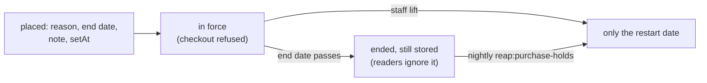

# Data retention: free text and holds

Free text on timelines, returns and holds, and the purchase hold.

## Free text on the order timeline

An order's [timeline](../modules/orders.md#the-timeline) holds one free-text field, `text`: the
reason a staff member gave for an override. Everything else on a row is an id, a code or a number.

| Rule                             | Why                                                                                                       |
| -------------------------------- | --------------------------------------------------------------------------------------------------------- |
| Own clock, from the row          | The order's clock starts only at erasure, so a live customer's text would never go.                       |
| `npm run job reap:orders` unsets | The row, its type and its codes stay: they are the accounting trail.                                      |
| Never copy a sibling's text      | `reap:returns` clears a return's `note` while a copy here would live on. Ids and codes only.              |
| Export carries it                | A staff assessment of a person is that person's data (the Nowak ruling above).                            |
| No staff name to the buyer       | Neither the screen nor the export names the staff member (Pankki S); the export keeps the buyer's own id. |

## Free text on returns

A return carries a required `reason` (`withdrawal`, `defective`, `wrong_item`, `other`) and two
free-text fields:

| Field            | Written by | Example risk                         |
| ---------------- | ---------- | ------------------------------------ |
| `note`           | customer   | "call me on 333…" typed into the box |
| `declineMessage` | staff      | an opinion about the customer        |

**The decline reason is a dropdown.** A decline carries a code (`return_period_ended`, `not_returnable`, `no_defect_found`, `other`), the buyer's mail turns it into one translated sentence, and a shop can count it. The code is a vocabulary, not a person typing, so it stays when the text goes; only the optional `declineMessage` (required for `other`) is wiped. Unlike a hold's `message`, which is dropped with the hold and never scrubbed because it is something the shop told a customer on a live order, a decline's message is staff's opinion kept on a finished record, so it has an end date.

**Why not just a dropdown for the rest.** Every large shop keeps an "Other" box (Amazon, Shopify's `OTHER`
reason), and a defect has to be described. Free text shrinks; it never reaches zero. So it needs
an end date of its own.

**What happens to it.** `npm run job reap:returns` unsets both fields once the return has not changed
for `NODE_RETURN_TEXT_RETENTION_DAYS` (3 years by default). Status, lines, amounts and dates stay:
they are the accounting trail.

**Why the text is kept for a while.** It is evidence in a consumer-rights claim:

| Claim              | How long it can come                                                                                                              |
| ------------------ | --------------------------------------------------------------------------------------------------------------------------------- |
| EU legal guarantee | at least 2 years from delivery ([Dir. 2019/771](https://eur-lex.europa.eu/eli/dir/2019/771/oj)), plus national limitation periods |
| card chargeback    | months after the payment, by card-network rules                                                                                   |

**Why its own clock, not the order's.** The order's clock starts only when an account is erased.
Tied to it, a live customer's note would never go.

**Why "since the last change", not "since closing".** An `approved` return whose goods never
arrive can never close (only a `received` return can), so a closing-based clock would keep its
text forever.

**Why staff text is the customer's data too.** A staff assessment of a person is that person's
data ([CJEU Nowak, C-434/16](https://www.scl.org/10098-cjeu-exam-answers-and-examiner-s-comments-are-personal-data/)).
So the right of access (Art. 15) covers `declineMessage` and the decline code beside it, and the data export carries both. The
staff member's own identity is not disclosed (CJEU Pankki S, C-579/21); it stays in the audit log.

**Not wiped early on erasure.** The text carries the same Art. 17(3)(e) basis as the rest of the
return.

**Less typed in the first place.** The return form asks for a description of the item and warns
against contact details; the box stays optional for every reason.

**What never leaves the database.** The `return.requested` webhook carries the `reason` code, never
the `note` (`returns/module.ts`).

## Free text on holds

Staff can put a fulfillment order on hold, with a reason from a closed set and an optional **note**
(`holdNote`, up to 1000 characters). The reason is a vocabulary; the note is a person typing about a
person: "customer rang twice, sounded drunk", "address looks like a reseller". That is the same shape
of risk as a return's `declineMessage`, so it gets the same treatment: an end date of its own.

**What happens to it.** `npm run job reap:delivery` unsets `holdNote` once the fulfillment order has not
changed for `NODE_HOLD_NOTE_RETENTION_DAYS` (one year by default). Lines, status, reason and dates stay:
they are the record of what was promised and what left. The wipe does not move `updatedAt`, so the
clock it reads does not reset, and a rerun matches nothing.

**Why one year, not three.** A hold is operational, not evidence in a consumer-rights claim: the
return's note has to outlive the two-year legal guarantee, a hold's has only to outlive the chargeback
window. **Why its own clock.** The order's clock starts only when an account is erased; tied to it, a
live customer's note would never go. **Why "since the last change", not "since closing".** A
fulfillment order held for ever never closes.

The note is in `POST /account/export`, the same rule as a return's `declineMessage`: staff's assessment of a
person is that person's data (CJEU Nowak, C-434/16). Who wrote it is not (CJEU Pankki S, C-579/21), and the
fulfillment order records no staff id, so none is exported.

## The purchase hold

A hold is a protective pause on one account's checkout after repeated cancellations, or by hand. It
stores a reason, an end date, an optional note staff wrote for the buyer, who set it and when. The
mechanics are in [the purchase hold](../modules/orders.md#the-purchase-hold). An automatic hold lasts
at most 7 days, so a machine's decision stays temporary, and it also flags the account for a person
to look at (`purchaseHoldFlaggedAt`, a timestamp and nothing else).

**What is kept, and for how long.** While the hold is in force, all of it. After it ends, only one
date: the nightly `reap:purchase-holds` reduces an ended hold to `purchaseHoldResetAt` (the later of
the hold's own `setAt` and the account's last staff lift) and removes the hold itself, note and staff
id included. That date is what stops the same cancellations triggering a second hold, so it has a
purpose; the note and the staff member's id do not outlive the hold's end (Art. 5(1)(e)). The data
export carries the hold while it is stored. Who set it is never exported (CJEU Pankki S, C-579/21);
the audit log keeps that for 180 days. The review flag is kept until a staff member sets or lifts a hold
on the account (the review is the purpose; it is a timestamp, no text and no staff id), and the data
export carries it with the rest of the profile.

**Legitimate-interest assessment (Art. 6(1)(f), [EDPB 1/2024](https://www.edpb.europa.eu/our-work-tools/documents/public-consultations/2024/guidelines-12024-processing-personal-data-based_en)).**

| Test      | Answer                                                                                                                                                                                                                                                                                    |
| --------- | ----------------------------------------------------------------------------------------------------------------------------------------------------------------------------------------------------------------------------------------------------------------------------------------- |
| Purpose   | Stop one account from holding stock and refunds in a loop, or a bot from doing it; a real interest (recital 47).                                                                                                                                                                          |
| Necessity | A pause after a count of the buyer's own UNPAID cancellations (never paid ones, which are statutory withdrawals and only flag the account) is a narrow way to do it. A flag for a person to review first is narrower still, and is a choice the operator may prefer (see the note below). |
| Balancing | The effect is that a new order is refused for at most seven days. It ends by itself, never blocks paying an order already placed, cancelling, a withdrawal, a return or the account's data rights, and is explained.                                                                      |

**Art. 22 is a separate scope question.** Whether the automatic pause is a decision "with similarly
significant effect" is open (see [orders](../modules/orders.md#the-purchase-hold)). If it is, no
exception fits (a refusal is not necessary to enter a contract, and a flag for review is a less
intrusive way), so the way out is a human in the loop before the pause, not a safeguard after it.
That is a product choice the operator owns, and the demo ships the automatic pause with the Art. 22(3)
safeguards: the reason, a way to ask a person, a person who can lift it, and a pause capped at 7
days that flags the account so a person reviews it.

**DPIA screening ([WP248](https://ec.europa.eu/newsroom/article29/items/611236)).** Of the nine
criteria one is plausibly met (an automated decision with a similarly significant effect, above). One
criterion is not a presumption of high risk; the count is one shop, one rule and a few accounts. Screen
again if you raise `NODE_PURCHASE_HOLD_WINDOW_DAYS`, add signals to the rule, or share it across shops.

**The right to object (Art. 21).** The basis is legitimate interest, so the person may object at any
time and the operator must stop unless it shows compelling grounds. The mail names the right in its own
paragraph (Art. 21(4)) and points to the contact page, which reaches staff who can lift the hold; the
privacy notice names it too. The operator decides what a compelling ground is, with its lawyer.

## Read next

- [data-retention](./data-retention.md): the hub this page belongs to.
